# Interrealm: a whitepaper

This is the overview: the idea, the rules, and every way two realms can interact, each with code, a
diagram and the test that pins it. The teaching page is [gno-interrealm.md](./gno-interrealm.md); the
decision record is [`gnovm/adr/pr6495_cross_to_write.md`](../../gnovm/adr/pr6495_cross_to_write.md).

## 1. A realm is a Go package with state

A realm (`gno.land/r/...`) is a Go package whose package-level variables persist between transactions. It also
has an address and can hold coins. A library (`gno.land/p/...`) is a Go package without state: after `init`
its variables never change.

## 2. Why realms need a boundary

Take a token. In Go, packages trust each other completely:

```go
// package token
var Balances = map[address]int64{}
func Transfer(from, to address, n int64) { Balances[from] -= n; Balances[to] += n }

// any importer
token.Balances[me] = 1_000_000_000       // nothing stops it
token.Transfer(alice, me, 100)           // and nothing says who is calling
```

That is fine inside one program with one author. On a chain, every package has a different author and some of
them are hostile. Solidity answers with a wall around each contract's storage and one kind of door:

```solidity
contract Token {
    mapping(address => uint) balances;              // nobody outside can touch it
    function transfer(address to, uint n) public {  // the door
        balances[msg.sender] -= n;                  // the door knows who knocked
        balances[to] += n;
    }
}
```

Gno keeps Go's packages and adds the same two things, a wall and doors that know who knocked, with one
difference: realms share live object references. A realm may return a pointer to its own data, and a callee
may receive an argument that points into the caller's state. Solidity never hands storage out, so it has no
rule for this; Gno needs one.

## 3. Fences in an open yard

Go's packages are an open yard: any code walks anywhere. The interrealm model puts a fence around each realm's
state and one kind of gate in it, the **crossing function**:

```go
func Transfer(cur realm, to address, n int64) { … } // first parameter `cur realm`
token.Transfer(cross(cur), bob, 10)                 // walking through the gate
```

Everyone may look over the fence. Only code that came in through the gate may change what is inside. The gate
does two jobs: it names the realm that may write, and it records who came through it, so the realm can
authenticate the caller with `cur.Previous()`.

## 4. The rules

### R1 Cross to write

A realm's stored state changes only during a crossing call into it: `func F(cur realm, …)` called
`F(cross(cur), …)`. Any other entry runs read-only. Library (`/p/`) code never writes another realm's objects on its own
authority; inside the owning realm's crossing call it writes for that realm (pattern l).

### R2 Only pointers cross

A struct or array value of a type a realm declares is created and copied only by that realm's code; others may
hold a pointer, read fields and call methods. Exceptions: the receiver copy of a direct call to a value-receiver
method, and an unnamed struct whose fields are all exported and which holds no realm's struct or array: it may
be passed and returned by value, and the copy belongs to whoever made it. Why: a pointer leaves the one value
in its realm, while a copy would put a second value in the caller's realm, one the owner never made; with no
copies, every `*T` that reaches the owner was made by the owner's own code. An error a realm hands out is a
pointer type: `func Fail() error { return E{"x"} }` boxes the declared value `E` in an interface, so return
`*E` instead; write `defer func() { x.M() }()` where a direct `defer x.M()` would copy another realm's value.
Two error texts, from two layers. The type checker refuses a copy a declaration or assignment makes in the
caller (`cannot hold a value of <T> outside its realm (use a pointer)`, `realmvalue.go:31`); that is
`zrealm_fv_copy_assign`'s `c := *p`. The allocator refuses a copy built at run time (`cannot copy <T> outside
realm <R> (use a pointer)`, `alloc.go:796`): that is the only refusal for `err := fvx.Fail()` and
`defer p.Val()`. Allocating a value in the wrong realm fails with `cannot allocate <T> in realm <R>`
(`alloc.go:807`).

### S3 A function value writes only in the crossing call that made it

A non-crossing function value (a closure, a bound method value, a declared function used as a
value) writes only during the crossing call that made it. Anywhere else — stored and read back, handed to or
returned from another realm — it runs read-only. A callback that must write later is crossing: `func(cur realm,
…)`, called with `cross(cur)`. Calls by name (declared functions, `/p/` and stdlib package tables) are
unchanged. The maker is a number: the id of the crossing call that made the value; 0 means no maker. The
predicate is `gnovm/pkg/gnolang/crossingfn.go`, the id lives in `alloc.go` and `machine.go`, and `op_call.go`
reads it at the call. `zrealm_saved_register` (Output `owner: registered`) is the same-call case it allows;
`zrealm_saved_cross_helper` (Error `gno.land/r/tests/vm/cbsaved's code is read-only here: a function value
writes only in the crossing call that made it: (const (ref(gno.land/r/tests/vm/cbsaved) package{})).Owner`) is
the stated cost.

**S3d: the write is allowed, the save is not.** Inside a read-only stretch entered by S3, a write to the
read-only realm's own not-yet-saved object is allowed, and the object is marked (`ObjectInfo.s3Written`).
`FinalizeRealmTransaction` refuses to save a marked object with `<realm>: an object written by read-only code
would be stored (write it inside a crossing call of <realm>)`. Any read-only entry, S3 or not, that writes an
unreal heap item (the wrapper of an escaping local) it did not make marks it the same way (`markViewWrite` in
`machine.go`). Why: before saving, only the heap wrapper of `&T{}` has an owner, so "is it attached?" cannot
be answered at write time. Pinned by `zrealm_s3u_rv2_1..5`, `rv2_9`, `rv3_1/4/5/6` (refused at save) and
`rv2_7` (`owner: stamped`: scratch, an object made since the read-only stretch began).

### R4 A function value copied out of its realm loses its maker

`stripMaker` (`gnovm/pkg/gnolang/alloc.go:627`, used at `values.go:1390`) gives the copy no maker when a
non-crossing function value is copied or handed to code that does not hold for its maker realm, so the copy
runs read-only. The strip is still needed with S3: it is what gives the copy no maker, so a copy never inherits
the crossing call that made the original. S3's crossing-id check also refuses `zrealm_saved_returned_reentry`
and `zrealm_saved_methodval_fresh` (made in one crossing call, called in a later one).

### R6 One import rule

Code reached through an interface or a method value is trusted only if its package is in the import tree of
the current realm, the one whose crossing call is running (its imports and theirs, the standard library
included, test files excluded); otherwise it runs view-only (it may read but not write).

### May this write happen?

A write is an assignment, or a builtin that mutates a slice or map. The guard is `isReadonly`
(`gnovm/pkg/gnolang/machine.go:3405`), called by every mutation site: assignments through `PopAsPointer2`,
and the builtins `append` (`uverse.go:929`), `copy` (`1140`, `1183`) and `delete` (`1249`).

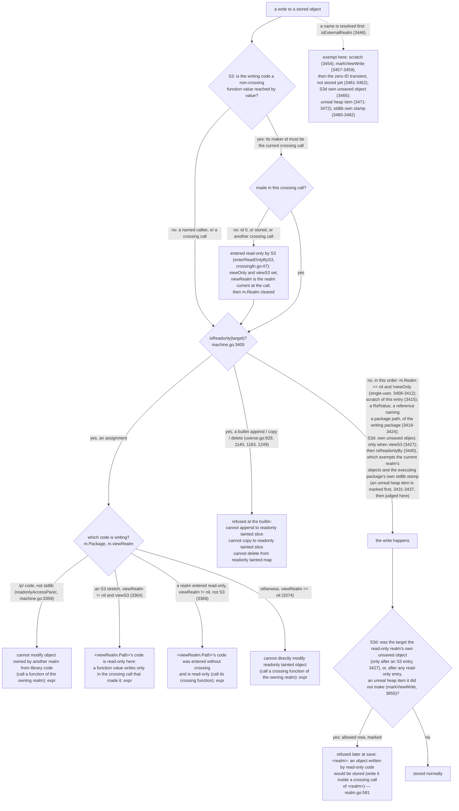

S3 sits above the ownership check because it decides whether the call runs with write rights at all: a
non-crossing value reached by value is writable only inside the crossing call that made it, and elsewhere the
callee enters read-only mode with `viewOnly` and `viewS3` set (`enterReadOnlyByS3`, `crossingfn.go:47`), so
every write goes through `isReadonly` in the order shown. For the realm's own code the first write gets the
S3 text (E4, `machine.go:3364-3368`); a `/p/` value reached by value gets the library text
(E1, `readonlyAccessPanic`, `machine.go:3359`), as `zrealm_saved_libtable_copy` shows. S3d sits under both: the
write goes through, the object is marked, and the refusal arrives at save (`assertNoUncrossedWrite`,
`realm.go:581`).

`isReadonly` compares the target's package ID with `m.Realm.ID` and the executing package's own stamp
(`ownership.go:467`, the package ID an object carries). When they differ and nothing exempts the target, the
write is refused and `readonlyAccessPanic` (`machine.go:3358`) picks the text from the **writing code**, not
from the call stack:

- `/p/` code (an immutable, non-stdlib package): the library text, E1 (`readonlyAccessPanic`,
  `machine.go:3359-3363`).
  `zrealm_model_token.gno` shows it: the token's ledger is written by library code (`modelledger.Move`) and no
  crossing into the token realm is on the stack.
- A realm's code entered read-only (`m.viewRealm != nil`): the "entered without crossing" text, E2
  (`machine.go:3369-3373`). It names the realm whose code runs read-only, not the owner of the target.
  `zrealm_ctw_callback.gno` shows it while a crossing call into `ctw` is on the stack, because the refused
  write is by the callback's home realm, `ctw_callback`. `zrealm_launder_rdata_pdr_panic_defer.gno` shows it
  naming the attacker realm that writes the victim's object during panic unwinding.
- An S3-entered stretch (`m.viewRealm != nil && m.viewS3`): the S3 text, E4 (`machine.go:3364-3368`):
  `<path>`'s code is read-only here: a function value writes only in the crossing call that made it. The
  callee is a by-value function value made outside the crossing call running it, so there is no crossing
  function to call; make the callback crossing (`func(cur realm, …)`, called with `cross(cur)`) or rebuild
  the value inside the call that runs it. `zrealm_maker_getdecl.gno` and `zrealm_saved_getter.gno` show it.
- Anything else: the fallback text, E3 (`machine.go:3380`), when the writing code is not `/p/` and `viewRealm`
  is nil. `zrealm_crossrealm25a.gno` shows it: a crossing call into `crossrealm_b` gives that realm full
  rights, and its code writes an object owned by `crossrealm`.

The exemptions, each with the check that grants it:

- Single-user mode: `m.Realm == nil` and not view-only, so nothing is read-only (`machine.go:3408-3412`). This
  is the only nil-realm exemption: `setViewOnly` (`machine.go:337`) sets `m.Realm` nil *and* `viewOnly`
  true, so with `rid` left zero every stored object is refused.
- An object allocated since the read-only stretch began is scratch, not stored state (`scratchOwn` at
  `machine.go:3827`; `isReadonly` at `3415`).
- The read-only realm's own object that is not saved yet: S3d allows the write and marks it (`3427`).
- A `RefValue` (a stored reference to a package, named by its path) whose package path is the writing package's own is writable; a foreign package path is not
  (`machine.go:3419-3424`).
- For a name, `isExternalRealm` (`machine.go:3446`) exempts scratch (`3454`), an object with a zero object
  ID, an unsaved transient (`3457-3459` marks the heap item, `3461-3462` returns on the zero ID), and an
  unreal `HeapItemValue`, a heap wrapper for an escaping local (`3471-3472`).
- Stdlib code may write its own stdlib-stamped package global. `IsReadonly` grants the own stamp only to
  stdlib (`machine.go:3397-3402`), and `isExternalRealm` mirrors it (`3480-3482`).
  `zrealm_stdlib_global_write.gno` shows it: a stdlib function's `counter++` on its own package global, run
  from a realm, prints `1` then `2`.

### What each rule stops

One attack per rule, in the order of §4. `master:` and `today:` are measured from the pinned fixture; §5 defines both.
Where `master:` already refuses, the rule moves the refusal earlier or names the real fix; the attack was closed before.

**R1 (realm code)** The attacker wants to change the victim's stored counter by calling its exported writer directly, without ever crossing.

```go
// realm a: gno.land/r/tests/vm/ctw (the owner)
func Bump() { Count++ }                            // exported, not crossing

// realm b: gno.land/r/ctw_bump (the caller)
func main(cur realm) {
	ctw.Bump()                                     // the attack
		// master: writes, Count++ (no refusal)
		// today:  refused: "gno.land/r/tests/vm/ctw's code was entered without crossing …: Count…"
}
```
if allowed: the victim's stored counter changes for a caller who never came through its gate.
Pinned by: `gnovm/tests/files/zrealm_ctw_bump.gno` (Error `gno.land/r/tests/vm/ctw's code was entered without crossing and is read-only (call its crossing function): Count<~VPBlock(3,0)>`).

**R1 (library /p/ code)** The attacker wants a `/p/` function of its choosing to write the victim's object through a pointer, with no victim code running.

```go
// p: gno.land/p/demo/tests/launderattack/v0
func TamperDirect(o *launderpkg.Object, s string) { o.Field = s } // writes in its own body

// realm b: gno.land/r/launderd (the caller)
func main(cur realm) {
	p := laundervictim.GetPtr()
	launderattack.TamperDirect(p, "pwnd")          // the attack
		// master: refused: "cannot directly modify readonly tainted object (use a method or crossing function): o<VPBlock(1,0)>.Field"
		// today:  refused: "cannot modify object owned by another realm from library code …: o<VPBlock(1,0)>.Field"
}
```
if allowed: library code would write a realm's stored field on the caller's say-so, and the owner's gate would never run.
Pinned by: `gnovm/tests/files/zrealm_launder_d_pattack_direct.gno` (Error `cannot modify object owned by another realm from library code (call a function of the owning realm): o<VPBlock(1,0)>.Field`).

**R2 forge** The attacker wants a value that passes as the victim realm's own type, by converting an anonymous struct to `*fvx.T` inside the victim's read-only code.

```go
// realm b: gno.land/r/fvforgero (the caller)
func main(cur realm) {
	var p *fvx.T
	fvx.Do(func() { p = (*fvx.T)(&struct{ N int }{5}) }) // the attack
		// master: refused at run time: illegal conversion to external realm type
		// today:  refused at type check: cannot hold a value of gno.land/r/tests/vm/fvx.T outside its realm (use a pointer)
	println(fvx.Read(cross(cur), p))               // never reached
}
```
if allowed: the victim's code would trust a `*fvx.T` the victim never made, so a forged value would pass as the victim's.
Pinned by: `gnovm/tests/files/zrealm_fv_forge_ro.gno` (TypeCheckError `…cannot hold a value of gno.land/r/tests/vm/fvx.T outside its realm (use a pointer)`).

**R2 copy-and-hand-back** The attacker wants a copy of the victim's value, changes it, and hands it back to the victim's crossing function, which trusts it.

```go
// realm b: gno.land/r/attackcopyhandback (the caller)
func main(cur realm) {
	p := fvx.New(1)                                // the owner's value
	c := *p                                        // the attack: copy it out
		// master: copies, then refuses the write to c: "cannot directly modify readonly tainted object …: c<~VPBlock(1,2)>.N"
		// today:  refused: cannot copy gno.land/r/tests/vm/fvx.T outside realm gno.land/r/tests/vm/fvx (use a pointer)
	c.N = 999
	println(fvx.Read(cross(cur), &c))              // hand the copy back
}
```
if allowed: the victim's code would read the attacker's 999 as its own value, and a copy of its declared type would live outside its realm.
Pinned by: `gnovm/tests/files/zrealm_attack_copy_handback.gno` (Error `cannot copy gno.land/r/tests/vm/fvx.T outside realm gno.land/r/tests/vm/fvx (use a pointer)`).

**S3** The attacker wants the victim's own writer, read out as a value from read-only code, to write when the victim runs it inside the attacker's crossing call.

```go
// realm a: gno.land/r/tests/vm/cbvictim (the owner)
func SetOwner(s string) { Owner = s }
func GetDecl() func(string) { return SetOwner }    // the owner's function, as a value

// realm b: gno.land/r/zrealm_maker_getdecl (the caller)
func main(cur realm) {
	cbvictim.RunS(cross(cur), cbvictim.GetDecl())  // the attack: the gate runs it
		// master: writes, prints owner: picked
		// today:  refused: "gno.land/r/tests/vm/cbvictim's code is read-only here: …: Owner<~VPBlock(3,0)>"
}
```
if allowed: a value made outside a crossing call would borrow the authority of whichever call runs it, so one legitimate call would license every later one.
Pinned by: `gnovm/tests/files/zrealm_maker_getdecl.gno` (Error `gno.land/r/tests/vm/cbvictim's code is read-only here: a function value writes only in the crossing call that made it: Owner<~VPBlock(3,0)>`).

**S3d** Not an outside attacker but a hole in S3: a function value with no maker, run read-only, writes the realm's own
not-yet-saved object, and the realm would save it.

```go
// realm a: gno.land/r/tests/vm/s3urv (the owner)
var W = func(e *Entry) { e.Owner = "stamped" }     // a's stored writer, no maker
func AddRelay(cur realm, f func(*Entry)) {         // a's gate
	e := &Entry{Owner: "victim"}                   // fresh, not saved yet
	entries = append(entries, e)
	f(e)                                           // the read-only write
}
func SelfRelay(cur realm) { AddRelay(cur, W) }

// realm b: gno.land/r/zrealm_s3u_rv2_1 (the caller)
func main(cur realm) {
	s3urv.SelfRelay(cross(cur))                    // the attack
		// master: writes, prints owner: stamped
		// today:  refused at save: "gno.land/r/tests/vm/s3urv: an object written by read-only code would be stored …"
}
```
if allowed: read-only code's write would become the realm's stored state, and the rule that a function value writes only in the crossing call that made it would leave no trace.
Pinned by: `gnovm/tests/files/zrealm_s3u_rv2_1.gno` (Error `gno.land/r/tests/vm/s3urv: an object written by read-only code would be stored (write it inside a crossing call of gno.land/r/tests/vm/s3urv)`).

**R4** The attacker wants a function value made in one crossing call to write when it is handed back and run in a later crossing call.
S3's crossing-id check refuses the run; R4 makes sure a copy never inherits the maker it would be checked against.

```go
// realm a: gno.land/r/tests/vm/cbsaved (the owner)
func MakeValue(cur realm) func(string) { return func(s string) { Owner = s } } // maker: this call

// realm b: gno.land/r/zrealm_saved_returned_reentry (the caller)
func main(cur realm) {
	f := cbsaved.MakeValue(cross(cur))             // made in this crossing call
	cbsaved.CallValue(cross(cur), f)               // the attack: run it in a later one
		// master: writes, prints owner: returned
		// today:  refused: "gno.land/r/tests/vm/cbsaved's code is read-only here: …: (const …).Owner"
}
```
if allowed: a copy of a value made in an earlier call would keep that call's authority, so one legitimate call would license writes forever.
Pinned by: `gnovm/tests/files/zrealm_saved_returned_reentry.gno` (Error `…a function value writes only in the crossing call that made it: (const (ref(gno.land/r/tests/vm/cbsaved) package{})).Owner`).

**R6** The attacker wants a library method of its own to write the victim's object, reached through the victim's interface so the victim never names it.

```go
// p: gno.land/p/demo/tests/ifaceattack (picked by the caller)
func (EvilV) Run(x *launderpkg.Immutable) { x.Field = "pwnd-via-iface" } // the method that writes

// realm a: gno.land/r/tests/vm/pfuncvictim (never imports it)
func Use(cur realm, r Runner) { r.Run(gObj) }      // a's gate runs the caller's method

// realm b: gno.land/r/zrealm_entry_iface_val (the caller)
func main(cur realm) {
	pfuncvictim.Use(cross(cur), ifaceattack.EvilV{}) // the attack
		// master: writes, prints victim: pwnd-via-iface
		// today:  refused: "cannot modify object owned by another realm from library code …: x<VPBlock(1,1)>.Field"
}
```
if allowed: any code the attacker can name through an interface would act with the victim's write rights, so an import that never happened would be trusted.
Pinned by: `gnovm/tests/files/zrealm_entry_iface_val.gno` (Error `cannot modify object owned by another realm from library code (call a function of the owning realm): x<VPBlock(1,1)>.Field`); `zrealm_entry_iface.gno` shows the same through a stored tree.

## 5. Patterns

Each case gives code by package, one diagram, the rules that decide it, and the filetest whose output or error shows that outcome. `cross(cur)` is a crossing
call, `plain call` anything else; a refused write aborts the whole transaction, so transactions are marked `tx 1`, `tx 2`.

`master:` is d25b308c1; `today:` is this branch; both are measured from the pinned fixture.

The cases go from the plainest interaction to the corner cases:

- **Calls into a realm:** a, b, c, d, e, f, g, h
- **Values across the boundary:** i, j, k
- **Library code:** l, m
- **Methods:** n
- **Function values and closures:** o, p, q, r, s
- **Interfaces:** t
- **Patterns built from these:** u, v
- **Failures and limits:** w, x

### a. A crossing call is a gate; an exported helper is not
**Goal:** A realm's state is written only by a crossing call; an exported function without `cur realm` is refused.

```go
// realm a: gno.land/r/tests/vm/ctw
var Count int                                       // a's stored counter
var Saved = &Local{N: 1}                            // a's stored object, changed through its method

type Local struct{ N int }                          // a's declared type
func (l *Local) Inc() { l.N++ }                     // a's method: a write, allowed inside the gate only

func Add(cur realm, n int) {                        // the gate: first parameter is cur
	Count += n                                      // write 1: a's own code
	bump()                                          // write 2: the unexported helper, called from Add
	Saved.Inc()                                     // write 3: a's method on a's object
}
func Bump() { Count++ }                             // exported, no cur: not a gate
func bump() { Count++ }                             // unexported helper, called from Add

// realm b: gno.land/r/ctw_cross (the caller)
// tx 1
func main(cur realm) {
	ctw.Add(cross(cur), 2)                          // through the gate: Count 0 -> 3, Saved.N 1 -> 2
	println(ctw.Count, ctw.Saved.N)                 // 3 2
}

// realm c: gno.land/r/ctw_bump (another caller)
// tx 2
func main(cur realm) {
	ctw.Bump()                                      // refused: gno.land/r/tests/vm/ctw's code was entered without crossing
		// master: writes, Count++ (no refusal)
		// today:  refused: "gno.land/r/tests/vm/ctw's code was entered without crossing …: Count…"
}
```

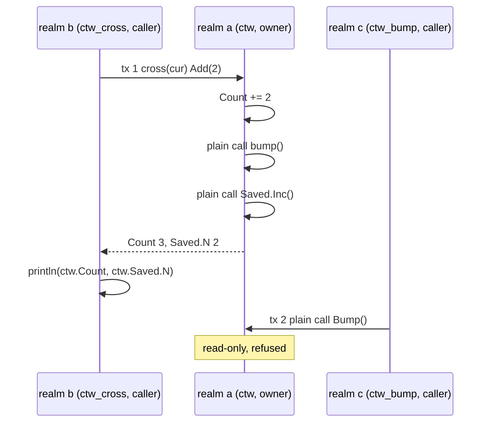

Only a crossing call writes; a public function without `cur realm` is not a door. The gate is narrow: `cross` must be a call's first argument, a crossing call
cannot be deferred directly, and `cross1` and `mutable` do not resolve (`zrealm_cross1_removed.gno`, `zrealm_entry_no_mutable.gno`: `name mutable not
declared`).

```go
// realm d: gno.land/r/demo/cross1removed (zrealm_cross1_removed)
// tx 1
func main(cur realm) {                                      // the filetest entry
	println(cross1)                                           // refused: name cross1 not declared
}

// realm e: gno.land/r/demo/crossdefer (zrealm_cross_defer)
func callee(cur realm) string { return cur.PkgPath() }      // the helper the defer would enter
// tx 1
func main(cur realm) {                                      // the filetest entry
	defer callee(cross(cur))                                  // refused: crossing call `cross(rlm)` cannot be deferred directly
		// master: refused: "crossing call `cross(rlm)` cannot be deferred directly"
		// today:  same: refused at preprocess
}

// realm f: gno.land/r/demo/crossdeferwrap (zrealm_cross_deferwrap)
func callee(cur realm) string { return cur.PkgPath() }      // the same helper, deferred through a closure
// tx 1
func main(cur realm) {                                      // the filetest entry
	defer func() { println("from defer:", callee(cross(cur))) }() // from defer: gno.land/r/demo/crossdeferwrap
	println("body done")                                      // body done, printed before the defer runs
}

// realm g: gno.land/r/borrow (zrealm_borrow2a), which imports gno.land/r/tests/vm/crossrealm_b
import "gno.land/r/tests/vm/crossrealm_b"                   // g's import of the callee below
type Struct struct{ A int }                                 // g's declared type
func (s *Struct) Mutate() {                                 // a method that hands cross over as a value
	crossrealm_b.SetClosure(cross, func() {})                 // refused: use of builtin cross not in function call
}

// realm h: gno.land/r/tests/vm/crossrealm_b (the callee above)
func SetClosure(cur realm, f func()) { Closure = f }        // h's gate: never reached, the call is refused
// tx 1
func main(cur realm) {                                      // the filetest entry
	s := &Struct{A: 100}                                      // g's object
	s.Mutate()                                                // never reached: Mutate is refused at type check
}
```

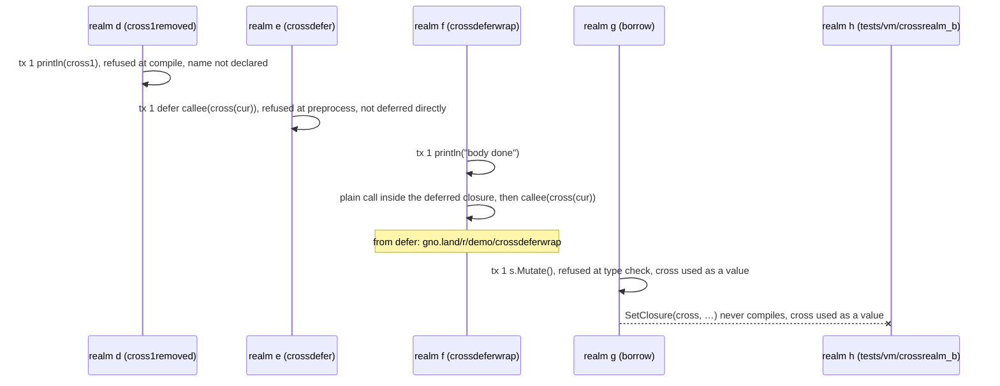

Rules: R1. Pinned by: `gnovm/tests/files/zrealm_ctw_cross.gno` (Output `3 2`: the crossing call writes through
the helper and the method) and `gnovm/tests/files/zrealm_ctw_bump.gno` (Error `gno.land/r/tests/vm/ctw's code
was entered without crossing and is read-only (call its crossing function): Count<~VPBlock(3,0)>`); the
narrow-gate cases above are `zrealm_cross1_removed.gno`, `zrealm_entry_no_mutable.gno`,
`zrealm_cross_defer.gno`, `zrealm_cross_deferwrap.gno` and `zrealm_borrow2a.gno`.

### b. Reading needs no gate; a pointer handed out is a view
**Goal:** Reading another realm's object through a pointer is allowed; writing through it from library code is refused.

```go
// p: gno.land/p/demo/tests/modelledger
type Ledger struct{ bal map[address]int64 }                       // library type, no state of its own
func New() *Ledger { return &Ledger{bal: map[address]int64{}} }   // constructor
func (l *Ledger) Move(from, to address, n int64) {                // write into the map
	l.bal[from] -= n                                              // the sender's entry
	l.bal[to] += n                                                // the recipient's entry
}
func (l *Ledger) Balance(a address) int64 { return l.bal[a] }      // read the map

// realm a: gno.land/r/tests/vm/modeltoken
var l = modelledger.New()                            // a's stored ledger, of a library type
func Ledger() *modelledger.Ledger { return l }       // hands out a pointer, a view
func Transfer(cur realm, to address, n int64) {      // the gate
	l.Move(cur.Previous().Address(), to, n)          // from = the caller realm's address (the thief)
}

// realm b: gno.land/r/thief (the caller)
const (
	alice = address("g1alice") // an account the thief tries to drain
	bob   = address("g1bob")   // the recipient of the thief's own tokens
)
// tx 1 (the whole fixture main is one transaction)
func main(cur realm) {
	modeltoken.Transfer(cross(cur), bob, 10)                   // through the gate: thief -> bob, bob 0 -> 10
	println("bob:", modeltoken.Ledger().Balance(bob))          // plain call, read: bob: 10
	modeltoken.Ledger().Move(alice, "g1thief", 1000000000)     // refused: cannot modify object owned by another realm from library code
		// master: writes, no Error (library code allowed to write)
		// today:  refused: "cannot modify object owned by another realm from library code …"
}
```

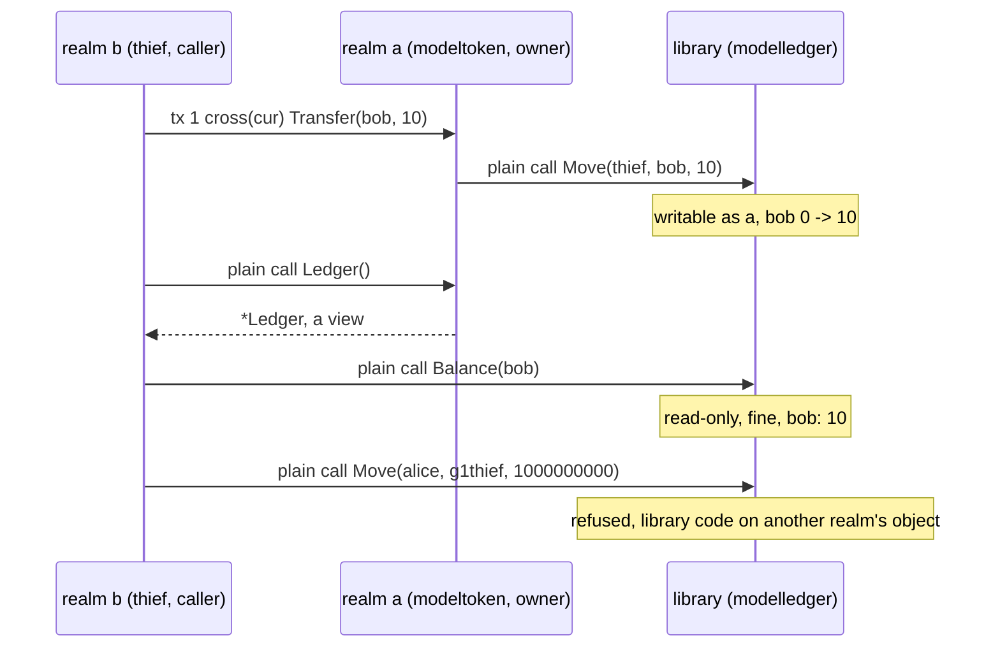

A pointer handed out is a view: reading it is free, writing through it is library code on another realm's
object and is refused. The fixture prints `bob: 10` and then the Error, in the same transaction.

Rules: R1, R2. Pinned by: `gnovm/tests/files/zrealm_model_token.gno` (Output `bob: 10`, then Error `cannot
modify object owned by another realm from library code (call a function of the owning realm):
l<VPBlock(1,0)>.bal[from<VPBlock(1,1)>]`).

### c. Identity: `cur.Previous()`, `IsUserCall()`, and `cur` as a capability
**Goal:** A chain of crossing calls tells each frame who called it, and `cur` is a capability to guard.

```go
// realm a: gno.land/r/curchaintest (the chain root)
// tx 1 (the filetest entry main is one transaction)
func main(cur realm) {                                   // a's gate
	println("main cur.PkgPath:", cur.PkgPath())            // gno.land/r/curchaintest
	curchain_a.A(cross(cur))                               // cross into the middle realm
}

// realm b: gno.land/r/tests/vm/curchain_a
func A(cur realm) {                                       // b's gate
	println("A cur.PkgPath:", cur.PkgPath())               // gno.land/r/tests/vm/curchain_a
	println("A prev.PkgPath:", cur.Previous().PkgPath())   // gno.land/r/curchaintest
	curchain_b.B(cross(cur))                               // cross into the terminal realm
}

// realm c: gno.land/r/tests/vm/curchain_b
func B(cur realm) {                                       // c's gate
	println("B cur.PkgPath:", cur.PkgPath())               // gno.land/r/tests/vm/curchain_b
	p1 := cur.Previous()                                   // the middle realm
	println("B Previous().PkgPath:", p1.PkgPath())         // gno.land/r/tests/vm/curchain_a
	p2 := p1.Previous()                                    // the chain root
	println("B Previous().Previous().PkgPath:", p2.PkgPath()) // gno.land/r/curchaintest
		// master: gno.land/r/curchaintest
		// today:  same: gno.land/r/curchaintest
	p3 := p2.Previous()                                    // the EOA origin: empty PkgPath
	println("B Previous()^3 PkgPath empty (EOA origin):", p3.PkgPath() == "") // true
	func() {                                               // the next .Previous() panics
		defer func() { println("B Previous()^4 panics past origin:", recover() != nil) }() // true
		_ = p3.Previous()                                  // past the origin
	}()
}

// realm d: gno.land/r/curpersistvar
var stashed realm                                        // d's stored state: a realm value
// tx 2
func main(cur realm) {                                   // d's gate
	stashed = cur                                        // assignment is fine, no copy
	println("assignment ok, awaiting finalize panic")    // printed if the runner captures it (not pinned: Error golden only)
}

// realm e: gno.land/r/curclassify (from zrealm_cur_classify)
// tx 3
func main(cur realm) {                                   // the filetest entry
	prev := cur.Previous()                               // the caller of this main: an EOA, empty PkgPath
	println("prev.IsUserCall:", prev.IsUserCall())       // prev.IsUserCall: true
	println("cur.IsUserCall:", cur.IsUserCall())         // cur.IsUserCall: false, cur is a code realm
}

```

```mermaid
sequenceDiagram
    participant U as user (EOA)
    participant A as realm a (curchaintest)
    participant B as realm b (curchain_a)
    participant C as realm c (curchain_b)
    participant D as realm d (curpersistvar)
    participant E as realm e (curclassify)
    U->>A: tx 1 filetest entry main()
    Note over A: cur is a, cur.Previous() is the user
    A->>B: cross(cur) A()
    Note over B: cur.Previous() is a
    B->>C: cross(cur) B()
    Note over C: cur.Previous() is b; its Previous() is a
    C->>C: p3.Previous() panics, recovered
    U->>D: tx 2 filetest entry main()
    Note over D: stashed = cur is fine, refused at finalize
    U->>E: tx 3 filetest entry main()
    Note over E: prev.IsUserCall true, cur.IsUserCall false
```

A chain of crossing calls is a chain of `Previous()` values, and past the origin the next one panics. A payment guard is `cur.Previous().IsUserCall()`, not
`IsUser()`: `zrealm_cur_classify.gno` pins `prev.IsUserCall: true` and `cur.IsUserCall: false`. `cur` is a capability: code holding it crosses and spends the
realm's coins, so never pass it to code you did not write, and crossing gives that identity (R1).

The binding is fixed for the life of the frame: `cur`'s address cannot be taken (``cannot take the address of a realm-typed `cur` ``), the first realm parameter
must be named `cur` (``a crossing function's first realm argument must have name `cur` ``), and it cannot be reassigned or range-assigned (``cannot reassign the
crossing `cur` parameter``, ``cannot assign to a realm-typed `cur` in a range clause``) — `zrealm_cur_addr.gno`, `zrealm_cur_alias.gno`,
`zrealm_cur_reassign.gno`, `zrealm_cur_range.gno`; `unsafe` is not in the policy (`name unsafe not declared`, `zrealm_crossrealm12.gno`); run scripts classify
like any entry (`zrealm_cur_classify.gno`: `cur.IsUserRun == rt.IsUserRun: true`).

Rules: R1. Pinned by: `gnovm/tests/files/zrealm_cur_chain.gno` (Output `main cur.PkgPath:
gno.land/r/curchaintest`, `B Previous().PkgPath: gno.land/r/tests/vm/curchain_a`, `B
Previous().Previous().PkgPath: gno.land/r/curchaintest`, `B Previous()^3 PkgPath empty (EOA origin): true`
and `B Previous()^4 panics past origin: true`), `gnovm/tests/files/zrealm_cur_classify.gno` (Output
`prev.IsUserCall: true` and `cur.IsUserCall: false`), and `gnovm/tests/files/zrealm_cur_persist_var.gno` (its
main assigns and prints, then the transaction fails at finalize with Error `cannot persist realm value: realm
values are ephemeral and tied to a call frame`).

### d. `cur` cannot be stored
**Goal:** A realm value cannot be stored: the save is refused when the transaction finalizes.

```go
// realm a: gno.land/r/curpersistvar (zrealm_cur_persist_var)
var stashed realm                                           // a's stored state: realm-typed
// tx 1
func main(cur realm) {                                      // the filetest entry
	stashed = cur                                             // fine: assignment is not a copy
		// master: assignment ok, finalize refuses "cannot persist realm value: …"
		// today:  same
	println("assignment ok, awaiting finalize panic")         // printed
}                                                           // finalize: refused, cannot persist realm value

// realm b: gno.land/r/curpersiststruct (zrealm_cur_persist_struct)
type Holder struct{ R realm }                               // b's declared type
var H *Holder                                               // b's stored state
// tx 1 (a separate fixture)
func main(cur realm) {
	H = &Holder{R: cur}                                       // the realm value is inside a saved object
	println("assignment ok, awaiting finalize panic")         // printed
}                                                           // finalize: refused, same error

// realm c: gno.land/r/curpersistclosure (zrealm_cur_persist_closure)
var stashedFn func() string                                 // c's stored state
// tx 1 (a separate fixture)
func main(cur realm) {
	c := cur                                                  // a local copy of cur
	stashedFn = func() string { return c.PkgPath() }          // the closure captures it
	println("closure stashed, awaiting finalize panic")       // printed
}                                                           // finalize: refused, same error
```

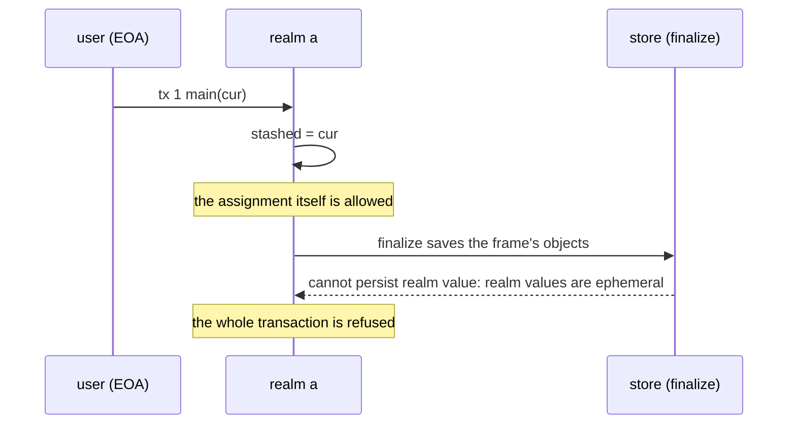

`cur` names a live call frame: it may be assigned and passed, never saved, and the check fires at finalize, in `saveObject`, for a top-level variable, a struct
field and a closure capture alike. The rules follow the type: an alias `type R = realm` crosses, but a realm parameter after position 0 may not be named `cur`,
and sub-tokens are refused the same way (`zrealm_cur_persist_*.gno`, `zrealm_cur_alias_legal.gno`, `zrealm_cur_alias_second.gno`).

Rules: R1. Pinned by: `gnovm/tests/files/zrealm_cur_persist_var.gno` (Error `cannot persist realm value: realm
values are ephemeral and tied to a call frame`), `gnovm/tests/files/zrealm_cur_persist_struct.gno` (same
Error), `gnovm/tests/files/zrealm_cur_persist_closure.gno` (same Error),
`gnovm/tests/files/zrealm_sub_persist.gno` (same Error, for a sub-token),
`gnovm/tests/files/zrealm_cur_alias_legal.gno` (Output `aliased` and `aliased crossed`), and
`gnovm/tests/files/zrealm_cur_alias_second.gno` (the naming Error).

### e. The `realm` type is sealed
**Goal:** A realm value cannot be forged: only the runtime's own type satisfies `realm`.

```go
// realm a: gno.land/r/crossrealm (zrealm_seal_embed: type-check only)
type fooRealm struct {                                      // a would-be realm
	realm                                                     // embedding a real one promotes .seal
	forged address                                            // and this overrides identity
}
func (r fooRealm) Address() address { return r.forged }     // forged identity
func (r fooRealm) PkgPath() string  { return "gno.land/r/crossrealm" } // forged path
var _ realm = fooRealm{}                                    // refused: does not implement realm (missing method .seal)
	// master: refused: "…fooRealm does not implement .uverse.realm (missing method .seal)"
	// today:  same
// tx 1 (type check only, main never runs)
func main(cur realm) {}                                     // never runs
```

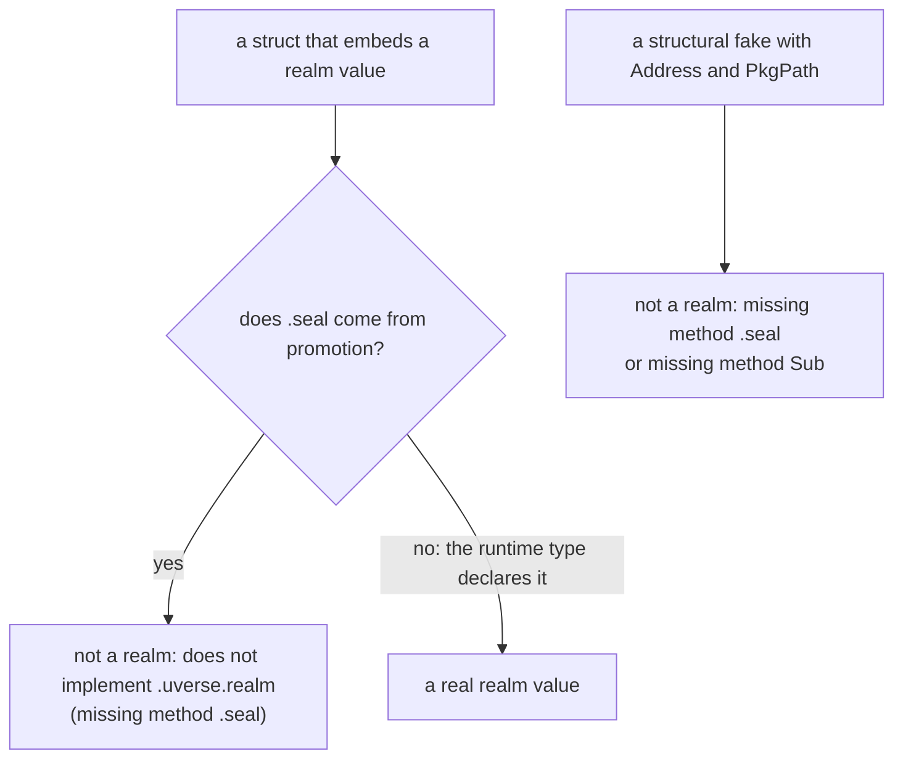

Only the runtime's own type satisfies `realm`: a promoted `.seal` does not count, so identity is not forgeable and `cur.Previous().PkgPath()` is meaningful.
Promotion through a pointer is refused at the same check (`zrealm_seal_embed_ptr.gno`), and a forged embedder asserted to `realm` yields `ok false`
(`zrealm_seal_embed_runtime.gno`).

Rules: R1. Pinned by: `gnovm/tests/files/zrealm_seal_embed.gno` (Error `gno.land/r/crossrealm.fooRealm does
not implement .uverse.realm (missing method .seal)`), `gnovm/tests/files/zrealm_seal_realm.gno` (Error
`gno.land/r/crossrealm.fakeRealm does not implement .uverse.realm (missing method .seal)`),
`gnovm/tests/files/zrealm_seal_embed_ptr.gno` (the same Error through the pointer embed), and
`gnovm/tests/files/zrealm_seal_embed_runtime.gno` (Output `assertion ok: false`).

### f. `func init(cur realm)` is a gate
**Goal:** `init` is a gate: it runs at deploy as the realm, with the deployer as caller, and its writes persist.

```go
// realm a: gno.land/r/curinit (zrealm_cur_init)
var initCurPkgPath, initPrevPkgPath string                  // a's stored state
// tx 1 (deploy)
func init(cur realm) {                                      // the deploy call: entered like a gate
	initCurPkgPath = cur.PkgPath()                            // gno.land/r/curinit
	initPrevPkgPath = cur.Previous().PkgPath()                // "" — the deployer EOA
}

// tx 2 (the same fixture: main runs after the deploy's init)
func main(cur realm) {                                      // the filetest entry, one transaction
	println("init cur.PkgPath:", initCurPkgPath)              // gno.land/r/curinit
	println("init prev.PkgPath empty (EOA):", initPrevPkgPath == "") // true
	println("main cur.PkgPath:", cur.PkgPath())               // gno.land/r/curinit
	println("main prev.PkgPath empty (EOA):", cur.Previous().PkgPath() == "") // true
}

// realm b: gno.land/r/crossrealm (zrealm_crossrealm15)
import "chain/runtime/unsafe"                               // for CurrentRealm below
import "gno.land/r/tests/vm/crossrealm"                     // the helper realm below, imported as crossrealm
type fooer struct{}                                         // b's declared type
func (fooer) Foo(cur realm) {                               // b's crossing method
	println("hello " + unsafe.CurrentRealm().PkgPath())      // hello gno.land/r/crossrealm
}
func (fooer) Bar() {                                        // b's non-crossing method
	println("hello " + unsafe.CurrentRealm().PkgPath())      // the realm whose code is current
}
var f *fooer                                                // b's stored object
// tx 1 (the deploy call runs init)
func init(cur realm) {                                      // deploy: b crosses out and registers
	println("init")                                           // init
	f = &fooer{}                                              // b's object
	crossrealm.SetFooer(cross(cur), f)                        // stores f in the callee realm
	crossrealm.CallFooerFooCross(cross(cur))                  // hello gno.land/r/crossrealm
	crossrealm.CallFooerBar()                                 // hello gno.land/r/crossrealm
	crossrealm.CallFooerBarCrossing(cross(cur))               // hello gno.land/r/tests/vm/crossrealm
		// master: hello gno.land/r/tests/vm/crossrealm
		// today:  same
}

// realm c: gno.land/r/tests/vm/crossrealm (the helper realm, imported as crossrealm)
type Fooer interface {                                      // the only name c has for b's object
	Foo(realm)                                               // crossing method
	Bar()                                                    // non-crossing method
}
var fooer Fooer                                             // c's stored object
func SetFooer(cur realm, f Fooer) Fooer {                   // c's gate: keeps b's object
	fooer = f                                                // the object b handed over
	return f                                                 // handed back
}
func CallFooerFooCross(cur realm) {                          // c's gate: crosses into Foo
	fooer.Foo(cross(cur))                                    // hello gno.land/r/crossrealm
}
func CallFooerBar() {                                       // plain call from b's own frame
	fooer.Bar()                                              // hello gno.land/r/crossrealm
}
func CallFooerBarCrossing(cur realm) {                       // c's gate: Bar runs with c current
	fooer.Bar()                                              // hello gno.land/r/tests/vm/crossrealm
}
```

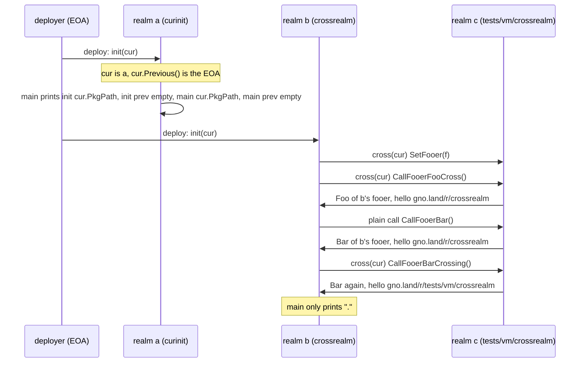

`init(cur realm)` runs at deploy with the realm as `cur` and the deployer as `Previous()`, so it may cross out; deploy order decides what exists, and
`zrealm_initctx.gno` pins the deploy frame: `unsafe.OriginCaller()` inside `init` is the deployer.

Rules: R1. Pinned by: `gnovm/tests/files/zrealm_cur_init.gno` (Output `init cur.PkgPath: gno.land/r/curinit`,
`init prev.PkgPath empty (EOA): true`), `gnovm/tests/files/zrealm_crossrealm15.gno` (Output `init`, `hello
gno.land/r/crossrealm` twice, `hello gno.land/r/tests/vm/crossrealm`), `gnovm/tests/files/zrealm_crossrealm38.gno`
(Output `2`), `gnovm/tests/files/zrealm_initctx.gno` (the deployer address from `init`, then the helper's empty
origin), and `gnovm/tests/files/zrealm_tests0.gno` (entries added in `init` survive into `main`).

### g. Run scripts and MsgCall
**Goal:** A run script or a MsgCall reaches another realm's state only by crossing into it.

```go
// realm a: gno.land/r/test/borrowrealm (from the txtars)
var value int                                      // a's stored value
func Mutate() { value++ }                          // no cur: not a gate
func MutateCrossing(cur realm) { value++ }         // the gate

// p: gno.land/p/test/utils
func AssertPreviousRealmPkgPath(expected string)   // panics unless the previous realm path matches
func AssertCurrentRealmPkgPath(expected string)    // panics unless the running realm path matches

// chain 1 (run txtar): a fresh node, two run scripts
// run script 1: gno.land/e/<addr>/run, file run/non_crossing_mutation.gno
// tx 1
func main() {                                      // no cur: no gate
	utils.AssertPreviousRealmPkgPath("")             // the previous realm is the user; its PkgPath is empty
	utils.AssertCurrentRealmPkgPath("gno.land/e/<addr>/run") // the script is its own realm
	borrowrealm.Mutate()                             // refused: gno.land/r/test/borrowrealm's code was entered without crossing
		// master: writes, value 0 -> 1 (no refusal)
		// today:  refused: "…borrowrealm's code was entered without crossing and is read-only"
}

// run script 2: the same ephemeral realm, file run/crossing_mutation.gno
// tx 2
func main(cur realm) {                             // the script's own gate
	borrowrealm.MutateCrossing(cross(cur))           // a's value 0 -> 1
}

// chain 2 (call txtar): another fresh node
// realm b: gno.land/r/test/callerrealm (MsgCall enters these as crossing calls)
// tx 1
func NonCrossingMutation(cur realm) {              // the MsgCall entry: user -> b
	utils.AssertPreviousRealmPkgPath("")             // the previous realm is the user, empty PkgPath
	utils.AssertCurrentRealmPkgPath("gno.land/r/test/callerrealm") // b is current
	borrowrealm.Mutate()                             // refused: gno.land/r/test/borrowrealm's code was entered without crossing
}

// realm b
// tx 2
func CrossingMutation(cur realm) {                 // the MsgCall entry
	borrowrealm.MutateCrossing(cross(cur))           // a's value 0 -> 1
}
```

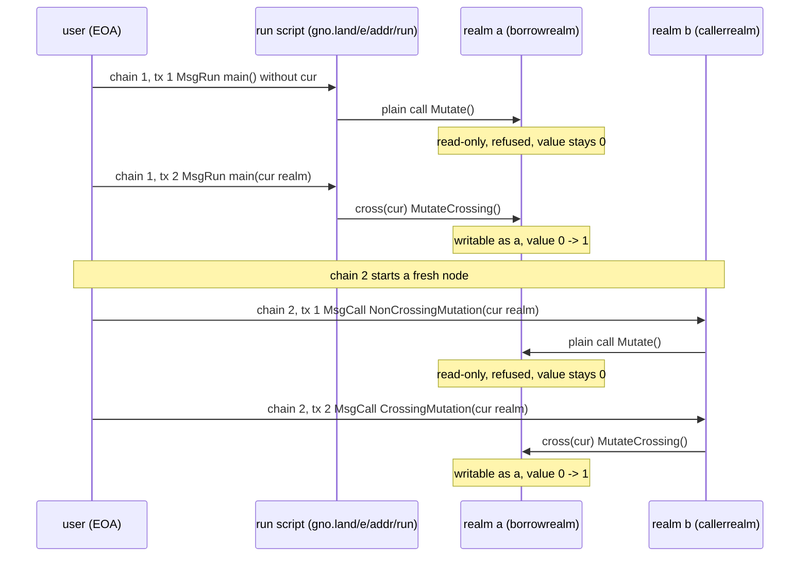

Each txtar starts its own node. On chain 1 the run script is its own realm, `gno.land/e/<addr>/run`; in both chains a plain call into `borrowrealm` is refused
(`gno.land/r/test/borrowrealm's code was entered without crossing and is read-only`, `value` stays `0`) and the crossing call writes it.

Rules: R1. Pinned by: `gno.land/pkg/integration/testdata/interrealm_mix_run.txtar` and
`gno.land/pkg/integration/testdata/interrealm_mix_call.txtar` (no `gnovm/tests/files` filetest covers MsgRun
or MsgCall).

### h. `Render` may take `cur`
**Goal:** A render query can inject `cur`, so `Render` may cross into its own helpers.

```go
// realm a: gno.land/r/test/render_crossing (render_crossing.txtar)
func observe(cur realm) (own, prev string) {                // a's crossing helper
	return cur.PkgPath(), cur.Previous().PkgPath()            // itself, and the frame that crossed
}
// tx 1 (the qrender query)
func Render(cur realm, path string) string {                // the chain injects cur for a qrender query
	outerOwn := cur.PkgPath()                                 // gno.land/r/test/render_crossing
	outerPrev := cur.Previous().PkgPath()                     // "" — the empty origin
	innerOwn, innerPrev := observe(cross(cur))                // crossing helper: prev is Render's own frame
		// master: observe prev = "gno.land/r/test/render_crossing"
		// today:  same
	return "Render cur.PkgPath() = " + outerOwn +                 // gno.land/r/test/render_crossing
		"\nRender cur.Previous().PkgPath() = \"" + outerPrev + "\"" + // ""
		"\nobserve cur.PkgPath() = " + innerOwn +                   // gno.land/r/test/render_crossing
		"\nobserve cur.Previous().PkgPath() = \"" + innerPrev + "\"" + // gno.land/r/test/render_crossing
		"\npath = " + path                                        // hello
}
```

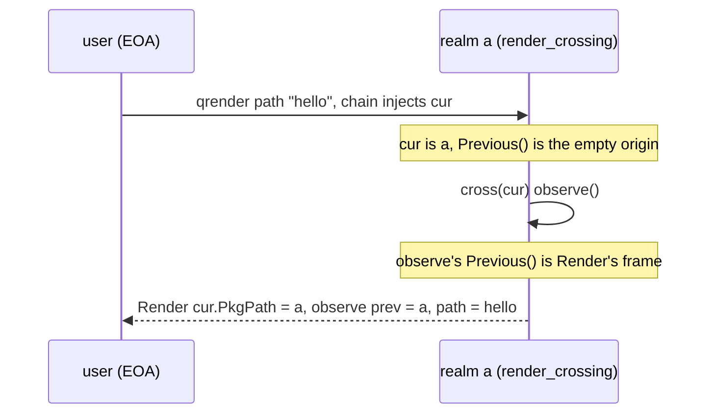

A realm may declare `Render(cur realm, path string)`: the query injects `cur` as for `main`, so `Render` can cross into its own helpers; the legacy `Render(path
string)` form stays read-only.

Rules: R1. Pinned by: `gno.land/pkg/integration/testdata/render_crossing.txtar` (stdout `Render
cur.Previous().PkgPath() = ""` and `observe cur.Previous().PkgPath() = "gno.land/r/test/render_crossing"`).

### i. R2 copies: values do not cross, pointers do
**Goal:** A value of another realm's declared type cannot be copied, so hand out a pointer.

```go
// realm a: gno.land/r/tests/vm/fvx
type T struct{ N int }                          // a's declared struct
type E struct{ Msg string }                     // a's declared error type
func (e E) Error() string { return e.Msg }      // value receiver: E is an error
var one = &T{N: 1}                              // a's stored T, handed out by Ptr
func Ptr() *T { return one }                    // returns a pointer: fine
func Fail() error { return E{"x"} }             // boxes the E value in error: a copy
func (t T) Val() int { return t.N }             // value receiver: every call copies t
func (t T) Add(k int) int { return t.N + k }    // same; shown through p below
func Opts(cur realm, o struct{ N int }) int { return o.N }             // unnamed all-exported: exempt
func Stats() struct{ A, B int } { return struct{ A, B int }{1, 2} }    // same, on a return
func Pair() [2]int { return [2]int{3, 4} }      // [2]int, a predeclared array type

// realm b: gno.land/r/fvpanicthencall
func try(p *fvx.T) (n int) {                    // b's helper: recovers the panic and reports -1
	defer func() { if r := recover(); r != nil { n = -1 } }() // recover, report -1
	return p.Add(div(0))                        // div(0) is evaluated first and panics; p.Add never runs
}
func div(z int) int { return 10 / z }           // div(0) panics
// tx 1
func main(cur realm) {
	p := fvx.Ptr()                              // a pointer: fine
	println(try(p))                             // -1: the panic is recovered
	println(p.Val(), p.Add(1))                  // 1 2: value-receiver calls copy only the receiver
	defer func() { println("deferred closure", p.Val()) }() // fine: no copy at the defer
}

// realm c: gno.land/r/fvcopyassign
// tx 2
func main(cur realm) {
	p := fvx.Ptr()                              // a pointer: fine
	c := *p                                     // refused at type check: cannot hold a value of gno.land/r/tests/vm/fvx.T outside its realm (use a pointer)
	                                            // and at run time: cannot copy gno.land/r/tests/vm/fvx.T outside realm gno.land/r/tests/vm/fvx (use a pointer)
		// master: writes the copy, prints 1 (no refusal)
		// today:  refused: "cannot hold a value of …fvx.T outside its realm (use a pointer)"
	println(c.N)                                // never reached
}

// realm d: gno.land/r/fverrdefine
// tx 3
func main(cur realm) {
	err := fvx.Fail()                           // refused: cannot copy gno.land/r/tests/vm/fvx.E
	println(err != nil)                         // never reached
}

// realm e: gno.land/r/fvdeferval
// tx 4
func main(cur realm) {
	p := fvx.Ptr()                              // a pointer: fine
	defer p.Val()                               // refused: cannot copy gno.land/r/tests/vm/fvx.T outside realm gno.land/r/tests/vm/fvx (use a pointer)
	println("ok")                               // never reached
}

// realm f: gno.land/r/fvanonarg
// tx 5
func main(cur realm) {
	println(fvx.Opts(cross(cur), struct{ N int }{N: 5})) // 5: unnamed all-exported struct by value
}

// realm g: gno.land/r/fvanonret
// tx 6
func main(cur realm) {
	s := fvx.Stats()                            // the same exception on a return
	println(s.A + s.B)                          // 3
	a := fvx.Pair()                             // [2]int: no declared struct involved
	println(a[0])                               // 3
}

// realm h: gno.land/r/fvrecviface
// tx 7
func main(cur realm) {
	println(fvx.Fail().Error())                 // x: a direct value-receiver call copies only the receiver
}
```

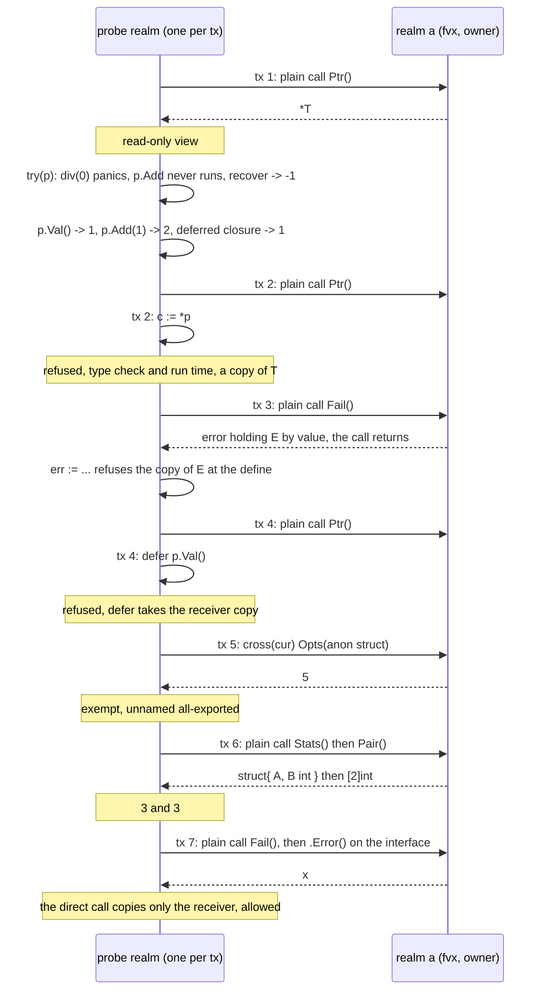

A copy of another realm's declared struct or array is refused. `c := *p` fails type checking; `err := fvx.Fail()` and `defer p.Val()` are refused at run time
(`alloc.go:796`). So return a pointer, return `*E` for an error, and defer a closure; an unnamed all-exported struct is exempt, and a value-receiver call on a
returned interface copies only the receiver (`zrealm_fv_*.gno`).

Rules: R2. Pinned by: `gnovm/tests/files/zrealm_fv_copy_assign.gno` (Error `cannot copy
gno.land/r/tests/vm/fvx.T outside realm gno.land/r/tests/vm/fvx (use a pointer)`, and TypeCheckError `cannot
hold a value of gno.land/r/tests/vm/fvx.T outside its realm (use a pointer)` for `c := *p`),
`gnovm/tests/files/zrealm_fv_err_define.gno` (Error `cannot copy gno.land/r/tests/vm/fvx.E outside realm
gno.land/r/tests/vm/fvx (use a pointer)`, at the define), `gnovm/tests/files/zrealm_fv_defer_val.gno` (Error
`cannot copy gno.land/r/tests/vm/fvx.T outside realm gno.land/r/tests/vm/fvx (use a pointer)`, raised by
`defer p.Val()`), `gnovm/tests/files/zrealm_fv_panic_then_call.gno` (Output `-1`, `1 2`, `deferred closure
1`: `try` recovers the panic from `div(0)`, which is evaluated before `p.Add`, and the closure form of the
deferred call copies nothing),
`gnovm/tests/files/zrealm_fv_recv_iface.gno` (Output `x`: the direct `fvx.Fail().Error()` call),
`gnovm/tests/files/zrealm_fv_anon_arg.gno` (Output `5`: an anonymous all-exported struct passed by value),
and `gnovm/tests/files/zrealm_fv_anon_ret.gno` (Output `3` from `Stats`, then `3` from `Pair()[0]`: the
exception on a return, and a `[2]int` from `Pair`).

### j. Laundering through package data
**Goal:** A copy read out of a library belongs to the realm that read it, so writing the copy is local.

```go
// p: gno.land/p/demo/tests/launderpkg/v0
var PInitData = Object{Field: "p-init"}                     // a /p/-init-allocated value
type Object struct{ Field string }                          // the library type

// realm a: gno.land/r/launderpdata_p (zrealm_launder_pdata_ptr_deref)
// tx 1
func main(cur realm) {
	p := &launderpkg.PInitData                                // pointer to the library global
	stolen := *p                                              // deref: a fresh copy owned by a
	stolen.Field = "pwnd-via-pdata-ptr-launder"               // writes a's copy, not the global
		// master: writes, prints pwnd-via-pdata-ptr-launder
		// today:  same
	println(stolen.Field)                                     // pwnd-via-pdata-ptr-launder
}

// realm b: gno.land/r/launderpdata_v (zrealm_launder_pdata_value_copy)
// tx 1 (a separate fixture)
func main(cur realm) {
	stolen := launderpkg.PInitData                            // value read: deep copy into b's heap
	stolen.Field = "pwnd-via-pdata-value-launder"             // writes b's copy
	println(stolen.Field)                                     // pwnd-via-pdata-value-launder
}
```

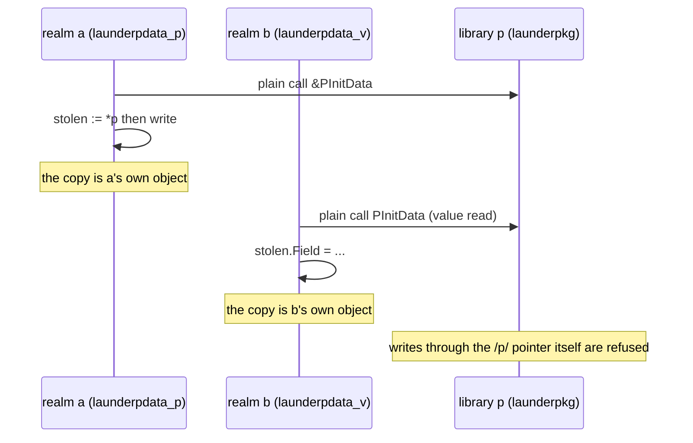

A value read or a pointer deref makes a copy owned by the reader, so writing it is local; writing *through* the `/p/` pointer is refused (pattern m).

Rules: R2. Pinned by: `gnovm/tests/files/zrealm_launder_pdata_ptr_deref.gno` (Output
`pwnd-via-pdata-ptr-launder`) and `gnovm/tests/files/zrealm_launder_pdata_value_copy.gno` (Output
`pwnd-via-pdata-value-launder`).

### k. A reference outlives its object
**Goal:** A copy of a deleted object still cannot make the owner's code write.

```go
// realm rv: gno.land/r/zc/rv (home_deleted_ref.txtar)
type Pair = pp.Pair                                         // the library types, aliased by rv
type Outer = pp.Outer                                       // the object that holds a function value
var Owner = "victim"                                        // rv's stored state
var Kept Outer                                              // rv's stored copy
func SetOwner(s string) { Owner = s }                       // rv's declared writer
var M = make(map[string]*Outer)                             // rv's stored objects
// tx 1
func Init(cur realm) { M["k"] = &Outer{Inner: Pair{F: SetOwner}} } // rv's gate: creates the object
func GetP() *Outer { return M["k"] }                        // read-only getter: a pointer, a view
// tx 2-5 (each)
func Del(cur realm) { delete(M, "k") }                      // rv's gate: deletes the object
// tx 2-3
func RunOuter(cur realm, o Outer) { o.Inner.F("pwned-val") } // rv's gate: runs the copied value's function
// tx 4
func Keep(cur realm, o Outer) { Kept = o }                  // rv's gate: stores the copy

// realm rs: gno.land/r/zc/rs (the attacker)
var keep pp.Outer                                           // rs's stored copy
// tx 2 (cold)
// tx 3 (warm)
func A1(cur realm, warm bool) {                             // copies the deleted object and runs its value
	p := rv.GetP()                                            // the view taken before the delete
	if warm && p.Inner.F == nil {                             // the warm run's extra check
		panic("nil")                                            // never reached
	}
	rv.Del(cross(cur))                                        // rv deletes the object
	o := *p                                                   // the copy, after the object is gone
	rv.RunOuter(cross(cur), o)                                // cold: unexpected object with id; warm: read-only
		// master: warm: writes, Owner -> pwned-val ("A1 reached end owner=pwned-val")
		// today:  warm: refused: "…rv's code is read-only here: a function value writes only in the crossing call that made it"
}
// tx 4
func A2(cur realm) {                                        // hands the copy to the realm whose code its value is
	rv.Init(cross(cur))                                       // creates the object
	p := rv.GetP()                                            // the view
	rv.Del(cross(cur))                                        // deletes it
	o := *p                                                   // the copy
	rv.Keep(cross(cur), o)                                    // the save is allowed; the value has no maker
}
// tx 5
func A5(cur realm) {                                        // saves the warm copy into the attacker's own realm
	rv.Init(cross(cur))                                       // creates the object
	p := rv.GetP()                                            // the view
	rv.Del(cross(cur))                                        // deletes it
	keep = *p                                                 // the warm copy, kept by rs itself
	panic("A5 kept")                                          // reaches its own sentinel: the copy was allowed
}
```

```mermaid
sequenceDiagram
    participant U as user (EOA)
    participant S as realm rs (attacker)
    participant V as realm rv (owner)
    U->>V: tx 1 Init(), creates M["k"]
    U->>S: tx 2 A1(false), cold copy
    S->>V: plain call GetP()
    S->>V: cross(cur) Del()
    S->>S: o := *p
    S->>V: cross(cur) RunOuter(o)
    V-->>S: unexpected object with id, refused, the tx reverts
    U->>S: tx 3 A1(true), warm copy
    S->>V: plain call GetP()
    S->>V: cross(cur) Del()
    S->>S: o := *p
    S->>V: cross(cur) RunOuter(o)
    V-->>S: read-only, refused
    U->>S: tx 4 A2
    S->>V: cross(cur) Init()
    S->>V: plain call GetP()
    S->>V: cross(cur) Del()
    S->>S: o := *p
    S->>V: cross(cur) Keep(o)
    V-->>S: stored; a later call is read-only
    U->>S: tx 5 A5
    S->>V: cross(cur) Init()
    S->>V: plain call GetP()
    S->>V: cross(cur) Del()
    S->>S: keep = *p, sentinel panic "A5 kept"
    U->>V: qeval Owner
    V-->>U: victim
```

Deleting an object does not revoke references another realm holds: copying a deleted object is refused, and while it is warm the copy is made but running its
value is read-only. Handing the copy back is allowed but writes nothing (S3), and the warm copy may be kept; the owner's state is unchanged.

Rules: R2, S3. Pinned by: `gno.land/pkg/integration/testdata/home_deleted_ref.txtar` (stderr
`unexpected object with id`, `read-only`, `A5 kept`, and qeval `Owner` = `victim`).

### l. Library code inside the owner's crossing call writes
**Goal:** Library code named by the owner's crossing call writes the owner's state.

```go
// p: gno.land/p/demo/tests/libtable/v0 (a library: owns no state)
type Box struct{ N int }                                     // the library type a realm stores
func Run(f func()) { f() }                                   // calls the callback it is given
var Apply = func(f func()) { f() }                           // a closure in a package variable
var Table = map[string]func(func()){"run": Run}              // a table of functions
func Each(bs []*Box, f func(*Box)) { for _, b := range bs { f(b) } } // calls f on each box
func Inc(b *Box) { b.N++ }                                   // writes its argument
var Handlers = map[string]func(*Box){"inc": Inc}             // the library's own table
func Dispatch(k string, b *Box) { Handlers[k] (b) }           // reaches Inc through that table

// realm a: gno.land/r/tests/vm/ctw (owner of Count and Boxes)
var Count int                                               // a's stored counter
var Boxes = []*libtable.Box{{N: 1}, {N: 2}}                 // a's objects, sum 3

func ViaApply(cur realm)    { libtable.Apply(func() { Count++ }) }        // via a package variable
func ViaTable(cur realm)    { libtable.Table["run"] (func() { Count++ }) } // via a table entry
func ViaLocal(cur realm) {                                  // a local copy of a declared function
	each := libtable.Each                                   // made in a's crossing code: keeps the maker
	each(Boxes, func(b *libtable.Box) { b.N++ })            // acts like libtable.Each (S3)
}
func ViaDispatch(cur realm) { libtable.Dispatch("inc", Boxes[0]) }        // Inc via the library's table
func BoxSum() (s int) {                                     // the sum of a's boxes
	for _, b := range Boxes {                               // every box
		s += b.N                                            // add its value
	}
	return s                                                // the total
}

// realm b: gno.land/r/ctw_owncb (the caller)
// tx 1 (the whole fixture main is one transaction)
func main(cur realm) {
	ctw.ViaApply(cross(cur))                                // Count 0 -> 1, a's closure run by library code a's gate named
	ctw.ViaTable(cross(cur))                                // Count 1 -> 2
	println("count:", ctw.Count)                            // count: 2
	ctw.ViaLocal(cross(cur))                                // Boxes sum 3 -> 5
	ctw.ViaDispatch(cross(cur))                             // Boxes[0] +1: sum 5 -> 6
		// master: writes, count: 2 … boxes: 6
		// today:  same: count: 2 … boxes: 6
	println("boxes:", ctw.BoxSum())                         // boxes: 6
}
```

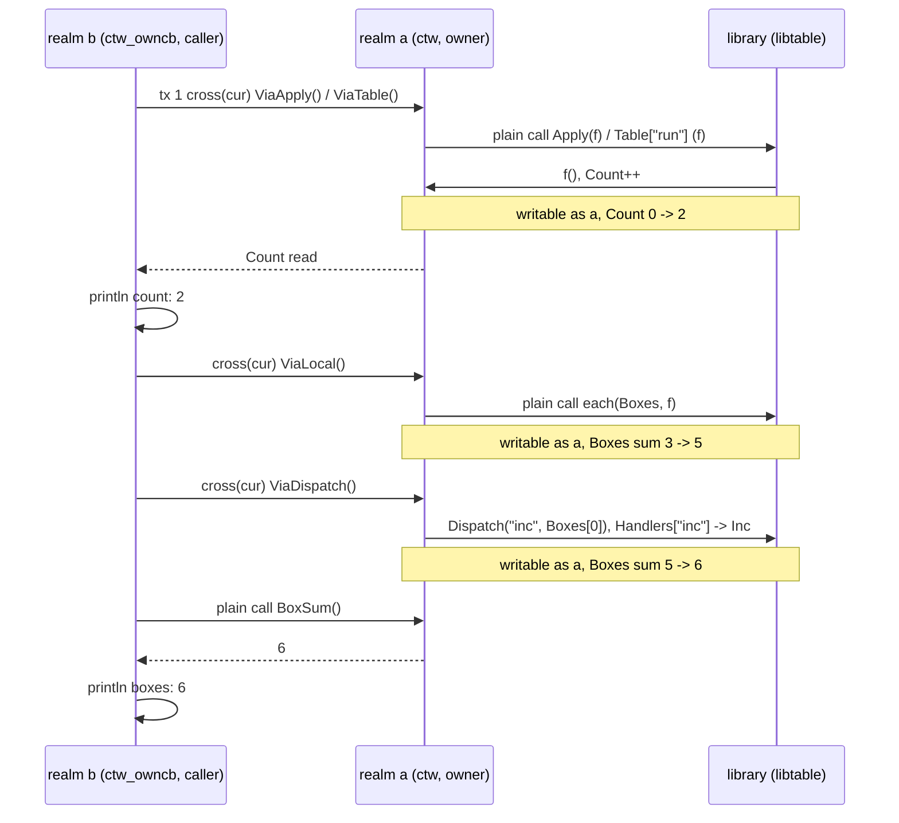

Library code runs with the authority of the realm whose crossing call names it; the same code called by
another realm against that realm's object gets none (pattern b).

Rules: R1, S3. Pinned by: `gnovm/tests/files/zrealm_ctw_owncb.gno` (Output `count: 2`,
`boxes: 6`): `Apply` and the table entry add 2 to `Count`; the local copy of `Each` adds 1 to each of the two
boxes and `Dispatch` adds 1 through the library's own table, so the boxes' sum goes from 3 to 6.
The copy `each` writes only because it is called in the crossing call that made it; kept and called
in a later call it is refused (§5o).

### m. A library package is immutable after init
**Goal:** A library's package state is immutable after init, whichever realm calls.

```go
// p: gno.land/p/demo/tests/v0
type TestRealmObject2 struct{ Field string }                // the library type the global holds
var SomeValue3 = &TestRealmObject2{}                        // a /p/ package global
func (o *TestRealmObject2) Modify() { o.Field = "modified" } // a /p/ method that writes the receiver

// realm a: gno.land/r/test/readonlyrecvmethod (zrealm_readonly_recv_method)
import "gno.land/p/demo/tests/v0"                           // imported as tests below
// tx 1
func main(cur realm) {                                      // the filetest entry
	p := tests.SomeValue3                                     // the /p/ pointer, taken by value
	p.Modify()                                                // refused: cannot mutate gno.land/p/demo/tests/v0: package is immutable post-init
		// master: refused: "cannot mutate gno.land/p/demo/tests/v0: package is immutable post-init"
		// today:  same
	println("unreachable; Field =", p.Field)                  // never reached
}
```

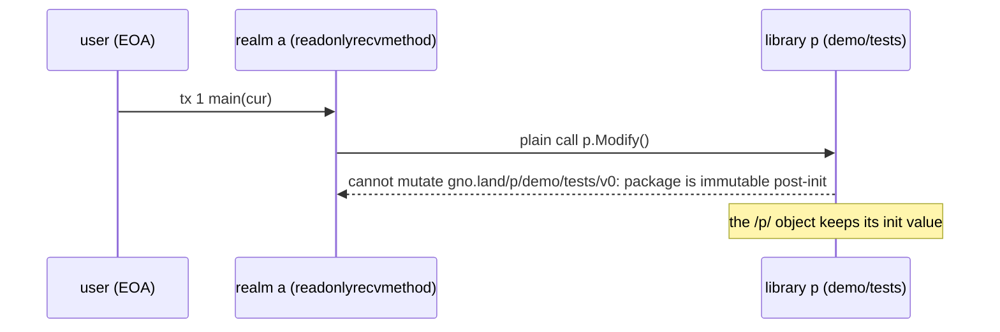

A library's package variable is frozen after `init`: no transaction, from any realm, can write it, and `Get` still sees the init value.

Rules: R1. Pinned by: `gnovm/tests/files/zrealm_readonly_recv_method.gno` (Error `cannot mutate
gno.land/p/demo/tests/v0: package is immutable post-init`) and
`gno.land/pkg/integration/testdata/object_pointer_pure.txtar` (stderr `cannot mutate
gno.land/p/testing/pure_package: package is immutable post-init`, then qeval `Get()` is `0 int`).

### n. Crossing methods on objects
**Goal:** A method with `cur realm` writes as its object's realm; one without it runs read-only for other callers.

Of one object's two methods, `Foo(cur realm)` is a gate that writes as the object's realm; `Bar()`, called from another realm, runs read-only.

```go
// realm a: gno.land/r/crossrealm (owns f)
type fooer struct{ s string }
func (f *fooer) Foo(cur realm) { f.s = "Foo"; println("hello " + f.s + …) } // gate: writes
func (f *fooer) Bar()          { println("hello " + f.s + …); f.s = "Bar" } // not a gate
var f = &fooer{s: "A"}

// realm b: gno.land/r/tests/vm/crossrealm (holds f only as the interface Fooer)
type Fooer interface{ Foo(realm); Bar() }
var fooerGetter func() Fooer                     // set by a's init: returns a's f
func CallFooerGetterFooCross(cur realm) { fooerGetter().Foo(cross(cur)) } // b crosses into a
func CallFooerGetterBar()               { fooerGetter().Bar() }           // b calls plainly

// what happens (a's init drives both calls; f.s is set to "D" before Bar)
b: fooerGetter().Foo(cross(cur))   // a is current → writes, prints hello Foo gno.land/r/crossrealm
b: fooerGetter().Bar()             // a entered without crossing → prints hello D, then f.s = "Bar" refused
	// master: write lands, bar: undefined (no refusal)
	// today:  refused: "…crossrealm's code was entered without crossing …: f<VPBlock(1,0)>.s"
```

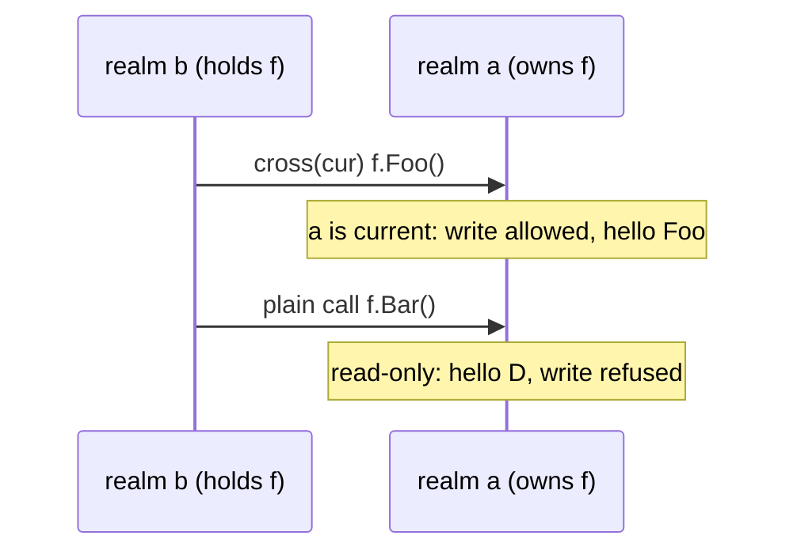

A crossing method carries its realm's authority to whoever holds the object, so it authenticates with `cur.Previous()` like any other gate; a method without
`cur realm` stays read-only from outside.

Rules: R1. Pinned by: `gnovm/tests/files/zrealm_crossrealm20.gno` (Output `hello Foo gno.land/r/crossrealm`
twice and `bar: gno.land/r/crossrealm's code was entered without crossing and is read-only (call its crossing
function): f<VPBlock(1,0)>.s`: the crossing write landed, the non-crossing one was refused).

### o. Function values with a maker
**Goal:** A function value writes only in the crossing call that made it.

```go
// p: gno.land/p/demo/tests/launderpkg/v0
type Immutable struct{ Field string }                   // the library type of a's object

// p: gno.land/p/demo/tests/pfuncbind
type Fn = func(*launderpkg.Immutable)                   // the callback type
func Apply(f Fn, x *launderpkg.Immutable) { f(x) }      // calls the value it is handed

// realm a: gno.land/r/zrealm_maker_ownfunc
var obj = &launderpkg.Immutable{Field: "orig"}          // a's object, of a library type
func set(x *launderpkg.Immutable) { x.Field = "own" }   // a's declared writer, named in a's source
// tx 1
func main(cur realm) {                                  // a's gate
	pfuncbind.Apply(set, obj)                           // a made the value, so it writes: orig -> own
	println("field:", obj.Field)                        // field: own
}

// realm b: gno.land/r/tests/vm/cbvictim (the owner of Owner and Box)
var Owner = "victim"                                    // b's stored state
func SetOwner(s string) { Owner = s }                   // b's declared writer
func GetDecl() func(string) { return SetOwner }         // read-only getter: the value has no maker
type T struct{ Name string }                            // b's declared type
func (t *T) SetName(s string) { t.Name = s }            // b's method writer
var Box = &T{}                                          // b's stored object
type S struct{ F func(string) }                         // b's struct holding a value
func GetSt() *S { return &S{F: Box.SetName} }           // method value bound read-only, carried in a struct
func RunS(cur realm, f func(string)) { f("picked") }    // b's gate: runs the value it is given
func RunSt(cur realm, s *S) { s.F("struct") }           // b's gate: runs the struct's value

// realm c: gno.land/r/zrealm_maker_getdecl
// tx 2
func main(cur realm) {
	println("owner:", cbvictim.Owner)                    // victim (not pinned: fixture has only an Error golden)
	f := cbvictim.GetDecl()                              // plain call: SetOwner, made read-only
	cbvictim.RunS(cross(cur), f)                         // refused: gno.land/r/tests/vm/cbvictim's code is read-only here
		// master: writes, Owner -> picked
		// today:  refused: "…cbvictim's code is read-only here: a function value writes only in the crossing call that made it: Owner<~VPBlock(3,0)>"
	println("owner:", cbvictim.Owner)                    // never reached
}

// realm d: gno.land/r/zrealm_maker_getst
// tx 3
func main(cur realm) {
	s := cbvictim.GetSt()                                // plain call: a method value bound read-only
	cbvictim.RunSt(cross(cur), s)                        // refused: gno.land/r/tests/vm/cbvictim's code is read-only here
	println("name:", cbvictim.Box.Name)                  // never reached
}
```

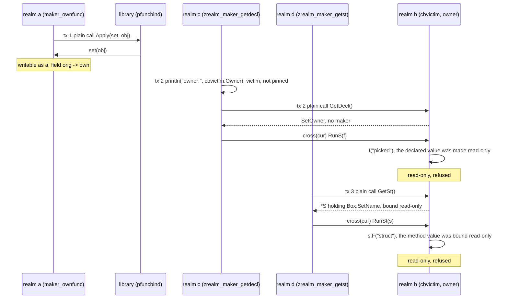

The maker of a declared function used as a value is the crossing call that made it: made inside the gate it acts like the named function, and made by a
read-only getter it has no maker. Four cases:

- Made by crossing call N, called from crossing call M: read-only (`zrealm_saved_escaped_container`, `zrealm_saved_local_ref`).
- Called through a package variable holding it (`SetOwner := Table[0]; SetOwner("x")`): read-only, the callee is not named in the source
(`zrealm_saved_name_collision`; `cbsaved.AliasTable`).
- Factored into the realm's own crossing helper it is read-only, the stated cost of S3 (`zrealm_saved_cross_helper`);
  made and called inside one crossing call it writes (`zrealm_saved_register`, Output `owner: registered`).

The three read-only shapes take the cbsaved text, Error `gno.land/r/tests/vm/cbsaved's code is read-only here: a function value writes only in the crossing call
that made it: (const (ref(gno.land/r/tests/vm/cbsaved) package{})).Owner` (`zrealm_saved_name_collision` names `Owner<~VPBlock(3,0)>` instead).

Rules: S3. Pinned by: `gnovm/tests/files/zrealm_maker_ownfunc.gno` (Output `field: own`: the realm's own
value, made in its own writable code, writes), `gnovm/tests/files/zrealm_maker_getdecl.gno` (Error
`gno.land/r/tests/vm/cbvictim's code is read-only here: a function value writes only in the crossing call
that made it: Owner<~VPBlock(3,0)>`, for the declared function from a read-only getter), and
`gnovm/tests/files/zrealm_maker_getst.gno` (Error `gno.land/r/tests/vm/cbvictim's code is read-only here: a
function value writes only in the crossing call that made it: t<VPBlock(1,0)>.Name`, for a method value bound
read-only and carried in a struct).

### p. A makerless function value cannot write
**Goal:** A function value made outside a realm can be stored but never writes.

```go
// p: gno.land/p/demo/tests/launderpkg/v0
type Immutable struct{ Field string }                    // the library type of a's object

// p: gno.land/p/demo/tests/launderattack/v0
func EvilWrite(i *launderpkg.Immutable) { i.Field = "pwnd-via-apply" } // library code, no realm

// realm a: gno.land/r/tests/vm/pfuncvictim
type Fn = func(*launderpkg.Immutable)                     // a's alias for a callback
var Hook Fn                                              // a's stored function value
var gObj = &launderpkg.Immutable{Field: "victim-orig"}    // a's object
func Read() string { return gObj.Field }                  // read-only getter
func SetHook(cur realm, f Fn) { Hook = f }                // a's gate: saves the value
func RunHook(cur realm) { Hook(gObj) }                    // a's gate: runs the saved value

// realm b: gno.land/r/zrealm_entry_pfunc_pkgvar
// tx 1 (the whole fixture main is one transaction)
func main(cur realm) {
	pfuncvictim.SetHook(cross(cur), launderattack.EvilWrite) // stored: the value has id 0
	pfuncvictim.RunHook(cross(cur))                          // refused: the library code cannot write
		// master: writes, prints victim: pwnd-via-apply
		// today:  refused: "cannot modify object owned by another realm from library code …: i<VPBlock(1,0)>.Field"
	println("victim:", pfuncvictim.Read())                   // never reached: tx 1 aborted
}
```

```mermaid
sequenceDiagram
    participant B as realm b (zrealm_entry_pfunc_pkgvar)
    participant A as realm a (pfuncvictim, owner)
    B->>A: tx 1 cross(cur) SetHook(library function value)
    Note over A: stored; the value has id 0
    B->>A: tx 1 cross(cur) RunHook()
    Note over A: refused: cannot modify object owned by another realm
    Note over A: tx 1 aborts; Read is never reached
```

A realm may store a function value made outside any realm, but it cannot write through it: S3 gives it id 0, so every call runs read-only and the refusal aborts
the transaction.

Rules: S3. Pinned by: `gnovm/tests/files/zrealm_entry_pfunc_pkgvar.gno` (Error `cannot modify object owned
by another realm from library code (call a function of the owning realm): i<VPBlock(1,0)>.Field`).

### q. Callbacks: a closure that must write its own realm is crossing
**Goal:** A callback that must write its own realm is crossing; a plain closure handed over is read-only.

```go
// realm a: gno.land/r/tests/vm/ctw
func ForEach(cur realm, f func(n int))             { f(1) }              // a's gate: calls a plain callback
func ForEachX(cur realm, f func(cur realm, n int)) { f(cross(cur), 1) } // a's gate: crosses into the callback

// realm b: gno.land/r/ctw_callback (the caller)
var sum int                                             // b's stored state
// tx 1
func main(cur realm) {                                  // b's gate
	ctw.ForEach(cross(cur), func(n int) { sum += n })   // refused: gno.land/r/ctw_callback's code was entered without crossing
		// master: writes, sum -> 1 (no refusal)
		// today:  refused: "…ctw_callback's code was entered without crossing …: …sum"
}

// realm c: gno.land/r/ctw_callbackx (the caller)
var sum int                                             // c's stored state
// tx 2
func main(cur realm) {                                  // c's gate
	ctw.ForEachX(cross(cur), func(cur realm, n int) { sum += n }) // crossing closure: sum 0 -> 1
	println(sum)                                        // 1
}
```

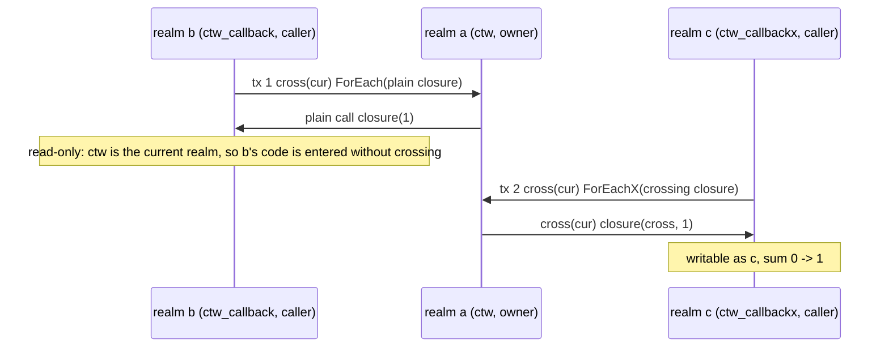

A callback that must change its own realm is `func(cur realm, …)` and the caller calls it with `cross(cur)`. A plain closure handed to another realm is refused
by the entered-without-crossing rule, not by S3: the current realm is the callee's, and `pushFrameCall` (`machine.go:2833-2836`) sends it into the read-only
path.

Rules: R1. Pinned by: `gnovm/tests/files/zrealm_ctw_callback.gno` (Error `gno.land/r/ctw_callback's code
was entered without crossing and is read-only (call its crossing function): (const
(ref(gno.land/r/ctw_callback) package{})).sum`) and `gnovm/tests/files/zrealm_ctw_callbackx.gno` (Output `1`).
The same-call case S3 allows is `zrealm_saved_register` (Output `owner: registered`).

### r. Callbacks in a real library: mux's crossing handlers
**Goal:** A real library stores crossing handlers and dispatches them with `cross` so they can write.

The rule is §5q; this is the same rule in `gno.land/p/nt/mux`, the router GovDAO's `Render` uses.

```go
// p: gno.land/p/nt/mux/v0 (the realm-aware handler is crossing)
type ResponseWriter struct{ Page string }                                    // the response body
func (w *ResponseWriter) Write(s string) { w.Page += s }                     // appends to the body
func (w *ResponseWriter) Output() string { return w.Page }                   // the rendered page
type Request struct{ Path string }                                           // the request path
type HandlerFunc func(res *ResponseWriter, req *Request)                     // handler.gno: plain, no realm
type HandlerFuncRlm func(cur realm, res *ResponseWriter, req *Request)       // handler.gno: crossing
type Handler struct {                                                        // one route
	Pattern string                                                           // the route pattern
	Fn      HandlerFunc                                                      // plain handler
	FnRlm   HandlerFuncRlm                                                   // realm-aware handler
}
type Router struct{ routes []Handler }                                       // the router that holds the routes
func NewRouter() *Router { return &Router{} }                                // a fresh router
func (r *Router) HandleFuncRlm(p string, f HandlerFuncRlm) {                 // the realm-aware registration
	r.routes = append(r.routes, Handler{Pattern: p, FnRlm: f})               // one realm-aware route
}
func (r *Router) RenderRlm(_ int, rlm realm, reqPath string) string {        // router.gno:84; no tx of its own
	route := r.routes[0]                                                     // router.gno:118-131: the matched route
	res := &ResponseWriter{}                                                 // the response writer
	req := &Request{Path: reqPath}                                           // the request
	if route.FnRlm != nil {                                                  // a realm-aware route matched
		route.FnRlm(cross(rlm), res, req)                                      // router.gno:127: dispatched with cross(rlm)
	}
	return res.Output()                                                      // router.gno:131: the rendered page
}
// RenderRlm calls the handler with cross(rlm); the /p/ router declares no crossing
// function, so preprocess permits the builtin here.

// realm a: gno.land/r/gov/dao/impl/v0 (registers a handler that may write DAO state)
import "gno.land/p/nt/mux/v0"                                               // a's mux import
type GovDAO struct{ last string }                                            // a's DAO state
func (d *GovDAO) Note(s string) { d.last = s }                               // a's writer, reached by name
type render struct {                                                         // a's renderer
	d      *GovDAO                                                          // the DAO it renders
	router *mux.Router                                                      // the router it built
}
func NewRender(d *GovDAO) *render {                                          // a's constructor, run at deploy
	ren := &render{d: d, router: mux.NewRouter()}                            // the renderer and its router
	ren.router.HandleFuncRlm("", func(cur realm, res *mux.ResponseWriter, req *mux.Request) { // the registered closure
		res.Write(ren.renderActiveProposals(cur, req.Path))                   // a's handler called by name
	})
	return ren                                                               // ready to render
}
func (ren *render) renderActiveProposals(cur realm, url string) string {     // a's handler (simplified)
	ren.d.Note(url)                                                         // writes a's state: d.last "" -> url
		// master: writes, page rendered (render_crossing passes)
		// today:  same: writes
	return "# GovDAO\n" + url                                               // the page
}
var ren = NewRender(&GovDAO{})                                               // deploy: build once, register the handler
// tx 1 (the qrender query)
func Render(cur realm, path string) string {                                 // the chain calls a's Render with cur
	return ren.router.RenderRlm(0, cur, path)                                // RenderRlm crosses into the handler
}
```

```mermaid
sequenceDiagram
    participant U as user (EOA)
    participant R as library (mux router)
    participant A as realm a (govdao)
    A->>A: deploy plain call NewRender(&GovDAO{})
    A->>R: deploy plain call mux.NewRouter(), HandleFuncRlm(pattern, closure)
    U->>A: tx 1 qrender, the chain calls a's Render with rlm
    A->>R: plain call RenderRlm(0, cur, path)
    R->>A: cross(rlm) handler(cross(rlm), res, req)
    A->>A: plain call res.Write(renderActiveProposals(cur, req.Path))
    A->>A: renderActiveProposals calls d.Note(url), writes a's state
    Note over A: cur.Previous() is realm a; rlm.IsCurrent() is false
    A-->>R: the page
    R-->>U: res.Output()
```

Under S3 a stored callback that must write later is crossing, so mux's realm-aware handler is `func(cur realm, res, req)` and the router dispatches
`route.FnRlm(cross(rlm), res, req)` (`router.gno:127`). The handler sees `cur.Previous()` as realm a, the frame that crossed, as `observe` does in
`render_crossing.txtar:28`; `rlm.IsCurrent()` is false inside it, so only the outer `Render` frame authenticates the caller.

Rules: S3. Pinned by: govdao's qrender tests (`render_crossing.txtar`); no filetest pins the rewritten
form. The dispatch is `examples/gno.land/p/nt/mux/v0/router.gno:127`; the DAO registers three crossing
handlers in `examples/gno.land/r/gov/dao/impl/v0/render.gno:35, 39, 43`, and `Render` is `impl.gno:18`.

### s. Events from a crossing callback
**Goal:** An event belongs to the realm whose code runs, including a callback in its crossing call.

```go
// realm a: gno.land/r/demo/cbee (event_callback.txtar)
import "chain"                                              // chain.Emit
const (
	foo = "foo"                                               // the first event type
	bar = "bar"                                               // the second event type
)
type contractA struct{}                                     // a's declared type
func (c *contractA) foo(cb func()) {                        // runs a's own event, then the callback
	subFoo()                                                  // emits foo
	cb()                                                      // runs the closure
		// master: writes, two events with pkg_path gno.land/r/demo/cbee
		// today:  same
}
func subFoo() { chain.Emit(foo, "k1", "v1", "k2", "v2") }   // a's event, no crossing of its own
type contractB struct{}                                     // a's second type
func (c *contractB) subBar() { chain.Emit(bar, "bar", "baz") } // a's second event
// tx 1
func Foo(cur realm) {                                       // a's gate
	a := &contractA{}                                         // a's object
	b := &contractB{}                                         // a's second object
	a.foo(func() { b.subBar() })                              // plain closure, made and called in this crossing call
}
```

```mermaid
sequenceDiagram
    participant U as user (EOA)
    participant A as realm a (cbee)
    U->>A: tx 1 Foo(cur)
    A->>A: a.foo(closure)
    A->>A: subFoo(), Emit("foo", ...)
    A->>A: closure(), b.subBar(), Emit("bar", ...)
    Note over A: both events carry pkg_path gno.land/r/demo/cbee
```

`chain.Emit` attributes an event to the realm whose code runs, so a callback inside its own realm's crossing call emits for that realm;
`event_defer_callback_loop.txtar` pins the same attribution from a loop, a callback and a deferred closure.

Rules: R1. Pinned by: `gno.land/pkg/integration/testdata/event_callback.txtar` (stdout `EVENTS:` with two
events, both `"pkg_path":"gno.land/r/demo/cbee"`).

### t. Interfaces and plugins: R6, one import rule
**Goal:** Code reached through an interface or method value has authority only if its package is in the import tree.

```go
// p: gno.land/p/demo/tests/launderpkg/v0
type Immutable struct{ Field string }                        // the library type of the victim's object

// p: gno.land/p/demo/tests/ifaceattack (written by the caller)
type EvilV struct{ N int }                                   // a library value with a method
func (EvilV) Run(x *launderpkg.Immutable) { x.Field = "pwnd-via-iface" } // the method that writes
type EvilS struct{}                                          // a library pointer type
func (*EvilS) Run(x *launderpkg.Immutable) { x.Field = "pwnd-via-iface" } // the same method on a pointer
type Evil int                                                // a library type, for the generator below
func (Evil) Run(x *launderpkg.Immutable) { x.Field = "pwnd-via-iface" } // the same write on a third type
type Gen struct{}                                            // the generator type
func (Gen) Handler() func(*launderpkg.Immutable) { return Evil(0).Run } // a method value built view-only

// realm a: gno.land/r/tests/vm/pfuncvictim (never imports ifaceattack)
type Runner interface{ Run(*launderpkg.Immutable) }          // a's interface, the only name it has
var gObj = &launderpkg.Immutable{Field: "victim-orig"}       // a's object
func Use(cur realm, r Runner) { r.Run(gObj) }                // a's gate, but the method is the caller's
func Read() string { return gObj.Field }                     // read-only getter

// realm b: gno.land/r/zrealm_entry_iface_val (the caller)
// tx 1
func main(cur realm) {
	pfuncvictim.Use(cross(cur), ifaceattack.EvilV{})         // refused: cannot modify object owned by another realm from library code
		// master: writes, prints victim: pwnd-via-iface
		// today:  refused: "cannot modify object owned by another realm from library code …: x<VPBlock(1,1)>.Field"
	println("victim:", pfuncvictim.Read())                   // never reached
}

// realm c: gno.land/r/zrealm_entry_iface_ptr (the caller)
// tx 2
func main(cur realm) {
	pfuncvictim.Use(cross(cur), &ifaceattack.EvilS{})        // refused: cannot modify object owned by another realm from library code
	println("victim:", pfuncvictim.Read())                   // never reached
}

// realm d: gno.land/r/tests/vm/ifacevictim (the third victim)
var gObj = &launderpkg.Immutable{Field: "victim-orig"}       // the third victim's object
func Read() string { return gObj.Field }                     // read-only getter
type HandlerGen interface{ Handler() func(*launderpkg.Immutable) } // the only name this realm has
func UseGen(cur realm, g HandlerGen) { h := g.Handler(); h(gObj) } // the method value has no stamp

// realm e: gno.land/r/zrealm_entry_iface_gen (the caller)
// tx 3
func main(cur realm) {
	ifacevictim.UseGen(cross(cur), ifaceattack.Gen{})        // refused: cannot modify object owned by another realm from library code
	println("victim:", ifacevictim.Read())                   // never reached
}
```

```mermaid
sequenceDiagram
    participant B as realm b (entry_iface_val)
    participant C as realm c (entry_iface_ptr)
    participant E as realm e (entry_iface_gen)
    participant A as realm a (pfuncvictim, owner)
    participant D as realm d (ifacevictim, owner)
    participant L as library (ifaceattack, not imported)
    B->>A: tx 1 cross(cur) Use(EvilV value)
    A->>L: interface call r.Run(gObj)
    Note over L: refused, read-only
    C->>A: tx 2 cross(cur) Use(EvilS pointer)
    A->>L: interface call r.Run(gObj)
    Note over L: refused, read-only
    E->>D: tx 3 cross(cur) UseGen(Gen value)
    D->>L: h := g.Handler(); h(gObj)
    Note over L: refused, the method value was built view-only
```

Reaching code through an interface or a method value carries no authority; the package it belongs to does, and only if it is in the import tree of the realm
whose crossing call runs—importing a package is how a realm says it trusts that code.

Rules: R6. Pinned by: `gnovm/tests/files/zrealm_entry_iface_val.gno` (Error `cannot modify object owned by
another realm from library code (call a function of the owning realm): x<VPBlock(1,1)>.Field`, for a library
value passed to `Use`), `gnovm/tests/files/zrealm_entry_iface_ptr.gno` (the same Error for a library pointer),
and `gnovm/tests/files/zrealm_entry_iface_gen.gno` (the same Error for the method value `Gen.Handler` builds
while view-only).

The standard library is in the import tree: `zrealm_import_std_out.gno` shows `control`, which imports `bytes`, taking a write from a `bytes.Reader`, while
`impvictim`, which imports only `io`, refuses `ReadAt` with Error `cannot copy to readonly tainted slice`.

```go
// realm c: gno.land/r/tests/vm/impvictim/control (imports bytes)
var buf = make([]byte, 4)                                  // c's own buffer
func Fill(cur realm, r io.ReaderAt) { r.ReadAt(buf, 0) }    // write through the caller's reader
func State() string { return string(buf) }                  // read the buffer

// realm d: gno.land/r/tests/vm/impvictim (imports io only)
var buf = make([]byte, 4)                                  // d's own buffer
func Fill(cur realm, r io.ReaderAt) { r.ReadAt(buf, 0) }    // the same write, refused
func State() string { return string(buf) }                  // read the buffer

// realm b: gno.land/r/zrealm_import_std_out (the caller)
// tx 1 (the whole fixture main is one transaction)
func main(cur realm) {
	control.Fill(cross(cur), bytes.NewReader([]byte("efgh")))   // trusted: bytes is in c's tree, buf becomes efgh
		// master: refused: "cannot copy to readonly tainted slice" (no output)
		// today:  writes, prints control: efgh
	println("control:", control.State())                      // control: efgh
	impvictim.Fill(cross(cur), bytes.NewReader([]byte("abcd"))) // refused: cannot copy to readonly tainted slice
	println("victim:", impvictim.State())                     // never reached
}
```

```mermaid
sequenceDiagram
    participant B as realm b (import_std_out, caller)
    participant K as realm c (control)
    participant V as realm d (impvictim)
    participant BY as library (bytes)
    B->>K: tx 1 cross(cur) Fill(bytes reader)
    K->>BY: plain call ReadAt(c's buf)
    Note over BY: bytes is in c's tree, writable as c, control: efgh
    B->>V: cross(cur) Fill(bytes reader)
    V->>BY: plain call ReadAt(d's buf)
    Note over BY: bytes is not in d's tree, refused
```

### u. Sub-realm tokens
**Goal:** A sub-token crosses like a realm, is minted only by `cur.Sub`, and carries its own limits.

```go
// realm a: gno.land/r/demo/subrealm (zrealm_sub1)
import "chain/runtime/unsafe"                             // for the parity print below
func callee(cur realm) {                                  // a's gate, entered through a sub-token
	println("prev.PkgPath:", cur.Previous().PkgPath())      // gno.land/r/demo/subrealm#dao/1
	println("prev.Address:", cur.Previous().Address())      // g1jy9ajp3mqdrcsklfgeafqpfr0nn2ypejnexzv6
	println("unsafe parity prev:",                          // the two APIs agree on the previous realm
		string(cur.Previous().Address()) == string(unsafe.PreviousRealm().Address()) &&
			cur.Previous().PkgPath() == unsafe.PreviousRealm().PkgPath()) // unsafe parity prev: true
	println("unsafe parity cur:",                           // and on the current realm
		string(cur.Address()) == string(unsafe.CurrentRealm().Address()) &&
			cur.PkgPath() == unsafe.CurrentRealm().PkgPath()) // unsafe parity cur: true
	inner := cur.Sub("inner")                               // a fresh sub-token of the live cur
	println("nested mint:", inner.PkgPath())                // gno.land/r/demo/subrealm#inner
}

// tx 1
func main(cur realm) {                                    // the filetest entry, one transaction
	sub := cur.Sub("dao/1")                                 // mint a sub-token: cross needs a bare identifier
	callee(cross(sub))                                      // crossing call presenting the sub-token
		// master: prev.PkgPath: gno.land/r/demo/subrealm#dao/1
		// today:  same
}
```

```mermaid
sequenceDiagram
    participant U as user (EOA)
    participant A as realm a (subrealm)
    participant S as sub-token a#dao/1
    U->>A: filetest entry main(cur)
    A->>S: cur.Sub("dao/1")
    A->>A: cross(sub) callee(sub)
    Note over A: cur.Previous() is the sub-token, not the EOA
    A->>A: cur.Sub("inner"), a nested sub of the live cur
```

A sub-token is a realm value with a `#subpath`: it crosses like any realm and `cur.Previous()` names it, and it is minted only by `cur.Sub(sp)` with the grammar
`zrealm_sub_validation.gno` pins; never use `unsafe.PreviousRealm()` in a crossing function, since it walks the call stack. A captured sub that is no longer the
topmost crossing cur cannot cross, mint, be stored, or issue or spend its own denom; a sub-of-sub is refused, and the address is off-chain computable and
rejects the same grammar (`zrealm_sub0.gno`, `zrealm_sub2.gno`, `zrealm_sub_derive_reject.gno`, `zrealm_sub_nested.gno`, `zrealm_sub_stale_cross.gno`,
`zrealm_sub_banker.gno`).

Rules: R1. Pinned by: `gnovm/tests/files/zrealm_sub1.gno` (Output `prev.PkgPath: gno.land/r/demo/subrealm#dao/1`,
`prev.Address: g1jy9ajp3mqdrcsklfgeafqpfr0nn2ypejnexzv6`, `unsafe parity prev: true`, `unsafe parity cur: true`,
`nested mint: gno.land/r/demo/subrealm#inner`), `gnovm/tests/files/zrealm_sub0.gno` (a sub's pkgpath, address,
`IsCurrent() true` and classification), `gnovm/tests/files/zrealm_sub2.gno` (the derived address equals
`Sub().Address()`, and `SplitPkgSubPath` recovers `dao/42`), `gnovm/tests/files/zrealm_sub_derive_reject.gno`
(9 of the 12 grammar rejections — `../x`, `x-` and the too-long case are missing — and the `#`-bearing host),
`gnovm/tests/files/zrealm_sub_validation.gno` (the same
grammar through `cur.Sub`, and the `Subpath()` accessor), `gnovm/tests/files/zrealm_sub_nested.gno` (Output
`IsCurrent: true`, `recovered: Sub: receiver pkgpath is already synthesized or invalid`),
`gnovm/tests/files/zrealm_sub_foreign.gno` (Error `Sub: caller is not operating in the receiver's namespace`),
`gnovm/tests/files/zrealm_sub_foreign_present.gno` (Output `observed prev.Subpath: dao/9`, `observed
prev.IsUserCall: false`, `unsafe prev parity: true`) with its callee `gno.land/r/tests/vm/subhost`,
`gnovm/tests/files/zrealm_sub_stale_cross.gno` (Error `cross: rlm is not the current cur (stale capture or
sibling frame)`), `gnovm/tests/files/zrealm_sub_stale.gno` (Output `recovered: Sub: receiver is not the live cur
(stale, sibling, or a sub-token)`), `gnovm/tests/files/zrealm_sub_persist.gno` (Error `cannot persist realm
value: realm values are ephemeral and tied to a call frame`), `gnovm/tests/files/zrealm_sub_banker.gno` (Output
`recovered: BankerTypeRealmIssue not supported for sub-realm tokens`), and
`gno.land/pkg/integration/testdata/subrealm_run_parity.txtar` (MsgRun entry, `observed prev.Subpath: dao/5`).

### v. Allowances, tellers and the banker
**Goal:** An allowance is a crossing function value that spends within its cap and dies on `Close`.

```go
// realm g: gno.land/r/test/granter (allowancesender_handoff.txtar)
func mk(cur realm) *allowancesender.AllowanceSender {       // a banker scoped to the current realm
	src := banker.NewBanker(banker.BankerTypeRealmSend, cur)  // only the live cur may issue one
	return allowancesender.New(src, unsafe.CurrentRealm().Address(), chain.NewCoins(chain.NewCoin("ugnot", 100000)))
}                                                           // the grant: cap 100000ugnot
// tx 1
func GrantAndStoreFn(cur realm) {                           // hands a crossing literal to the callee, then closes
	al := mk(cur)                                             // the grant, cap 100000
	defer al.Close()                                          // dead after this call
	callee.StoreFn(cross(cur), func(cur realm, to address, amt chain.Coins) { al.Send(to, amt) }) // the literal spends as g
}
// tx 3
func GrantNoClose(cur realm) {                              // the same without Close
	al := mk(cur)                                             // the grant stays open
	callee.StoreFn(cross(cur), func(cur realm, to address, amt chain.Coins) { al.Send(to, amt) }) // the same literal
}
// tx 6
func GrantObject(cur realm) {                               // hands the object, not a literal
	al := mk(cur)                                             // the grant
	defer al.Close()                                          // dead after this call
	callee.UseObj(cross(cur), al)                             // this tx is refused: cannot modify
}
// tx 7
func GrantStoreObjNoClose(cur realm) {                      // stores the object in the callee
	al := mk(cur)                                             // the grant stays open
	callee.StoreObj(cross(cur), al)                           // storing the object is allowed
}

// realm c: gno.land/r/test/callee
var fn func(realm, address, chain.Coins)                    // the stored crossing literal
var obj *allowancesender.AllowanceSender                    // the stored sender object
// tx 1 (from GrantAndStoreFn)
// tx 3 (from GrantNoClose)
func StoreFn(cur realm, f func(realm, address, chain.Coins)) { fn = f } // saves the literal
// tx 2
// tx 4
// tx 5
func CallStored(cur realm, amount int64) {                  // uses the stored literal
	fn(cross(cur), cur.Address(), chain.NewCoins(chain.NewCoin("ugnot", amount))) // spends within the cap
}
// tx 6 (runs inside GrantObject's refused tx)
func UseObj(cur realm, al *allowancesender.AllowanceSender) { // uses a caller-supplied object
	al.Send(cur.Address(), chain.NewCoins(chain.NewCoin("ugnot", 10))) // refused: cannot modify
		// master: writes, spends 10ugnot (no refusal)
		// today:  refused: "cannot modify"
}
// tx 7
func StoreObj(cur realm, al *allowancesender.AllowanceSender) { obj = al } // saves the object
// tx 8
func SendStoredObj(cur realm, amount int64) {               // uses the saved object
	obj.Send(cur.Address(), chain.NewCoins(chain.NewCoin("ugnot", amount))) // refused: cannot modify
}

// caller (the gnokey maketx call lines, one transaction each)
// tx 1: granter.GrantAndStoreFn, send 1000000ugnot         // OK, the literal is stored and g closes
// tx 2: callee.CallStored(1000)                             // refused: closed
// tx 3: granter.GrantNoClose, send 1000000ugnot             // OK, the grant stays open
// tx 4: callee.CallStored(1000)                             // OK, within the cap
// tx 5: callee.CallStored(5000000)                          // refused: cap exceeded
// tx 6: granter.GrantObject, send 1000000ugnot             // refused: cannot modify (UseObj runs inside it)
// tx 7: granter.GrantStoreObjNoClose, send 1000000ugnot    // OK, the object is stored
// tx 8: callee.SendStoredObj(1000)                          // refused: cannot modify
```

```mermaid
sequenceDiagram
    participant U as user (EOA)
    participant G as realm g (granter)
    participant C as realm c (callee)
    U->>G: tx 1 GrantAndStoreFn (send 1000000ugnot)
    G->>C: cross(cur) StoreFn(crossing literal)
    Note over G: Close runs, the grant is dead
    U->>C: tx 2 CallStored(1000)
    C-->>U: closed (refused)
    U->>G: tx 3 GrantNoClose
    G->>C: cross(cur) StoreFn(literal)
    U->>C: tx 4 CallStored(1000)
    Note over C: OK, within the cap
    U->>C: tx 5 CallStored(5000000)
    C-->>U: cap exceeded (refused)
    U->>G: tx 6 GrantObject
    G->>C: cross(cur) UseObj(al)
    C-->>U: cannot modify (refused, the whole tx)
    U->>G: tx 7 GrantStoreObjNoClose
    G->>C: cross(cur) StoreObj(al)
    U->>C: tx 8 SendStoredObj(1000)
    C-->>U: cannot modify (refused)
```

An allowance is a capability with a lifetime: a crossing function literal written in the granter's source keeps working after it is stored while the grant is
open and within the cap, and dies on `Close`; the sender object is not spendable by another realm, and a banker can only be built over the live `cur`
(`zrealm_banker_previous.gno`).

Related pins. `allowancesender_recover.txtar` and `allowancesender_outer_recover.txtar` show the call succeeds (no panic for `recover`, so `Close` runs);
`allowancesender_persistence.txtar` pins the spend and the cap, `allowancesender_diag.txtar` no cause. `banker_originsend_lifetime.txtar` aborts at finalize,
`banker_persistence.txtar` keeps spending, `banker_realm_embed.txtar` and `banker_realm_embed_wugnot.txtar` fail with `missing method .seal`,
`banker_security.txtar` refuses arbitrary addresses, `realm_banker_issued_coin_denom.txtar` prints `31337/gno.land/r/test/realm_banker:ugnot`;
`grc721_callerteller_home.txtar` prints `frame-relative teller used outside the token.s realm`, and the grc20 registry (`grc20_registry_spoof.txtar`: `must be
declared in the registering realm`; `grc20_registry_run_register.txtar`: `run script cannot register`; `grc20_registry_wrappers.txtar`;
`grc20_registry_emit.txtar`: `pkg_path` `gno.land/p/nt/grc20/v0`; `grc20_registry.txtar`) pins registration.

Rules: R1, R2. Pinned by:
`gno.land/pkg/integration/testdata/allowancesender_handoff.txtar` (stderr `closed`, `cap exceeded`, `cannot
modify`), `gnovm/tests/files/zrealm_banker_previous.gno` (Error `banker can only be instantiated for the
current realm`), and `gno.land/pkg/integration/testdata/grc20_callerteller_home.txtar` (stderr `caller teller is
confined to the token`, three times, with balances unchanged).

### w. Panics
**Goal:** A refused write panics, and the caller can recover it and keep its own authority.

```go
// realm a: gno.land/r/tests/vm/ctw
func Boom() { panic("boom") }                          // entered read-only: a plain panic
func RecoverValue(cur realm) (r any) {                 // a's gate
	defer func() { r = recover() }()                    // recovers in a's own code
	f := libtable.Panics                               // a library function taken as a value
	f()                                                // panics "boom"
	return nil                                         // no panic to return
}

// p: gno.land/p/demo/tests/libtable/v0
func Panics() { panic("boom") }                         // the library function taken above

// realm b: gno.land/r/ctw_recover
var Count int                                          // b's stored state
// tx 1 (fixture zrealm_ctw_recover: its entry main is one transaction)
func main(cur realm) {                                 // b's gate
	func() {                                           // b's own recover scope
		defer func() { println("recovered:", recover()) }() // b's own defer catches a's read-only panic
		ctw.Boom()                                         // recovered: boom
			// master: panic "boom" escapes, run aborts (no output)
			// today:  recovered: boom, count: 1
	}()
	Count++                                            // count: 1, b kept its authority
	println("count:", Count)                           // count: 1
	println("value:", ctw.RecoverValue(cross(cur)))    // value: boom, recovered by a's own defer
}

// realm c: gno.land/r/launderrh_pdr_panic_defer (the attacker)
// tx 2 (fixture zrealm_launder_rdata_pdr_panic_defer: its entry main is one transaction)
func main(cur realm) {                                 // c's gate
	println("before:", launderrvictim.ReadImm())       // before: rdata-original
	launderrvictim.PanicAfterPushDefer(cross(cur), func(i *launderrvictim.Immutable) {
		i.Field = "pwnd-via-panic-defer"               // refused: gno.land/r/launderrh_pdr_panic_defer's code was entered without crossing
	})
	println("after: ", launderrvictim.ReadImm())       // never reached
}

// realm d: gno.land/r/tests/vm/launderrvictim (the victim)
type Immutable struct{ Field string }                  // d's own data type, declared in /r/
var gImm = &Immutable{Field: "rdata-original"}         // d's stored object
func ReadImm() string { return gImm.Field }            // read-only getter
func PanicAfterPushDefer(cur realm, h func(*Immutable)) { // d's gate
	defer h(gImm)                                      // defers the caller's callback
	panic("victim-induced panic")                      // so it runs during unwinding
}
```

```mermaid
sequenceDiagram
    participant B as realm b (ctw_recover)
    participant A as realm a (ctw, owner)
    participant L as library (libtable)
    participant C as realm c (launderrh_pdr_panic_defer, attacker)
    participant D as realm d (launderrvictim, owner)
    B->>A: tx 1 plain call Boom()
    A-->>B: panic boom
    Note over B: recovered by b's own defer, Count -> 1
    B->>A: tx 1 cross(cur) RecoverValue()
    A->>L: plain call f(), the library function value
    L-->>A: panic boom
    Note over A: recovered by a's own defer, value: boom
    C->>D: tx 2 cross(cur) PanicAfterPushDefer(callback)
    D->>D: defer h(gImm), then panic victim-induced panic
    D->>C: run the deferred callback during unwinding
    C->>D: write gImm.Field
    D--xC: refused, read-only, the call aborts
    Note over C,D: the golden chains both panics: victim-induced panic, then the read-only text
```

A refused write is a panic, raised at once. A read-only frame is no realm boundary, so the caller recovers a panic raised in another realm's read-only code and
keeps its authority, and a realm's own code recovers a library panic it called through a value; inside the victim's unwinding the error shows both panics in
order.

Rules: R1. Pinned by: `gnovm/tests/files/zrealm_ctw_recover.gno` (Output `recovered: boom`, `count: 1`,
`value: boom`) and `gnovm/tests/files/zrealm_launder_rdata_pdr_panic_defer.gno` (Error `victim-induced panic`
followed by `gno.land/r/launderrh_pdr_panic_defer's code was entered without crossing and is read-only (call
its crossing function): i<VPBlock(1,0)>.Field`; the realm named is the attacker's, the one whose code runs
read-only, not the victim that owns the object).

### x. Known limits
**Goal:** These are the remaining limits: a few read-only shapes still surprise.

```go
// realm a: gno.land/r/tests/vm/cbvictim (the owner)
var Owner = "victim"                                      // a's stored state
func SetOwner(s string) { Owner = s }                     // a's declared writer
var Table = []func(string){SetOwner}                      // a's own stored function values
func RunAll(cur realm, fs []func(string)) {               // a's gate: runs caller-supplied values
	for _, f := range fs {                                // each value in the caller's container
		f("table")                                        // a's gate runs it: it acts for a
	}
}
func RunS(cur realm, f func(string)) { f("picked") }      // a's gate: runs one value
func RelayFrom(fs []func(string), rlm realm)              // non-crossing: relays one value from the caller
var FV = SetOwner                                         // a's own function value
func GetFV() func(string) { return FV }                   // read-only getter: strips the maker

// realm c: gno.land/r/tests/vm/cbother (a third realm)
func RelayTable(cur realm) { cbvictim.RunAll(cross(cur), cbvictim.Table) } // hands a's table back by reference
	// master: writes, prints owner: table
	// today:  refused: "…cbvictim's code is read-only here: a function value writes only in the crossing call that made it: Owner<~VPBlock(3,0)>"

// realm b: gno.land/r/zrealm_home_known_relay_table
// tx 1
func main(cur realm) {
	cbother.RelayTable(cross(cur))                          // a's own values run in a's gate: refused, tx 1 aborts
	println("owner:", cbvictim.Owner)                       // never reached
}

// realm d: gno.land/r/zrealm_home_known_ro_relay
// tx 2
func main(cur realm) {
	cbvictim.RelayFrom(cbvictim.Table, cur)                 // a's helper crosses for the caller: refused, tx 2 aborts
	println("owner:", cbvictim.Owner)                       // never reached
}

// realm e: gno.land/r/zrealm_home_ro_relay
// tx 3
func main(cur realm) {
	f := cbvictim.GetFV()                                   // read-only getter: id 0, and the copy keeps it
	g := f                                                  // a plain copy keeps no maker
	cbvictim.RunS(cross(cur), g)                            // refused: gno.land/r/tests/vm/cbvictim's code is read-only here
	println("owner:", cbvictim.Owner)                       // never reached
}
```

```mermaid
sequenceDiagram
    participant B as realm b (known_relay_table)
    participant C as realm c (cbother)
    participant A as realm a (cbvictim, owner)
    participant D as realm d (known_ro_relay)
    participant E as realm e (ro_relay)
    B->>C: tx 1 cross(cur) RelayTable()
    C->>A: cross(cur) RunAll(a's Table)
    Note over A: refused: the table's values carry no maker, tx 1 aborts
    D->>A: tx 2 plain call RelayFrom(a's Table, cur)
    A->>A: RunS(cross(rlm), the caller's first value)
    Note over A: refused: the value came from the caller's container, tx 2 aborts
    E->>A: tx 3 plain call GetFV()
    A-->>E: SetOwner, no maker
    E->>A: cross(cur) RunS(g)
    Note over A: refused, the maker was stripped
    Note over A: a library table entry in place writes (ViaDispatch -> Inc);<br/>a package-variable copy to a local is refused (zrealm_saved_libtable_copy)
```

- `zrealm_home_known_relay_table.gno` and `zrealm_home_known_ro_relay.gno` refuse with Error `gno.land/r/tests/vm/cbvictim's code is read-only here: a function
  value writes only in the crossing call that made it: Owner<~VPBlock(3,0)>`, and the `println` never runs: values from outside the crossing call have no maker
  id. Advice: never call function values found in caller-supplied containers.
- A value fetched by read-only code (`zrealm_home_ro_relay.gno`) has no maker either, and a value stored and read back has none, so the escaped-container,
  local-reference, name collision and own-crossing-helper cases all run read-only (`zrealm_saved_*`).
- A library table entry is the one surprise: the same entry writes when called in place (`lib.Table[k] (x)`) and is refused once copied to a local. In place,
  `zrealm_ctw_owncb.gno`'s `ViaDispatch` pins the write (`Handlers["inc"]` reaches `Inc`, which writes `Boxes[0].N`; `ViaTable` alone proves nothing, its
  `Count++` is ctw's own closure); copied to a local, `zrealm_saved_libtable_copy` calls `cbsaved.LibCopy`, refused with Error `cannot modify object owned by
  another realm from library code (call a function of the owning realm): b<VPBlock(1,0)>.N`, while a declared function named as a value (`each :=
  libtable.Each`) still writes (`ViaLocal` in `zrealm_ctw_owncb`).
- Import-tree trust includes the standard library (`zrealm_import_std_out.gno`).
- The mark is per object (`zrealm_s3u_rv3_2`, Output `owner: stamped`); saving `&x` after another realm's non-crossing `FillStr(&x)` is refused
  (`zrealm_s3u_rv4_1`, `would be stored`); the rules hold chain-wide.
Rules: R6, S3, S3d, R4. Pinned by: `gnovm/tests/files/zrealm_home_known_relay_table.gno` (Error `…cbvictim's code is
read-only here: a function value writes only in the crossing call that made it: Owner<~VPBlock(3,0)>`),
`gnovm/tests/files/zrealm_home_known_ro_relay.gno` (the same Error),
`gnovm/tests/files/zrealm_home_ro_relay.gno` (Error `gno.land/r/tests/vm/cbvictim's code is read-only here: a
function value writes only in the crossing call that made it: Owner<~VPBlock(3,0)>`),
`zrealm_s3u_rv3_2` (Output `owner: stamped`) and `zrealm_s3u_rv4_1` (Error `gno.land/r/zrealm_s3u_rv4_1: an object written by read-only code would be
stored (write it inside a crossing call of gno.land/r/zrealm_s3u_rv4_1)`).

## 6. Writing a realm

A short checklist, aligned with the rules.

- Every function that changes state takes `cur realm` first and checks `cur.Previous()` if not everyone may
call it (R1).
- Exported non-crossing functions and methods are for getters, constructors and the helpers a crossing
function calls; never for writes (R1).
- Return pointers, and errors as pointers; copy only your own values (R2).
- A callback that must change its own realm is `func(cur realm, …)`, called with `f(cross(cur), …)`; a stored
  or returned function value is read-only outside the crossing call that made it (S3).
- Never call function values found in caller-supplied containers (advice).
- Reach code through the interfaces and packages you import; a caller-supplied interface runs view-only unless
its package is in your import tree (R6).
- Type-assert caller-supplied interface values to the types you expect (R6).
- Never hand `cur` to code you did not write; it is a capability, and crossing is what gives it identity (R1).
- Never store `cur`: it is refused at finalize, but the error costs the whole transaction (R1).
- A crossing method runs as its realm for anyone holding the object: check the caller there too.
- To keep data in another realm's type, cross into that realm; otherwise use your own or a library type.

## 7. Where it lives (for reviewers)

The table maps each rule to the code that enforces it and the filetest family that pins it. The count command
for every row is printed under the table.

| Rule | Enforcing code | Fixture family | Files |
|---|---|---|---|
| R1 Cross to write | `gnovm/pkg/gnolang/machine.go:readonlyAccessPanic`, `isReadonly` | `zrealm_ctw_*` (14) + `zrealm_crossrealm*` (56) | 70 |
| R2 Only pointers cross | `gnovm/pkg/gnolang/alloc.go:checkCopy` (784), `panicForeignAlloc` (799-810); `gnovm/pkg/gnolang/realmvalue.go:checkRealmValues` (25) | `zrealm_fv_*` (53) + `zrealm_value_ban*` (2) | 55 |
| S3 A function value writes only in the crossing call that made it | `gnovm/pkg/gnolang/crossingfn.go:crossingCallee` (the predicate), `calledByValue` (22), `restrictByValueCall` (40); the crossing id in `alloc.go:crossingOf` (1386) and `machine.go`, read in `op_call.go` (20, 43, 793) | `zrealm_saved_*` | 16 |
| S3d The refusal at save | `gnovm/pkg/gnolang/machine.go:unstoredWrite` (3838), `markViewWrite` (3855); `gnovm/pkg/gnolang/realm.go:assertNoUncrossedWrite` (581) | `zrealm_s3u_*` | 38 |
| R4 A function value copied out of its realm loses its maker | `gnovm/pkg/gnolang/alloc.go:stripMaker` (627, used at `values.go:1390`); still needed with S3 | `zrealm_maker_*` (15) + `zrealm_saved_*` (16) | 31 |
| R6 One import rule | `gnovm/pkg/gnolang/machine.go:foreignLib`, `trustRoot` | `zrealm_entry_iface*` (27, includes `zrealm_entry_iface.gno`) + `zrealm_import_*` (6) | 33 |
| `cur` is a capability | `gnovm/pkg/gnolang/uverse.go:refusePersistRealmHIV` | `zrealm_cur_*` | 28 |
| Laundering attempts | the same checks, from the offender side | `zrealm_launder_*` | 71 |

```
ls gnovm/tests/files/zrealm_ctw_* | wc -l          # 14
ls gnovm/tests/files/zrealm_crossrealm* | wc -l    # 56
ls gnovm/tests/files/zrealm_fv_* | wc -l           # 53
ls gnovm/tests/files/zrealm_value_ban* | wc -l     # 2
ls gnovm/tests/files/zrealm_maker_* | wc -l        # 15
ls gnovm/tests/files/zrealm_home_* | wc -l         # 27
ls gnovm/tests/files/zrealm_entry_pfunc_* | wc -l  # 14
ls gnovm/tests/files/zrealm_entry_iface* | wc -l   # 27 (includes zrealm_entry_iface.gno)
ls gnovm/tests/files/zrealm_import_* | wc -l       # 6
ls gnovm/tests/files/zrealm_cur_* | wc -l          # 28
ls gnovm/tests/files/zrealm_launder_* | wc -l      # 71
ls gnovm/tests/files/zrealm_saved_* | wc -l        # 16
ls gnovm/tests/files/zrealm_s3u_* | wc -l          # 38
ls gnovm/tests/files/zrealm_* | wc -l              # 514
```

S3's check and S3d's save refusal are both enforced here; R4's strip stays. The counts
above are what `ls` prints, so a reviewer can re-run them.
