# ADR: IBC v2 between gno.land and Ethereum

- **Status:** proposed. The protocol path works end to end on a local 3-validator gno.land testnet ⇄ Ethereum
  Sepolia. The safety and governance controls (§7) are built on both chains: the gno.land side in gno-realms
  `feat/ibc-controls` (1353ab5, [ADR 0004](https://github.com/allinbits/gno-realms/blob/feat/ibc-controls/docs/adrs/0004-ethereum-route-controls.md)),
  the Ethereum side in gno-eth-ibc `feat/ibc-controls` (7366bc1,
  [`docs/controls.md`](https://github.com/allinbits/gno-eth-ibc/blob/feat/ibc-controls/docs/controls.md)). The
  monitors, the watch tool and the setup audit tool (T4–T6) are not built. This document describes the design as
  built; where the implementations depart from the design as reviewed, §8.5 lists each departure and each accepted
  residual.
- **Date:** 2026-10-16; amended 2026-10-18 and 2026-10-19 to match the implementations (§14).
- **Scope:** tm2, gnovm, gno.land, the IBC realms (allinbits/gno-realms), the Ethereum contracts, the relayers and
  the off-chain tooling.
- **Related ADRs:** [`tm2/adr/pr6375_secp256k1_validator_keys.md`](../../tm2/adr/pr6375_secp256k1_validator_keys.md),
  [`gnovm/adr/pr6375_bls12381_native.md`](../../gnovm/adr/pr6375_bls12381_native.md),
  [`gnovm/adr/pr6358_param_key_colons.md`](../../gnovm/adr/pr6358_param_key_colons.md),
  [gno-realms ADR 0003 — Ethereum light client](https://github.com/allinbits/gno-realms/blob/feat/ibc-controls/docs/adrs/0003-ethereum-light-client.md),
  [gno-realms ADR 0004 — Ethereum route controls](https://github.com/allinbits/gno-realms/blob/feat/ibc-controls/docs/adrs/0004-ethereum-route-controls.md),
  [gno-realms upgrade runbook](https://github.com/allinbits/gno-realms/blob/feat/ibc-controls/docs/upgrade-runbook.md),
  [gno-eth-ibc `docs/controls.md`](https://github.com/allinbits/gno-eth-ibc/blob/feat/ibc-controls/docs/controls.md).

## Contents

1. [Context](#1-context)
2. [Decision](#2-decision)
3. [Architecture](#3-architecture)
4. [Components, status and required changes](#4-components-status-and-required-changes)
5. [Protocol design](#5-protocol-design)
6. [Flows](#6-flows)
7. [Safety and governance controls](#7-safety-and-governance-controls)
8. [Security assumptions and behaviour](#8-security-assumptions-and-behaviour)
9. [Parameters](#9-parameters)
10. [Costs](#10-costs)
11. [Alternatives considered](#11-alternatives-considered)
12. [Consequences](#12-consequences)
13. [Work plan and open questions](#13-work-plan-and-open-questions)
14. [Review log](#14-review-log)
15. [References](#15-references)

Status legend used throughout: **✅ implemented** · **🟡 implemented, needs changes** · **♻️ exists in
gnolang/bridges, to be ported** · **❌ not implemented**.

---

## 1. Context

gno.land needs a bridge to Ethereum for GNOT, GRC20s and Ethereum tokens. Two designs exist:

1. **This design: IBC v2 (Eureka)** on both chains, with a light client on each side.
   - Ethereum verifies gno.land's tm2 commits.
   - gno.land verifies Ethereum's sync committee.
2. **[gnolang/bridges](https://github.com/gnolang/bridges)**: a Hyperlane-based design.
   - Its Solana bridge is live (testing phase).
   - Its Ethereum port is a first draft on the
     [`ethereum-draft`](https://github.com/gnolang/bridges/tree/ethereum-draft) branch.
   - It verifies gno.land's ed25519 commits in Solidity.
   - The way back (Ethereum → gno.land) is 2-of-3 trusted signers until a ZK verifier ships.
   - It surrounds that with a strong set of controls: meters, mint limits, guardians, delayed decisions, and
     governance of the Ethereum side by gno.land's GovDAO.

Verifying ed25519 in Solidity costs about 221k gas per signature, so the Hyperlane draft's update cost scales
badly: 1.38M gas at today's 6 validators, 3.56M at 20, and one transaction tops out near 100. Either design would
therefore want gno.land validators to sign with **secp256k1**, which Ethereum verifies with `ecrecover`.

With that settled, the remaining difference is the protocol:

- **IBC v2** is a standard, has audited core contracts on Ethereum
  ([solidity-ibc-eureka](https://github.com/cosmos/solidity-ibc-eureka)), refunds stuck transfers through timeouts,
  and needs no trusted parties in either direction for transfers (the optional emergency recovery of §7.12 adds a
  declared guardian trust assumption; §8.1 lists every trust assumption of the built controls).
- **The Hyperlane draft's controls** are its real strength, and they are transport-agnostic.

## 2. Decision

1. **Use IBC v2 as the protocol, unmodified on the wire.**
   - Ethereum: solidity-ibc-eureka `ICS26Router`, a minimal fork of its `ICS20Transfer` (§4.4 E6; its callbacks are
     not `virtual`, so it cannot be subclassed), and a `GnoLightClient`.
   - gno.land: the ICS26/ICS20 realms of allinbits/gno-realms, with an Ethereum light client.
2. **gno.land validators sign with secp256k1.** Ethereum verifies commits with `ecrecover`.
3. **gno.land verifies Ethereum natively.** A sync-committee light client in Gno, with BLS12-381 aggregate
   verification as a GnoVM native, and Merkle-Patricia storage proofs with the `keccak256` native.
4. **Port the controls of gnolang/bridges** into the app layer and an admin contract, scoped to the Ethereum route
   (§7). The IBC wire format is unchanged, so counterparties and relayers stay standard. One governance channel
   serves exactly one Ethereum transfer route, ever (§7.6, Scope); routes over Tendermint clients are not enrolled
   in these controls.
   - Outflow meters with a claim queue on gno.land.
   - Mint limits on Ethereum.
   - Guardians with flags and holds.
   - A decision ledger with 7-day delays on every loosening change.
   - A governor who yields once to GovDAO.
   - An immutable Ethereum admin that acts only on GovDAO decisions proven over IBC.
   - A quarantine after validator-set transitions.
   - Voids, monitors and the operational rules.
   - Recovery paths that work when the governance channel itself is down (§7.12).
5. **Gno-native denoms get real decimals on Ethereum.** A `GnoVoucher` with gno.land's decimals is registered
   through `ICS20Transfer.setCustomERC20` before the denom's first transfer.

## 3. Architecture

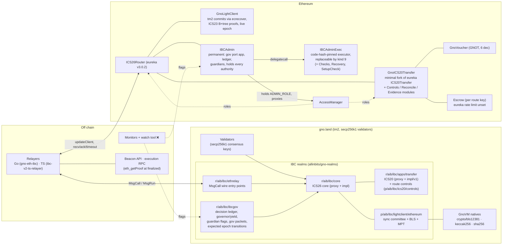

Client pairing: the gno.land Ethereum client `ethereum-N` ↔ the router client `client-M` (a `GnoLightClient`). Each
side registers the other as counterparty with its merkle prefix:

- **On Ethereum**, the gno client's prefix is `["main", "/pv/vm:gno.land/r/aib/ibc/core:"]`.
- **On gno.land**, the Ethereum client's prefix is `[""]`: router commitments live directly in its storage
  mapping.

## 4. Components, status and required changes

Repositories and branches:

| Short name | Location |
|---|---|
| **gno** | this branch, `feat/secp256k1-validators-ibc` (fork remote clockworkgr/gno) |
| **gno-realms** | [allinbits/gno-realms `feat/ethereum-light-client`](https://github.com/allinbits/gno-realms/tree/feat/ethereum-light-client) (protocol path); [`feat/ibc-controls`](https://github.com/allinbits/gno-realms/tree/feat/ibc-controls) (the controls, 1353ab5; ADR 0004) |
| **ts-relayer** | [allinbits/ibc-v2-ts-relayer PR #40](https://github.com/allinbits/ibc-v2-ts-relayer/pull/40) (`feat/ethereum-clients`) |
| **gno-eth-ibc** | [allinbits/gno-eth-ibc](https://github.com/allinbits/gno-eth-ibc) (`main`): the Solidity contracts, deployment scripts, Go relayer, testnet and e2e scripts; the controls on `feat/ibc-controls` (`docs/controls.md`). |
| **bridges** | [gnolang/bridges](https://github.com/gnolang/bridges): `main` (Solana, live) and [`ethereum-draft`](https://github.com/gnolang/bridges/tree/ethereum-draft) |
| **eureka** | [cosmos/solidity-ibc-eureka `solidity-v3.0.2`](https://github.com/cosmos/solidity-ibc-eureka/tree/solidity-v3.0.2) |

### 4.1 Chain (tm2, gno.land node)

| # | Component | Status | Where | Changes needed |
|---|---|---|---|---|
| C1 | secp256k1 validator consensus keys: params accept both key types; `gnoland secrets init -validator-key-type`; new keys default to secp256k1 | ✅ | gno: [`tm2/pkg/bft/types/params.go`](../../tm2/pkg/bft/types/params.go), [`tm2/pkg/bft/privval/signer/local/key.go`](../../tm2/pkg/bft/privval/signer/local/key.go), [`gno.land/cmd/gnoland/secrets_init.go`](../../gno.land/cmd/gnoland/secrets_init.go); ADR [`pr6375_secp256k1_validator_keys`](../../tm2/adr/pr6375_secp256k1_validator_keys.md); test `TestReactorBasicSecp256k1` | Upstream PR. It reverses [`pr5949_remove_secp256k1_validators`](../../tm2/adr/pr5949_remove_secp256k1_validators.md), so the PR must answer that ADR's reasons. Signatures are 64-byte `r‖s` over `sha256(signBytes)`, low-S. |
| C2 | **Migration of gnoland-1's validators to secp256k1** | ❌ | — | A chain-upgrade plan: set `Validator.PubKeyTypeURLs` to allow both types, have each validator rotate its consensus key (valset change through GovDAO), then optionally restrict to secp256k1. Coordinate with operators. While the set is mixed, `GnoLightClient` refuses ed25519 signers (C1 is secp256k1-only on the Ethereum side). |
| C3 | Colons in realm param names (IBC keys contain `:`) | ✅ | gno: [`gnovm/stdlibs/chain/params/params.go`](../../gnovm/stdlibs/chain/params/params.go), [`gno.land/pkg/sdk/vm/params_deposit.go`](../../gno.land/pkg/sdk/vm/params_deposit.go); ADR [`pr6358_param_key_colons`](../../gnovm/adr/pr6358_param_key_colons.md); upstream as [gnolang/gno#6358](https://github.com/gnolang/gno/pull/6358) | Needs a maintainer review. |
| C4 | `vm/qrender` ignores the requested height | ❌ (nice to have) | — | Relayers and monitors cannot read render history at a height. Not blocking: proofs use `.store` queries. |
| C5 | Lossless `block_results` (non-UTF-8 event bytes become U+FFFD in JSON) | n/a | — | Not needed for IBC: we prove state (ICS23), not results leaves. Relevant only if results-leaf proofs are ever used (the Hyperlane design depends on them). |

### 4.2 GnoVM natives

| # | Component | Status | Where | Changes needed |
|---|---|---|---|---|
| N1 | `crypto/bls12381.FastAggregateVerify(pubkeys, msg, sig)` | ✅ | gno: [`gnovm/stdlibs/crypto/bls12381/`](../../gnovm/stdlibs/crypto/bls12381/), gas row in [`native_gas.go`](../../gnovm/stdlibs/native_gas.go) (Base 2,024,000; Slope 1,962,000 per 1,024 bytes of keys, ≈92k per 48-byte key); ADR [`pr6375_bls12381_native`](../../gnovm/adr/pr6375_bls12381_native.md) | Gas rows are drafts: calibrate against the gas benchmark harness before upstreaming. Builds on the idea of [gnolang/gno#5583](https://github.com/gnolang/gno/pull/5583). Needs an audit (subgroup checks, infinity handling). |
| N2 | `crypto/bls12381.FastAggregateVerifyExcluding(aggregate, excluded, msg, sig)`: verify against a committee's aggregate key minus non-signers | ✅ | gno: same package (gas Base 2,116,000; same slope per 1,024 bytes of excluded keys) | Same as N1. This lets updates carry only non-signers, which cut update gas from about 260M to 40M. |
| N3 | `crypto/keccak256`, `crypto/sha256` | ✅ (master) | gno: [`gnovm/stdlibs/crypto/`](../../gnovm/stdlibs/crypto/) | None. |

### 4.3 gno.land realms and packages (gno-realms)

| # | Component | Status | Where | Changes needed |
|---|---|---|---|---|
| R1 | IBC v2 core (ICS26) behind an upgradeable proxy | ✅ (pre-existing) | [`r/aib/ibc/core`](https://github.com/allinbits/gno-realms/blob/feat/ethereum-light-client/gno.land/r/aib/ibc/core) | Scope route controls per client (§7). The relayer allow-list gates `UpdateClient`, `RecvPacket`, `Acknowledgement` and `Timeout` in the core **proxy** ([`core.gno`](https://github.com/allinbits/gno-realms/blob/feat/ethereum-light-client/gno.land/r/aib/ibc/core/core.gno), [`client.gno`](https://github.com/allinbits/gno-realms/blob/feat/ethereum-light-client/gno.land/r/aib/ibc/core/client.gno)), which is frozen once deployed, so the public-relaying decision of R17 must be made before deployment. `core.Pause` blocks refunds and is reserved for a core bug. **Built (ADR 0004):** relaying for an Ethereum client (`UpdateClient`, `RecvPacket`, `Acknowledgement`, `Timeout`) is open to anyone, other clients keep the allow-list; `CreateClient` needs a listed relayer while the list names any, and `RegisterCounterparty` (write-once) the signer that created the client. The proxy gains identifying receipts (R19), retirement of a client (`RetireClient`) or of one port of it (`RetireClientPort`), a per-client **trust generation** bumped by every recovery, freeze, upgrade, migration and verifier substitution (`ClientTrustGeneration`), its own copies of counterparty prefixes and of packets awaiting asynchronous acks, and value-only read accessors. Proofs, client and consensus states and client messages are type-checked to the core's own concrete types before any method runs, so none runs caller-supplied code. Two interfaces are handled otherwise: `RegisterApp` takes an application interface (a registration under the trusted namespace activates at once, any other waits for a governed approval) whose callbacks run as crossing calls in the app's own realm; and an implementation's constructor runs only in an authorized installation, or in the governed preflight against an empty, write-refusing store. |
| R2 | Client-specific proofs through the frozen messages' `Ext` field (`extproof.Proof{Data any}` + `Verifier`) | ✅ | [`p/aib/ibc/lightclient/extproof/v0`](https://github.com/allinbits/gno-realms/tree/feat/ethereum-light-client/gno.land/p/aib/ibc/lightclient/extproof/v0); core impl routing (commit `a5d7f0b`) | None. |
| R3 | **Ethereum light client**: Altair sync protocol across Electra, Fulu and Gloas; summaries instead of keys; non-signer updates; next-committee-only updates; MPT/RLP/SSZ; wire decoders | ✅ | [`p/aib/ibc/lightclient/ethereum/v0`](https://github.com/allinbits/gno-realms/tree/feat/ethereum-light-client/gno.land/p/aib/ibc/lightclient/ethereum/v0) (`ethereum.gno`, `ssz.gno`, `mpt.gno`, `rlp.gno`, `wire.gno`, `types.gno`); ADR [0003](https://github.com/allinbits/gno-realms/blob/feat/ethereum-light-client/docs/adrs/0003-ethereum-light-client.md); live Sepolia replay test | Fixed in review: updates build on the latest trusted state only ([`d56b992`](https://github.com/allinbits/gno-realms/commit/d56b992)); the client expires 8 sync committee periods after its latest trusted slot, misbehaviour requires conflicting finality, and misbehaviour too must build on the latest trusted state ([`cba712f`](https://github.com/allinbits/gno-realms/commit/cba712f)); evidence needs the same 2/3 supermajority as an update, and expiry counts an exact slot window ([`b7e8454`](https://github.com/allinbits/gno-realms/commit/b7e8454)); every byte slice the client keeps is a deep copy, so a caller realm cannot change trusted state after an update ([`461ba6b`](https://github.com/allinbits/gno-realms/commit/461ba6b)); SSZ field sizes and Merkle branch nodes are checked before hashing ([`3ad782f`](https://github.com/allinbits/gno-realms/commit/3ad782f)); a finality update that crosses into the next period carries no next sync committee, and both relayers submit one at every rotation, so the client now accepts it as the sync protocol's `apply_light_client_update` does, rotating its committees and leaving the next one unknown until a later update reveals it (before, every rotation stopped the client; [`1e0c7c5`](https://github.com/allinbits/gno-realms/commit/1e0c7c5)). Still to do: consensus-state pruning (each update stores about 6 KB, never refunded), the fork-specific conversion code of each future fork (the migration framework itself is built, R16), an audit. |
| R4 | `r/aib/ibc/ethrelay`: MsgCall entry points taking wire-encoded `[]byte` (`UpdateClient`, `SubmitMisbehaviour`, `RecvPacket`, `Acknowledgement`, `Timeout`), avoiding MsgRun's per-byte cost | ✅ | [`r/aib/ibc/ethrelay`](https://github.com/allinbits/gno-realms/tree/feat/ethereum-light-client/gno.land/r/aib/ibc/ethrelay) | Optional: `CreateClient`/`RegisterCounterparty` from wire bytes (today a MsgRun). |
| R5 | Wire format `p/aib/encoding/wire/v0` (originally `p/clockwork/wire/v0` from [clockworkgr/gno-upgradeable](https://github.com/clockworkgr/gno-upgradeable)) | ✅ | [`p/aib/encoding/wire/v0`](https://github.com/allinbits/gno-realms/tree/feat/ethereum-light-client/gno.land/p/aib/encoding/wire/v0) (commit `e0b12e6`) | Deploy with the realms. |
| R6 | ICS20 ABI payloads (`application/x-solidity-abi`) to and from `ethereum-*` clients | ✅ | [`p/aib/ibc/ics20/abi/v0`](https://github.com/allinbits/gno-realms/tree/feat/ethereum-light-client/gno.land/p/aib/ibc/ics20/abi/v0); transfer impl (commit `1b53279`) | None. |
| R7 | Core renders of Ethereum client and consensus states (read by the TS relayer) | ✅ | core `impl/v0/render.gno` (commits `a863e19`, `39fc86b`) | None. |
| R8 | **Outflow meters + claim queue** for Ethereum → gno credits (§7.1) | ✅ (ADR 0004: `p/aib/ibc/ics20/controls/v0`, transfer `impl/v1`, proxy entry points `Claim`, `ClaimRefunds`) | bridges: [`solana/realm/p/hlroute/v0/hlroute.gno`](https://github.com/gnolang/bridges/blob/ethereum-draft/solana/realm/p/hlroute/v0/hlroute.gno) (`Meter`, `Credit`, `Claim`, `Cap`), [`ethereum/realm/hlgnot/installments.gno`](https://github.com/gnolang/bridges/blob/ethereum-draft/ethereum/realm/hlgnot/installments.gno) | Port the meter/claim/void algorithms (not the 2,500-line package, which is tied to one route's lock) into a new transfer impl, keyed by (client, denom). Two accountings: **unescrow of gno-native assets** is capped by their escrow (the lock); **minting of vouchers for Ethereum assets** has no lock and needs its own cap and backing accounting ([`impl/v0/app.gno`](https://github.com/allinbits/gno-realms/blob/feat/ethereum-light-client/gno.land/r/aib/ibc/apps/transfer/impl/v0/app.gno) mints them). `Claim(n)` must be reachable: the transfer proxy's `Logic` interface is frozen ([`apps/transfer/upgrade.gno`](https://github.com/allinbits/gno-realms/blob/feat/ethereum-light-client/gno.land/r/aib/ibc/apps/transfer/upgrade.gno)), so a new proxy entry point (or a generic dispatch method) is required — a proxy change, not only an impl. **Built:** the deployment is fresh, so the transfer proxy's first implementation is `impl/v1` (Tendermint clients served by `impl/v0`'s logic, every Ethereum client under the controls) and there is no migration from `impl/v0`; the controls' state is one `controls.Registry` in the proxy's extension store, surviving implementation switches; the proxy refuses an implementation without the controls once a route exists. |
| R9 | **Decision ledger** + **governor / one-way yield** (§7.5, §7.7) | ✅ (vendored as `p/aib/decisions/v0`; `ibcgov`) | bridges: [`solana/realm/p/decisions/v0/decisions.gno`](https://github.com/gnolang/bridges/blob/main/solana/realm/p/decisions/v0/decisions.gno) (about 300 lines, depends only on `avl`; deployed on gnoland-1 under the bridge operator's namespace) | Reuse by import or copy. Its 7-day `Delay` and 14-day `Deadline` are constants and `DAOPath` is `gno.land/r/gov/dao`, which suits us. Ours needs per-kind delays: on gno.land unpauses apply at once (spent under a hold), loosening waits 7 d; on Ethereum an unpause waits 24 h. |
| R10 | **Guardian flags** on gno.land (sends / credits / payouts / refunds, 4 guardian + 2 watch seats) (§7.4) | ✅ (`ibcgov/guardians.gno`) | bridges: [`ethereum/realm/hlmailbox/flags.gno`](https://github.com/gnolang/bridges/blob/ethereum-draft/ethereum/realm/hlmailbox/flags.gno), [`gov.gno`](https://github.com/gnolang/bridges/blob/ethereum-draft/ethereum/realm/hlmailbox/gov.gno) | Host them in the new governance realm (R11); the transfer impl consults them per client. |
| R11 | **Governance realm `ibcgov`**: builders, ledger, governor/yield, flags, and the **sender of governance packets** to Ethereum on a `gov` port (§7.6) | ✅ (`r/aib/ibc/ibcgov`; not upgradeable, §8.5) | pattern: bridges [`ethereum/realm/hlgov/hlgov.gno`](https://github.com/gnolang/bridges/blob/ethereum-draft/ethereum/realm/hlgov/hlgov.gno) (decision kinds, `seq`, `Redispatch`) | New realm. It registers as an IBC app on gno core (port `gov`) and sends packets in the canonical envelope of §5.4 (`version ‖ epoch ‖ seq ‖ kind ‖ params`) to `IBCAdmin`. It handles the app acks and timeouts as §5.4 specifies (re-dispatch of the same bytes). **Source authentication:** gno core's `SendPacket` accepts any caller's payload for any port and only then calls the port's `OnSendPacket` ([`core.gno`](https://github.com/allinbits/gno-realms/blob/feat/ethereum-light-client/gno.land/r/aib/ibc/core/core.gno), [`impl/v0/packet.gno`](https://github.com/allinbits/gno-realms/blob/feat/ethereum-light-client/gno.land/r/aib/ibc/core/impl/v0/packet.gno)), so `ibcgov.OnSendPacket` accepts a packet only against a one-time dispatch authorization `ibcgov` itself created for a recorded decision, binding client, epoch, `seq` and the exact payload hash; direct core sends on `gov` are refused, and every `ibcgov` callback checks that core is its caller. **Built:** as specified; `ibcgov` also receives exactly one kind of packet, the epoch notice (§7.12), and keeps the expected governance transitions. It has no proxy: its port and ledger are permanent, as `IBCAdmin`'s are, and the core and transfer proxies accept loosening governance only from its fixed path (`IBCGovPath`). |
| R12 | Send-side limits: per-message max/min, route fee with floor and ceiling, recipient filters (§7.8) | ✅ (`controls.DenomConfig`, `impl/v1/send.gno`) | bridges: `hlroute.CheckSend`, [`ethereum/realm/hlgnot/hlgnot.gno`](https://github.com/gnolang/bridges/blob/ethereum-draft/ethereum/realm/hlgnot/hlgnot.gno) `TransferRemote` (`RefusedEthRecipient`) | Transfer impl v1, per client. The same send path writes the per-packet send record that the ack and timeout callbacks complete (§7.13). |
| R13 | Voids / restores / credit-by-vote (§7.9) | ✅ (`controls/voids.gno`) | bridges: `hlroute.DraftVoid`, `Decide` | Only with the claim queue. Needs IBC terminal-state rules: claims are keyed by packet and created atomically with the receipt; a manual credit only for a packet with a receipt; never both a credit and a source refund (§7.9). |
| R14 | Existing admin surface: `p/aib/authority` (deployer + GovDAO), relayer allow-list, global and per-app pause, address blocklist, GovDAO builders, `UpdateImpl` | ✅ (no deployer member; loosening powers `ibcgov` only, ADR 0004 Authorities) | [`r/aib/ibc/core/admin.gno`](https://github.com/allinbits/gno-realms/blob/feat/ethereum-light-client/gno.land/r/aib/ibc/core/admin.gno), [`core/upgrade.gno`](https://github.com/allinbits/gno-realms/blob/feat/ethereum-light-client/gno.land/r/aib/ibc/core/upgrade.gno), [`app.gno`](https://github.com/allinbits/gno-realms/blob/feat/ethereum-light-client/gno.land/r/aib/ibc/core/app.gno), [`apps/transfer/admin.gno`](https://github.com/allinbits/gno-realms/blob/feat/ethereum-light-client/gno.land/r/aib/ibc/apps/transfer/admin.gno), [`p/aib/authority`](https://github.com/allinbits/gno-realms/blob/feat/ethereum-light-client/gno.land/p/aib/authority/v0/authority.gno) | *Before the controls (pre-controls background):* authority members (the deployer and GovDAO) acted **immediately**, including `UpdateImpl` and adding members, which would bypass every delay. Every loosening power over the Ethereum route — impl upgrades, membership, relayer list, recovery, legacy proposal callbacks — must move exclusively to `ibcgov` (R11) and the deployer must be removed; immediate authority remains only for tightening. **Built:** membership starts as GovDAO and `ibcgov`; `ibcgov` is **permanently** protected from removal on both proxies, while GovDAO is removable by the immediate removal builders, so GovDAO's direct tightening powers last only while it remains a member. `core.Pause`, `PauseApp`, `RejectApp` and `transfer.BlockAddress` stay with the authority members (GovDAO and `ibcgov`); every other administrative call is `ibcgov`'s only. Implementation code reaches the live store only through an authorized installation: each implementation registers a manifest of plain values (`RegisterImpl(cur, ctor, version, over[, keepsControls])`), the governed preflight `CheckUpdateImpl` builds the candidate against an empty store, and every realm address a proxy ever registered stays indexed as a realm of the bridge (`IsImplAddress`, one keyed lookup). Neither proxy registers an implementation at the address of a route's current fee collector. **Publishing prerequisites**, separate from the 7-day activation decision: each proxy registers only packages under its own `/impl/` namespace (the governance builders also require `/impl/v`); deploying one needs deployment authority over that namespace, and on a chain with an inert code-submission policy the package's enablement, since registration runs at enablement. |
| R15 | 18-decimal Ethereum tokens on gno (GRC20 and amounts are int64: about 9.22 tokens max) | ❌ | — | A 6-decimal wrapper on Ethereum (factory, `wrap` takes whole multiples of 10^(d−6), refunds dust, `wrapAndSend`), or accept the cap (§12). |
| R16 | **Ethereum light-client fork migration**: replacing the verifier of a live `ethereum-N` client (new fork parameters, new container indices) while keeping its client id, commitments and consensus states | ✅ (core `impl/v1`, `MigrateClient`; ADR 0004 R16) | [`p/aib/ibc/lightclient/ethereum/v0/ethereum.gno`](https://github.com/allinbits/gno-realms/blob/feat/ethereum-light-client/gno.land/p/aib/ibc/lightclient/ethereum/v0/ethereum.gno) (client upgrade/recovery refuse differing fork parameters) | A core impl change: a governed `SetLightClient`-style conversion from the old client state to a new package version, rehearsed before each relevant Ethereum fork (§6.12). A new package alone changes no stored client. **Built, two kinds:** a **fork-schedule migration** (`ethereum-fork-schedule`: the client Active, genesis fork and every fork at or before the current epoch unchanged, every changed fork activating later, epochs in order); and a **verifier replacement** (`ethereum-verifier`, `NewReplaceVerifierRequest`, 7 days), whose conversion is code of a core implementation installed beforehand by a governed upgrade and declared as plain values; it runs on a read-only view of the live verifier inside a recovered boundary, converts an Active or Expired client (a Frozen one is recovered first), and every check on its result (version, status, latest height, trusted-from slot) runs before anything is installed. The new verifier reads the retired history through a flat, persistent index of the retired stores, O(log replacements), copying none of it. Either migration advances the client's trust generation and empties its route's payout meters. A recovered Ethereum client trusts no consensus state below the slot the recovery copied (`TrustedFromSlot`). |
| R17 | **Route-scoped flags on gno** that keep returns open, and **public relaying for the Ethereum route** | ✅ (transfer `impl/v1`; core `ensureRelayerFor`) | [`core/app.gno`](https://github.com/allinbits/gno-realms/blob/feat/ethereum-light-client/gno.land/r/aib/ibc/core/app.gno) `PauseApp` pauses the whole `transfer` port (sends included, so voucher returns too); [`core/core.gno`](https://github.com/allinbits/gno-realms/blob/feat/ethereum-light-client/gno.land/r/aib/ibc/core/core.gno) and [`core/client.gno`](https://github.com/allinbits/gno-realms/blob/feat/ethereum-light-client/gno.land/r/aib/ibc/core/client.gno) apply the relayer allow-list to `UpdateClient`, `RecvPacket`, `Acknowledgement` and `Timeout` | Per-client flags in the transfer impl that stop credits/payouts and sends of gno-native tokens, never burns of returning vouchers; plus the refund meter and the guardian `refunds` hold of §7.13 (the only controls that delay refunds, never cancel them). Refunds need fresh client updates as well as the ack/timeout itself, so exempting acks and timeouts alone is not enough: make every relaying entry point for the Ethereum client permissionless (they are proof-checked), or keep the allow-list with at least two independent relayers and a documented fail-over. Decide before deploying the core proxy. **Decided and built:** every relaying entry point for an Ethereum client is permissionless on gno.land, and relaying is public in production on Ethereum (§7.3). One deliberate exception to "only the refund meter and the `refunds` hold delay refunds": **a closed route pays no refund until it reopens**, the healthy replacement client's refunds included (§7.12, §8.5). |
| R18 | **Route replacement on gno.land** (§7.12): new Ethereum client and counterparty, `ibcgov` epoch, re-pointing the transfer realm's route alias (registries keyed by route key, translated to the current client id on the wire), freezing the old client, reconciliation of in-flight packets | ✅ | ADR 0004 R18, §7.12 gno side; `controls.Registry.Replace`, ibcgov `NewReplaceRouteRequest` | Built as §7.12 specifies. The route key is the route's first client id; the old client is **marked retired** in the core rather than frozen (its verifier keeps its status), for the transfer port at once and for the `gov` port only by the governance retirement rule (§7.12). |
| R19 | **Receipts that identify the packet**: gno core stores a constant receipt value ([`core/store.gno`](https://github.com/allinbits/gno-realms/blob/feat/ethereum-light-client/gno.land/r/aib/ibc/core/store.gno)) and its ack commitment hashes only the acknowledgement ([`p/aib/ibc/types/v0/commitment.gno`](https://github.com/allinbits/gno-realms/blob/feat/ethereum-light-client/gno.land/p/aib/ibc/types/v0/commitment.gno)), so nothing provable says *which* payload was received at a sequence | ✅ | `types.CommitPacketReceipt`, core `store.gno`, `impl/v0/packet.gno` | Store a hash of the received packet as the receipt value — e.g. sha256 of its canonical encoding — as eureka already does with its own encoding (`keccak256(abi.encode(packet))`, [`utils/ICS24Host.sol`](https://github.com/cosmos/solidity-ibc-eureka/blob/solidity-v3.0.2/contracts/utils/ICS24Host.sol) `packetReceiptCommitmentBytes32`), so reconciliation (§7.12) can tell which packet occupies a sequence. A store change behind the frozen core proxy: decide before deployment. **Built:** the receipt value is `sha256(0x03 ‖ uint64be(sequence) ‖ sha256(sourceClient) ‖ CommitPacket(packet))` at the ICS24 receipt path, for every route; a different packet at a received sequence now aborts (it returned `RESPONSE_NOOP`). Ethereum's `proveOutcome` recomputes it from the same vectors. |

**Changes that reach every route.** The controls are Ethereum-only, but some core and transfer changes reach every
client, Tendermint ones included, each deliberate and tested against the base behaviour (ADR 0004, "Changes affecting
every route"): identifying receipts (R19); governance-only relayer and membership administration (R14); client
retirement and trust generations (R1); the core's own copies of counterparty prefixes, of packets awaiting
asynchronous acks and of everything a Tendermint light client trusts; canonical addresses in `VoucherSend`,
`VoucherApprove` and membership calls; voucher symbols and grc20reg keys allocated from a counter (`IBC-1`, `IBC-2`,
…) so no ground denom can take another's registry key; no caller-supplied implementation of a proof, state or
message type; the fee-collector registration bar (R14); Markdown-inert JSON renders. Identifier validation and the
SDK packet limits (262,144 bytes of payload data, a send timeout after now and at most 24 hours ahead) are unchanged; an Ethereum route's packets carry exactly one payload (gno.land `ValidateBasicRouter`, as eureka's router); an oversized receive is refused by the core before
the app runs, so it stays pending at the source until it times out. Ethereum's transfer app bounds ICS20 payloads at the same
262,144 bytes on send and receive, and error-acks an oversize receive; `IBCAdmin` instead consumes a readable
oversize governance envelope within the window and spends it (§5.4).

### 4.4 Ethereum contracts

| # | Component | Status | Where | Changes needed |
|---|---|---|---|---|
| E1 | `ICS26Router`, `Escrow`, `IBCERC20`, `AccessManager` roles | ✅ (eureka v3.0.2, unchanged) | eureka [`contracts/`](https://github.com/cosmos/solidity-ibc-eureka/blob/solidity-v3.0.2/contracts); deployed by gno-eth-ibc [`contracts/script/DeployGnoIBC.s.sol`](https://github.com/allinbits/gno-eth-ibc/blob/main/contracts/script/DeployGnoIBC.s.sol) | `ICS20Transfer` is replaced by a minimal fork (E6); AccessManager's admin moves to E8. |
| E2 | **`GnoLightClient`**: tm2 header hash (amino leaves, sha256 merkle), CanonicalVote sign bytes, secp256k1 `ecrecover` low-S, power tally > 2/3 plus trust level for non-adjacent headers, validator-set cache by hash, packed 81-byte signatures, minimal signer set, ICS23 B+tree + simple-tree membership/non-membership, misbehaviour freezing | ✅ | gno-eth-ibc [`contracts/src/GnoLightClient.sol`](https://github.com/allinbits/gno-eth-ibc/blob/main/contracts/src/GnoLightClient.sol), [`contracts/src/lib/`](https://github.com/allinbits/gno-eth-ibc/tree/main/contracts/src/lib); 88 Foundry tests (fixtures from real tm2 code) | Fixed in review: the ICS23 leaf prefix must equal the spec's exactly ([`6769925`](https://github.com/allinbits/gno-eth-ibc/commit/6769925)); before, a proof of an attacker's own param key could be relabelled as a core commitment. The Sepolia deployment of 2026-10-16 predates the fix and must be redeployed. Add the quarantine (E9). Consider supporting mixed key sets only if C2 needs it. Audit. **Built:** the live epoch, `lastTransition`, `isFrozen` and `isExpired` (E9). |
| E3 | **`GnoVoucher`**: ERC20 with gno.land's decimals (GNOT 6), mint/burn only by ICS20, registered with `setCustomERC20` before the first transfer; `RegisterGnoDenom.s.sol` for more denoms | ✅ | gno-eth-ibc [`contracts/src/GnoVoucher.sol`](https://github.com/allinbits/gno-eth-ibc/blob/main/contracts/src/GnoVoucher.sol), [`contracts/script/GnoDenoms.sol`](https://github.com/allinbits/gno-eth-ibc/blob/main/contracts/script/GnoDenoms.sol), [`contracts/script/RegisterGnoDenom.s.sol`](https://github.com/allinbits/gno-eth-ibc/blob/main/contracts/script/RegisterGnoDenom.s.sol) | Limits are **not** enforced in `mint`: ICS20 also calls `mint` to refund a returning voucher on an error ack or timeout ([ICS20Transfer.sol `_refundTokens`](https://github.com/cosmos/solidity-ibc-eureka/blob/solidity-v3.0.2/contracts/ICS20Transfer.sol)), and refunds are exempt from the **receive** limits (only §7.13's refund meter and `refunds` hold apply to them). Limits live in E6's receive path. |
| E4 | Deployment: AccessManager, router, ICS20, roles as eureka's `DeployAccessManagerWithRoles`, GnoLightClient, `addClient`, GNOT voucher; resumes a broadcast after RPC nonce lag | ✅ | gno-eth-ibc [`contracts/script/DeployGnoIBC.s.sol`](https://github.com/allinbits/gno-eth-ibc/blob/main/contracts/script/DeployGnoIBC.s.sol), [`scripts/sepolia.sh`](https://github.com/allinbits/gno-eth-ibc/blob/main/scripts/sepolia.sh) | Hand every authority to E8 at the end; add a `finishSetup`-style check list (♻️ bridges `HlAdmin.finishSetup`). **Built:** the fork is the ICS20 proxy's first implementation, its controls initialized before the hand-over (no stock ICS20Transfer, no legacy packet, no backfill). `RouterLauncher` deploys the router and registers the launch client `client-0` in one transaction, so no one can take that id between them; `finishSetup(launch)` checks the launch record against the chain (client id, verifier address and code hash, original checkpoint and fixed parameters — each skipped when its supplied hash is zero, which the deploy script supplies only when it creates the verifier, so a launch with an externally supplied verifier must check these by hand — counterparty and prefix, ugnot voucher, limits and quarantine), and `IBCAdmin` refuses every delivery, execution and recovery until it passes. The route's quarantine is armed before any receive limits exist. Production relaying is public: the script refuses a relayer allow-list unless a testing flag is set. |
| E5 | **Mint and release limits** per token: per-message max + leaky-bucket day cap (§7.2) | ✅ (`_chargeReceive`, `LeakyBucket`) | bridges: [`PausableGate.sol`](https://github.com/gnolang/bridges/blob/ethereum-draft/ethereum/bridge/contracts/src/PausableGate.sol) `_charge`/`_level` | Enforced in E6's `onRecvPacket` only, before minting or `escrow.send`, so refunds (which also mint or use `escrow.send`, [`utils/Escrow.sol`](https://github.com/cosmos/solidity-ibc-eureka/blob/solidity-v3.0.2/contracts/utils/Escrow.sol)) are exempt from these receive limits (they are governed by §7.13's refund meter and `refunds` hold instead). Eureka's own `Escrow` rate limit also applies to refunds, so it is left unset. |
| E6 | **`GnoICS20Transfer`**: a **minimal fork** of eureka's `ICS20Transfer` (deployed as the ICS20 proxy's first implementation; later versions only by kind 7, the proxy's UUPS upgrade). The callbacks are `external` and not `virtual`, and `_refundTokens` is private ([`ICS20Transfer.sol`](https://github.com/cosmos/solidity-ibc-eureka/blob/solidity-v3.0.2/contracts/ICS20Transfer.sol)), so a subclass is impossible. The fork adds, in `onRecvPacket` only: flags, quarantine, limits (E5), and **default-deny denoms** (a gno-native denom without a registered `GnoVoucher` is refused, so no stock 18-decimal `IBCERC20` can ever be created for it); in every send variant: send-side limits **for Ethereum-native tokens leaving through escrow only**, the **refund meter** per route and denom on its ack/timeout refund path (refunds beyond the bucket are queued and paid as it refills, §7.13); a per-packet **send record** written by every send variant after `sendPacket` returns the sequence, to which the ack and timeout callbacks attach the outcome (§7.13); the guardian `refunds` hold that suspends proof-based refunds on a route pending reconciliation (§7.13) — returning vouchers (burns) are never limited or paused; and never blocks acks, timeouts or refunds through ordinary pauses or limits (only §7.13's refund meter and refunds hold can delay a refund, and a closed route defers it to the reopening, §7.12). Expected refusals revert with non-empty custom errors | ✅ | gno-eth-ibc `GnoICS20Transfer` with three delegatecalled modules kept apart by EIP-170 (`GnoICS20Controls`: setters, flags, `claim`, the ack hook; `GnoICS20Reconcile`: `claimParked`, kind 12, kind 13; `GnoICS20Evidence`: `proveOutcome`, notifications), each pinned by code hash in its holder; one shared transient reentrancy lock taken by the state-changing entry points of the fork and its modules, with these exceptions: eureka's `initialize`/`initializeV2` take none, the UUPS authorization only refuses while the lock is held, and `multicall` has no enclosing lock (each inner call takes its own) | New. Keep the diff small and audited, or upstream an extensibility hook to eureka. Do not grant `PAUSER_ROLE`: eureka's pause also blocks `onAcknowledgementPacket`/`onTimeoutPacket`. Note the router turns a callback revert **with non-empty data** into an **error ack** ([`ICS26Router.sol`](https://github.com/cosmos/solidity-ibc-eureka/blob/solidity-v3.0.2/contracts/ICS26Router.sol) `recvPacket`'s try/catch): such a refused receive refunds the sender. A revert with empty data (including out-of-gas) or an empty/forbidden returned ack reverts the whole router call and rolls back the receipt, so the packet stays pending. **Built additions:** receive and send amounts are capped at 2^96 − 1 (a receive record fits one slot); outstanding escrowed sends reserve their escrow, so a redemption never releases what a send may have to refund; escrowed sends need limits (kind 4) first. |
| E7 | **Guardians, flags and holds** on Ethereum (4 guardian + 2 watch seats; hold = two guardian flags; unpause after 24 h clears only earlier flags; replacement under a hold no sooner than day 21) | ✅ (`lib/Guardians.sol`, with seat generations; vacancies refused, §8.5) | bridges: [`lib/Guardians.sol`](https://github.com/gnolang/bridges/blob/ethereum-draft/ethereum/bridge/contracts/src/lib/Guardians.sol) | Reuse nearly as is, in E6/E3 (deliveries) and E8 (decisions). |
| E8 | **`IBCAdmin`** (permanent) + **`IBCAdminExec`** (replaceable executor). `IBCAdmin` is a small immutable IBC app on port `ibcgov` (accepting only source port `gov`) (router ports can never be re-registered, [`ICS26Router._addIBCApp`](https://github.com/cosmos/solidity-ibc-eureka/blob/solidity-v3.0.2/contracts/ICS26Router.sol)) that owns the ledger state (sequence, buffer, decision hashes, cancellations, maturity times, flags, hold history, recovery proposals) and **holds every authority** (`ADMIN_ROLE`, every proxy, `migrateClient`). It accepts packets only from the router, from `ibcgov` over the paired client, and delegatecalls an executor whose code hash it pins; decision kinds with delays, deferred by flags and holds; code-hash-pinned upgrades with after-checks. A hand-over (kind 9) only moves the executor pin, atomically, on a path `IBCAdmin` records and executes itself, never through the installed executor (gno-eth-ibc af6259d); no migration call, and no state or authority moves | ✅ (`IBCAdmin`, `IBCAdminExec`; `IBCAdminNative`, an immutable helper `IBCAdmin` deploys in its constructor (after the launch check) and exposes as `native()`, holding kind 9's execution, the guardians' recovery cancellation and `clearRecoveryBlock`; `IBCAdminRecovery`, `IBCAdminChecks` and `IBCAdminSetupCheck` deployed by the executor and pinned with it; `FrozenLightClient` for retired ids) | pattern: bridges [`HlAdmin.sol`](https://github.com/gnolang/bridges/blob/ethereum-draft/ethereum/bridge/contracts/src/HlAdmin.sol), [`admin/HlAdminExec.sol`](https://github.com/gnolang/bridges/blob/ethereum-draft/ethereum/bridge/contracts/src/admin/HlAdminExec.sol) (there the executor is fixed and hand-over moves authorities to a successor) | Replace Hyperlane's `handle`/ISM plumbing with `IIBCApp` callbacks and implement the delivery protocol of §5.4 (never revert with empty data; expected refusals revert with custom errors; out-of-window packets error-ack for redispatch). Kinds remapped (§7.6). Keep each contract under EIP-170. |
| E9 | **Quarantine** after a validator-set transition | ✅ (`GnoLightClient._isLiveTransition`; durations per route, §7.10) | bridges: [`GnoLightClient.sol`](https://github.com/gnolang/bridges/blob/ethereum-draft/ethereum/bridge/contracts/src/GnoLightClient.sol) (`quarantineEnd`) | The client keeps a **live epoch**: the `(validatorsHash, nextValidatorsHash)` pair of its latest accepted header. A newly accepted update (not a no-op, not misbehaviour checking) starts a quarantine only for a **live transition**: its `nextValidatorsHash` differs from the live epoch's (a new set announced), or its `validatorsHash` is neither the live set nor the live announced next set (a set the chain never announced: the > 1/3 skip). The verification anchor the relayer chooses plays no part, so an older anchor cannot restart it. Each transition sets its own deadline once (`quarantineEnd = max(quarantineEnd, transitionTime + duration)`); later headers of the established epoch do not extend it. `_verifyHeader` is `view`: it returns the transition data and `update` applies it (`contracts/src/GnoLightClient.sol`). E6 refuses token receives until `quarantineEnd`; `IBCAdmin` ignores it. |
| E10 | 6-decimal wrapper for 18-decimal Ethereum tokens | ❌ | — | See R15. |
| E11 | **Bootstrap role cleanup**: *before the controls* the deployment granted the deployer `ID_CUSTOMIZER_ROLE` and `ERC20_CUSTOMIZER_ROLE` besides the AccessManager admin; as built it grants neither ([`contracts/script/DeployGnoIBC.s.sol`](https://github.com/allinbits/gno-eth-ibc/blob/main/contracts/script/DeployGnoIBC.s.sol)) | ✅ (the deployer never holds the customizer roles; `ADMIN_ROLE` renounced; `IBCAdminSetupCheck`) | gno-eth-ibc [`contracts/script/DeployGnoIBC.s.sol`](https://github.com/allinbits/gno-eth-ibc/blob/main/contracts/script/DeployGnoIBC.s.sol) | `finishSetup` must enumerate and revoke every bootstrap role and admin, renounce the deployer, and check the result on chain (♻️ bridges `finishSetup`'s check list). **Built, with one limit:** `finishSetup` checks `IBCAdmin`'s and the deployer's roles only, since the AccessManager cannot list a role's members, so exclusive ownership needs an external audit of its `RoleGranted` log; its function list also omits the roles of `settleRecords`, `reopenRoute`, `checkpointForReplacement` (unassigned, so `ADMIN_ROLE` by default) and `sendTransferWithSender` (`DELEGATE_SENDER_ROLE`, granted to nobody), which the audit must confirm (§8.4). |
| E12 | **Route replacement** (§7.12): retire and freeze an old client id, add a new one, open a new governance epoch (§5.4 envelope) dropping the old epoch's unexecuted state, `migrateRoute` re-pointing the route alias (constant work); the optional guardian-attested emergency path | ✅ | `IBCAdminExec._route`, `IBCAdminRecovery`, `GnoICS20Controls.migrateRoute`, the reconciliation state machine of `docs/controls.md` | New, in `IBCAdmin`/`IBCAdminExec` and the ICS20 fork (E6), whose registries and escrows are keyed by route key with a client-id alias. |

### 4.5 Relayers and tooling

| # | Component | Status | Where | Changes needed |
|---|---|---|---|---|
| T1 | Go relayer: trust, create/update clients both ways, relay gno → Eth and Eth → gno, acks, transfers, snapshots, wire/ABI vectors | ✅ | gno-eth-ibc `relayer/` (`cmd/relayer`, `relay/`, `gnoibc/`, `ethgno/`, `beacon/`, `eth/`) | Fix: `relay-gno-acks` re-sends an ack another step just delivered (stale read). Read commitments at the latest receipt's block. Add a regression test over consecutive periods (a finality update crossing a rotation, then the update revealing the next committee). |
| T2 | TypeScript relayer: Ethereum chains (source and host), gno hosting Ethereum clients, byte-equality tests against the Go encoders | ✅ (PR open) | ts-relayer [`src/clients/ethereum/`](https://github.com/allinbits/ibc-v2-ts-relayer/tree/feat/ethereum-clients/src/clients/ethereum), [`src/clients/gno/ethereum.ts`](https://github.com/allinbits/ibc-v2-ts-relayer/blob/feat/ethereum-clients/src/clients/gno/ethereum.ts); [PR #40](https://github.com/allinbits/ibc-v2-ts-relayer/pull/40) | Support the claim queue (call `Claim`), governance packets, and the guardian-aware pause. Implement conflicting-header detection for the GnoLightClient (unsupported today, `src/clients/ethereum/host.ts`) and bounded `eth_getLogs` scans instead of scanning from block 0. Fixed in review: an update revealing the next committee that already finalizes the fetched finality update's slot is no longer followed by that stale update, which the client refuses (catch-up planned by the tested `planUpdates`, [`675ad9f`](https://github.com/allinbits/ibc-v2-ts-relayer/commit/675ad9f)). |
| T3 | Local testnet (N secp256k1 validators, realms at genesis), local e2e with anvil, Sepolia scripts | ✅ | gno-eth-ibc [`testnet/`](https://github.com/allinbits/gno-eth-ibc/tree/main/testnet), [`scripts/e2e-local.sh`](https://github.com/allinbits/gno-eth-ibc/blob/main/scripts/e2e-local.sh), [`scripts/sepolia.sh`](https://github.com/allinbits/gno-eth-ibc/blob/main/scripts/sepolia.sh) | — |
| T4 | **Monitors**: supply identity, header record, foreign decisions; auto-flag on integrity breaks, alarm on liveness | ❌ (♻️) | bridges: [`ethereum/bridge/agent`](https://github.com/gnolang/bridges/tree/ethereum-draft/ethereum/bridge/agent) (monitor role) | New, IBC-specific: accounted escrow per client against voucher supply plus in-flight packets, reconstructed from packet records at causally closed heights (§7.11), not read from commitments; actual escrow balances must cover the accounted backing, and surplus only alarms. |
| T5 | **Watch tool** for guardians and GovDAO members: state, pending decisions, flags, `check` of upgrade targets (code-hash, reproducible build, append-only storage layout) | ❌ (♻️) | bridges: [`ethereum/bridge/cmd/hlwatch`](https://github.com/gnolang/bridges/tree/ethereum-draft/ethereum/bridge/cmd/hlwatch) | Port. Until it exists, the Ethereum build verification (`scripts/verify-codehashes.sh`, §7.6) is run by hand with operator-supplied pending lists, after every deployment and executed decision and for every recorded kind 5, 6, 7 or 9 and opened emergency recovery within its delay; of the bytecode build verification only non-`GnoLightClient` verifiers are checked by hand, while the other manual checks of §7.6 stay manual (the append-only storage-layout review and the repair-critical `gnoBusy()` review of kind 7 and 9 candidates, the deployment manifest) |
| T6 | Setup audit tool (reads every authority and setting back, byte-for-byte creation checks) | ❌ (♻️) | bridges: `ethereum/bridge/cmd/hleth` (`audit`) | Port. |

## 5. Protocol design

### 5.1 gno.land → Ethereum: `GnoLightClient`

- **Header.** The relayer submits the tm2 header (its amino-encoded leaves), the commit, and the signers' packed
  signatures: 81 bytes each, `validatorIndex u16 ‖ trustedIndex u16 ‖ timeSeconds u64 ‖ timeNanos u32 ‖ r ‖ s ‖ v`
  ([`contracts/src/msgs/IGnoLightClientMsgs.sol`](https://github.com/allinbits/gno-eth-ibc/blob/main/contracts/src/msgs/IGnoLightClientMsgs.sol); the recovery id `v` is found off chain). The client rebuilds the header hash with
  sha256 merkle, rebuilds each validator's CanonicalVote sign bytes, recovers each address with `ecrecover` over
  `sha256(signBytes)`, and requires low-S.
- **Trust rule.** Adjacent headers need more than 2/3 of the trusted next set's power. Non-adjacent headers need
  more than 2/3 of the header's own set **and**, when that set differs from the trusted next set, more than the
  trust level (1/3) of the trusted next set (tm2 light-client rules), within the trusting period and the clock
  drift. So the security of skipping is the standard light-client assumption: fewer than 1/3 of the trusted set's
  power is faulty within the trusting period. A coalition of more than 1/3 of the trusted set can sign a header of
  a set it fully controls; the quarantine (§7.10) is the brake for that.
- **Validator-set cache.** Sets are stored by hash. A supplied signing set is cached only when it is also the
  accepted header's next set; trusted-set inputs and misbehaviour submissions do not populate the cache, so a
  relayer checks `isValidatorSetCached` before omitting keys. Later updates then send no keys, only signer indexes.
  A set holds at most 65,535 validators (a `u16` index; `NO_TRUSTED_INDEX` is reserved).
  The relayer sends the minimal signer set: enough of the trusted power first, then of the new set.
- **Proofs.** Packet commitments, receipts and acks are proven with ICS23 against the app hash of height H+1 (the
  leaf prefix must equal the spec's `0x00` exactly: gno's specs have fixed prefixes, and a longer one would let a
  proof of one key be relabelled as another; IAVL's variable prefixes are not supported):
  - the `ics23:bptree` op proves the key in gno.land's `main` B+tree store under
    `/pv/vm:gno.land/r/aib/ibc/core:`;
  - the `ics23:simple` op proves the store in the multistore root.
- **Misbehaviour.** Submitted evidence freezes the client: two conflicting signed headers at one height, or a
  higher header whose timestamp does not exceed the lower one's. An update is also checked automatically: a valid
  update at a higher height whose timestamp does not exceed the latest state's freezes the client instead of
  advancing it.

### 5.2 Ethereum → gno.land: the Ethereum light client in Gno

- **State.**
  - Client state: chain id, genesis validators root and time, fork schedule, slot parameters, the router address,
    and the slot of the router's commitments mapping.
  - Consensus state per finalized slot: execution state root, timestamp, and the summaries of the current and
    next sync committee (SSZ pubkeys root + aggregate pubkey).
- **Update.** A light-client update carries:
  - the attested and finalized headers with the finality branch;
  - the sync aggregate bits and signature;
  - the **non-signers** with their Merkle branches to the pubkeys root;
  - on Gloas, the RLP execution header, checked against the committed block hash;
  - optionally the next committee's summary with its branch.

  The client makes two independent participation checks: at least the configured `MinSyncCommitteeParticipants`
  (the relayer configures 341) must have signed for the update to be valid, and the mandatory 2/3 supermajority
  (`participants·3 ≥ 512·2`, i.e. 342 of 512) for it to move the client; it then checks
  `FastAggregateVerifyExcluding(aggregate, nonSigners, signingRoot, sig)`.
- **Next-committee-only updates.** Updates whose finalized slot does not advance are accepted when they reveal the
  next committee (the spec's `apply_light_client_update`). This is needed because beacon nodes only serve
  bootstraps at recent checkpoints.
- **Single store.** Every update must build on the client's **latest** trusted state (`TrustedSlot == LatestSlot`),
  as the spec's store does; it either advances the latest slot or, for a next-committee-only update, updates the
  latest state in place. No update can insert a root below the latest slot, so a past committee cannot add history.
  Roots already stored stay usable for proofs.
- **Freshness (enforced).** The client follows Ethereum one sync-committee period (~27 h) at a time, so it can
  catch up after a gap. Its trust is bounded: it **expires** once the current slot (from the block time) is more
  than `TrustingPeriods = 8` periods' worth of slots (8 × 256 × 32 slots, ~9 days on mainnet) after its latest
  trusted slot — an exact slot window, wherever that slot falls in its period. An expired client reports
  `Expired` and refuses every client message, so stale committees can never advance it; it comes back only through
  governed recovery (the core's recovery with a fresh substitute) or a route replacement (§7.12). The relayer
  updates it at least daily; the monitor alarms after a day without an update.
- **Misbehaviour** is conflicting finality: two valid updates (each signed by at least 2/3 of the committee, the
  same supermajority an update needs, not only the configured minimum) that finalize **different beacon headers at the same slot**. Different attested heads alone are not
  evidence: sync committees sign their fork-choice head, and an ordinary reorg yields two. Evidence must build on
  the latest trusted state of an unexpired client, so a past committee cannot freeze it. Valid evidence freezes the
  client. A header that would store a different state root at a slot the client already holds is also treated as
  misbehaviour.
- **Fork-aware generalized indices.** Gloas: finality 735, next committee 2946, execution block hash 2856.
  Electra/Fulu: 169, 87, 25.
- **Proofs.** `eth_getProof` at the finalized block gives an account proof (router address under the state
  root) and a storage proof at `keccak256(keccak256(path) ‖ slot)`, verified with RLP/MPT in Gno. A **proof height**
  is `{revision 0, height = finalized beacon slot}`, never an execution block number (the execution block is only
  where the relayer runs `eth_getProof`); a proof at another revision, at a slot after `LatestSlot`, or at a slot
  with no trusted consensus state stored (never updated to, or before a recovery's `TrustedFromSlot`) is refused.
- **Update validity.** An update needs `signatureSlot > attestedSlot ≥ finalizedSlot`, a non-genesis finalized
  slot, and `signatureSlot` not after the current slot derived from gno.land's block time; headers before Electra
  are refused.
- **Wire.** Updates and packets reach `r/aib/ibc/ethrelay` as MsgCall `[]byte` arguments in the
  `p/aib/encoding/wire/v0` format: `Uint` 8-byte big-endian, `Uvarint` LEB128, `Str`/`Blob` length-prefixed.

### 5.3 Transfers

- **ICS20 payload.** `application/x-solidity-abi` encoded `FungibleTokenPacketData` both ways.
- **Denoms.** gno-native denoms on Ethereum are `transfer/<client>/<denom>` → `GnoVoucher` (E3). Ethereum
  tokens on gno are GRC20 vouchers of the transfer realm.
- **Acks.** The Ethereum app writes `{"result":"AQ=="}` (JSON) on success. The gno app writes the protobuf
  `Acknowledgement`; relayers decode it to the app ack before `ackPacket`. A refused receive on either chain is
  answered with the IBC v2 **universal error acknowledgement** (eureka's router, gno core), never an app-specific
  error ack; reconciliation relies on that (§5.4, Proven outcomes).
- **Amounts** are raw base units, never scaled.

### 5.4 Governance channel (new)

- A dedicated IBC app pair: `ibcgov` on gno.land (port `gov`) ⇄ `IBCAdmin` on Ethereum (port `ibcgov`: eureka's
  router refuses custom port ids shorter than 4 characters; `IBCAdmin` accepts only source port `gov`), over the
  same client pair as transfers.
- **Binding and scope.** The channel is bound once, by a 7-day gno.land decision (`NewBindGovernanceRequest`), to
  the current client of the one enrolled Ethereum transfer route: the client must be Active and that route's
  current client both when the decision is built and when it executes. Binding opens epoch 1. One channel serves
  exactly one Ethereum transfer route, ever (§7.6, Scope). Every Ethereum-bound decision is refused until the
  channel is bound. On Ethereum, `IBCAdmin` refuses every delivery, execution and recovery until `finishSetup` has
  passed (E4). **Launch invariant: Ethereum stays at epoch 1 until gno.land binds.** Ethereum enforces it by
  refusing the emergency recovery while its epoch is 1 and its last recorded sequence is 0, i.e. until `IBCAdmin` has
  recorded its first decision from gno.land (built, gno-eth-ibc 0c673ad); kind 10 needs a decision from gno.land
  anyway. If Ethereum's epoch advanced before the binding
  regardless, the launch is void and must be redeployed: gno.land's epoch 1 could never be reconciled with it.
  **Before binding, gno.land refuses any replacement of the Ethereum route**, when the request is built and when it
  executes (built, gno-realms b86f38d): a failed client is recovered in place, or the unlaunched deployment is restarted. So the
  binding is always over the route's **original** client, the pair Ethereum's epoch 1 uses (gno.land's client of the
  router and the router's launch client `client-0`), and the launch checklist verifies that pair. Until Ethereum
  records its first governance decision, no value moves on either chain, by these gates:
  - **gno.land (manual operating gate, checked before recording):** the route starts with no enabled denom. Since
    `Execute` is permissionless once a decision is due, the gate cannot wait for execution: operators check on
    Ethereum that `epoch()` is 1 and `lastSeq() ≥ 1` **before the first `NewSetDenomRequest` is recorded** — before
    the governor records it, or before GovDAO approves the proposal that records it — and its 7-day delay starts
    only then. A denom enablement recorded before the check is cancelled (`NewCancelRequest`) and recorded again
    after it (runbook §7 step 5, gno-realms 1353ab5). No code on gno.land enforces this Ethereum-state condition.
  - **Ethereum:** the deployment registers ugnot with zero limits, and the deploy script reads the installed limits
    back exactly (`finishSetup` checks only that limits exist); its output carries `activationKind4Params`, and
    governance activates the route with that kind 4 only after `IBCAdmin` has recorded gno.land's first decision
    (gno-eth-ibc 0a5f2ba). `LAUNCH_ACTIVE`, which deploys with live limits, is a test-network flag refused on chain id 1.
- **Envelope** (canonical, at most 1024 bytes — a kind 6 carrying gno.land's real merkle prefix is 558): `version u8 (= 1) ‖ epoch u32 ‖ seq u64 ‖ kind u8 ‖ params`.
  - `epoch` starts at 1 and is raised only by a route replacement (§7.12) — an executed kind 10 or emergency
    recovery on Ethereum, a notice-driven epoch switch on gno.land; `IBCAdmin` accepts packets only for its
    current epoch and only over that epoch's client. Another epoch is refused with an error ack (custom error
    `StaleEpoch`), and `ibcgov` never re-sends a packet of a past epoch.
  - `seq` is a **dedicated contiguous sequence of Ethereum-bound decisions** within the epoch, starting at 1,
    separate from the numbers of gno-only ledger entries. `ibcgov` binds a number in the same transaction that
    records and dispatches its decision, so numbers are never reserved without bytes, reused or skipped.
  - Every hash, buffer slot and tombstone is keyed by `(epoch, seq)`.
  - The app acknowledgement is `epoch u32 ‖ seq u64 ‖ status u8 ‖ redispatch u8` (14 bytes), status one of
    recorded, buffered, duplicate, conflict, spent.
  - `ibcgov` builders never produce an envelope over 1024 bytes (`14 + len(params) ≤ 1024`). `IBCAdmin` does not
    refuse a readable longer one for its size: within the window it consumes its number and is spent when
    recorded; beyond the window it is an error ack, as any non-cancel.
- **Wire encoding.** The source port is `gov` (gno.land) and the destination port `ibcgov` (Ethereum), version `ibcgov-1`, encoding
  `application/x-ibcgov`. The envelope prefix is fixed-width big-endian (`version`, `epoch`, `seq`, `kind`: 14
  bytes); `params` is the Solidity ABI encoding (`abi.encode`) of the kind's tuple below, with no outer offset, so
  `IBCAdmin` decodes it with `abi.decode` and `ibcgov` builds it with the ABI encoder the transfer app already uses.
  `IBCAdmin` decodes every kind at recording and re-encodes it: parameters that are not exactly the canonical
  encoding of the tuple (trailing data, other offsets or padding) are spent at recording. The app
  acknowledgement's `status` is 1 recorded, 2 buffered, 3 duplicate, 4 conflict, 5 spent. A `token` is the
  Ethereum ERC20 address; a `clientId` is the Ethereum router's client id, in eureka's grammar (`client-N`, or a
  custom id of up to 128 characters). A client id added by governance (kind 6 op 1, kind 10, recovery) is a custom
  id of 4 to 128 characters of eureka's alphabet not starting with `client-` or `channel-` (eureka reserves
  those). A gov packet's timeout is 6 hours. Byte-equality vectors for every kind, every ack status (a duplicate, a
  conflict, a buffered decision, a spent unknown kind, a cancel beyond the window acked `status 2, redispatch 1`)
  and the epoch notice and its two acks: gno-eth-ibc `contracts/test/fixtures/gov-vectors.json`, checked by both
  implementations (gno-realms filetests `z2b`, `z2c`, `z2e`, also against viem).

  | Kind | `params` tuple | Delay rule |
  |---|---|---|
  | 1 cancel | `(uint64 from, uint64 to)[] ranges` (inclusive). 1 to 16 ranges by the grammar; the 1024-byte envelope makes 14 the effective maximum, which `ibcgov`'s builder enforces together with a source-side check that each range lies within the numbers already dispatched in the current epoch. `IBCAdmin` itself accepts any ordered uint64 range, future numbers included (tombstoning them ahead), and normalizes a zero start to 1 | at recording |
  | 2 unpause | `(uint8 object, string clientId)`; object 1 = the transfer route of `clientId` (it clears the route's pause flags **and** its `refunds` flags set before the decision, and is spent while either flag set holds), 2 = `IBCAdmin` (`clientId` empty; it clears `IBCAdmin`'s conflict flag only when the latest conflict came strictly before the unpause was recorded) | 24 h |
  | 3 seats | `(uint8 seat, address key)[]`; seats 0–3 guardians, 4–5 watch keys; at most 2 guardian seats per decision; never a seat's current key; at execution Ethereum refuses any key that already holds **any** seat, including one being moved within the same decision (gno.land checks only the final arrangement, so a swap passes there; §8.5); **never no key** (Ethereum refuses vacancies: such a decision is spent at recording, §8.5); a replaced seat loses its recovery approval | 7 d; through a hold at ≥ day 21 |
  | 4 limits | `(string clientId, address token, uint256 maxPerMessage, uint256 dayCap, uint256 refundCap, uint256 sendMax, uint256 sendMin)`; `sendMax`/`sendMin` apply to Ethereum-native tokens only (0 = unset). Spent unless: the token is non-zero, `dayCap` and `refundCap` are at most 2^128 − 1, `sendMin ≤ sendMax` when `sendMax` is set. A zero `dayCap` or `maxPerMessage` refuses every receive, a zero `refundCap` queues every refund. A token's first limits always wait 7 days, escrowed sends of a token need them, and receive limits are refused until the route's quarantine is armed (§7.10). A limits change settles both buckets at the old caps first. An older decision maturing later never overwrites a newer setting | at recording if no field loosens, else 7 d |
  | 5 voucher | `(string clientId, string baseDenom, address voucher, bytes32 codeHash)`; `baseDenom` only in the transfer app's wire grammar, shared byte for byte with `ibcgov`'s builder: a native denom `[a-z][a-z0-9]{2,15}`, or `gno.land:r` then at least two `:`-separated gno package names, optionally `.` and a slug of 1 to 32 `[A-Za-z0-9_-]`, at most 128 bytes; a realm-issued coin (`/gno.land/r/...:denom`) is refused; a denom registers once; at execution the voucher's `ics20()` must be this transfer app, and the voucher must not already represent another denom (a matching code hash alone is not enough) | 7 d |
  | 6 client | `(uint8 op, string clientId, string counterpartyClientId, bytes[] merklePrefix, address lightClient, bytes32 codeHash)`; op 1 add (a custom id, thereby **enrolled** as a target kind 10 may move a route to), 2 migrate `clientId` to `lightClient` (quarantine checkpointed and the route's verifier generation bumped first, which voids outcomes proven through the old verifier; **not atomic**: a router refusal spends the decision without undoing them). The verifier must be usable (code with the pinned hash, not an EIP-7702 designator, gno.land's chain id, neither frozen nor expired); the counterparty only in canonical form (gno.land's exact prefix `["main", "/pv/vm:gno.land/r/aib/ibc/core:"]`, a client id of 1 to 64 `[a-z0-9-]`); a migration keeps the counterparty id; a retired id is never migrated | 7 d |
  | 7 upgrade | `(address proxy, address implementation, bytes32 codeHash, bytes call)`: the router, the transfer app or one of its two beacons; fixed call gas, after-checks (authority, bindings, every beacon the decision does not name unchanged), rolled back whole on failure. On the transfer proxy only code that keeps the controls: the candidate fork's `gnoControlsVersion()` at least the running one's; each of its three modules (controls, reconciliation, evidence) code answering **exactly** the fork's version, recording its own address as its `gnoSelf()` and with the code hash its holder recorded (so an ordinary proxy-backed module, whose `gnoSelf()` answers its implementation's address, is refused); and the proxy answering that version for all four after the upgrade. The call is empty or a selector on the executor's pinned allow-list (empty in the launch executor; only a later executor installed by kind 9 can carry a longer list), and never an upgrade-setting selector (`upgradeToAndCall`, `multicall`, `upgradeEscrowTo`, `upgradeIBCERC20To`) | 7 d |
  | 8 role | `(bool grant, uint64 roleId, address account)`; Ethereum accepts **only `RELAYER_ROLE` (1)** with a non-zero account (`ibcgov`'s builder also refuses `ADMIN_ROLE` and `PUBLIC_ROLE`). It cannot enable `sendTransferWithSender` (its `DELEGATE_SENDER_ROLE` is granted to nobody), and `sendTransferWithPermit2` exists only when the deployment configures a `PERMIT2` address (a deploy-time setting, unset by default); plain `sendTransfer` is the deployed send path | grant 7 d, revoke at recording |
  | 9 hand-over | `(address exec, bytes32 codeHash, bytes migrationCall)`, recorded and executed by `IBCAdmin` itself, **never by delegatecall into the installed executor**, so a broken executor can be replaced — given an authenticated governance channel to deliver the kind 9, or a working recovery to restore one, and an accurate transfer-app `gnoBusy()` (§8.5 R14, R15) (gno-eth-ibc af6259d, e7a299f); during an open recovery kind 9 is suspended until it closes, and the guardians' native cancellation always lifts that suspension (§7.12). Recording (in `IBCAdmin`, `handoverParams`): the params must be exactly the canonical `abi.encode` of the tuple with a non-zero `exec` and an **empty** `migrationCall` — the migration call must be empty, and a non-empty one is spent at recording (`migration`), any other non-canonical form spent (`params`); `ibcgov`'s `NewEthHandOverRequest` takes no migration parameter and always sends it empty. A hand-over only moves the pin; any migration is done afterwards by the new executor through its own decisions. Execution, after the usual pending, tombstone, suspension, deferral and maturity checks: at least 161,587 gas (checked in `IBCAdmin`) or it reverts `CallStarved` and stays pending; then `IBCAdmin` delegatecalls its immutable `IBCAdminNative` helper, which checks that `exec` holds code (an EIP-7702 designator refused) with the pinned code hash, else spent (`codehash`); a `bindings()` staticcall with 100,000 gas must answer exactly 96 bytes matching the router, the AccessManager and the transfer app, else spent (`bindings`); then the pin moves and `ExecReplaced` is emitted. The envelope, sequencing, 7-day delay, deferral, recovery suspension, kind 1 cancellation and spending on refusal are those of every kind | 7 d |
  | 10 route replacement | `(string oldClientId, string newClientId, uint64 suspectFrom)`: retire the old client id (`migrateClient` to a `FrozenLightClient`, since the router has no freeze), `migrateRoute`, open the next epoch over the new client and send its epoch notice (§7.12). The new id must be one a kind 6 enrolled (an id the router generated is refused) whose verifier is still usable immediately before the switch; the old id must be the route's current client. **All or nothing**: the quarantine checkpoint (which bumps the route's verifier generation), the migration and the epoch switch run in one frame, and a refused migration rolls all of it back, the decision spent and outcomes proven before still usable. Allowed while the route is closed: it opens a new incident and aborts a reopening under way (§7.12). `suspectFrom` is the Ethereum block from which acks and timeouts processed through the old client are suspect (§7.12): every send record processed at or after it must be settled by kind 12 before kind 13. On gno.land its dispatch also creates a pending **expected transition** whose binding to a local client is a separate 7-day decision (§7.12) | 7 d |
  | 11 route settings | `(string clientId, uint64 quarantineSeconds)`, at most 365 days, per route; a duration applies to transitions accepted after it; one already started keeps its deadline; an older decision maturing later never overwrites a newer setting | lengthening at recording, shortening 7 d |
  | 12 settle | `(string clientId, (uint64 sequence, uint8 action, uint256 amount)[] items)`: §7.12's reconciliation outcomes for the send records of a client a replacement retired; at most 8 items (more is spent at recording), all or nothing, a fixed 6M gas budget. Action 1 genuine refund: pay its remainder — `amount` must equal the entitlement minus what was already refunded, **zero** for a genuine refund already paid in full, which then only marks the record settled and moves no funds (a refund is never cut short, §7.9); a refund the free escrow cannot pay now is **parked**, owed and reserved, never failing the batch (§7.12). 2 reject an owed refund of a delivered packet, queued **or parked** (refused if any of it was paid: use 4). 3 settled as delivered (refused if any refund was paid: use 4). 4 forged refund: the record's transport outcome an error ack or timeout, its proven outcome delivered; reject the unpaid remainder **and** record what was already paid as a loss, atomically (`amount` must equal what was paid). Ethereum's receiver also accepts action 4 with zero and ignores `amount` for actions 2–3, but `ibcgov`'s `NewEthSettleRequest` (like gno.land's own settlement) refuses zero for action 4 and requires zero for actions 2–3, so end to end an entirely unpaid refund of a delivered packet is settled by action 2. 5 forged receive: `sequence` is an **inbound** sequence on the retired client whose receive released or minted `amount` (recorded per receive), booked as a loss once; it needs no destination-outcome proof, so it runs even while the replacement verifier is frozen or expired. Each send record is settled at most once. Actions 1–4 require the record's **proven outcome** (below) to match: 1 refundable (proven non-receipt or error ack, or a collision), 2–3 delivered (proven success ack and matching receipt), 4 delivered. Two passes: the first validates and settles every item and restores every action 1 refund's reservation, the second pays them against the batch's complete reservations, so the item order never matters. A kind 12 with an action 1 item of non-zero amount is **deferred** (stays pending) while the route's `refunds` hold stands; one paying nothing is not held. While any incident of the route is unprepared (§7.12) kind 12 pays no refund: the refunds stay parked | 7 d |
  | 13 reopen | `(string clientId)`, which must be the route's **current** client (a retired alias is refused and the decision spent): reopen a route closed by kind 10, the emergency recovery or a late loss. Refused while any **retired** client of an unresolved replacement incident still has an open send record (outstanding commitment, or a queued, parked or unpaid refund, not settled by kind 12) or an unsettled record whose ack or timeout was processed at or after its replacement's `suspectFrom`; the live client's records never count. Every recorded loss becomes an **accepted deficit** (Ethereum has no recapitalization decision, §8.5): 16 tokens in the decision, the rest in bounded batches by a permissionless `continueReopen`; the route stays closed until the last batch, which checks the preconditions again and aborts the reopening if a record opened meanwhile. While a route reopens, no kind 12 runs on a client whose incident is reopening and no loss is booked on the route | 7 d |

  **Proven outcomes.** Before kind 12 (or gno.land's settlement) settles a record, anyone submits the destination's
  state for it through the route's **current** (replacement) client — a permissionless `proveOutcome` taking the
  packet (authenticated against the record's commitment), a proof height, and the destination's receipt and
  acknowledgement membership proofs, or a receipt non-membership proof. The source recomputes the destination's
  receipt in that chain's encoding (R19 on gno.land, `keccak256(abi.encode(packet))` on Ethereum), compares it, and
  stores the verified outcome (delivered, refundable, collision) on the record, with the verifier that proved it and
  that verifier's generation (gno.land: the client's trust generation; Ethereum: the route's verifier generation,
  bumped before every verifier swap and replacement). Governance chooses the action; the proof decides whether it
  may apply. Neither the verifier address nor the generation can detect a trust reset **inside** an unchanged
  verifier, so **verifier admission requires irreversible freezing**: an admitted verifier must freeze
  irreversibly and offer no in-place trust reset, as `GnoLightClient` does (Ethereum: kind 6, kind 10 targets and
  recovery candidates); on gno.land a verifier may change what it trusts only through the core's governed paths
  (recovery, migration, verifier substitution), each of which advances the trust generation. This is a mandatory
  admission check and a trust assumption (§8.1).
  - Only **final** states count: a receipt non-membership proof shows "refundable" only at a proof height whose
    destination timestamp is at or past the packet's timeout (the destination can then never receive it — IBC's
    own timeout rule); a written acknowledgement and a receipt are final once proven; an unwritten acknowledgement
    proves nothing.
  - **Which acknowledgements prove what.** On gno.land, with a matching receipt, the acknowledgement commitment must
    be exactly eureka's canonical success (one app acknowledgement `{"result":"AQ=="}`), proving delivered, or the
    universal error acknowledgement, proving refundable; any other commitment is refused, which is narrower than
    ordinary ack processing (an honest eureka ICS20 writes exactly these two; §8.4). On Ethereum, the universal
    error acknowledgement proves refundable and any other written acknowledgement delivered, as gno.land's transfer
    app answers every refusal with the universal error ack.
  - The verifier must be active (not frozen, expired or retired) when the outcome is submitted **and** when the
    settlement consumes it, at the same generation: an outcome whose verifier has since frozen, expired, or been
    recovered, upgraded, migrated, substituted or re-pointed (Ethereum: even back to the same client) is void and
    must be proven again through a healthy client. Ethereum's `voidOutcome` clears such an outcome so it can be
    proven again; on gno.land the generation check makes it void in place.
  - **A proof never releases a reservation**, not even one of delivery, since a proof can go void and be proven
    otherwise; only the settlement applying an outcome still valid at execution releases it (§7.12). A proof of a
    refund owed on a send whose forged success released its backing reserves that refund again at once.
  - **Settlement freezes a record's evidence**, on both chains: Ethereum's `proveOutcome` and `voidOutcome` refuse a
    settled record (gno-eth-ibc d9e0ef1); gno.land's `ProveOutcome` refuses it, the replacement's preparation skips
    it, and a late ack or timeout on it moves nothing (gno-realms 39e5ecf). So no later proof can recreate a hold,
    change a reservation, or replace the proven ack.
  - An implementation that cannot keep these records (e.g. the transfer realm's pre-controls version) may never be
    reinstalled over a route that has them; both chains enforce it (the gno transfer proxy's `keepsControls`,
    kind 7's controls-version probe).

  A decision that fails to decode, names an unknown kind or fails its checks at recording or at execution is
  **spent**, never retried. On Ethereum a pending decision has **no execution expiry**: it stays executable until
  it is cancelled, spent, or abandoned by an epoch switch (§7.5).
- Router semantics this relies on: a callback revert with non-empty data becomes an error ack and the receipt
  stays; a revert with empty data (or out-of-gas) rolls the whole receive back. So `IBCAdmin` never reverts with
  empty data — with one exception, which is not a refusal of the packet: a delivery made from inside a
  transfer-app entry point (a token, permit2 or sender hook relaying while relaying is public) reverts with no data,
  so the router writes nothing and the packet is relayed again later. Every refusal is the universal error ack (the
  custom error appears only in the router's event): wrong port, version, encoding or client, an undecodable
  envelope, another epoch (`StaleEpoch`), beyond the window (`BeyondWindow`), a decision starved of gas
  (`ExecutionStarved`; recording, refusable calls and self-steps run with fixed budgets and floors, so nobody spends
  a decision by starving it). `IBCAdmin` **orders recording, not delivery**:
  - `seq == last+1`: recorded; then buffered `last+2…` are recorded in order, at most `D = 8` per call; the
    rest by a permissionless `drain()`.
  - `last+1 < seq ≤ last+W` (window `W = 64`): stored with its hash, success ack (`buffered`). A second packet for a
    buffered `seq` with the same hash is a duplicate; with a different hash it is a conflict: flags `IBCAdmin`
    (refreshing the conflict flag's block on every conflict), keeps the first, is never applied.
  - `seq > last+W`: error ack (custom error). `ibcgov` treats an error ack of a governance packet as "redispatch
    later": it re-sends the **same `seq` with identical bytes** once the window has moved (backpressure).
  - `seq ≤ last`: compared with the stored hash of that number; same hash → `duplicate` (status 3, `redispatch =
    0`), changing nothing; different → conflict as above.
  - Undecodable envelope (no readable `seq`): error ack; `ibcgov`'s builders never produce one, so it can only come
    from a forgery. A decodable decision with unknown kind or bad parameters is recorded and **spent**, so it never
    blocks the sequence.
  - **Cancellations** are an exception to the window: a cancel decision is never refused. On arrival, whatever its
    `seq`, its ranges are tombstoned as given, merged with every stored range they touch (at most 64 stored ranges
    per epoch; past that a new range merges with the nearest stored one, cancelling the numbers in the gap too, as
    `HlAdmin`), and it gets a **success** ack. If its own `seq` is inside the window it is also recorded or buffered
    as usual; if it is beyond the window, it is bound to its hash and acked `buffered` with `redispatch = 1`, and
    `ibcgov` re-sends the same `seq` with identical bytes later so the cancel takes its place in the sequence (its
    tombstones already applied; re-applying them is a no-op). A malformed cancel beyond the window is an error ack.
    `execute` of a tombstoned pending decision cancels it.
  - Only the router may call, only from `ibcgov`'s port over the paired client; anything else is an error ack.
  - **Source side.** Anyone can call gno core's `SendPacket` with any payload for port `gov`; core then calls
    `ibcgov.OnSendPacket`. `ibcgov` therefore refuses every send that does not match a one-time dispatch
    authorization it created itself in the same call — bound to the client, `epoch`, `seq` and the exact payload
    hash — and consumes it; its callbacks accept core as the only caller (R11).
- **Re-sending (retransmission).** `ibcgov` reads an error ack, a timeout, a malformed ack or `redispatch = 1`
  (whatever the status) as a request to re-send; statuses 1–5 are recorded per dispatch. Beyond that, **anyone may
  re-send any dispatch of the current epoch** (`Redispatch(e, seq)`) in a fresh transport packet with its identical
  bytes whenever none of its packets is in flight, **after any answer, a success included**: a compromised
  Ethereum-side verifier can forge a success ack for a decision that never reached `IBCAdmin`, leaving a gap later
  numbers wait behind. `IBCAdmin` deduplicates by number and hash, so a re-send changes nothing where the decision
  is held, and a duplicate answering a decision already acknowledged otherwise leaves its recorded status on
  gno.land as it was. **The one exception is a conflict** acknowledged without `redispatch = 1`: `IBCAdmin`
  re-flags itself on every conflict, so a free re-send would let anyone keep its 7-day decisions deferred. Since a
  compromised verifier can forge a conflict too, governance authorizes one re-send of such a dispatch by an
  immediate decision, `NewRetransmitRequest(e, seq)` (current epoch only), after checking on Ethereum that the
  conflict was fabricated (`IBCAdmin.decision(e, seq)` holds no decision or these very bytes, and no `Conflict(e,
  seq, …)` event was emitted); the next `Redispatch` uses it up. It is no loosening: the bytes are immutable and
  deduplicated. A real conflict is never re-sent.
- `ibcgov` never skips or reuses a number, so the destination never has a permanent gap. **A number's bytes are
  immutable once bound**: a dispatched decision is withdrawn only by a separate cancel decision (its own number),
  never by re-sending its number with other bytes. Since a number is bound in the transaction that dispatches it,
  no reserved-but-unbound number exists and no no-op send is needed.
- **Epoch notices** travel the other way, from `IBCAdmin`'s port `ibcgov` to `ibcgov`'s port `gov`, version
  `ibcgov-1`, encoding `application/x-ibcgov`: `version u8 (1) ‖ epoch u32 ‖ clientId` (big-endian; the client id
  the raw trailing bytes, equal to the packet's source client, the epoch's new router client), timeout 23 hours.
  gno.land answers in the governance ack layout with `seq = 0` and `redispatch = 0`: status 1 when the notice
  switches the epoch, 3 for a notice of the epoch already switched to; anything else is the universal error ack.
  Only status 1 or 3 with `seq 0` and `redispatch 0` marks a notice acknowledged on Ethereum (`epochNoticeAcked`);
  an ack of an epoch already acknowledged is ignored and nothing clears the mark. Vector: epoch 2 over `gnoland-2`
  is `0x0100000002676e6f6c616e642d32`, switched ack `0x0000000200000000000000000100`, duplicate ack
  `0x0000000200000000000000000300`. Their resend and acceptance rules are in §7.12.
- Forged governance packets (a light-client forgery) can occupy sequence numbers with the attacker's bytes; honest
  re-sends then show up as conflicts and flag `IBCAdmin`. That case is handled by the guardians' hold and the route
  replacement of §7.12, which starts a new governance epoch over a new client, not by GovDAO cancelling over the
  same channel.

## 6. Flows

### 6.1 GNOT gno.land → Ethereum

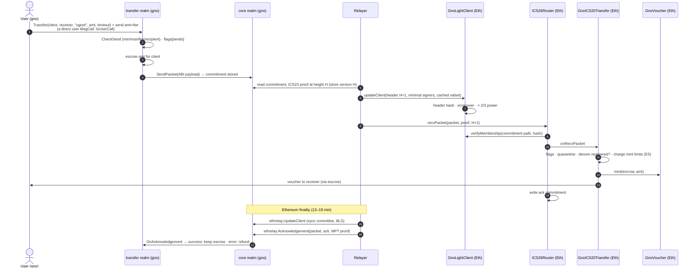

### 6.2 Ethereum → gno.land (voucher returning, or an Ethereum token)

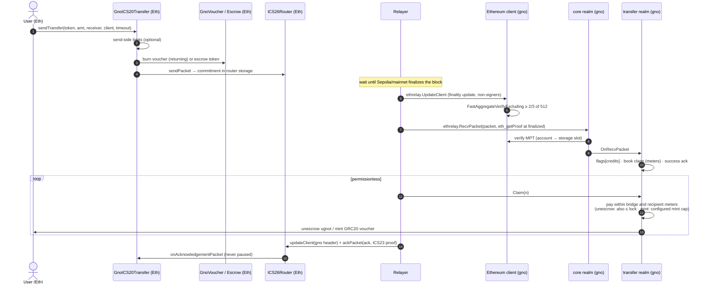

### 6.3 Timeouts and error acks (refunds)

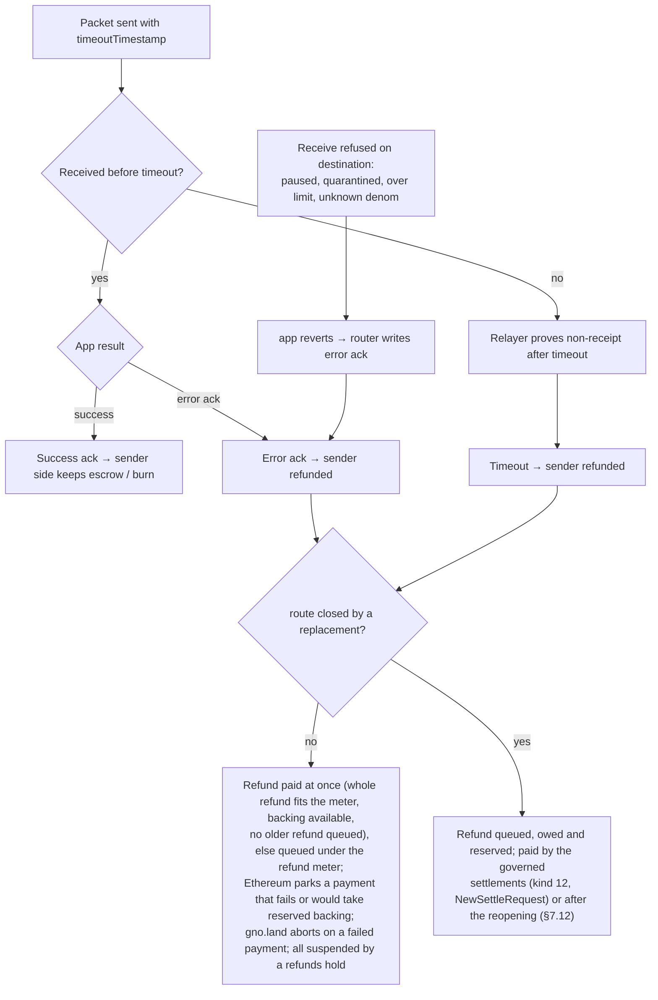

### 6.4 `GnoLightClient` update

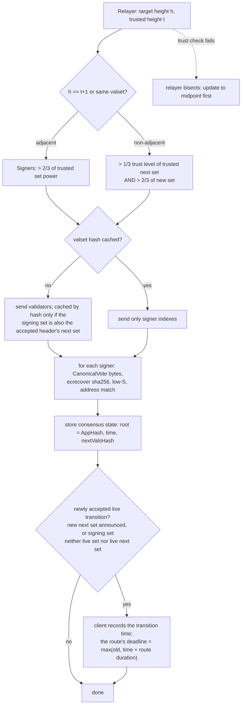

### 6.5 Ethereum light-client update on gno.land

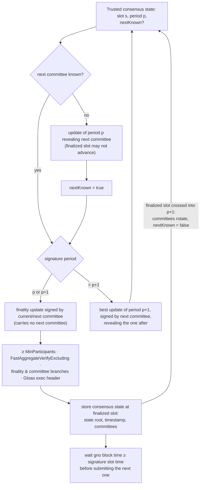

### 6.6 Governance decision lifecycle (new)

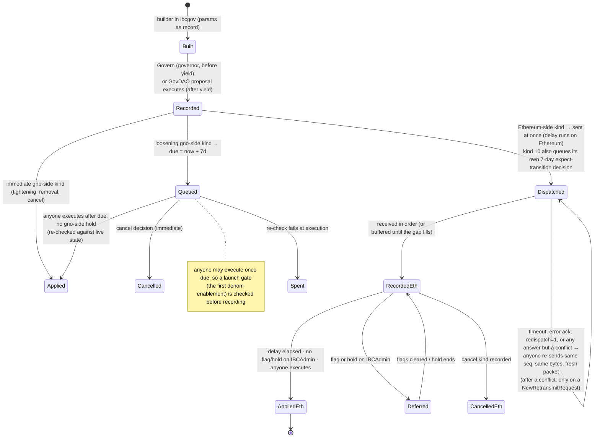

The delay is applied once per side:

- **gno-side kinds** (meters, fees, gno guardians) wait on gno.land.
- **Ethereum kinds** are dispatched at once from gno.land and wait in `IBCAdmin` after they are recorded (7 days;
  unpause 24 h). Guardians on either side have the full window. Every 7-day Ethereum kind is deferred while a flag
  or hold stands on `IBCAdmin`, **except** the guardian replacement, which lands through holds from day 21 after
  the first hold standing at or after its due time (a deadline later holds cannot reset, §7.4). Holds on gno.land (deferring gno-side decisions) are built in `ibcgov` (bridges' realms have
  none). A gno-side hold defers every queued gno-side decision (a seat change too, until its day-21 deadline,
  §7.4) but never an Ethereum-bound one, whose delay and deferral run on Ethereum. A gno-side `payouts` or
  `sends` flag defers nothing: only a hold does, except that a sweep payment waits under a `payouts` flag and a
  refund-paying settlement under a `refunds` hold.
- **No execution expiry on Ethereum.** A recorded Ethereum decision stays executable until it is cancelled, spent,
  or abandoned by an epoch switch; the 14-day deadline applies to gno.land proposals before anything is recorded.

### 6.7 Guardian flags and holds

```mermaid
stateDiagram-v2
  [*] --> Open
  Open --> Paused: any 1 of 6 seats flags
  Paused --> Open: flag owner clears, or unpause decision (Eth: 24h, clears flags set before it)
  Paused --> Hold: 2 guardian seats flagged together
  Hold --> Paused: < 2 guardian flags for ≥ 24h
  Hold --> Hold: unpause decisions are spent<br/>7-day kinds deferred (gno.land: any hold;<br/>Ethereum: only IBCAdmin's flags or hold)
  Hold --> Paused: guardian replacement lands<br/>(day 21 of the first hold standing at or after its due time,<br/>a deadline later holds cannot reset; ≥ 7d after recording)
```

What a flag stops: deliveries/mints and escrowed sends (Ethereum, per route), `credits`/`payouts`/`sends`
(gno.land, per route). What it never stops: burns, sends of vouchers back, acks and timeouts. Refunds run under
ordinary flags; only the dedicated `refunds` hold (§7.13) delays them, until reconciliation, and a closed route
defers them to its reopening (§7.12; a deliberate exception, §8.5). The hold is per side and global on gno.land
(two guardian seats flagging anything); on Ethereum, holds are per flag set (each route's pause flags, its
`refunds` flags, `IBCAdmin`'s flags). On Ethereum a seat cannot be vacated (§8.5).

### 6.8 Meters and claims on gno.land

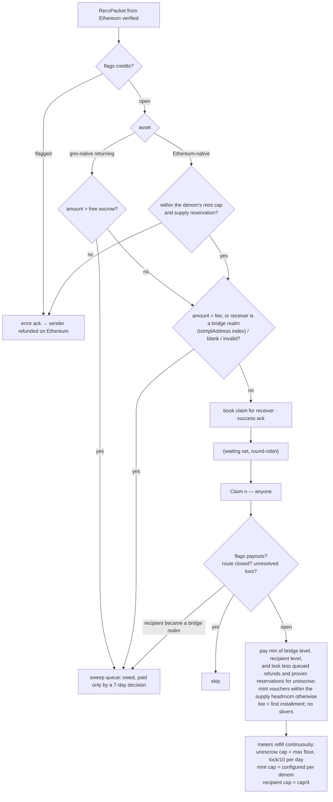

### 6.9 Validator-set change and quarantine

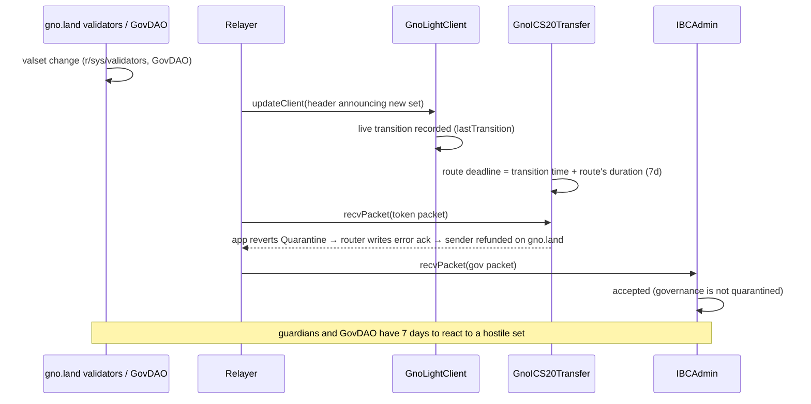

### 6.10 Launch and yield

```mermaid
sequenceDiagram
  participant G as Governor key
  participant GNO as gno.land realms
  participant D as Deployer
  participant E as Ethereum contracts
  participant M as GovDAO members
  D->>GNO: deploy realms (the real governor key compiled in, replacing the shipped placeholder, or none; transfer impl/v1 first)
  D->>E: deploy (AccessManager, RouterLauncher: router + launch client client-0 in one tx,<br/>GnoICS20Transfer + modules, ugnot voucher, IBCAdmin)
  D->>E: quarantine armed, then limits; hand ADMIN_ROLE + proxies to IBCAdmin, renounce
  D->>E: finishSetup(launch): check list + the launch record against the chain
  G->>GNO: create Ethereum client (checkpoint authenticated independently), register counterparty
  G->>GNO: decisions (7 d each): enroll the route, seat guardians, bind governance over the route's original client, set denoms
  Note over G,E: no route replacement before binding (recover in place, or restart the deployment);<br/>checklist: the bound pair is Ethereum's epoch-1 pair; first gno denom enablement recorded only after<br/>Ethereum shows epoch 1 and lastSeq ≥ 1 (anyone executes it once due); ugnot deployed with zero limits,<br/>activated by the kind 4 in activationKind4Params only after IBCAdmin records gno's first decision
  M->>E: audit tool reads every authority back (RoleGranted log); build verification
  G->>GNO: Launch (meters start empty, small caps)
  Note over G,GNO: testing phase: small lock, governor decides with every delay in force
  G->>GNO: Yield() — one way
  M->>GNO: from here every decision is a GovDAO proposal
  Note over GNO,E: launch invariant: Ethereum stays at epoch 1 until gno.land binds governance<br/>(recovery refused before IBCAdmin's first recorded decision; an earlier epoch advance voids the launch: redeploy)
```

### 6.11 Incident response

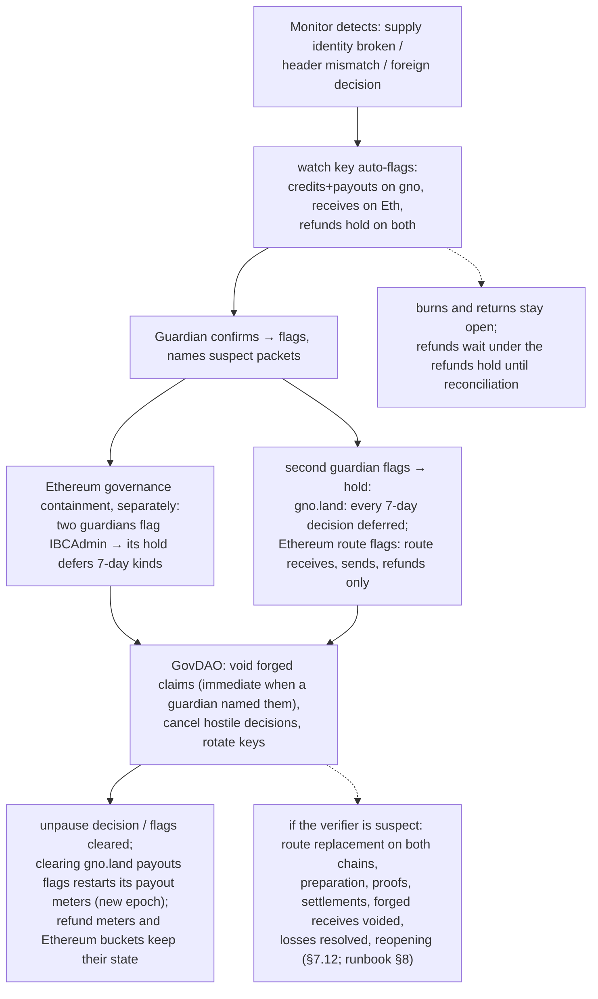

The full drill, step by step, is the gno-realms upgrade runbook §8 ("Incident drill: replacing a route's client").

### 6.12 Upgrades

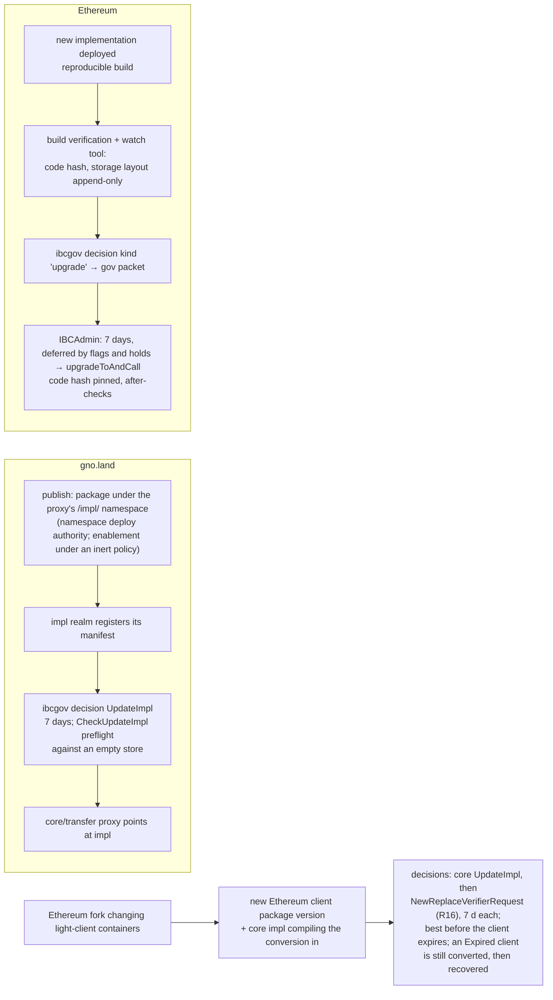

The runbook (gno-realms `docs/upgrade-runbook.md`, §7 step 7) gives the deadline: install the conversion-bearing
core implementation before the fork, so only the 7-day verifier replacement remains when a client stalls; a client
that expired first is still converted, then recovered the ordinary way.

## 7. Safety and governance controls

The controls are those of gnolang/bridges, ported to the IBC app layer. They are scoped **per Ethereum route**
(keyed by a stable route key, the route's first client id, with an alias from its current client), so other IBC
routes of the same realms are unaffected; a governance channel serves exactly one such route (§7.6, Scope).

### 7.1 Outflow meters and claims (gno.land) — R8

- **Day cap.** `cap = max(CapFloor, lock/10)`, recomputed at every refill.
- **Bridge meter.** A token bucket refilling at `cap/86400` per second, ceiling one day: no midnight reset, at most
  2 caps in any 24 hours.
- **Recipient meter.** Same, at `cap/4`.
- **Credits are claims.** `RecvPacket` books a claim and returns a success ack. Anyone calls `Claim(n ≤ 20)`.
  - Recipients are served round-robin, the oldest claim first.
  - Each turn pays `min(bridge, recipient, lock)`.
  - The fee is the first installment.
  - A later installment is paid only when both meters hold at least `min(remaining, fee)` (no slivers).
  - A claim's fee is locked when it is credited; each payout turn uses the lower of that fee and the denom's fee
    then, and keeps a cut once seen, so a later fee raise never strands a claim and a cut always applies.
  - Nothing is paid while a `payouts` flag stands, the route is closed (§7.12) or any denom of the route has an
    unresolved loss (§7.9). An `unescrow` payout is bounded by the lock less what queued refunds and proven
    reservations hold; a `mint` payout by the supply's int64 headroom (an installment is cut to it, the remainder
    kept).
- **Sweep queue.** Amounts below the fee, above the **free escrow** (the lock less `Reserved()`: open and withheld
  claims, queued refunds and proven reservations; so an amount the total escrow covers can still be swept), or to a
  bridge realm, a blank or an undecodable or invalid
  address are booked as owed (with a success ack) and paid only by a 7-day decision (`NewSweepRequest`: live
  entries of one denom, each paid whole to the decision's payee, no claim fee, outside the payout meters, for an `unescrow` denom within
  the free escrow, for a `mint` denom only within the int64 supply headroom (the entries' supply is already booked),
  deferred under a `payouts` flag). A **bridge realm** is the core and transfer proxies, `ibcgov`,
  `ethrelay`, transfer `impl/v0` (never registered) and every implementation either proxy ever registered, read at each receive through each proxy's
  permanent index of registered implementation addresses (`IsImplAddress`, one keyed lookup). The recipient is
  checked again at payout: a claim whose recipient became a bridge realm after its credit moves to the owed sweep.
- **Meters start empty.** At launch, after a migration or verifier replacement of the route's client, after a route
  replacement (a new payouts epoch), and whenever a `payouts` flag is cleared, by its owner as well (any clearing
  starts a new payouts epoch, §8.5). Refund meters keep their state through all of these.
- **Cap changes never backdate a refill.** On gno.land (built, gno-realms 2966e40), a governed reconfiguration of a
  denom first settles its bridge and refund meters (refilled to now) at the old cap. The lock-derived unescrow cap
  and the per-recipient meters are not settled at the change: each picks up the new cap at its next refill, which
  refills the earlier time at the **old** cap. For a raise that grants less than settling would; for a cut it
  grants the old rate only up to the change's refill, which the bound's `cap_max` already covers. On Ethereum both buckets are settled at the old caps before a limits change (always built).
- **Two accountings.** Gno-native assets returning from Ethereum are unescrowed: `lock` is their escrow and caps
  payouts. Ethereum assets arriving on gno are **minted** as vouchers: there is no gno lock, so they get their own
  day cap (absolute, per denom) and their own outstanding-supply accounting; `amount > lock` sweeping applies only
  to unescrow. A minted denom's supply cap bounds what is booked against it, `Outstanding + Returning + Parked +
  ProvenOwed + Owed + Withheld + Swept` (vouchers in circulation, in-flight burns, settled refunds parked for want
  of supply, refunds reserved by a replacement's preparation or a proof, claims and sweep entries owed), the terms
  never overlapping; a credit is admitted only within it (and, for every denom, unescrow included, a receive is
  refused when `Owed + Withheld + Swept + amount` would pass int64), and lowering the cap stops admission without touching
  what is booked. A denom's accounting never changes once enabled, and its cap floor never goes below its launch
  value.
- **Aggregates are exact.** Every int64 aggregate goes through one checked-arithmetic set: liability, reservation
  and loss totals that can genuinely pass 2^63 (`InFlight`, `Returning`, `QueuedRefunds`, `Parked`, `ProvenOwed`,
  the outstanding loss balances) are kept **wide** (two limbs, exact beyond int64, their int64 views saturating) so
  no send, acknowledgement, timeout, settlement, proof or loss is ever refused for their size; checks that read a
  saturated view can only refuse more; statistics saturate.
- **What it bounds.** A bucket starts at most full and refills over time, so within any 24 hours at most **two**
  day caps can leave (a full bucket plus one day of refill), and within `t` hours of an exploit at most
  `level₀ + Δ⁺ + ∫ cap(τ)/24 dτ ≤ cap_max + Δ⁺ + cap_max·t/24`, where `cap_max` is the largest cap over the interval
  and `Δ⁺` the sum of the cap raises during it (for unescrow `cap = max(CapFloor, lock/10)` only falls while the lock
  drains, so `cap_max` is the cap at the start unless new deposits raise the lock; for minting it is the configured
  cap). Because a new cap never applies to time before it took effect — governed changes settle at the old cap,
  and gno.land's lock-derived and per-recipient meters refill the earlier time at the old cap, which can only grant
  less — refill is never backdated; a raise can still lift what is available at once — on Ethereum, whose bucket tracks `used`, available
  becomes `cap − used`, up by the raise; on gno.land the stored level stays and only the ceiling rises, so `Δ⁺ = 0`
  there. Conservatively, the loss within `t` is at most a full bucket at the interval's maximum cap plus its refill,
  `2·cap_max` within any 24 hours. Governed raises wait 7 days, so they are visible in advance. The loss before a void is that amount for the time it takes a monitor or guardian to set a
  `payouts` flag; that detection time is an operational parameter (monitors poll every 10 s and flag within
  minutes).
- **Time to leave.** If nothing is flagged, holders can withdraw at the meter rate before a hostile 7-day decision
  lands — about half the lock in 7 days at lock/10 per day; less when the meter is shared with an attacker or a
  `payouts` flag stops exits.
- **IBC alternative.** Refuse with an error ack when a meter is empty, so the sender is refunded on Ethereum.
  Simpler, but under an attack honest transfers bounce. The claim queue is the tested design and is the default.

### 7.2 Mint and release limits (Ethereum) — E5

- **Per token:** a per-message maximum and a leaky-bucket day cap (`used` drains at `dayCap` per day).
- **Where:** in `GnoICS20Transfer.onRecvPacket`, before it mints a gno-native token's voucher or releases an
  Ethereum token from escrow. **Not** in `GnoVoucher.mint` or `Escrow.send`: ICS20's refund path (error ack,
  timeout) also mints returning vouchers and uses `escrow.send`, and refunds are never limited by receive limits
  (only by §7.13's refund meter, in the refund path). Eureka's per-token escrow rate limit is left unset for the
  same reason.
- **Default deny:** a gno-native denom without a registered `GnoVoucher` and configured limits is refused; no stock
  `IBCERC20` is ever created. An Ethereum-native token needs its limits (kind 4, its first setting always 7 days)
  before it can be sent; receive limits are refused until the route's quarantine is armed.
- **Escrow reservation:** a receive may not release escrow below the route's reservation for that token — owed
  refunds (queued, parked, decided but unpaid) and **outstanding escrowed sends**, whose refund could still be owed
  — and is error-acked otherwise (`GnoEscrowReserved`); vouchers reserve nothing.
- **Amounts:** a receive or send above 2^96 − 1 is refused (a receive record fits one slot), whatever the limits.
- **Launch values:** `maxPerMessage = min(25,000, dayCap)`, `dayCap = min(100,000, expectedLock/10)`, refund cap the
  day cap, applied by the activating kind 4 (`activationKind4Params` from the deploy output) after `IBCAdmin`
  records gno.land's first decision; the deployment itself registers ugnot with zero limits (§5.4). Overrides may only lower them, and a zero override means "use the default" (not a zero cap,
  unlike kind 4, where a zero cap refuses every receive or queues every refund).
- **What it bounds:** a gno.land validator-key forgery mints at most `level₀ + Δ⁺ + ∫ dayCap(τ)/day dτ ≤ dayCap_max
  + Δ⁺ + dayCap_max·t/day` within `t` of the forgery, the cap integral and maximum taken over the interval (the
  bucket keeps drainage at the caps in force when it happened, so with an unchanged cap this is `level₀ +
  dayCap·t/day`, at most two day caps in any 24 hours), each message at most `maxPerMessage`, until a flag lands.

### 7.3 Pausing that never traps exits — E6, R1

- **Rule: a pause stops minting and crediting, never burning, acks, timeouts or refunds.** The single exception is
  the refund controls of §7.13 — a **refund meter** that queues refunds beyond its daily budget, and the guardian
  **refunds hold** for a suspected compromise of the verifier that proves them; both delay refunds, neither cancels
  them. Sends and returns themselves are never capped by these controls. **A second, deliberate exception (built
  on both chains): a route closed by a replacement pays no refund until it reopens** — no queued refund, no parked
  one, and an ack or timeout queues the refund it would have paid at once — whatever the flags and the meter,
  including the genuine refunds of sends over the healthy replacement client (§7.12, §8.5). Only the governed
  reconciliation pays refunds on a closed route (kind 12 on Ethereum, gno.land's settlement).
- **Exits from a closed route.** A voucher return over the route's current, non-retired client (a burn) is never
  blocked by a closed route or an open emergency recovery, on either chain: it is an exit, whose refund, if the
  packet fails, waits for the reopening. Escrowed sends of Ethereum-native tokens, and gno-native sends, are refused
  on a closed route.
- **gno.land.**
  - The incident tool is the per-client flags of the transfer impl (R17): `credits`, `payouts`, and `sends` of
    gno-native tokens. Burns of returning vouchers are never paused by route flags or a closed route.
  - **The address blocklist is an exception to exits.** `transfer.BlockAddress` (immediate, authority members) is
    global: a blocked sender's every send is refused, voucher returns included, and receives to it too; refunds
    still reach it. Unblocking is an `ibcgov` decision (7 days).
  - `PauseApp` refuses sends (voucher returns included) for the whole `transfer` port, error-acks receives and keeps
    acks and timeouts running: acceptable as a coarse fallback, not the incident tool.
  - `core.Pause` blocks the whole packet path, refunds included, and is reserved for a core bug.
  - **Direct user calls only.** `Transfer` requires `IsUserCall()`: an intermediate realm or a `maketx run` script
    cannot send, for any token. Ethereum's `sendTransfer` accepts any calling account, contracts included (§8.5).
  - **A failed payment aborts on gno.land.** gno.land neither parks nor withholds on an ordinary payout failure:
    an immediate refund, a claim payout or a refund-claim payout that fails (e.g. a GRC20 transfer returning an
    error) panics and rolls back the **whole** transaction, transport completion included — the acknowledgement or
    timeout is not processed, its send record unchanged and nothing queued, withheld or parked — and the ack,
    timeout or claim must be retried once the payment problem is repaired. Ethereum parks instead (§7.13, §8.5).
    (Withholding on gno.land is only the governed void of a claim, never a reaction to a failed payment; parking on
    gno.land is only a settlement's, §7.12.)
  - Relaying for an Ethereum client (updates, receives, acks, timeouts) is permissionless (R17).
  - A route with an unresolved loss of any denom takes no new exposure (no gno-native send, credit, claim payout or
    sweep payment), whatever the flags; voucher returns, acks, timeouts and refunds go on (§7.9).
- **Ethereum.**
  - Eureka's `ICS20Transfer.pause` also blocks `onAcknowledgementPacket`/`onTimeoutPacket`, so `PAUSER_ROLE` is
    granted to nobody, and `whenNotPaused` is removed from the fork's ack and timeout callbacks.
  - **Relaying is public in production.** Eureka's router restricts `recvPacket`, `ackPacket` and `timeoutPacket`
    per function, never per port, so an allow-list would gate `IBCAdmin`'s governance delivery and the epoch-notice
    acks too, and the only way to restore access (a kind 8 grant) arrives over that very delivery: a lost relayer
    key would lock governance out for good. The deployment refuses an allow-list unless a testing flag is set;
    `submitMisbehaviour` is always public. Governance delivery never depends on a relayer allow-list.
  - The pause lives in `GnoICS20Transfer.onRecvPacket` and in its send variants for **Ethereum-native** tokens
    entering escrow; a voucher returning to gno.land (a burn) is never paused or limited.
  - A paused receive reverts inside the app with a custom error; the router turns that into an **error ack**, and
    the source refunds the sender when the ack is relayed: IBC's escape hatch, which the Hyperlane design does not
    have. (A receive refused *before* the app — by the light client — or reverting with empty data would instead
    leave the packet pending until it times out.)
  - On gno.land, refusals in the transfer impl return a failure acknowledgement before any state change, rather
    than relying on a panic being converted.

### 7.4 Guardians, flags and holds — R10, E7

- **Seats.** Six per side: 4 guardians (2 of them outsiders) and 2 watch keys (the operator's monitors). On
  gno.land all six start empty, and an unseated key cannot flag, so nothing protects a route until they are seated
  by decision (at most two guardian seats a decision, no address in two seats).
- **Flags.**
  - One flag pauses at once.
  - Flags are per function on gno.land (`sends`, `credits`, `payouts`, `refunds`), kept under the route key: a
    client of a route, current or retired, names its route. A flag may stand on any Ethereum client id, enrolled or
    not, so a client about to become a route's can be held beforehand; a route replacement folds the flags standing
    under the new client's id into the route's (a flag of the same seat and function merges, keeping the earlier
    time and at most 64 named packets, the route's first; guardians re-assert any name dropped).
  - Flags are per route on Ethereum (the route's pause flags, which stop receives and escrowed sends, and its
    `refunds` flags) and per object on `IBCAdmin`. `IBCAdmin`'s flags wait for `finishSetup`. Setting a flag again
    refreshes its block.
  - **Seat generations** on both chains: a flag stands only while the key that set it holds its seat, so a seat's
    key leaving ends its flags in constant work, and a key removed and restored cannot revive its earlier flags.
- **Holds.** Two guardian flags make a **hold**: on gno.land every 7-day decision is deferred (except the guardian
  replacement, below) and unpause decisions are spent. On Ethereum the general deferral of 7-day decisions needs
  `IBCAdmin`'s own flags or hold; a route's hold (its pause or `refunds` flags) has only its narrower effects — the
  route's receives and escrowed sends, or its refunds and refund-paying kind 12, and spending a kind 2 on that
  route. A hold ends after 24 hours below two flags. Holds come from
  bridges' Ethereum code; on gno.land they are built in `ibcgov`. **On gno.land the hold is global**: two guardian seats
  flagging anything, on any route or client, make it. On Ethereum, a hold is per flag set, and a dip in which a
  guardian flag standing at the dip's start stops standing (its key replaced) ends the hold at once, as a
  replacement does; an owner's own clear keeps the 24-hour grace.
- **Guardian replacement** under a hold lands no sooner than day 21 of the hold. Each pending seat change has a
  **deadline that later holds cannot reset** (built on both chains: gno-realms 2966e40, gno-eth-ibc 7a53e2b). The anchor is the **start of the first hold standing at or after the decision's due
  time**, even if that hold began before the due time, so the decision may execute from day 21 of that hold
  whatever holds stand then; clearing and re-flagging (a new hold) never moves it. Per chain: Ethereum takes the
  anchor from its hold history, so a hold no one observed still counts, pins it on the decision's first held
  `execute` (which returns without reverting) and lands the change at anchor + 21 days; hold-history
  compression marks merged intervals and never takes an anchor from one, so the anchor is never earlier than this
  rule, though it can be later. gno.land uses the hold standing at the
  decision's first deferring `Execute`, which records the anchor and emits a `deferred` event instead of
  reverting. Neither chain ever anchors earlier than the ideal boundary; compression (Ethereum) and the timing of
  the first observed deferral (gno.land) can each make one chain's anchor later than the other's, so neither
  chain's wait is guaranteed to be at least the other's. A vacancy (a seat set to no
  key) is a replacement: it waits 7 days and, under a hold, follows the same deadline. On gno.land a vacating change targets
  the holder **and the seat generation** the seat had when the request was built, and is skipped if either changed
  since (built, gno-realms 4dbcc03); the governor
  cannot end a hold by vacating the flagging seats. **Ethereum refuses vacancies**: kind 3 never sets a seat to no
  key, and such a decision is spent at recording (a deliberate divergence, §8.5).
- **Unpause.**
  - The flag's owner can clear their own flag at any time.
  - On gno.land, GovDAO unpauses immediately (`NewUnpauseRouteRequest`, spent under a hold).
  - On Ethereum, an unpause decision waits 24 hours and clears only flags set before it; on a route it clears both
    the pause flags and the `refunds` flags, and is spent while either set holds.
- **Naming suspects.** A guardian's `payouts` flag may name suspect packets (at most 64 packet keys; a re-assertion
  replaces the list), which makes their void immediate when it names every packet of the void.
- **No veto.** Guardians delay, they never veto. Unlike AccessManager's guardian role, they cannot cancel a
  decision.

### 7.5 Decisions with delays — R9

- **Immediate:** tightening changes, removals, cancels and unpauses on gno.land; on Ethereum, cancels and
  tightening of limits (kind 4 lowering) take effect at recording, and unpauses after 24 h (§7.6). On gno.land the
  immediate builders are: pause, pause app, reject app, unpause, unpause app, remove member, remove a relayer while
  others stay, block an address, refuse recipients, a denom change that only tightens, a void of packets a
  guardian named, unpause route, cancel, every Ethereum-bound decision (dispatched at once, delayed on Ethereum),
  `NewRemoveExpectationRequest` (it narrows what notices authorize), `NewRevokeRecapRequest` and
  `NewRetransmitRequest` (one re-send of immutable bytes).
- **7 days:** every loosening change: raising a cap, maximum or fee; adding or replacing a key, signer or
  guardian; upgrades; enrolling a client or route; a hand-over. On gno.land also: relayers, client recovery and
  migration, approvals, membership, a restore of withheld claims, fee collector, unrefusing, credits, sweeps,
  losses, recapitalizations, reductions, accepted deficits, settlements, route replacement and reopening, channel
  binding, every seat change (a vacancy included), every expected transition (kind 10's, a recovery's) and a
  tombstone purge (§7.12). A denom change is classified when its decision is recorded, against the configuration
  then: a new denom, a higher cap floor, supply cap, fee, send maximum or refund cap, a lower send minimum, and
  **any** change of the fee floor or of the Ethereum token wait 7 days (the last two conservatively, §8.5).
- **The ledger.** Decisions are numbered and are pending, applied, cancelled or spent.
  - Anyone executes after the delay.
  - Parameters are re-checked against live state at execution.
  - Proposals expire after 14 days.
  - A request refused when it is recorded (its checks failing against the live state) records a **spent** decision:
    an approved GovDAO proposal carrying it is consumed and cannot run again without a new vote (gno.land, z1p).
  - The builders take no free text: the parameters are the record.
  - **Governed execution never aborts on the live state:** every gno-side decision whose call would fail when it
    applies (the light client's recovery and migration checks and the core's send checks included) is refused and
    spent, never left pending; a sweep payment under a `payouts` flag and a refund-paying settlement under a
    `refunds` hold are deferred instead. What the preflight cannot evaluate still rolls back and leaves the decision
    pending: a panic in candidate implementation code, a constructor whose result depends on the store it is
    handed, or an install hook refusing on a condition it does not declare (an accepted residual, §8.5). **A second
    rollback exception: governed payments** — a sweep payment or a settlement's refund — are checked by `payable`
    before anything changes, but a runtime token failure `payable` cannot predict (e.g. a paused GRC20) rolls the
    `Execute` back and the decision stays pending. Operator procedure: cancel the decision, or retry `Execute`
    once the token resumes. Token assumption: an enrolled GRC20 does not pause or blacklist the transfer realm, and
    governance checks this before enrolling it (§8.1).
  - On Ethereum, `execute` reverts, leaving the decision pending, while it is suspended by an open recovery,
    deferred by flags or holds, immature, the transfer app is busy, the executor's code is not the pinned one, a
    refund-paying kind 12 is under its route's `refunds` hold, or the caller's gas is below the kind's frame; the
    executor then runs in a frame of its own with the kind's fixed gas, and a returned reason, a refused call or any
    revert inside it spends the decision. A recorded Ethereum decision has no execution expiry.
- **Ordering rule.** Raise the remote mint limit before the gno send maximum; lower them in the reverse order.

### 7.6 GovDAO governs Ethereum — R11, E8

- **`IBCAdmin` is immutable code and the permanent owner** of the governance state and of every authority:
  AccessManager's `ADMIN_ROLE`, every proxy's upgrade right, `migrateClient`, the custom-ERC20 registration, the
  mint limits and the guardian seats. Its logic runs in `IBCAdminExec`, which it delegatecalls at a pinned code
  hash.
  - It acts only on `gov` packets from `ibcgov`, proven by the GnoLightClient, on its own timers, and on the
    guardians' local flags and the §7.12 recovery path.
- **Decision kinds** (remapped from `HlAdmin`):

  | Kind | Action | Delay |
  |---|---|---|
  | 1 | cancel numbers / ranges | at recording |
  | 2 | unpause an object (clears earlier flags; a route's pause and `refunds` flags together; spent under a hold) | 24 h |
  | 3 | set guardians / watch keys (at most 2 guardians, never a seat's current key, never no key) | 7 d; lands through a hold at ≥ day 21 |
  | 4 | set mint/release limits (per route and token) | lowering: at recording; raising, and a token's first limits: 7 d |
  | 5 | register a gno denom's voucher (`setCustomERC20`) | 7 d |
  | 6 | add / migrate a light client (`addClient`, `migrateClient`) | 7 d |
  | 7 | upgrade a proxy (implementation + code hash + optional call; after-checks) | 7 d |
  | 8 | grant / revoke a **non-admin** AccessManager role (the relayer role, used only by a testing deployment: production relaying is public, §7.3); never `ADMIN_ROLE` or `PUBLIC_ROLE`, never a role or target function that can upgrade, re-point authorities or set execution delays | 7 d (revoke: immediate) |
  | 9 | hand-over: move `IBCAdminExec`'s pin to a new executor and code hash, on `IBCAdmin`'s own path (`IBCAdminNative`; no delegatecall into the installed executor); the migration call must be empty, a non-empty one spent at recording (`migration`); state and authorities stay in `IBCAdmin` | 7 d |
  | 10 | route replacement: retire the old client id, move the route, open the next epoch and send its notice (§7.12) | 7 d |
  | 11 | route quarantine duration (§7.10) | lengthening: at recording; shortening: 7 d |
  | 12 | settle a retired client's send records and forged receives (§7.12) | 7 d; refund-paying ones deferred by the `refunds` hold |
  | 13 | reopen a closed route, accepting its losses as deficits (§7.12) | 7 d |

  §5.4 gives each kind's parameters and checks.

- **Choice of transport.** A dedicated port rather than eureka's `ICS27GMP`: GMP executes arbitrary calls from a
  derived account, with no delays, guardians or kind checks.
- **Stable endpoint and state.** Router ports cannot be re-registered and an immutable contract's storage cannot be
  moved, so the port registration, the ledger state and the authorities all stay in `IBCAdmin`; only the executor
  changes, atomically, by kind 9, which `IBCAdmin` records and executes itself, so even a broken executor can be
  replaced, given an authenticated governance channel (or a working recovery to restore one) and an accurate
  transfer-app `gnoBusy()` (§8.5 R14, R15). A broken `IBCAdmin` itself can only be answered by a new deployment (new port),
  which is why it is kept minimal.
- **Scope.** Route controls (flags, limits, quarantine) are keyed by route key and token; upgrades, roles
  and the guardian seats are global powers of the deployment. **One governance channel serves exactly one
  Ethereum transfer route, ever.** `IBCAdmin` replaces, recovers, settles and reopens only the route of the client
  it governs over (its kind 10 and emergency recovery name that client), so a second route would have no
  Ethereum replacement or recovery path. The first enrolment on gno.land fixes the route — its key and its
  deployment's identity (chain, ICS26 router with its commitments slot, and the `IBCAdmin` behind them) — and any
  further enrolment is refused when requested and again when it executes (`checkOneRoute`), before the binding or
  after it. Replacements keep the route's key and identity. Several routes, or a second Ethereum deployment, would
  need a further `ibcgov` instance governing its own core and transfer proxies, and Ethereum-side support; neither
  is shipped, and the shipped proxies accept governance from this `ibcgov` only.
- **Code pinning.** Governance pins code by hash (kinds 5, 6, 7, 9 and the recovery proposal; an EIP-7702
  delegation designator is refused even with the pinned hash). Pins are transitive: every contract records, as
  constructor immutables, the address and code hash of each delegate it runs (the fork its controls module, that
  module the reconciliation module, that one the evidence module, the executor its checks and recovery modules),
  checked on every delegated call; kind 7 checks every module of a candidate, and kind 9 (on `IBCAdmin`'s own path) the new executor's code
  hash and its exact 96-byte `bindings()` answer.
  Every call to candidate code before installation is a `STATICCALL`. A hash says nothing of the source, so **every
  pinned hash must equal a reproducible build of the named source, and no pinned module may hold a mutable
  implementation pointer**: the build verification (`scripts/verify-codehashes.sh`) rebuilds each contract in
  simulation at its own address with the constructor arguments the system's graph calls for and compares the code
  byte for byte. **Coverage** (built, gno-eth-ibc 0c673ad and ad7f3e3):
  - *performed by the tooling:* what runs now, read from the chain (the transfer and router implementations, the
    escrow and voucher beacons' implementations, `IBCAdmin` and its executor with their delegate graphs); the **current
    epoch's verifier** (read through `govClient()`, rebuilt as a `GnoLightClient`) and its registered ugnot voucher;
    every pending kind 5, 6, 7 or 9 candidate before it matures (the recorded
    decision's hash against the envelope gno.land sent, the candidate's live code hash, a rebuild of its source);
    further vouchers and light clients, which must be listed explicitly (`VOUCHERS`, `CLIENTS`); and emergency
    recovery candidates (the proposal's `lightClient`, listed);
  - **one release per run:** the tool rebuilds every artifact from the one checkout it runs in, so each pending
    candidate is verified from a checkout of the release it installs with `CANDIDATES_ONLY=true`;
  - **mixed releases:** kinds 7 and 9 replace components one at a time, so a live deployment can hold components
    of different releases or compiler settings, which no single checkout rebuilds. A **deployment manifest** (kept
    by the operators beside the deployment) has one entry per deployed component — named as `VerifyCodehashes`'s
    `COMPONENTS` takes it: `transfer`, `router`, `escrow`, `ibcerc20`, `admin` (`IBCAdmin` with its launch check
    and `IBCAdminNative`, always its launch release), `exec`, `launchClient`, `launchVoucher`, plus one per further
    voucher or verifier — recording its address, **source revision**, **compiler settings**, **constructor
    bindings** and **expected runtime code hash**. Live verification is per component and per release (gno-eth-ibc
    e7a299f): group the manifest's components by release and, from a clean checkout of each, run
    `COMPONENTS=<that release's components> scripts/verify-codehashes.sh`; the live system is verified when every
    component passes in its own release's run, every live code hash equals the manifest's, and nothing runs on
    chain that the manifest does not list. **After a partial upgrade** (an executed kind 7 or 9) operators update
    only the replaced component's entry (the candidate's release, settings, bindings and code hash, already verified
    as pending) and verify per release again; **after a rollback** the entry returns to the earlier release's
    values, which that release's run must confirm (an earlier build is never assumed to be the one last named).
    `COMPONENTS` and `CANDIDATES_ONLY` are exclusive;
  - *manual:* a verifier of another type than `GnoLightClient` (a reproducible build of its named source,
    and no mutable implementation pointer), checked before the kind 6 or recovery that installs it matures; and
    running the tool itself, with operator-supplied pending lists, until the watch tool (T5) automates it; and
    a **storage-layout compatibility review** (append-only layout) of every kind 7 implementation and kind 9
    executor before it matures, and for every kind 7 transfer implementation a repair-critical review that its
    `gnoBusy()` is functional and answers false outside an operation (§8.5 R14) (a kind 9 carries no migration call, so a new executor must work with the layout as
    it is, or migrate it afterwards by its own decisions): a successful bytecode verification proves the code is a build of its source, not
    that its layout is compatible with the live storage.
  It is run after every deployment and executed decision, and for each recorded kind 5, 6, 7 or 9 and each opened
  recovery within its delay; a failing pending candidate is cancelled by kind 1 (a recovery by the guardians'
  cancellation).
- **Repairing live code that failed after execution** (kind 1 acts only on pending decisions). Two dependencies
  qualify every repair: `IBCAdmin`'s delivery, `drain()` and every execution (kind 7 and kind 9 included) first call
  the installed transfer implementation's `gnoBusy()`, so if that view reverts, returns malformed data or keeps
  answering true, even an already-recorded repair cannot execute and the shipped admin has no bypass (§8.5 R14;
  every kind 7 candidate's review checks its `gnoBusy()` as repair-critical); and a repair decision must reach
  `IBCAdmin` over an authenticated governance channel, or a working recovery must restore one (§8.5 R15). Every
  7-day decision is deferred while `IBCAdmin` is held, the repair included, so the order is:
  1. **contain:** guardians set the route flags (receives and escrowed sends stop) and the `refunds` flags (refunds,
     claims and refund-paying kind 12 wait), and may flag `IBCAdmin` so nothing else matures meanwhile;
  2. **cancel** (kind 1, at recording) every pending decision the failure makes unsafe;
  3. **keep the transfer containment** (the route and `refunds` flags stay set);
  4. **clear the `IBCAdmin` flags and wait out the hold** (24 hours below two guardian flags), so 7-day decisions
     can execute again;
  5. **execute the verified repair**, recorded meanwhile and verified as pending before it matures: a kind 7 back to
     the last verified implementation or to a fixed build (transfer app, router, beacon), a kind 9 to a verified
     executor. For a failed verifier: an already-recorded kind 6 migration **only when its history is trusted**
     (expiry, or a liveness-only defect shown not to have accepted any false update or proof), since kind 6 creates
     no incident, retires nothing and has no `suspectFrom`, and kind 12 settles only a retired client's records;
     otherwise a kind 10 replacement or the emergency recovery, with `suspectFrom` covering the time it ran, and
     reconciliation. A failed voucher cannot be swapped (kind 5 registers a denom once). Ethereum route flags and
     zero caps stop **ingress only**: returning-voucher burns continue, and a defect that mints unbacked vouchers can
     still be burned into gno.land claims with genuine Ethereum send records. So containment also needs gno.land's
     `credits` and `payouts` flags on the route, then reconciliation of the affected gno.land receive entitlements
     (voids, settlements, §7.12) **together with an audit of the voucher's supply against its escrowed backing** — a
     matching send record alone does not establish backing — and containment stays until a repair or the denom's
     retirement; stopping the burns themselves needs a governed code change (kind 7);
  6. **clear the `refunds` flags** before a refund-paying reconciliation (a refund-paying kind 12 stays pending
     under them), keeping the route flags so receives and escrowed sends stay contained;
  7. **reconcile** what ran meanwhile (kind 12, on the records of the client a kind 10 or recovery retired) where
     outcomes were touched, and lift the route flags once the manifest is updated for every repair and every component passes verification
     from its own release (mixed releases included). Kind 12 settles only a
     retired client's records, so after a **transfer-implementation failure** repaired by kind 7 the reconciliation
     needs its own replacement: enrol a target client (kind 6 op 1) → a kind 10 with a `suspectFrom` boundary
     covering the fault → the replacement's preparation → kinds 12 and 13.
- **Single point of failure.** If the GnoLightClient can no longer follow gno.land, or a forgery has pushed it past
  honest heights, the governance channel stops and GovDAO's cancellations are not provable on Ethereum. See §7.12
  for the recovery that does not depend on the channel. Refunds already queued or parked stay claimable after a
  client fails; only new proof-based processing (receives, acks, timeouts, proofs) through it stops.

### 7.7 Governor and one-way yield — R9/R11

- The realms compile a governor key, which decides through the same builders, checks and delays as GovDAO.
  **As shipped (ab794ba through 1353ab5), `ibcgov.LaunchGovernor` is a test address marked `PLACEHOLDER`.** Launch must supply the
  real key in the deployed source, and GovDAO members verify it before the immutable realm is deployed. The
  supported alternative is an empty key (`""`): then no governor exists, `Yield` is refused, and GovDAO decides
  from the first block.
- GovDAO proposals are refused until the governor calls `Yield()` once. After that only GovDAO decides.
- Until the yield the lock is kept small and no outside holders are invited. A leaked governor key is a leaked lock
  after 7 days, unless it is seen and cancelled.

### 7.8 Send-side limits — R12

- Per-message maximum and minimum.
- A route fee with a floor and a ceiling: raising it waits 7 days, lowering is immediate.
- **gno.land denom admission.** The builder takes a denom of 1 to 128 ASCII characters among letters, digits and
  `/:._-`; a `mint` configuration may name its token by its Ethereum address, normalized to its voucher's `ibc/`
  denom over the route key, and a minted denom must be such an `ibc/` denom, an unescrowed one must not
  (`DenomConfig.Validate`): a positive cap floor, a positive refund cap, a positive fee
  floor and `FeeFloor ≤ Fee ≤ CapFloor/4` (the configured floor, even when the lock-derived cap is larger); an
  `unescrow` denom needs `0 < SendMin ≤ SendMax`, no supply cap and a non-zero lower-case Ethereum token; a `mint`
  denom a positive supply cap, no send limits and no Ethereum token field. Ethereum's kind 4, by contrast, allows
  zero caps (refusing receives or queueing refunds) and unset (zero) send limits.
- Recipient filters, on **gno.land → Ethereum** sends: refuse the zero address and reserved addresses (≤ `0xffff`),
  the token itself, bridge contracts and realms, and malformed addresses. Ethereum's sends copy the gno receiver
  string without such validation; a blank, undecodable or invalid gno receiver becomes an owed sweep entry on
  arrival (§7.1). On gno.land each route has its own filters from its enrolment on: the router, ICS20 transfer and
  `IBCAdmin` its enrolment named and every voucher token a denom names (a gno-native denom's Ethereum token
  included) are **protected recipients**, never unrefused and kept through replacements; no gno-native send goes
  out before they are set.
- The route fee is not refunded with a refunded send: a refund pays the packet's amount (§8.5).
- Every gno address a builder takes (payees, fee collectors, seats, relayers, members, blocked addresses) is
  canonicalized before it is stored or compared; Ethereum addresses are lowercased.
- **Fee collector.** Never a realm of the bridge (a GRC20 fee paid to the transfer realm is a self-transfer the
  token refuses, which would stop the route's GRC20 sends and claims): refused when the enrolment or collector
  decision is built and again when it executes, through the bridge realms and both proxies' implementation-address
  indexes. A later registration cannot make an existing collector a bridge realm: the controls keep an indexed
  count of the routes each address collects for, and both proxies refuse to register an implementation at such an
  address, so the collector is changed first by a 7-day decision.

### 7.9 Voids — R13

- A **withheld** void can be restored. A **forged** void drops the remainder and books what was already paid as
  lost.
- A void is immediate when a guardian's `payouts` flag named every packet it voids, otherwise 7 days. Only a
  withheld void is restored; a forged void and a voided sweep entry are final. A paid sweep entry voided as forged
  books its payout once.
- Credit-by-vote is the manual fallback for a griefed transfer: 7 days, for an `unescrow` denom never above the
  lock (free escrow); for a `mint` denom the credit reuses the supply its sweep entry already booked. As built it replaces
  a **sweep entry** booked at the receipt after the route's enrolment, for the entry's current whole amount (at
  least the current fee), or completes a pending asynchronous ack for exactly what the packet carried; a sweep entry
  moved from a claim cannot be re-credited. It checks that its client is one of the route's — the current client or
  one a replacement retired — through an index (`Route.HasClient`), in logarithmic work whatever the number of
  replacements.
- **IBC terminal-state rules.** A claim is keyed by its packet and created in the same transaction as the receipt.
  A credit-by-vote is only for a packet whose acknowledgement on gno.land is a **success** (or an asynchronous ack
  still unwritten, which the credit completes as success in the same transaction); an error-acked packet is
  refunded at its source and is never credited. Credits are deduplicated against every claim and payment of the
  same packet. A void never creates a refund on the source: a successfully acknowledged packet is final there, so a
  voided forged claim is booked as lost or withheld on gno.land only. Escrow is reserved for open claims so voids
  and payouts never double-spend it.
- **Recognized losses.** A loss enters a packet-keyed **loss ledger** per route and denom (packet, amount, chain,
  incident) only through a decided void or a §7.12 reconciliation outcome — a forged payout already paid, a refund
  paid for a delivered packet, a forged delivery. Monitors and guardians cannot record one. Each loss is stored
  under its packet's **direction and key** (a receive or a send), so one economic loss is booked once whatever the
  path (a forged void, a forged-receive or forged-refund settlement, a recorded loss): on gno.land
  `NewRecordLossRequest` names its cause (`forged-delivery` or `collision`) and chain, a forged refund is booked only
  by settlement action 4 and a forged receive represented by a claim or sweep entry only by its void or action 5.
  **`NewRecordLossRequest` with chain `"ethereum"` is a mirror-only operation** (gno-realms 97cbbf0): it records on
  gno.land the shortfall a forged Ethereum payout of a gno-native token's vouchers creates, and closes the route to
  new exposure until resolved (`LossClosed`), but the loss's authoritative record is Ethereum's (§7.12, Cross-chain
  loss ownership). A mirror is resolved only by an accepted deficit: a reduction, a recapitalization or a forged
  void into a mirror incident is refused and the decision spent. An incident never mixes mirror and authoritative
  losses. Loss balances are wide (§7.1). The ledger's
  **unrecovered** total enters the supply identity (§7.11), so a reconciled incident stops reading as a break while
  any further deficit still does.
- **Restoring solvency.** Recording a loss does not restore the backing. Before a route that lost funds reopens
  (its flags and `refunds` hold lifted, or its replacement enabled), one of these is decided (7 days):
  - **recapitalization**: tokens or GNOT paid into the escrow through a governed `recapitalize(route, denom,
    amount, incident)` call, credited to accounted backing and debited from the unrecovered losses — a plain
    transfer to the escrow stays surplus (§7.11) and repairs nothing. As built on gno.land, a decision authorizes
    an amount (bounded by the incident's unrecovered losses, accepted deficits included, less unpaid authorizations;
    at most 64 open per incident and denom; revocable at once), and anyone pays exactly that amount
    (`transfer.Recapitalize`); only an `unescrow` denom is recapitalized. **Ethereum has no recapitalization
    decision**: its kind 13 accepts every recorded loss as a deficit (§8.5);
  - **liability reduction**: an explicit, published haircut on the affected route's **open, owed or withheld
    claims on gno.land** (§7.1; owed sweep entries included), recorded per packet against the incident: each reduced claim pays its reduced
    amount, the claims term of §7.11 drops by the reduction and the unrecovered losses by the same amount.
    **Refunds are never reduced**: a genuine refund — paid at once, queued (§7.13) or paid by reconciliation
    (§7.12) — is always the packet's full amount minus what was already refunded, so the refund guarantee holds;
  - **accepted deficit**: governance reopens with the loss unrecovered and states it in the trust statement
    (§8.1); the identity still holds, since the loss is recorded, and later breaks are still detected.

  One rule orders the remedies: a remedy that restores backing or lowers liabilities (a paid recapitalization, a
  reduction) is bounded by the incident's unrecovered losses, accepted deficits included, and lowers the unresolved
  balance only as far as it remains; an acceptance is bounded by the unresolved losses and lowers only them. The
  reopening accepts whatever stays unresolved and revokes unpaid recapitalization authorizations, in bounded
  batches. A route with a loss of any denom unresolved takes no new exposure until then (§7.3). On Ethereum, a loss
  booked while the route is open (a *late loss*) closes the route again until a new kind 13 accepts it.

### 7.10 Quarantine — E9

- A newly accepted update that is a **live transition** — it announces a next set different from the live epoch's
  (the latest accepted header's), or it is signed by a set that is neither the live set nor the live announced next
  set — starts a 7-day quarantine of token receives on Ethereum (E9). The anchor a relayer chooses plays no part,
  and later headers of the same epoch do not extend it. Governance is not quarantined. Quarantined receives error-ack and
  are refunded at the source.
- It bounds a validator-set takeover: two GovDAO members can replace the set in one block.
- The duration is a governed parameter (0 disables it) **of the route** (kind 11, at most 365 days), not of the
  client: the client records the time of its latest live transition (`lastTransition`), and the transfer app fixes
  each transition's deadline with the duration in force when it first sees it; a duration change settles the
  deadlines of transitions accepted before it. A started quarantine's deadline is checkpointed before any verifier
  swap (kind 6 op 2) or route replacement (kind 10), so the new client cannot end it early. A route replacement
  (kind 10, the emergency recovery) never depends on the old verifier's `lastTransition()`: if it reverts or is
  malformed, the deadline becomes `max(saved, now + route quarantine)`, `verifierGen` is still bumped, and the
  replacement proceeds. The probe of the old verifier in a replacement or recovery is a **bounded `staticcall`**: a
  gas cap and bounded return data, with gas reserved to finish the replacement, so an old verifier cannot starve or
  block it. A kind 6 swap keeps the strict read.
- **Fail closed.** A client whose `lastTransition()` is missing or reverts refuses receives and quarantine changes,
  except a route replacement (above), and with two further exceptions that do not read it: a receive on a route whose duration and saved deadline are both zero, and
  the route's first quarantine setting (which arms it). Checkpoints and installation require an answer of exactly
  two words (64 bytes); a receive reads it with a typed call, which accepts a longer answer whose first two words
  decode.
- **Armed before receives exist.** The route's first quarantine setting (the deployment's) arms it without a
  checkpoint, so every transition since the trusted launch checkpoint counts with the launch duration; receive
  limits are refused until it is armed, and the deployment sets the quarantine first.
- A freshly constructed client installed by kind 6, kind 10 or the recovery starts unquarantined until its first
  transition (§8.4). A client already updated before installation brings its transitions in: each one's quarantine
  counts from its existing transition timestamp, so it may already have elapsed at installation.

### 7.11 Monitoring — T4, T5

- **Supply identity, per route and denom**, over **accounted backing**: the escrow balance implied by
  authenticated bridge operations (escrows on send minus releases on receive, refund and claim payout), kept by the
  monitor from packet records, not the escrow account's raw token balance:
  - gno-native: `accounted escrow on gno = voucher supply on Ethereum + in flight + unpaid refunds + open/owed/withheld claims on gno − unrecovered losses`
    (a returned voucher is burned on Ethereum but its GNOT stays escrowed until its claim is paid);
  - Ethereum-native: `accounted escrow on Ethereum = voucher supply on gno + in flight + unpaid refunds + open/owed/withheld mint claims on gno − unrecovered losses`.
  - **Unrecovered losses** are the loss ledger's open total (§7.9), each (packet, token) loss counted once, at the
    payout chain's open balance (a mirrored record on the other chain never counts, §7.12 Cross-chain loss
    ownership): only decided, packet-keyed losses, so a
    reconciled incident does not re-trigger the response, and any deficit beyond them is a new break.
  - Each packet's amount sits in **exactly one** of these terms at a time, keyed by the packet:
    - **in flight** — sent and not yet received at the destination, or received with an error ack (or past its
      timeout) whose ack or timeout the source has not processed yet;
    - **unpaid refunds** — the source processed the error ack or timeout but has not **paid** the refund yet:
      a refund queued under the refund meter (§7.13) or held by a `refunds` hold, on **either** chain — including
      a pending re-mint of returned vouchers on Ethereum, or re-mint of returned vouchers on gno. A refund leaves
      this term only when paid, not when its ack or timeout is processed;
    - **claims** — received on gno.land with a success ack and not yet paid out there (open, owed or withheld,
      §7.1). Claims exist only on gno.land, in both directions: a return of gno-native vouchers becomes a claim on
      escrowed GNOT, and a deposit of an Ethereum-native token a **mint claim** for its voucher. A successful
      receive moves the amount from "in flight" into the claim, and each paid installment moves its portion into
      the released balance or the voucher supply. Ethereum releases and mints at once on receive (within E5's
      limits), so it has no claim term;
    - otherwise settled: in the destination's supply or released from escrow.
    Not every outstanding commitment is in flight, since commitments also persist until acks are processed.
  - **Balances must cover it.** Separately, each escrow's actual balance must be at least its accounted backing.
    A shortfall is an integrity break. An excess is **surplus** — anyone can transfer tokens or GNOT straight to
    an escrow address without a packet — and only alarms; it never flags or holds the route. Governance could
    sweep it in principle, but no shipped operation does (gno.land's sweep pays only packet-keyed sweep entries;
    §8.4).
  - **Consistent cut.** Escrow and mint (or burn and release) happen on different chains at different times, so
    two snapshots read in any fixed order can catch a receive without its send and report a break that is not
    there; correcting for such a receive afterwards would have to reverse every effect that followed it (escrow
    releases, claims, payouts, refund settlements). The monitor instead evaluates the identity only at a pair of
    **causally closed** heights `(G, E)`: every receive at or below either height has its send at or below the
    other's, so no effect needs reversing. It pins `G` at a committed gno.land height and `E` at the latest
    finalized Ethereum height, each read from the operator's own node and checked against two agreeing RPC
    providers by block hash, then, from packet records: lowers `E` below the first Ethereum receive whose gno send
    lies above `G`, and lowers `G` below the first gno.land receive whose Ethereum send lies above `E`, repeating
    until neither moves. Both only decrease, so this ends, at worst at the previous evaluation's pair (or the route's launch heights), which is closed.
    Refund liabilities, claims and payouts are all read at the same pair.
  - **Confirmed orphans are breaks, not skew.** Rewinding is only for receives whose send is **not yet visible**
    at the other pin. Absence at the selected pin is not conclusive by itself (an honest send just above the pin
    looks the same), but a later finalized state settles it: a receive is a **confirmed orphan** when the source's
    **permanently retained send record** for that sequence is absent (or holds a different packet) at an
    independently authenticated finalized source state whose timestamp has passed the packet's timeout, or whose
    router `prevSequenceSends[sourceClient]` (the last allocated sequence) is at or past the receive's sequence,
    or at which the receive's named source client is **retired** on the Ethereum transfer app (immediately, for a
    record holding a different packet or under a retired client) — no honest send can appear after that. It need not reach the receive's referenced proof height, which the attacker chose.
    A confirmed orphan is an integrity break by itself, flagged at once with the containment response below, not
    rewound past or deferred; before that state exists the receive is rewound past or the evaluation deferred, as
    below.
  - **Fabricated proof heights.** Separately, a receive whose referenced source proof height or consensus state is
    demonstrably fabricated — e.g. beyond the source chain's independently authenticated head, or a state root the
    source never had at that height — is an integrity break by itself, flagged at once with the same containment.
  - **Deferred alarms.** If a closed pair cannot be established because data is **unavailable** — a record
    missing, a provider disagreeing, a pinned height not yet finalized, or the pair falling too far behind — the
    evaluation is skipped and retried later; it only alarms after a configured number of failures. An integrity auto-flag needs a break (in the
    identity or a balance shortfall) that persists over two consecutive evaluations at closed pairs.
- **What triggers what.** A confirmed orphan receive, or a break at closed pairs that persists as above, auto-flags credits+payouts and
  receives, and sets the route's `refunds` hold (§7.13). Stalls, ages, float runways, failures to find a closed pair and escrow
  surplus only alarm.
- **Watch tool.** Guardians and members see flags, holds, pending decisions and the client heads, and check
  upgrade targets.
- **Visibility limits.** `ibcgov`'s page lists the newest 100 pending and 100 settled decisions of each kind; an
  older pending decision stays executable but drops off it, so operators read the full ledger with
  `Render("decisions")` or `Decision(id)`. It lists flags only under enrolled routes, while a flag on a client no
  route has yet still counts toward the global hold: read it with `Flags(clientID)`. The route JSON shows each
  meter (`meter`, `refund_meter`) as stored, its level at the last refill, not what it holds now;
  `controls.Reader.Meters` returns the bridge and recipient levels refilled to now, on copies.
- **What is built.** The monitors (T4) and the watch tool (T5) are not. The chains keep everything they need: on
  gno.land, the controls reader's JSON (route totals; paginated claims, sweeps, sends and losses, at most 100 per
  page with a cursor) and `route_*` events, every render Markdown-inert; on Ethereum, the operating views
  (`sendRecord`, `openRecords`, `reserved`, `losses`, `incidents`, `clientRecon`, `receiveRecord`, the flag, hold,
  epoch and notice views) and the `GnoSettled` settlement events.

### 7.12 Recovery without the governance channel — new

The governance channel runs over the same GnoLightClient it would need to repair. Three situations need recovery:
the client **expired** (no update within the trusting period), it is **frozen** (misbehaviour), or it was
**poisoned** by a forgery (a > 1/3 coalition of a trusted set signed headers the honest chain never had). A
poisoned client can be pushed to any height with current timestamps, and the forgery can leave state behind:
router receipts at transport sequence numbers the attacker chose (eureka stores a receipt hash per
`(client, sequence)` and refuses a different packet there,
[`IBCStoreUpgradeable.setPacketReceipt`](https://github.com/cosmos/solidity-ibc-eureka/blob/solidity-v3.0.2/contracts/utils/IBCStoreUpgradeable.sol)), and governance sequence
numbers, buffered decisions and tombstones in `IBCAdmin`. Replacing the verifier of the same client id
(`migrateClient`) repairs none of that, so recovery from poisoning is a **route replacement**. When the old history
is trusted — the client **expired**, or a **liveness-only** defect stopped it that is shown not to have accepted any
false update or proof — a **kind 6 op 2 already recorded** on `IBCAdmin` alone can repair the channel loss by
migrating the client to a working verifier; a kind 10 is not always needed. Where that is not established, the
client is treated as possibly poisoned and recovery requires a kind 10 or the emergency recovery, with
reconciliation.

- **Ethereum-local brake (always available).** Guardian flags and holds on `IBCAdmin` and `GnoICS20Transfer` are
  Ethereum transactions, not packets, so they keep working while the channel is down or poisoned.
- **Emergency route replacement (optional, off at launch; an explicit additional trust assumption).** Configured
  once, at deployment (`RecoveryConfig`): `delay` (0 disables recovery; otherwise at least 30 days,
  `MIN_RECOVERY_DELAY`, enforced by the constructor and the deploy script), `threshold` and `cancelThreshold` (3 or
  4 of the 4 guardian seats; launch 3; **`cancelThreshold` must lie in `[3, threshold]`**, enforced at construction,
  so the guardians able to open a proposal can always close it), `silence` (launch 30 days; 0 disables that criterion) and `holdPeriod`
  (launch 14 days; 0 disables it). Enabling it is a **pre-deployment decision**: the configuration is fixed then and
  no governed transition enables it later. Only the one route the channel governs can be recovered. **Assumption:**
  a cancellation quorum (`cancelThreshold` guardian keys) stays available while a proposal is open, since guardian
  replacement (kind 3) is suspended meanwhile.
  1. *Proposal.* A guardian supermajority (`threshold`, e.g. 3 of 4) proposes a new GnoLightClient rooted at a
     checkpoint they attest (a gno.land header of the same chain id and its validator set): `newClientId`,
     `counterpartyClientId`, the canonical `merklePrefix`, `lightClient`, `codeHash` and `suspectFrom`. No constraint
     ties it to the old client's height: a poisoned client's height is meaningless, so the checkpoint is judged on
     its own (the watch tool shows it against the operator's own gno nodes and public endpoints, and the build
     verification rebuilds its `lightClient`). Each guardian seat approves one proposal (its hash), only after
     `finishSetup` and while no proposal is open; the client must be code with that hash (not an EIP-7702
     designator), follow gno.land's chain id, and be neither frozen nor expired. The proposal's **permanent constraints
     are checked at approval, before it can open** (built, gno-eth-ibc 0c673ad): `newClientId` a valid custom router id (4 to 128 characters of
     eureka's grammar, not `client-` or `channel-`), not already used by the router, and a fresh route for the
     transfer app; so a proposal that could never execute never opens. **Approvals of an unopened proposal never
     expire and survive governed epoch switches**, so earlier votes can help open a recovery on a later route; an
     approval clears only when its guardian withdraws it, overwrites it by approving another proposal, loses the
     seat, or the recovery closes. Guardians withdraw approvals they no longer support.
  2. *Eligibility*, checked **when the proposal opens** — and never before `IBCAdmin` has recorded its first
     decision from gno.land (the launch invariant, §5.4: refused while the epoch is 1 and the last recorded sequence
     is 0; an epoch advance before the binding voids the launch, which is redeployed) — on each approval (so a guardian approves again when
     eligibility arrives later), never again at execution. The route is eligible when any of: the epoch's client
     answers `isFrozen()` or `isExpired()` true (an exact answer; a client answering neither opens nothing by
     status); `silence` is non-zero and at least `silence` has passed since the last recorded decision or epoch
     opening; `holdPeriod` is non-zero and a hold on `IBCAdmin` has stood for at least `holdPeriod`.
  3. *Delay and cancellation.* It executes after a long public delay (at least 30 days). From its opening every
     token receive **and every escrowed send** on the route is refused (returning-voucher burns stay available),
     the monitors alarm, and only a guardian majority (`cancelThreshold`) can cancel it — governance packets over
     the old client cannot, since that client may be the compromised party; before opening, a guardian may withdraw
     its approval. **Cancellation is native to `IBCAdmin`** (gno-eth-ibc e7a299f): `IBCAdmin.cancelRecovery()`
     delegatecalls its immutable `IBCAdminNative` helper — deployed by `IBCAdmin`'s constructor after the launch
     check and exposed as `native()`; no pointer to it is stored, so no decision can redirect it, and since Cancun
     `SELFDESTRUCT` cannot remove its code; called directly it reverts `NotDelegated` — never the executor or its
     recovery module, which no longer has a cancellation. The caller must hold a guardian seat (`NotGuardian`
     otherwise). Before the proposal opens the call withdraws that seat's approval; once it is open, it sets the
     seat's bit in a vote bitmap, and when the votes reach `cancelThreshold` the recovery closes: the proposal,
     `openedAt`, the cancel votes and every approval are cleared, which lifts the suspension of the old epoch's
     decisions (kind 9 included). The closing vote then lifts the route's recovery block **best effort**: it calls
     the transfer app's `setRecoveryBlock(govClient, false)` with a 200,000-gas cap inside `try`/`catch`, behind a
     `CallStarved` floor of `200,000·64/63 + 20,000` gas (so no caller can starve it on purpose). If that call
     fails, the recovery still closes and the suspension lifts, but the route stays blocked (the safe direction)
     and `RecoveryBlockKept(proposal)` is emitted; the permissionless `IBCAdmin.clearRecoveryBlock()` retries the
     unblock — it reverts `RecoveryState` while a recovery is open, does nothing when no block stands, and reverts
     while the transfer app still refuses (its intended use is after a kind 7 repair of the transfer app).
     Approval and execution of a recovery still go through the executor's recovery module. **Opening a proposal atomically suspends the application, at recording and at execution, of every
     authority-changing decision of the old epoch** (they are still recorded and stay pending) — kind 3 (guardians), kinds 6–9 (clients, upgrades, roles,
     executor hand-over), any kind 7 migration call, **and kind 10** (a recovery and a governed replacement must not race;
     §8.5) — independently of flags and holds, until the recovery executes (which drops them with the old epoch) or
     guardians cancel it.
  4. *Keeping the candidate alive.* The proposed verifier is not the route's client until execution, so the
     ordinary relayer schedule does not update it: operators update the candidate verifier directly, at least
     daily, throughout the delay, and monitor its freshness (alarming as for the route's client). If it expires (or
     freezes) before execution, the proposal can no longer execute: the guardians cancel it and propose afresh from
     a new attested checkpoint, which restarts the delay.
  5. *Execution, atomically in `IBCAdmin`* (permissionless, at least `delay` after opening, the proposal's client
     still usable, the id constraints checked again; any
     failure reverts the whole call, the proposal staying open and the route blocked until someone retries or the
     guardians cancel):
     - retire the old client id: the ICS20 fork refuses every send variant on it (the router's `sendPacket` does
       not check client status, [`ICS26Router.sol`](https://github.com/cosmos/solidity-ibc-eureka/blob/solidity-v3.0.2/contracts/ICS26Router.sol)), and returns go through the new client; then freeze it
       (no further receives, acks or timeouts through it). The router has no freeze, so the old id is
       `migrateClient`ed to a `FrozenLightClient`, which proves nothing and reads as frozen. Sends are retired on
       both chains, and the retirement is final on both for transfers, before any reconciliation snapshot is taken;
     - `addClient` a **new client id** with the attested GnoLightClient, so transport sequence numbers start
       fresh and no forged receipt can block an honest packet; the quarantine is checkpointed first, so the new
       client inherits a quarantine already started;
     - open a **new governance epoch** (the envelope's `epoch`, §5.4): every recorded-but-unexecuted decision,
       buffered entry and tombstone of the old epoch is dropped (executed decisions stand; a forged one that
       executed is reversed by new decisions); the new epoch's sequence starts at 1 and only accepts packets from
       `ibcgov` over the new client; its epoch notice is sent;
     - move the route in **constant work**: the ICS20 fork keys its voucher registry and escrows by a stable
       **route key**, not by client id, and keeps an alias `client id → route key`. Denom paths on the wire still
       use the current client id: the fork translates `transfer/<route key>/…` to `transfer/<current client>/…` on
       send and back on receive, so returning tokens are recognised on both sides. `migrateRoute(oldClient,
       newClient)` only points the new client's alias at the old route key and retires the old alias; no per-denom
       work, whatever the number of registered denoms (needs E6's fork). The transfer realm on gno.land uses the
       same indirection. The route closes (a new incident) and stays closed after the recovery.
- **gno.land side, by GovDAO directly.** Create the new Ethereum client from an independently authenticated
  checkpoint and register it against the new router client; record `NewReplaceRouteRequest(route, new,
  suspectFrom)` (7 days), which points the transfer realm's route alias from the old client to the new one
  (constant work, as on Ethereum) and retires the old client for the transfer port. GovDAO acts on gno.land
  without the channel. As built:
  - the new client must be an Active Ethereum client that is no route's, not retired on any port, authenticating
    the route's identity (below), checked when the replacement is requested and again when it executes; the old
    one may be frozen or expired;
  - it replaces the route's current client whether the route is open or closed: each replacement is an incident of
    its own covering the client it retires, the earlier incidents' records, suspect intervals and counters
    untouched, a reopening under way aborted, and proofs of every incident's records going through the route's
    current client;
  - the route closes until a governed reopening, its payout meters (bridge and recipient) start empty through a
    new payouts epoch (refund meters keep their state), and the flags standing under the new client's id fold into
    the route's (§7.4). **On Ethereum they do not**: the new client aliases the existing route, whose flags, limits
    and quarantine govern from then on, and flags set under the candidate's own id do not carry over, so operators
    flag the existing route (§8.5);
  - the old client is **marked retired** in the core, not frozen: its verifier keeps its status; retired for good,
    it takes no new packet message, except that the app that registered a packet's port may still write the
    pending asynchronous acknowledgement of a packet received before the retirement. For the `gov` port the
    governance retirement rule below applies;
  - the replacement starts its preparation (below) in the same transaction.
- **Governance epoch switch, two-phase and authenticated.** `ibcgov` keeps its current epoch, bound to the old
  client, until Ethereum has actually executed the matching kind 10: retiring the old client for transfers does not
  retire it for the `gov` port, so a decision still in flight (or the kind 10 itself) can be re-sent. When `IBCAdmin`
  executes kind 10 (or the emergency recovery), it raises its epoch by one and sends an **epoch notice** — `version
  u8 ‖ epoch u32 ‖ newClient` (§5.4) — from its port over the **new** client to `ibcgov`'s `gov` port. `ibcgov`
  accepts a notice only along transitions it expects, proven through the gno.land Ethereum client that governance
  bound to that transition; on acceptance it switches to the notice's epoch over that client and retires the old epoch's
  client for the `gov` port (only that one, below). Until a notice is accepted, gno.land never sends with the new epoch, so gno.land's
  epoch is at or behind Ethereum's, never ahead (short of the forged-notice residual, §8.5).
  - **Expected transitions** are kept apart from the transfer aliases, in router client ids, each bound to the
    local gno client governance approves to carry the epoch over the new router client:
    - dispatching a kind 10 (`NewEthRouteReplacementRequest(old, new, suspectFrom, localClient)`) records its
      transition as a **decision of its own** ("expect transition", 7 days, deferred by a hold: approving a local
      verifier loosens); a notice that arrives before it applies is refused with the universal error ack, and
      `IBCAdmin` sends it again;
    - an emergency recovery, which `ibcgov` does not dispatch, is recorded by `NewExpectRecoveryRequest(old, new,
      localClient)` (7 days, deferred by a hold; it fits within Ethereum's 30-day recovery delay);
    - the local client must be an Active Ethereum client, not retired, its counterparty the new router client,
      authenticating the identity of the route the channel was bound over, checked when the decision is built and
      again when it applies; its identity alone proves nothing (a client created from a fabricated checkpoint can
      copy it), so only the named client is accepted. A client retired on any port, or one governance moved past,
      can never become a transfer alias.
  - **Pending intents with per-decision ownership.** From the dispatch (or the recording of a recovery
    expectation) the transition is an *intent*: it counts against the old client's successors at once (a fifth
    competing kind 10 is refused when built or dispatched) and keeps its clients open for governance, but it grants
    notice authority only once its expectation applies. An intent records the expectation decisions that own it,
    indexed by (transition, intent generation, decision) with a live-owner count, so checking or releasing an
    ownership is a keyed lookup, O(log), whatever the number of duplicate recordings; it goes only when the last
    owner is refused, spent or cancelled, never once active. An expectation applies only to its own intent, still
    pending and owned by its decision, so an approval left behind by an epoch switch is spent, never resurrects
    it. An expectation is never overwritten.
  - **The expected graph and its budget.** A router client has at most **4** expected successors (only one of
    competing kind 10s executes on Ethereum). The graph holds at most **64** transitions, **pending, active and
    tombstoned together** (one joint budget: a chain of 64 steps, or 16 steps of 4 competing successors): a dispatch
    or recovery expectation of a brand-new transition that would pass it is refused when built and when it applies.
    The graph is **acyclic**, live transitions and tombstones together: a brand-new transition is refused when its
    new router client already reaches its old one (Ethereum never returns to a router client it left), so every
    path is a **simple path**, the only kind a notice is applied along (no router client or local client repeated,
    the epoch's own included); a switch never retires the client it adopts. Every transition must start from a
    router client the epoch client reaches, checked when built, dispatched or recorded and when its expectation
    applies. Each retention and pruning walk reads each of the at most 64 transitions and tombstones once and expands at
    most 65 router clients (the starting one included); a
    notice-path walk is bounded by 64 layers: there is no "too many to tell" case. So, qualifying the earlier "the
    expectation costs nothing": pending or active, an expectation holds a place among its old client's 4 successors
    and the graph's 64 until it goes, so one never confirmed by a notice costs capacity.
  - **Tombstones, removal and purge.** A transition that goes before a switch supersedes it — released with its
    last owning decision, or removed — leaves a **tombstone**: it frees its successor place, grants no notice
    authority, but keeps its local client, and those of every transition and tombstone beyond it, retained for
    governance, so it can be approved again and still carry its notice. Moving a transition between live and
    tombstoned is count-neutral (removing, releasing and approving a tombstone again are never refused for
    capacity; the last still needs a successor place); only a brand-new transition needs a free place. An epoch
    switch drops every transition and tombstone whose old router client the new epoch client no longer reaches
    through live transitions and tombstones alike, freeing their places. Two governed additions:
    - `NewRemoveExpectationRequest(old, new, localClient)` removes an **active** expectation **at once** (a
      tightening: it narrows what notices authorize), so the transitions of cancelled or failed recoveries and
      kind 10s do not exhaust the capacity; removing one Ethereum did execute costs only liveness (it is expected
      again by a 7-day decision). It is refused for the transition to the epoch's own client, and while a notice
      recorded as proven may still be applied along a path through it;
    - `NewPurgeTombstoneRequest(old, new, localClient)` (7 days, deferred by a hold: it gives up a notice path)
      drops one tombstone, freeing its place without a switch. It frees capacity only and never makes a client
      retirable: the clients it disconnects are kept off the graph, gov port open and inert, until a switch leaves
      them behind as the old epoch's client; it is refused while a notice recorded as proven may still be applied along a path through it.
    The protection of a recorded notice is read live, by the rules `ApplyEpochNotice` applies (`pinnedBy`): it pins
    a transition only while some active or tombstoned path of exactly `e − current` steps from the epoch client's
    router counterparty, ending at the notice's source over its client, goes through it, and only while the
    notice's epoch is past the current one and its client is Active, not retired for the gov port, at the
    generation it was proven under. So the pin ends by itself when the notice could no longer apply.
  - **Accepting a notice.** A notice for epoch `current + k`, `k` from 1 to 64, is accepted only when the `k`-th
    step of a path of active expected transitions from the epoch client's counterparty leads to its source and is
    bound to exactly the local client it arrives on; the epoch then adopts that client, past any step in between (a
    step whose client failed before its notice arrived is skipped). The next step (`k = 1`) is checked on receipt,
    among at most 4 edges. A notice more than one step on is **recorded as proven** (answered with the universal
    error ack, so Ethereum does not count it as acknowledged) only over a local client some expected transition
    approved, and applied by anyone with `ApplyEpochNotice(epoch, client, path)`, the path naming each step's router
    client and local client, verified step by step in O(k): no search of the graph, however it branches, ever
    refuses an authentic notice. A recorded notice keeps the trust generation of the client that proved it and
    applies only while that client is Active, not retired and at the same generation; after a freeze, an expiry, a
    recovery, an upgrade or a verifier replacement it must be proven afresh. Relaying the original packet again does
    not do that — its receipt exists, so the core answers `RESPONSE_NOOP` before any proof or callback — so
    `IBCAdmin` sends the identical notice bytes in a **fresh packet** (`resendEpochNotice(epoch)`), which is
    relayed. A notice recorded under an earlier generation is never revived by a later one. Answers: status 1 when
    the notice switches the epoch, 3 for a notice of the epoch already switched to; anything else (a transition not
    taken or not yet expected, an epoch already passed over a client still open, a recorded but unapplied notice)
    the universal error ack; a notice over a client retired for governance is refused by the core (the relay
    transaction aborts). In no case does a resend change anything.
  - **Resending notices.** `resendEpochNotice(epoch)` is permissionless and works for **any recorded epoch at any
    time** — before or after an acknowledgement, whatever the current epoch — over **that epoch's own router
    client**, even one Ethereum has since retired (eureka's `sendPacket` reads only the counterparty). An
    acknowledgement never closes resending, since a compromised Ethereum-side verifier could authenticate forged
    acks. An initial notice send that fails (e.g. the kind 10 executed from inside another app's receive callback)
    leaves the epoch switched and is completed by a resend.
  - **No Ethereum cap on unacknowledged advances; catch-up in prefixes.** Ethereum puts no bound on how far its
    epoch runs ahead of gno.land's acknowledgements (a cap could block the emergency recovery after the latest
    client froze before it verified an ack). gno.land bounds its own work: a notice of any advance is accepted when
    its whole explicit path lies in the expected graph, so the advance limit is the graph's own 64. When Ethereum is
    further ahead than any path the graph holds, gno.land catches up in bounded prefixes: the notice of an
    intermediate epoch within 64 steps is resent, relayed and applied, the switch frees the transitions behind it,
    the next expectations are recorded (7 days each), and so on; a later notice recorded as proven still applies
    from there. Where the gno local client of an intermediate transition failed, governance recovers it in place
    (`NewRecoverClientRequest`, 7 days: same id, a new trust generation; it needs a Frozen or Expired subject and an
    honest substitute client ahead of it, without which the catch-up past that client can fail permanently) and the
    resent notice is proven through it; where Ethereum's recovery created a new router client, its transition is recorded with a fresh local
    client.
  - **Governance retirement: the one rule.** A route's replaced client is retired, when its route replacement
    executes on gno.land, as follows, and in no other way:
    - *on an expected path* from the epoch's client (the epoch's own, or the local client of any transition or
      tombstone reachable from it, at any distance): retired for the transfer port only (`RetireClientPort`) and
      recorded in `awaitingGov`, so a decision in flight can still be re-sent and a later step's notice can still
      arrive;
    - *off the graph, on the route once the channel is bound, not yet passed by a switch*: retired for the
      transfer port only and kept open for governance, outside `awaitingGov` (the graph may have had no room for
      its transition while Ethereum moved on by honest recoveries, and a catch-up may need it as a prefix
      endpoint); its open gov port is inert, since a notice over it needs an active transition approving it and
      decisions go over the epoch client only;
    - *otherwise* (a client a switch already retired for governance, or one replaced before the channel was
      bound): retired for good.

    A client is then retired for governance **only when an authenticated epoch switch leaves it behind as the old
    epoch's client** (gno-realms b95e29f): the later epoch's notice proves Ethereum moved past it (for good if its
    route replacement executed here, otherwise for the gov port), in bounded work. The applied path's
    **intermediate clients are not retired**: whoever applies a recorded notice supplies its path, so it does not
    prove which clients Ethereum passed (with A→B→C and A→X→C both recorded, Ethereum may have run A→B→C and later
    recovered to X). They, and every client the switch's pruning disconnects (on a branch the path did not take),
    are taken out of `awaitingGov` and **kept off the graph, gov port open and inert**, exactly as a purge keeps the
    clients it disconnects, so a later expectation can still carry their notice (z9zzv, z9zzu). The pruning drops
    the transitions and tombstones it leaves behind. The permissionless `PruneGovRetirements(n)` (1 to 64 a call,
    resumable, wrapping round) retires for good only clients in `awaitingGov` that no path reaches any more, and
    none is ever left so; it remains a safety net. Graph unreachability alone, a full graph, an unchanged epoch, a
    purge or a switch's pruning never retires a client. This qualifies "a retired client id is final" below: final
    for transfers at once, and for governance only once a switch leaves the client behind as the old epoch's
    client.
- **Route identity is preserved.** A replacement client must authenticate the same history as the one it retires:
  on gno.land the same Ethereum chain (chain id and genesis validators root), router address and commitment slot;
  on Ethereum the same gno.land chain id and store prefix. A route records this identity at enrollment, and every
  replacement — governed or emergency — is refused unless the new client matches it. Moving a route to a different
  router or chain is not a replacement and needs its own migration. (The core's ordinary
  recovery needs a frozen or expired subject and a substitute ahead of it,
  [`impl/v0/client.gno`](https://github.com/allinbits/gno-realms/blob/feat/ethereum-light-client/gno.land/r/aib/ibc/core/impl/v0/client.gno); a route replacement does not use it.)
  As built: on gno.land these fields are fixed when a client is created (`EthLightClient.RouteIdentity`, read through
  `core.ClientRouteIdentity`), the enrolment's named bridge router must be the router the client reads, and the
  route records the identity (`ibcgov.RouteIdentity`) and never changes it; on Ethereum every replacement path (kind
  6 add or migrate, kind 10, the recovery) requires the verifier to follow `IBCAdmin`'s gno.land chain id, which
  `finishSetup` checked against the launch client, and the counterparty to use gno.land's exact store prefix.
- **Packets of the old route** are settled by a governed reconciliation, after sends are retired on both chains.
  It covers every outstanding source commitment **and** every packet whose ack or timeout the source accepted
  through the old client during the **suspected compromise interval**, and the source keeps its processed records
  ordered by processing height so the records to settle are counted in logarithmic work: transport success through
  a suspect verifier is not financial settlement.
  - **The suspect height** (kind 10's `suspectFrom`, an Ethereum block; the emergency recovery proposal's; gno.land's
    replacement's, a gno.land height) is the **earliest verification operation of the retired client that may have
    been compromised** — an update, or a membership or absence proof checked — considering verifier defects and the
    implementation versions affected; on both chains it covers the updates and the proof verifications performed
    under every affected verifier version. When that is unknown it is **0**, every ack and timeout the client ever
    processed: an authenticated consensus root proves that root genuine, not that every proof checked against it
    was verified correctly, and an independently authenticated newer head says nothing about older stored roots. A
    later boundary than 0 needs **both** a **safe state prefix** (every consensus state the client retains from
    before the boundary is genuine, each root authenticated independently) **and** evidence that no affected
    verifier version verified any proof, against any root, before it. It is then the **earliest potentially
    compromised operation**: the earlier of the installation of the earliest consensus state that may be forged and
    the earliest update or proof verification by affected code. When either is uncertain it stays 0. A newer
    genuine head never advances it. One record too many costs a proof;
    one too few keeps a forged refund. (This replaces "from the
    last height the replacement clients confirm as honest".) The range is clamped to the client's activation: on
    gno.land a suspect height below the previous replacement's height (`ReplacedAt`) is raised to it, and a future or
    negative one is refused — for the route's first replacement `ReplacedAt` is 0 at enrolment, so `suspectFrom`
    stays as given (0 by default), which is harmless since no record predates the enrolment; on Ethereum it is found by binary search in the client's own processed list, and a
    future one counts nothing. Acks and timeouts a retired client processes later count as suspect too; the live
    client's never count.
  - For every outstanding source commitment, the original packet is first **authenticated** by recomputing its
    source commitment from the packet bytes and comparing it with the stored one (the source chain's encoding). An
    **unpaid queued refund** or any other packet whose ack or timeout was processed (§7.13) has no source
    commitment left — processing deleted it — so it is authenticated by its **send record** instead (§7.13): an
    immutable record the app wrote atomically with the send, holding the full packet (timeout included) or, on
    Ethereum, its commitment hash, and the send metadata. The ack and timeout callbacks cannot build it themselves:
    they receive neither the packet's timeout, which the commitment covers, nor the proof height, and the router
    deleted the commitment before calling them. Then the destination's state is proven through the route's
    current client — its receipt and acknowledgement (§5.4, Proven outcomes) — and the destination's receipt hash is
    **recomputed from the same packet in the destination's own encoding** (eureka: `keccak256(abi.encode(packet))`;
    gno: R19's) and compared with the proven receipt. Each packet is reconciled in two steps, recorded atomically
    with marking its send record settled, so it is settled exactly once.
  1. **Verified outcome**, from the destination's proven state:
     - **delivered**: received, the proven receipt equals the one recomputed from the authenticated packet, and the
       ack is a success → the sender is owed nothing;
     - **refundable**: received with an error ack, or not received at a proven destination time at or past the
       packet's timeout → the sender is owed the packet's amount;
     - **collision**: the proven receipt at that sequence differs from the recomputed one (a forgery occupied it) →
       the honest packet is refundable, and the forged delivery is accounted as a loss (§7.9);
     - **asynchronous ack not yet written** → the destination writes it (success or error) before the snapshot,
       then one of the cases above; until then nothing is proven.
  2. **Payment**, from the send record's payment state: the source pays the verified entitlement **minus what it
     already refunded** for that packet:
     - genuine refund already paid → nothing more (action 1 with amount 0);
     - genuine refund unpaid (queued, or no refund yet because a forged success ack consumed the commitment) → the
       remainder is paid by decision;
     - refund paid although the packet was delivered (forged error ack or timeout) → no payment; the overpayment is
       recorded as a loss (§7.9);
     - refund queued although the packet was delivered → the queued refund is rejected.
  Packets whose ack or timeout was processed **before** the suspected compromise interval and whose refund, if
  any, was paid are taken as settled and skipped. Transport completion inside the interval is not: every ack and
  timeout accepted there, success acks included, goes through both steps. Packets accepted by the old client but
  **never sent** by the honest source (forgeries) are written off against the voids and loss accounting of §7.9.
  - **Preparation at suspicion.** Before any payment on the route, the replacement **reserves every refund the
    retired clients' records may owe and nothing yet reserves**: every unsettled success processed at or after the
    suspect height (a forged success may have released its backing) and every escrowed send still pending. It runs
    in bounded batches from a cursor — every record visited and every move to the next retired client a step of the
    budget — on gno.land the first batch with the replacement itself (64 steps), the rest by anyone
    (`transfer.PrepareReplacement(route, n)`); on Ethereum by anyone (`prepareIncident`), over the retired client's
    processed list from its first suspect entry. Until it has walked every
    record: on gno.land no settlement, sweep payment, credit by vote or reopening applies on the route (each is
    refused as "not prepared"); on Ethereum kind 12 pays no refund (they stay parked) and, the route being closed,
    nothing else pays. So a refund proven and paid first never takes the backing of a sibling still unproven,
    whatever the proof order. A success a retired client processes later is reserved at once, and a refund proven
    owed on a send a forged success released is reserved from its proof.
  - **Reservations are released only by settlement.** A reservation is released only by the settlement that
    applies an outcome still valid at execution: no proof releases one, a proof of delivery included (it can go
    void and be proven otherwise), and voiding an outcome keeps it. A batch that settles a delivered record and
    pays a sibling still works: the delivered record is settled first, then the sibling paid.
  - **Refund liabilities move with the backing.** Escrow re-keyed to the new client stays reserved for the refunds
    owed — every queued, parked or decided-but-unpaid refund (and, on Ethereum, every outstanding escrowed send) is
    reserved per route and token, and a receive may not release escrow below that reservation. A settlement's
    genuine refunds are paid **outside the refund meter**, from the **free** backing only: what remains after every
    other reservation of the route's token, computed net of what the batch itself releases. A refund it cannot pay
    now is **parked**: owed and fully reserved, its record settled (so it never blocks the reopening), never
    failing or reverting the batch, whatever the item order. On gno.land an escrowed denom's batch refunds are paid
    only all together, when the free escrow backs all of them, and otherwise all park; a minted denom's take the
    supply's int64 headroom in item order; a parked refund is paid by `ClaimRefunds` once the route reopens, under
    the refund meter and any `refunds` hold, in installments: the refund meter must hold the minimum installment (and, escrowed, the escrow must cover it), so
    an escrowed refund can wait although some backing is free; only a minted installment is then cut to the
    supply's headroom, below the minimum if need be. On Ethereum a settlement's parked refund is retried by `claimParked` on an open route
    without a `refunds` hold, for its whole remainder outside the meter; a refund a token refuses is parked the
    same way. The only permitted shortfall is the one reconciliation recognizes: refunds owed again for packets a
    forged success released, whose backing the compromise consumed, and only while they are unpaid. **Scope:** on
    Ethereum this holds for good, since its sibling-reservation guard holds every refund until backing is restored.
    On gno.land it holds until the route reopens: after a reopening with an accepted deficit, `ClaimRefunds` pays
    queued refunds first in, first out, against the lock less `ProvenOwed` only, so the deficit can fall on a
    later genuine refund rather than on the one whose backing a forged success released (§8.5 19j). Before
    accepting a deficit and clearing the `refunds` hold, operators therefore recapitalize, or accept that FIFO order
    assigns the shortfall.
  - **Cross-chain loss ownership.** One economic loss can be booked on both chains (e.g. a forged Ethereum receive
    that occupied an honest packet's sequence: Ethereum's action 5 and gno.land's `NewRecordLossRequest` for the
    collision). It is counted exactly once by this rule:
    - **Identity:** the packet — the sending chain's client id and sequence — and the token.
    - **Authoritative ledger: the payout chain.** Every loss is a payout that happened on exactly one chain, and that
      chain books it with its own machinery — on gno.land a forged void or settlement action 4 or 5, on Ethereum
      kind 12 action 4 or 5 — and its remedies (recapitalization, reduction, acceptance) act there.
    - **Mirrors:** a record of the same (packet, token) on the other chain is a mirror. It is resolved only by an
      accepted deficit (on gno.land at the reopening, on Ethereum by kind 13), never reduced or recapitalized;
      gno.land enforces this in code: `NewRecordLossRequest(…, "ethereum", …)` is mirror-only — it shows on
      gno.land the shortfall of a forged Ethereum payout of a gno-native token's vouchers and closes the route to new
      exposure (`LossClosed`) until an accepted deficit resolves it; reductions, recapitalizations and forged voids
      into a mirror incident are refused (the decision spent), and no incident mixes mirror and authoritative
      losses (§7.9).
    - **Monitoring** counts each (packet, token) loss once, at the payout chain's open unrecovered balance, in the
      supply identity's `unrecovered losses` term (§7.11), never a mirror.
    - **Why the payout chain, not the token's home chain:** Ethereum has no operation to book a loss paid only on
      gno.land (e.g. a forged mint of Ethereum-native tokens' vouchers there), so a home-chain rule could not be
      met; the payout chain always has the machinery.
  - **Forged receive entitlements.** The reopening checks the retired clients' **send** records only. Reconciliation
    must therefore also enumerate every suspect **receive** entitlement on gno.land — every claim (open, withheld or
    paid) and every sweep entry (paid or unpaid) of every client the route ever retired, from its own suspect
    height — and authenticate each against Ethereum: the received packet `P` matches gno.land's receipt
    (`CommitPacketReceipt(P)`), and Ethereum's transfer app's **permanently retained send record** at that sequence
    (`GnoICS20Transfer.sendRecord`, never deleted) has commitment `CommitPacket(P)`. The router's live commitment
    is no evidence either way (the source ack deletes it). **Evidence rule:**
    - evidence comes only from an **independently authenticated finalized** Ethereum state, with `eth_call` and
      `eth_getProof` pinned to that finalized block, never `latest`;
    - a matching `sendRecord` is genuine;
    - **mismatch:** a `sendRecord` at that (source client, sequence) holding a different packet proves forgery
      **at once**, since records are immutable;
    - **absence, by sequence:** proves forgery once the finalized state shows
      `prevSequenceSends[sourceClient] ≥` the receive's sequence. In eureka v3.0.2 the router keeps this mapping in
      its ERC-7201 `IBCStore`: the **last allocated** send sequence of that client, not the next one. It has no
      getter, so it is read with `eth_getProof` of that mapping slot, pinned to the same authenticated finalized
      block. This is conclusive because a transfer send at an allocated sequence writes its `sendRecord` in the same
      transaction, and a sequence allocated to another app's packet on that client also means no transfer was sent
      at it;
    - **absence under a retired client:** proves forgery at once, whatever the sequence counter or timeout says,
      when at the pinned finalized state the client id the receive names is **retired** on the Ethereum transfer app
      and its `sendRecord` at that sequence is absent. `retired[id]` is set only by `migrateRoute` (kind 10 or the
      emergency recovery) and never cleared, transfer sends over a retired id are refused, and records are written
      only on that send path, so only a governed kind 7 upgrade could change this. Read it with `isRetired(sourceClient)`
      on the transfer proxy (`eth_call` at the pinned block), or `eth_getProof` of `GnoTransferStorage.retired[sourceClient]`
      (ERC-7201 namespace `gno.storage.GnoICS20Transfer`, base + 10) at that block (gno-eth-ibc 076ae87). So a
      route replacement ends any forged-receive hostage;
    - **absence, by timeout** (fallback): proves forgery once that finalized state's timestamp has reached the
      packet's timeout; a forged receive's timeout is attacker-chosen (the 24-hour ceiling binds sends only), so the
      sequence path above is the one that cannot be held hostage;
    - a receive whose referenced proof height or consensus state is demonstrably fabricated (§7.11) is a forgery
      too;
    - until one of these holds the entitlement stays **unresolved** and containment stays in place.
    gno.land's Ethereum client proves only the router's storage, so this check is **off-chain**, on evidence from an
    Ethereum node trusted independently of the incident (a stated trust assumption, §8.1). Every forged remainder
    must be **voided or settled before the route reopens or containment is cleared** — a forged void if nothing was
    paid, settlement action 5 for what was paid — an **operator precondition** the code does not enforce (§8.5),
    since nothing stops a forged claim left unvoided from being paid once the route is open and `payouts` cleared.
    Evidence that cannot be obtained, or is not yet conclusive, leaves the route closed.
  - **Closed-route refunds.** While a route is closed no refund is paid outside the settlements (§7.3): queued and
    parked refunds wait, and acks and timeouts queue what they would have paid, including the genuine refunds of
    sends over the healthy replacement client. While the route is closed the retired client's records are not yet
    told apart, and a refund paid from the route's escrow or supply then could pay a forged one out of the backing a
    genuine one needs; one rule for the closed route keeps that backing whole without a per-client refund path.
    Liveness rests on the governed, bounded reconciliation (7-day decisions, permissionless batches). A deliberate
    divergence from R17, §6.7, §7.3 and §7.13 (§8.5).
  - **Repeated replacements.** A replacement may follow another before its reconciliation completes. Each retired
    client keeps its own incident and suspect height (raised to at least the height it became current), its records
    are proven through the route's current client and settled per originating client under its own incident, and
    the reopening waits for every retired client still blocking it, read through an index (`ReopenBlockers` on
    gno.land, `pendingIncidents` on Ethereum), in logarithmic or constant work whatever the number of replacements.
    Each client id is retired once, so suspect ranges never overlap.
  - **Settlements are final once they apply** (an accepted residual), and a settled record's evidence is frozen:
    no later proof, void, preparation step, ack or timeout changes its outcome, holds or reservations (§5.4). Before then they wait their 7 days, a hold
    defers them, and the outcomes they rest on are void once the proving verifier is no longer Active or changed
    generation. A compromise of that verifier found only after execution does not reopen them: a record settled as
    delivered, or a refund settled as forged, on a fabricated proof stays settled, and no governed path on either
    chain pays such a user afterwards; compensation lies outside these controls (an upgrade, a treasury payment).
    The defense is the delay and the guardians' hold over it (§8.5).
  A retired client id is final for transfers: no decision may migrate it back to a live client, and an ack or
  timeout for a send record already settled by reconciliation pays nothing and notifies nobody.
  The replacement route opens only once every loss the reconciliation recognized is recapitalized, reduced or
  accepted by decision (§7.9), every suspect receive entitlement is resolved under the evidence rule above
  (finalized, independently authenticated Ethereum state; a mismatched record conclusive at once, an absence once
  the router's `prevSequenceSends[sourceClient]` reaches the receive's sequence or the named source client is retired
  on the Ethereum transfer app, or past the packet's timeout), each
  loss booked and remedied on the chain that paid it out and any mirror on the
  other chain resolved by an accepted deficit only (Cross-chain loss ownership, above): on Ethereum the route stays closed after kind 10 or the emergency recovery,
  outcomes are applied by kind 12 and the route reopens by kind 13 (accepting every loss as a deficit); on gno.land
  outcomes are applied by `NewSettleRequest` (at most 64 items, naming a sequence once per direction) and the route
  reopens by `NewReopenRouteRequest`, which waits for every open send record and every send record processed in a
  suspect interval of every retired client, and accepts the remaining losses and revokes unpaid recapitalizations
  in permissionless batches (`ContinueReopen`; a call visits at most 64 incident entries **and** at most 64
  recapitalization authorizations). Unlike Ethereum, which seals a reopening incident against settlements and
  losses, gno.land lets a loss be booked during a reopening and then restarts the reopening's incident scan, so the
  new loss is accepted too (§8.5). The whole procedure is the gno-realms upgrade runbook §8.
- **Without the emergency path** (the default), the route replacement can only be done through governance, which
  needs a working governance channel. If the channel is lost (client expired, frozen or poisoned), **the Ethereum
  side's backing is stranded** — unless a suitable repair was **already recorded** on `IBCAdmin` before the
  failure, which executes with no new delivery: a kind 6 migration when the history is trusted, or a kind 10 to an
  enrolled healthy target: the escrow of Ethereum-native tokens can only be released by the existing ICS20
  contract ([`utils/Escrow.sol`](https://github.com/cosmos/solidity-ibc-eureka/blob/solidity-v3.0.2/contracts/utils/Escrow.sol) `send`), existing vouchers can only be minted and burned by it, and every
  authority over it sits in `IBCAdmin`. A fresh deployment would need fresh liquidity and could not honour the old
  vouchers. So: if preserving backing after a channel loss is a requirement, the emergency path must be enabled
  **at deployment** — its configuration is fixed then, and no governed transition enables it later, so the
  guardian seats must hold independent outsiders from the start; otherwise this risk is accepted and stated in the
  trust statement (§8.1). The same holds for a forged epoch switch on gno.land that Ethereum cannot reach (§8.5).
- **Operational deadlines.** The relayer updates the GnoLightClient at least daily, well within the trusting
  period; the monitor alarms after 3 days without one. Timeouts need a proof from the destination after the
  timeout, so a halted chain cannot refund until it resumes.

### 7.13 Refund exposure under a compromised verifier — new

Refunds are proven by the same light client as receives: an error ack or a timeout of a packet sent from chain A is
verified against A's client of chain B. If that client is compromised (forged headers), an attacker can complete a
transfer — keep or sell what arrived on B — and then forge an error ack or a non-receipt on A, so A refunds the
same packet: a double spend that receive limits, flags and the quarantine do not touch.

- **Refund meter.** A refund frees its source commitment, so an attacker could repeat send → delivery → forged
  refund; outstanding volume alone does not bound the total. Each chain therefore meters **cumulative refunds** per
  route and denom with a leaky bucket (`refundCap` per day, refilled continuously, not replenished by refunds). A
  refund is paid at once only when the **whole** of it fits the bucket, its backing is available, no older refund of
  the token is queued, no `refunds` hold stands and the route is open. "Available" differs per chain (§8.5): Ethereum
  checks that the payment leaves every other record's reservation backed; gno.land checks the gross escrow (an
  `unescrow` denom's lock covers the refund) for an immediate refund, and for a queued one the lock less
  `ProvenOwed` only, not every sibling reservation or claim liability. Otherwise it is booked as owed on the packet's **send record** (below), with the acknowledgement
  or timeout that triggered it, with no first installment, and paid by a permissionless `claim` as the bucket
  refills: first in, first out, stopping at a head it cannot pay (gno.land `ClaimRefunds`, in installments of at
  least `min(remainder, max(1, refundCap/24))`, a minted installment then cut to the supply's headroom; Ethereum
  `claim(clientId, token, maxCount ≤ 20)`, paying the head as far as the meter allows). The record outlives the
  source commitment, which processing the ack deletes, so route replacement reconciles it (§7.12): a genuine
  refund is never cancelled, a forged one is rejected there. On gno.land refund meters start empty when a denom is enabled; on Ethereum a
  token's refund bucket starts with its whole `refundCap` available (`used = 0`) (§8.5). Both keep their state
  through replacements and payouts epochs. Before a cap change both chains settle the buckets at the old cap (§7.1). On Ethereum the meter is charged before the token
  moves and given back if the payment fails; a refund its token refuses (a blacklisted sender, a paused token, a
  token needing more than the fixed payment gas), **or one that cannot be paid without taking another record's
  reserved backing**, is **parked**, never blocking the ack or the queue, and retried by `claimParked`. An ordinary
  parked refund's retry stays metered and may pay a partial installment; only a refund kind 12 settled (action 1)
  is retried whole outside the meter. One exception to parking: a voucher refund first mints into the escrow, and
  if the escrow's release then fails the mint is undone by an unbounded `burn` on the governance-pinned voucher,
  whose failure propagates; that burn is trusted to succeed. **On gno.land there is no such parking**: an ordinary
  payout failure (an immediate refund, a `ClaimRefunds` installment, a claim payout) panics and rolls back the whole
  transaction, transport completion included, so the ack, timeout or claim is retried after the payment problem is
  repaired; the entitlement is never withheld or parked for it (§7.3). Only a settlement parks on gno.land (§7.12).
- **Send and settlement records.** The transfer app's send entry point (E6's fork on Ethereum, the transfer realm on
  gno.land) writes an immutable **send record** keyed by `(client, sequence)` in the same transaction as the send:
  the full packet (timeout and payload), its commitment hash and the send metadata (sender, denom, amount, local
  send height). It has all of these, since it builds the packet and the router returns the sequence; the
  `onSendPacket` callback alone would lack the timeout. On Ethereum the record keeps the router's commitment
  hash and the send metadata, not the packet bytes (about half a send's gas): the bytes are in the router's
  `SendPacket` event and are authenticated against the stored commitment. The deployment is fresh on both chains
  (the fork is the ICS20 proxy's first implementation; transfer `impl/v1` the transfer proxy's), so no packet
  predates the controls and every send has a record: there is no backfill, and an ack or timeout without a record
  is refused (none can exist). A gno.land voucher return waits until its denom is enabled on the route, so it too
  has a record. The ack and timeout callbacks look the record up by
  `(client, sequence)` and only **attach** to it the outcome (success ack, error ack or timeout), the **local
  processing height** — which selects the reconciliation interval; the callbacks receive no proof height — and the
  payment state (paid, queued or claimed). Every ack or timeout the app processes is recorded this way — success
  acks, paid refunds and queued refunds alike — and the record is retained for at least the client's trusting
  period plus the reconciliation window (pruned only once older than any interval a reconciliation could still
  cover). As built, neither chain prunes records: Ethereum keeps every send record for good (which the
  authentication of forged receives relies on, §7.12), and gno.land's pruning policy is open (§13). Ethereum also
  keeps every receive's token and amount per inbound sequence (action 5 reads it); once action 5 books the loss,
  `receiveRecord` returns a zero amount (the token kept), and the historical amount comes from the `GnoSettled`
  event.
  A forged success ack deletes the honest packet's commitment and creates no refund, so without this record the
  packet would vanish from reconciliation; with it, §7.12 checks every ack accepted during the suspected compromise
  interval against the destination's proven receipt and refunds an undelivered honest packet exactly once.
- **Bound.** Receive losses and refund losses stop at different times, so they have separate intervals: the
  receive-side loss of §7.1/§7.2 accumulates until a `payouts`/receive flag lands (`t_recv`); the refund loss
  accumulates until an effective `refunds` hold lands (`t_ref`), since ordinary flags deliberately leave refunds
  running. Per denom the loss is at most `receiveBound(t_recv) + refundLevel₀ + Δ⁺_ref + refundCap_max·t_ref/day`
  (`Δ⁺_ref` the refund-cap raises in the interval, as §7.1; meters settled at the old cap before every change, so
  conservatively a full bucket at the maximum refund cap plus its refill, at most two such caps in any 24 hours).
- **Refunds hold.** A flag dedicated to suspected verifier compromise (`refunds`, per route, on each chain)
  suspends **proof-based** refunds — error acks and timeouts — and the `claim` payouts of queued and parked refunds
  on that route, and **defers** (leaves pending) every reconciliation settlement that pays a refund (Ethereum: a
  kind 12 with an action 1 item of non-zero amount; gno.land: a settlement paying refunds); a settlement paying
  nothing is not held. It cancels nothing: everything it holds is settled by the reconciliation of §7.12 against the honest
  chain's state. Because it only delays, watch keys set it automatically on an integrity break (§7.11), keeping
  `t_ref` to the monitors' reaction time; lifting it follows the ordinary flag rules. On gno.land, after a
  reopening with an accepted deficit, lifting it lets `ClaimRefunds` pay queued refunds in FIFO order against the
  lock less `ProvenOwed`, so the deficit falls on whichever refunds come last: recapitalize first, or accept that
  assignment (§7.12, §8.5 19j).
- **Accounting.** Under §7.11's economic definition of in flight, a forged refund of a packet that was in fact
  delivered leaves the backing short of the supply (the refunded sender and the recipient both hold value), so the
  identity breaks and the monitors alarm.
- **Closed routes.** A route closed by a replacement pays no refund outside the settlements until it reopens
  (§7.12): a deliberate exception to this section's "only the meter and the hold delay a refund" (§8.5).
- **Sender notifications (Ethereum).** A contract sender answering ERC-165 true for `IIBCSenderCallbacks` is
  notified (support is probed with OpenZeppelin's `ERC165Checker`: at most three `staticcall`s — `IERC165`, the
  invalid id, the target interface — each capped at 30,000 gas with only the first word copied; for the two positive
  probes (`IERC165`, the target) a revert, a short answer or a zero word means unsupported and an oversized answer
  counts by its first word, while the invalid-id probe passes on a successful zero or short answer (it must not
  claim support); the worst case, about
  90,000 gas, comes before the 100,000-gas callback and the 60,000 reserve, gno-eth-ibc b07faf4) of an error ack or timeout when its refund is paid at once (bounded gas; a failure never rolls the
  refund back); otherwise only the notification's hash is kept and anyone delivers it later
  (`retryNotification`). Each send record has **one terminal notification** (a checked invariant, gno-eth-ibc 0a5f2ba), and **a transport callback already
  delivered is final**: when kind 12 later decides the other kind (a delivered forged success, then an action 1
  refund; or a delivered refund notification, then actions 2–4), no second, contradictory callback follows, and the
  reconciliation is reported by the settlement event `GnoSettled(clientId, sequence, action, amount)`, emitted once
  per record, from which integrations that took the transport callback reconcile. Otherwise the settlement's
  outcome is delivered once (`notifySettled`): a refund replacing another transport outcome, or none, as a
  synthesized `onTimeoutPacket` once paid in full, or the success with the ack `proveOutcome` proved. When action 1
  keeps an existing refund outcome, its original notification survives (an error-ack refund still announces
  `onAckPacket(false, …)`), the settlement only marks it due, and `retryNotification` delivers it; `notifySettled`
  refuses that case.

## 8. Security assumptions and behaviour

### 8.1 Trust per direction

| Direction | Accepted when | Trusted |
|---|---|---|
| gno.land → Ethereum | `GnoLightClient`: > 2/3 of the header's set and, for a skip, > 1/3 of the trusted next set (secp256k1) | gno.land's validators: fewer than 1/3 of the trusted set's power faulty within the trusting period (a > 1/3 coalition can forge a skip to a set it controls; > 2/3 forge adjacent headers; ≥ 1/3 halt); the Solidity client and `ecrecover`; eureka core |
| Ethereum → gno.land | Gno Ethereum client: ≥ 2/3 of the 512-member sync committee signed a finalized header (BLS aggregate) + MPT proof | The sync committee (unslashable for signing; weaker than Casper finality, the standard light-client assumption); the BLS natives; the Gno client's fork tracking |
| Governance → Ethereum | `IBCAdmin`: a `gov` packet from `ibcgov` proven by the GnoLightClient | GovDAO (after the yield) or the governor; gno.land's validators; the 7-day window and guardians |
| Emergency recovery (if enabled, §7.12) | a guardian supermajority's attested checkpoint, after a long public delay | the guardian supermajority — a declared, optional trust assumption |
| Recovery if the emergency path is disabled | governance over a working channel only | nobody — but a lost governance channel strands the Ethereum side's backing (§7.12), unless a suitable repair was already recorded on `IBCAdmin` (a kind 6 with trusted history, or a kind 10 to an enrolled healthy target) |
| Governance epoch notices (Ethereum → gno.land) | `ibcgov`: a notice proven through the local Ethereum client governance approved for that transition, along a recorded simple path of expected transitions | the approved local client's verifier and the sync committee; a compromised approved verifier can move gno.land's epoch wrongly (§8.5) |

Further trust assumptions of the built controls, each stated where its rule is:

- **Ethereum's client of gno.land** is honest until a compromise is found and the route replaced; the quarantine,
  the guardians' holds and reconciliation bound what a compromise does before that. **gno.land's client of
  Ethereum** is trusted for governance as well as transfers: an approved local client authenticates epoch notices
  (§7.12), and a poisoned one gno.land keeps Active blocks a catch-up past 64 epochs.
- **Initial client states.** Neither chain proves a client's bootstrap: gno.land's `CreateClient` stores the
  Ethereum client and consensus state as given, so the checkpoint, sync committee summaries, chain parameters and
  router configuration are authenticated independently before creation and again before voting on the enrolment
  or a replacement (runbook §7 step 0); on Ethereum, `finishSetup` checks the launch client against the
  deployment's own record, and later clients (kind 6, recovery) are attested by governance or the guardians.
- **GRC20s on gno.land.** An enrolled GRC20 is assumed not to pause or blacklist the transfer realm; governance
  checks this before enrolling it. Otherwise a governed payment can roll back and stay pending (§7.5), and an
  ordinary payout rolls back its transaction (§7.3).
- **Ethereum repair dependencies.** Repair trusts the installed transfer implementation's `gnoBusy()` to stay
  functional and answer false outside an operation (every delivery and execution reads it, with no bypass), and,
  after a channel loss, a working transfer app and executor recovery module; there is no guardian code-upgrade path
  (§8.5 R14, R15).
- **Verifiers freeze irreversibly.** Proven outcomes record the verifier address and route generation, which
  cannot detect a trust reset inside an unchanged verifier, so every admitted verifier (Ethereum kind 6, kind 10
  targets, recovery candidates; gno.land Ethereum clients) must freeze irreversibly with no in-place trust reset
  outside the governed paths that advance the generation (§5.4, Proven outcomes).
- **Supported tokens.** Ethereum's escrow, reservation and conservation guarantees hold only for tokens whose
  transfers move exactly the amount asked, whose `balanceOf` is truthful and whose balances change only by the
  holder's transfers (no fee on transfer, no rebasing, no hooks moving other balances). Governance establishes this
  before a token's first limits; its issuer's powers (pause, blacklist, seize, burn, upgrade) are **trusted**: a
  seizure, negative rebase or semantic upgrade creates a shortfall reconciliation does not recognize. A token that
  pauses or blacklists only makes refunds park. gno.land vouchers on Ethereum are the bridge's own pinned code.
- **Forged receive authentication** after a replacement relies on an Ethereum node trusted independently of the
  incident, read off-chain by governance at an independently authenticated finalized block (never `latest`): a
  mismatched `sendRecord` is conclusive at once, an absence once the router's `prevSequenceSends[sourceClient]` (the last
  allocated sequence, read by `eth_getProof` of its `IBCStore` slot at the same block) is at or past the receive's
  sequence, at once when the named source client is retired on the Ethereum transfer app (`isRetired`, or
  `eth_getProof` of `retired[sourceClient]`), or once that state's timestamp reaches the packet's timeout (§7.12).
- **Code pins** mean what they name only through the build verification (§7.6), run by the operators until the
  watch tool exists; a verifier of another type than `GnoLightClient` is checked by hand. Exclusive ownership of
  Ethereum roles needs an external audit of the AccessManager's `RoleGranted` log and of the function-role
  assignments `finishSetup` does not check (§8.4).
- **Relaying is public** on both chains for the Ethereum route; liveness of governance, refunds and notices
  assumes someone relays, and anyone can. `submitMisbehaviour` is always public.
- **gno.land governance code is fixed**: the core and transfer proxies accept loosening governance only from
  `ibcgov`'s fixed path, and `ibcgov` is not upgradeable, so a defect in it needs a new deployment of the realms.

### 8.2 Actors and what each can break

| Actor | Can | Cannot | Bounded by |
|---|---|---|---|
| > 1/3 of the trusted gno.land validator power (or keys leaked) | forge a skipped header to a set it controls, then gno → Eth packets and governance packets; push the client past honest heights; consume governance sequence numbers | bypass Ethereum's delays, guardians or limits | quarantine (every set transition), mint limits, guardians and holds (Ethereum-local), 7-day delays, §7.12 recovery |
| 2 GovDAO members | replace the validator set in one block (on gno.land) | skip Ethereum's 7-day delays | quarantine + guardians (time to leave) |
| Sync committee (≥ 2/3 colluding) | forge Eth → gno credits | mint on Ethereum | gno meters, flags, voids |
| Relayers | delay, withhold, grief with permissionless calls (re-sends, batches, notices) | move funds, forge, keep `IBCAdmin` flagged by re-sending a conflict (a conflict is re-sent only on a governed `NewRetransmitRequest`) | anyone can relay; work per call bounded (claims ≤ 20, pages ≤ 100, gno.land preparation ≤ 64 budgeted steps plus possibly one move to the next client, Ethereum preparation a caller-chosen `n`, reopening calls ≤ 64 incident entries plus ≤ 64 recapitalization authorizations on gno.land and 16 tokens per kind 13 on Ethereum, prune ≤ 64) |
| Guardians | pause, hold (delay decisions up to their lifting); with §7.12 enabled, a supermajority can install a client checkpoint after a long delay | veto, unpause others' flags; move funds directly | GovDAO replacement (≥ day 21 under a hold); §7.12's delay, constraints and cancellation |
| An approved gno-side Ethereum verifier, compromised | authenticate a forged epoch notice and move gno.land's governance epoch; forge a success or conflict ack of a governance dispatch | change gno-side governance, which does not depend on the epoch | redispatch after any answer; governed retransmit after a conflict; Ethereum's emergency recovery (§8.5) |
| Token issuers (Ethereum) | seize, burn, pause or upgrade their token | — | trusted for the tokens governance enrolls (§8.1) |
| Governor (before yield) | every decision, with delays | skip delays; end a hold by vacating the flagging seats (a vacancy waits for day 21 too, and Ethereum refuses vacancies) | small lock, cancel window |
| Deployer | plant state during setup | act after `finishSetup` | check list + audit tool, byte-for-byte |
| RPC providers | lie to relayers/monitors | forge a verified proof | two agreeing providers; own gno nodes |
| BLS / ecrecover / client bugs | forge depending on the bug | — | audits; meters and limits bound the loss |

### 8.3 Behaviour under failure

| Situation | Behaviour |
|---|---|
| gno.land halts | gno → Eth stops; Eth → gno packets wait; their timeouts need a gno.land proof after the timeout, so refunds on Ethereum wait until gno.land resumes |
| Ethereum finality stalls | Eth → gno stops (only finalized state is provable); monitors go blind and alarm |
| Ethereum fork changes light-client containers | the Gno client must be upgraded before the fork; otherwise Eth → gno stops until it is |
| Validator set changes | quarantine of gno → Eth receives (if enabled): they error-ack and are refunded on gno.land |
| GnoLightClient cannot follow gno.land (expired trusting period), frozen, or poisoned by a forgery | every proof against it fails or is untrustworthy — receives, acks and timeouts on Ethereum, and governance (refunds already queued or parked stay claimable: only new proof-based processing stops); guardians hold the route; recovery is a route replacement (§7.12), by governance or, if enabled, the guardian emergency path, with reconciliation — or, only when the history is trusted (expiry, or a liveness-only defect shown not to have accepted any false update or proof), an already-recorded kind 6 migration |
| Meter exhausted (gno) | claims wait and are paid as the meter refills; no loss |
| Mint limit reached (Eth) | receive refused in the app → error ack → sender refunded on gno.land |
| Guardian flag | the flagged function stops; exits stay open |
| Relayer down | relaying for the Ethereum route is permissionless on both chains (R17, §7.3): anyone relays updates, packets, acks, timeouts, governance packets and epoch notices |
| Route closed by a replacement | receives, escrowed and gno-native sends, claims and refunds stop; voucher returns still exit; refunds stay owed and reserved and are paid by settlement or after the reopening (§7.12) |
| gno.land more than 64 epochs behind Ethereum | catch-up in prefixes of at most 64 transitions, each prefix's expectations waiting their 7 days (§7.12) |

### 8.4 Known limits

- gno amounts and GRC20 vouchers are int64. An 18-decimal ERC20 is capped at about 9.22 tokens (per transfer and in
  supply) unless wrapped to 6 decimals on Ethereum (R15/E10).
- Each gno-side Ethereum client update stores about 6 KB, never refunded (pruning: R3).
- A first transfer of a denom on Ethereum must use a registered `GnoVoucher`. `setCustomERC20` refuses a denom that
  already has a token.
- **Nothing is pruned.** Send records, claims, sweep entries and losses are kept for good on gno.land (a pruning
  policy is open, §13), as every send record is on Ethereum; an Ethereum client's consensus states on gno.land grow
  by one per accepted finalized height, and a recovery only stops trusting the older ones.
- **No surplus sweep on gno.land.** `NewSweepRequest` pays only live, packet-keyed sweep entries within the
  accounted free escrow, so tokens sent to the transfer realm outside any packet cannot be recovered without a new
  transfer implementation.
- **Two acknowledgement commitments only** in gno.land's reconciliation: eureka's canonical success
  `{"result":"AQ=="}` and the universal error ack. An honest eureka ICS20 writes exactly these; a packet whose
  destination wrote anything else cannot be proven, so not settled, until an implementation recognizing it is
  installed.
- **An unpaid recapitalization authorization** is revoked when the route reopens, which accepts the rest as a
  deficit.
- **Payouts to a recipient blocked after its credit** are still paid: the blocklist is checked at receive.
- **The credit-by-vote path completing a pending asynchronous ack** cannot be exercised end to end, since the
  transfer app never answers asynchronously; its core and controls halves are tested separately.
- **Pre-recovery consensus states of a Tendermint client** stay usable, as in ibc-go; only the Ethereum light
  client marks them untrusted, and only Ethereum clients prove settlement outcomes.
- **A freshly constructed client starts unquarantined** on Ethereum: a client installed by kind 6, kind 10 or the
  recovery and never updated has no transition until its first one (marking construction as one would also
  quarantine the launch client). A transition accepted before installation counts from its existing timestamp, so
  its quarantine may already have elapsed. A route replacement keeps the old route's quarantine deadline.
- **Expensive tokens are parked** on Ethereum: a refund gives the token fixed gas (200,000 a call, 30,000 for
  `balanceOf`); one needing more is parked and paid by `claimParked` with a caller-chosen budget. Delivering a
  stored sender notification needs its calldata rebuilt from the original ack or timeout transaction (only a hash is
  kept).
- **Ethereum role ownership.** `finishSetup` checks `IBCAdmin`'s and the deployer's roles only; that no one else
  holds a governed role needs an external audit of the AccessManager's `RoleGranted` log, and the function-role
  assignments its checklist omits — `settleRecords`, `reopenRoute`, `checkpointForReplacement` (unassigned:
  `ADMIN_ROLE` by default) and
  `sendTransferWithSender` (`DELEGATE_SENDER_ROLE`, granted to nobody) — must be verified externally too.
- **Governance capacity.** An expected transition never confirmed by a notice holds a successor place and a place
  in the graph's 64 until removed (at once) or released; a recorded notice nobody applies pins the transitions on
  its path while its client stays Active at that generation (anyone may apply it; its expiry ends the pin).
- **Governance history grows outside the graph's budget.** The 64-place budget bounds only live transitions and
  tombstones: `ibcgov`'s `approvedLocal` keeps every local client an expectation ever approved, and `proven` every
  notice recorded and never applied, stale ones included (an epoch switch or a generation change makes them void
  but keeps them), at most one entry per (epoch, approved client), each driven by a 7-day approval or a notice the
  core proved. On Ethereum a notice resent over a client Ethereum retired can be neither acknowledged nor timed out
  there (the frozen client verifies nothing), so its commitment stays for good, harmlessly.

### 8.5 Divergences and accepted residuals

The reviewed design (§1–§7 as of the twenty-second review) was implemented with the departures below. Each is
deliberate; where it changes a rule, the rule's section now states the built behaviour. "Both" means both chains.

**Divergences.**

| # | Side | Divergence | Rationale |
|---|---|---|---|
| 1 | Both | **A closed route pays no refund until it reopens**, the healthy replacement client's included; only the governed settlements pay on a closed route (R17, §6.7, §7.3, §7.13 said only the refund meter and the `refunds` hold delay a refund) | While closed, the retired client's records are not yet told apart; a refund paid from the route's backing could pay a forged one with what a genuine one needs. One rule keeps the backing whole without a per-client refund path; liveness rests on the bounded, governed reconciliation (project-owner decision) |
| 2 | Both | **Suspect height** = the earliest verification operation that may have been compromised, default 0 (clamped to the client's activation), later only with both a safe state prefix (every retained earlier consensus state genuine) and evidence that no affected verifier version verified a proof before it, at the earliest potentially compromised operation (a possibly forged root's installation, or an update or proof verification by affected code), 0 when uncertain; a newer genuine head never advances it (§7.12 said "from the last height the replacement clients confirm as honest"); no "first update after the last authenticated root" shortcut | An authenticated root proves the root, not every proof checked against it, and a newer genuine head says nothing about older stored roots; one record too many costs a proof, one too few keeps a forged refund |
| 3 | Both | **Preparation at suspicion**: a replacement reserves every refund its retired clients' records may owe before any payment; reservations are released **only** by a settlement applying an outcome valid at execution, never by a proof | Otherwise a refund proven and paid first could take a sibling's backing, and a proof that later goes void could release backing a refund needs |
| 4 | Both | **Settlement refunds park** when the free backing is short (owed, reserved, record settled), instead of failing the settlement | A drained escrow must not block the reconciliation or the reopening; the refund is paid once the backing returns |
| 5 | Both | **Voucher returns exit a closed route** over its current client; their refunds wait for the reopening | An exit is never trapped (§7.3's rule), while the closed-route refund rule (1) still holds |
| 6 | Both | **Refund-paying settlements are deferred under a `refunds` hold** (Ethereum: action 1 with non-zero amount) | The hold exists for a suspected verifier; a settlement resting on its proofs must wait as well |
| 7 | Both | **Exactly one Ethereum transfer route per governance channel**, enforced at enrolment request and execution | `IBCAdmin` replaces, recovers, settles and reopens only the route of the client it governs over; a second route would have no Ethereum repair path (project-owner decision) |
| 8 | Both | **Public relaying in production**; a relayer allow-list only in testing deployments (R17 left the choice open) | Eureka restricts relaying per function, not per port, so an allow-list would gate governance and notice acks, and a lost relayer key would lock governance out for good |
| 9 | Both | **Epoch notices**: resendable for any recorded epoch at any time, over that epoch's own client, in a fresh packet; acks informational; **no cap on unacknowledged advances on Ethereum**; on gno.land one-step notices apply on receipt, longer ones are recorded as proven and applied with an explicit path; **no authenticated epoch resync** (§7.12 said a notice is re-sent until acknowledged) | A cap could block the recovery after the latest client froze; forged acks could close resending; gno.land bounds its own work by its expected graph (project-owner decisions) |
| 10 | gno.land | **Expected-transition graph**: 4 successors per router client, 64 transitions pending, active and tombstoned jointly, acyclic, simple paths only; pending intents owned per decision; kind 10's local binding a separate 7-day, hold-deferred decision; tombstones, `NewRemoveExpectationRequest` (immediate) and `NewPurgeTombstoneRequest` (7 days) added; an unconfirmed expectation costs capacity (§7.12 said it costs nothing) | Bounded work with exact reachability; approving a local verifier loosens and waits; a cancelled or failed transition must not exhaust the capacity |
| 11 | gno.land | **One governance retirement rule**: a replaced client of the route is retired for transfers at once and for governance only by an authenticated epoch switch (final retirement qualified) | A client Ethereum may still send a notice over must keep its `gov` port; only being left behind as the old epoch's client proves Ethereum moved past it (a notice's path is supplied by whoever applies it, so intermediate and pruned clients stay open and inert) |
| 12 | Both | **Retransmission**: anyone re-sends a current-epoch dispatch after any answer but a conflict; a conflict is re-sent once per governed `NewRetransmitRequest` (§5.4 said re-send on `redispatch = 1` or a timeout) | A forged success ack can hide an undelivered decision; free conflict re-sends would let anyone keep `IBCAdmin` flagged |
| 13 | gno.land | **A retired client is marked, not frozen** (its verifier keeps its status) | Retirement is per port (divergence 11); a mark refuses new packets without changing the verifier |
| 14 | gno.land | **`ibcgov` is not upgradeable**; the proxies accept loosening governance only from its fixed path | Its port and ledger are permanent, as `IBCAdmin`'s are |
| 15 | gno.land | **Holds are global**: two guardian seats flagging anything make a hold | Simpler and stricter |
| 16 | gno.land | **Any clearing of a `payouts` flag starts a new payouts epoch** (owner's own clear included): meters restart empty more often than in bridges | Conservative |
| 17 | gno.land | **Route key = first client id**; a route is enrolled by a decision naming an existing Ethereum client; `CreateClient` needs a listed relayer while the list names any | Pre-existing escrow carries over; governance vets the client it names |
| 18 | gno.land | **The route fee is not refunded** with a refunded send; a refund pays the packet's amount | The fee paid for the attempt |
| 19 | gno.land | **Refund meters start empty**; a refund is paid at once only if the whole of it fits; installments of at least `min(remainder, max(1, refundCap/24))`, which the meter (and, escrowed, the escrow) must hold; a settled parked refund is paid under the meter, and only a minted installment may then be cut below the minimum by the supply's headroom (Ethereum pays a settled refund outside the meter) | Conservative; a parked minted refund larger than any headroom a return frees is still paid |
| 19a | Both, differing | **Refund meter starting state**: gno.land starts empty; Ethereum starts with the whole `refundCap` available (`used = 0`) | Each chain's port of the bucket; recorded so operators size the launch refund cap for an immediately full Ethereum budget |
| 19c | Both, differing | **Ordinary refund availability**: Ethereum pays at once (or on a claim) only if every other record's reservation stays backed, else parks; gno.land checks gross escrow for an immediate refund and the lock less `ProvenOwed` for a queued one, not every sibling reservation or claim liability | Recorded as built; gno.land's settlement payments (§7.12) do check free escrow net of every reservation |
| 19d | Both, differing | **Failed refund payments**: Ethereum parks a refund its token refuses; gno.land has no parking outside settlements, so a failed payout panics and the ack, timeout or claim is retried after the payment problem is repaired | Recorded as built; on gno.land nothing is withheld or parked for a failed payout, and the transport completion rolls back with it |
| 19e | Both, differing | **Who may send**: gno.land's `Transfer` requires a direct user call (`IsUserCall`), refusing intermediate realms and `maketx run`; Ethereum's `sendTransfer` accepts any account, contracts included | gno.land's realm-call model; integrations built on gno.land cannot wrap a transfer in a realm |
| 19f | gno.land | **The address blocklist stops exits**: a blocked sender cannot send, voucher returns included (refunds still reach it); blocking is immediate, unblocking a 7-day decision | A deliberate exception to "a pause never stops burning" (§7.3); the blocklist is a compliance tool, not a pause |
| 19g | Both, differing | **Reopening during new losses**: gno.land lets a loss be booked during a reopening and restarts the incident scan; Ethereum seals the reopening (no settlement on its incidents, no loss on the route) | Recorded as built; both end with every loss accepted or resolved |
| 19i | Both, differing | **Candidate flags at replacement**: gno.land folds flags standing under the new client's id into the route's; Ethereum does not — the new client aliases the existing route, whose flags, limits and quarantine govern, and flags set under the candidate's own id do not carry over | Recorded as built; on Ethereum operators flag the existing route |
| 19j | Both, differing | **Who bears an accepted deficit after reopening**: on gno.land `ClaimRefunds` pays queued refunds FIFO against the lock less `ProvenOwed`, so an accepted deficit can fall on a later genuine refund rather than the one whose backing a forged success released; Ethereum's sibling-reservation guard holds every refund until backing is restored | Documented, no code change; operators recapitalize before accepting a deficit, or accept FIFO assignment |
| 19h | Both, differing | **Seat swaps**: gno.land checks only the final seat arrangement, so a decision may move a key between seats; Ethereum refuses any new key already holding any seat at execution | Recorded as built; on Ethereum a swap takes two decisions |
| 20 | gno.land | **Ethereum-bound decisions are not deferred by gno-side holds** | Their delay and deferral run on Ethereum |
| 21 | gno.land | **Conservative choices**: a route with an unresolved loss takes no new exposure; a credit by vote only replaces a sweep entry booked after enrolment; only a withheld void is restored; a voucher return waits until its denom is enabled; a flag may stand on any Ethereum client; any change of the fee floor or the Ethereum token waits 7 days; settlements apply only to retired clients' sends | Where the design was silent, the stricter option |
| 22 | gno.land | **Fee-collector bar**: no implementation is registered, by either proxy, at a route's current fee-collector address (this reaches every route) | A collector becoming a bridge realm would stop the route's GRC20 sends and claims |
| 23 | gno.land | **Settlement action 4 needs a paid refund** (an unpaid one is action 2), on gno.land's settlement and in `ibcgov`'s Ethereum builder alike; **an unprepared settlement is refused** (spent) | Each item names one exact remedy; nothing pays before preparation |
| 24 | Ethereum | **Refuses guardian vacancies** (kind 3 to no key spent at recording; §7.4 allows them under the replacement delays) | Stricter: a seat is always held (project-owner decision) |
| 25 | Ethereum | **The router has no freeze**: a retired id is `migrateClient`ed to `FrozenLightClient` | Eureka has no freeze call |
| 26 | Ethereum | **Quarantine duration per route** (kind 11, ≤ 365 days), the client recording only its transition time; deadlines checkpointed before verifier swaps and replacements; armed before receive limits at launch | Durations apply to later transitions only, and a swap cannot end a quarantine early |
| 27 | Ethereum | **Flags per route** (pause, `refunds`), `IBCAdmin`'s per object; guardian keys global, pushed to the transfer app by kind 3; kind 2 on a route clears both flag sets and is spent while either holds; seat generations | One unpause per route; a replaced key's flags die and never revive |
| 28 | Ethereum | **Kind 10 is suspended while an emergency recovery is open** (§7.12 listed kinds 3, 6–9) | A recovery and a governed replacement must not race |
| 29 | Ethereum | **Limits are required for escrowed sends**; a token's first limits always wait 7 days | Default deny for Ethereum-native tokens |
| 30 | Ethereum | **Parameters are decoded at recording**: undecodable or non-canonical ones are spent then; a readable envelope over 1024 bytes is not refused for its size | Fail early; the size bound is the source's |
| 31 | Ethereum | **Kind 7 cannot read a UUPS proxy's implementation on chain**: after-checks read authority, bindings and beacons; the migration call is empty unless a kind 9 executor's allow-list admits it; on the transfer proxy the fork's three modules are probed for the controls version | What the EVM allows; the build verification covers the rest |
| 32 | Ethereum | **Kind 12 pays refunds outside the refund meter**, only for retired client ids; at most 8 items | A governed decision fixed the amount |
| 33 | Ethereum | **No recapitalization decision**: kind 13 accepts every recorded loss as a deficit | Not built; recapitalization stays a gno.land remedy |
| 34 | Ethereum | **Incidents per client generation**; a loss booked on an open route (a late loss) closes it again until a new kind 13; a future `suspectFrom` counts nothing | Any number of replacements and losses, constant work |
| 35 | Ethereum | **Outstanding escrowed sends reserve their escrow**; receive and send amounts capped at 2^96 − 1 | A redemption never releases what a send may refund; one-slot records |
| 36 | Ethereum | **Settlement relaxations**: action 2 rejects a queued or a parked refund; the receiver accepts action 4 with zero and ignores `amount` for actions 2–3, though `ibcgov`'s builder never sends either (end to end, an unpaid forged refund is action 2); action 5 needs no destination proof; an unprepared kind 12 executes and parks its refunds | What the ledger needs, no more |
| 37 | Ethereum | **Recovery eligibility is checked at opening only** (on each approval), never at execution; kind 6 op 2 is not atomic (a refused migration still voids proofs); kind 10 is | Execution after a 30-day delay must not depend on a status that changed meanwhile |
| 38 | Ethereum | **A delivery from inside a transfer-app entry point reverts with no data** (the packet stays pending) | Under the reentrancy lock nothing privileged may run; the delivery is relayed again later |
| 39 | Ethereum | **Delivered transport callbacks are final**: a settlement deciding otherwise is reported by `GnoSettled`, not a second callback; a synthesized reconciliation refund notification is `onTimeoutPacket`, only when the settlement replaces another transport outcome or none | One terminal notification per send record |

**Accepted residuals.**

| # | Residual | Repair, if any |
|---|---|---|
| R1 | **Settlement finality** (both): a settlement is final once it applies; a record settled as delivered, or a refund settled as forged, on a proof whose verifier is found compromised only afterwards stays settled, and **no compensation path exists inside these controls** | Outside the bridge (an upgrade, a treasury payment); the defense is the 7-day delay and the guardians' hold over it (project-owner decision) |
| R2 | **A forged epoch notice applied** on gno.land by a compromised approved local verifier: the switch retires the old epoch's client for governance, adopts the forged epoch, and no decision undoes it (no authenticated resync). A premature notice naming the epoch and client a recorded kind 10 will establish costs nothing | Only Ethereum's emergency recovery, if enabled, to a fresh router client recorded as expected from gno.land's current epoch client over a fresh local client; its epoch must pass gno.land's (one recovery, 30 days, per epoch gno.land was pushed ahead). Without it, Ethereum-bound governance ends for good; gno-side governance continues (project-owner decision) |
| R3 | **A poisoned intermediate client gno.land keeps Active** (forged updates at every prefix endpoint within 64 steps) blocks a catch-up past 64, since recovery needs a Frozen or Expired subject | Freeze it by misbehaviour when conflicting valid updates exist, or let it expire; recover it in place (`NewRecoverClientRequest`), which also needs an **honest substitute client ahead of the subject**, and relay the resent notice through it. Without such a substitute the catch-up past that client can fail permanently (project-owner decision) |
| R4 | **No replacement of `ibcgov`**: core and transfer take loosening governance only from `IBCGovPath`; `IBCAdmin` is immutable | Tightening powers stay with GovDAO only while it remains an authority member (it is an initial, removable member; `ibcgov` is the only permanent one); a defect needs a new deployment |
| R5 | **Forged receive entitlements are not checked by the reopening**: a forged claim or sweep entry left unvoided is paid once the route is open and `payouts` cleared | Operator precondition: authenticate every suspect receive entitlement off-chain against Ethereum's retained send records and void or settle every forged one before reopening or clearing containment (project-owner decision) |
| R6 | **Refund liveness on a closed route** depends on the governed reconciliation finishing (divergence 1) | Bounded: 7-day decisions, permissionless batches |
| R7 | **A forged conflict ack** of a governance dispatch stops free re-sends of it | `NewRetransmitRequest` after checking `IBCAdmin` on Ethereum |
| R8 | **A forged success ack** of a governance dispatch hides an undelivered decision | Anyone re-sends it (`Redispatch`); `IBCAdmin` deduplicates |
| R9 | **Candidate implementation code** that panics, depends on the store it is handed, or refuses on an undeclared condition rolls the `Execute` back and leaves its decision pending | Declare install conditions in `CheckInstall`; cancel the decision; ship a fixed version |
| R9a | **A governed payment on gno.land** (sweep or settlement refund) whose token fails at runtime in a way `payable` cannot predict (e.g. a paused GRC20) rolls the `Execute` back and leaves the decision pending | Cancel the decision, or retry once the token resumes; enrolled GRC20s are assumed not to pause or blacklist the transfer realm, checked by governance before enrolment |
| R10 | **A lost governance channel without the emergency path** strands the Ethereum side's backing (§7.12), except where a suitable repair was already recorded before the failure (a kind 6 with trusted history, or a kind 10 to an enrolled healthy target) | None after deployment: enabling the emergency path is a pre-deployment decision (no later governed enablement) |
| R11 | **Token issuers' powers** (seize, burn, rebase, upgrade) are trusted for enrolled tokens | Governance vets each token before its first limits |
| R12 | **Ethereum keeps no cap on unacknowledged epoch advances** | gno.land catches up in prefixes (project-owner decision) |
| R13 | ~~**A defective executor hand-over path (Ethereum):** kind 9 recorded and executed by the installed executor, so a defect in it strands Ethereum governance~~ — **resolved** | **Fully resolved.** `IBCAdmin` records and executes kind 9 itself, through its immutable `IBCAdminNative` helper, never through the installed executor, so a broken executor can be replaced by kind 9 whenever a kind 9 can be delivered — over an authenticated governance channel, or after a working recovery restores one — and during an open emergency recovery, which suspends kind 9, once the guardians cancel it natively (gno-eth-ibc af6259d, e7a299f; §5.4, §7.12). Its remaining dependencies are R14 and R15 |
| R14 | **Repair depends on the transfer app's busy view (Ethereum):** `IBCAdmin`'s delivery, `drain()` and every execution — kind 7 repairs and kind 9 included — first call the installed transfer implementation's `gnoBusy()`; if it reverts, returns malformed data or keeps answering true, even an already-recorded repair cannot execute, and the shipped admin has no bypass | Accepted by the owner. An accurate `gnoBusy()` (functional, false outside an operation) is a trust assumption repair depends on; every kind 7 candidate's review checks it as repair-critical (§7.6) |
| R15 | **Repair after a channel loss needs working recovery and transfer components (Ethereum):** the emergency recovery assumes a working transfer app (for `migrateRoute` and the best-effort unblock) and a working executor recovery module (approval, execution); if a defect in one of them blocks the recovery after the governance client is lost, no kind 7 or 9 can be delivered and the route and its backing are stranded | Accepted by the owner. There is deliberately no guardian code-upgrade path; replacing a failed executor or transfer app needs an authenticated governance channel, or a working recovery to restore one |

## 9. Parameters

Proposed launch values, following gnolang/bridges where applicable.

| Parameter | Value | Change rule |
|---|---|---|
| gno meter `CapFloor` (per denom) | 10,000 tokens/day | raise 7 d, lower immediate (not below launch floor, not below 4·fee) |
| gno meter fraction | lock/10 per day | constant |
| per-recipient meter | cap/4 | constant |
| send max per message (GNOT) | 25,000 | raise 7 d / lower immediate |
| send min per message (GNOT) | 40 | lower 7 d / raise immediate |
| route fee (GNOT) | 20 (floor 2, ceiling `CapFloor/4`, the configured floor even when the lock-derived cap is larger) | raise 7 d / lower immediate |
| Ethereum `maxPerMessage` | min(25,000, dayCap) | kind 4: lowering immediate, raising 7 d |
| Ethereum `dayCap` | min(100,000, expectedLock/10) | kind 4: lowering immediate, raising 7 d |
| `refundCap` per route and denom, both chains | the denom's day cap | lowering immediate, raising 7 d |
| decision delay | 7 days | constant |
| Ethereum unpause delay | 24 h | constant |
| proposal deadline | 14 days (gno.land proposals; a recorded Ethereum decision has no execution expiry) | constant |
| guardian replacement under hold | from day 21 of the first hold standing at or after the decision's due time (its start the anchor, even if before the due time); later holds never reset it (built on gno.land, using the hold standing at the first deferring `Execute`; built on Ethereum from its hold history, pinned at the first held `execute`; a gno.land vacancy too; Ethereum refuses vacancies) | constant |
| quarantine after valset change | 7 days | kind 11, per route (governed), 0 disables |
| GnoLightClient maximum validator-set size | 65,535 | constant |
| GnoLightClient trusting period / clock drift | 14 days / 30 s (gno.land is proof-of-authority with no unbonding; the period assumes a retired validator key is not used to forge within 14 days of its removal) | client creation |
| GnoLightClient update cadence / alarm | at least every 24 h / no update for 3 days | relayer and monitor configuration |
| Gno Ethereum client trusting window | 8 sync committee periods (~9 days) after the latest trusted slot | constant `TrustingPeriods` in the client package (changes by a new package version, R16) |
| Gno Ethereum client update cadence / alarm | at least every 24 h / no update for 24 h | relayer and monitor configuration |
| packet timeout (relayer default) | 1–3 h | per transfer |
| refund installment minimum (gno.land) | `min(remainder, max(1, refundCap/24))` | constant |
| governance window `W` / drain `D` (Ethereum) | 64 / 8 | constant |
| stored cancel ranges per epoch (Ethereum) / ranges per cancel | 64 / 1–16 by grammar, 14 by the envelope | constant |
| gov packet timeout / epoch notice timeout | 6 h / 23 h | constant |
| expected successors per router client / expected graph (live + tombstones) / notice path | 4 / 64 / 64 steps | constant |
| `MaxClaims` (gno `Claim` batch) / Ethereum refund `claim` batch | 20 / 20 | constant |
| `MaxKeys` (named suspects per flag, `PruneFlags`, `PruneGovRetirements`, gno.land preparation batch) | 64 (a preparation batch may add one final move past a finished client; Ethereum's `prepareIncident(n)` takes a caller-chosen `n`) | constant |
| `MaxOpenRecaps` (unpaid recapitalizations per incident and denom) / `ReopenBatch` | 64 / 64 | constant |
| controls page size (`PageLines`) | 100 | constant |
| settlement items per decision | gno.land 64; Ethereum kind 12: 8 (6M inner `settleRecords` budget) | constant |
| Ethereum execution frame per kind | kind 12: 7M; kind 7: 3.5M; kind 9 on `IBCAdmin`'s own path, needing at least 161,587 gas (`CallStarved` otherwise, left pending) with a 100,000-gas `bindings()` probe; kinds 6, 10, 13: 2.5M; others 1.5M; `execute` needs `frame·64/63 + 60,000` gas left; recording through the executor (`_atRecording`) runs in a fixed 1M frame with its starvation floor, while bad or unknown envelopes, cancels, tombstoned decisions and kind 9 (`handoverParams`) are recorded inline in `IBCAdmin` | constant |
| packet limits (every route) | one payload on an Ethereum route; 262,144 bytes of payload data, on gno.land enforced by the core for every packet (an oversize receive refused before the app, leaving the packet pending), on Ethereum by the transfer app for ICS20 payloads on send and receive (an oversize receive error-acked; a readable oversize governance envelope is instead consumed and spent by `IBCAdmin`, §5.4); send timeout after now and at most 24 h ahead (gno.land also refuses a timeout not after the client's latest consensus time) | constant |
| kind 13 deficits per decision (Ethereum) | 16 tokens, the rest by `continueReopen` | constant |
| Ethereum receive / send amount | at most 2^96 − 1 | constant |
| Ethereum `dayCap`, `refundCap` / quarantine | at most 2^128 − 1 / at most 365 days | kind 4 / kind 11 |
| emergency recovery: delay / approvals / cancellations / silence / hold period | 0 (off) or ≥ 30 d / 3 of 4 / 3 of 4 / 30 d / 14 d | deployment (`RecoveryConfig`), fixed |
| Ethereum hold history | 8 holds (a ninth merges the two oldest into a marked compressed interval); execution reads it to choose guardian-replacement anchors and never anchors on a compressed interval, so compression can add delay | constant |
| Ethereum refund payment gas / `balanceOf` gas / sender notification gas | 200,000 / 30,000 / 100,000 (60,000 reserve) | constant |

## 10. Costs

Measured on the working stack. Ethereum figures: 3 validators on Sepolia (Glamsterdam pricing) unless noted. gno.land
figures in gas, priced at 1 ugnot per 1,000 gas on mainnet.

| Operation | Gas |
|---|---|
| Ethereum: `updateClient`, validator set cached / first sight | 463k / 928k (≈196k cached on Cancun pricing; est. ~245k at 15 validators on mainnet) |
| Ethereum: `recvPacket`, steady state / first on a client (creates escrow) | ≈549k / 1.87M |
| Ethereum: `sendTransfer` | 348k |
| Ethereum: `ackPacket` | 398k |
| Ethereum: full deployment | ≈120M on Sepolia (Glamsterdam repricing); far less on mainnet |
| gno: create Ethereum client | 46M |
| gno: Ethereum client update (finality / next committee / period crossing) | ~40M / ~37M / 50–54M |
| gno: `RecvPacket` from Ethereum (MPT proof) | 94M |
| gno: `Acknowledgement` from Ethereum | 63M |
| gno: ICS20 `Transfer` to Ethereum | 70M |

For comparison, the Hyperlane draft verifying ed25519 in Solidity costs 1.38M gas per update at 6 validators, 3.56M at
20 and 16.4M at 100. The controls add a few storage writes per transfer on each side, not yet measured.

## 11. Alternatives considered

| Alternative | Why not |
|---|---|
| **Hyperlane design as in gnolang/bridges** (private Mailbox, HypERC20, results-leaf proofs, 2-of-3 signers back) | Trusted way back until a ZK verifier exists; no refunds (messages never expire); its stock relayers cannot serve the private ISM; no interoperability gained. Its controls are adopted here instead. |
| **Keep ed25519 validators, verify ed25519 in Solidity** | About 221k gas per signature (update 1.4M → 16M gas as the set grows); a forgery-critical custom ed25519 implementation. |
| **ZK light client of gno.land on Ethereum** (like sp1-ics07-tendermint, ~230k gas) | A new SP1 program for tm2's amino; prover infrastructure; a later cost cut, not the launch. |
| **ZK sync-committee verifier on gno.land** (SP1 Helios → Groth16 on bn254) | Needs a prover, a verifying key per fork and the zkVM's trust; the native BLS client is simpler and already works. |
| **Trusted signers for Ethereum → gno.land** | Removes trust minimisation; only acceptable as a delayed fallback. |
| **Governance through eureka `ICS27GMP`** | Arbitrary calls from a derived account, with no delays, kinds or guardians. |
| **Error ack instead of claim queue when meters are empty** | Simpler, but honest transfers bounce under attack; kept as a fallback option. |
| **AccessManager guardians + execution delays alone** | AccessManager's guardian cancels (a veto), and its admin is a key; no cross-chain governance. |
| **Scaling amounts for 18-decimal tokens inside ICS20** | Breaks escrow accounting and ICS20 conservation; touches audited code. |

## 12. Consequences

- **Positive.**
  - Trust-minimised in both directions from launch.
  - Ethereum header cost nearly independent of the validator count.
  - Standard IBC v2: audited Ethereum core, timeouts and refunds, any IBC v2 relayer.
  - Losses bounded by meters and limits.
  - GovDAO governs both chains, with delays and guardians.
- **Negative.**
  - Requires a chain-level validator key migration (C2) and new natives (N1, N2).
  - Ethereum fork maintenance in Gno (each relevant fork needs a client upgrade first).
  - Heavy gno-side gas and storage per message type.
  - The governance channel depends on the light client.
  - 18-decimal tokens need a wrapper.
  - The ported controls (from model-only audits) and all our custom pieces need a human review and an outside audit
    before real value moves.
  - A closed route defers every refund to its reopening, so refund liveness during an incident rests on governance
    finishing the reconciliation (§8.5).
  - Reconciliation needs operator work the code does not enforce (forged receive entitlements, §7.12) and
    governance judgement on off-chain evidence.
  - One governance channel serves one Ethereum route; a second route or deployment needs a further `ibcgov` and
    Ethereum support.
  - Relayers must also call `Claim`, `ClaimRefunds`, `PrepareReplacement`, `ContinueReopen`, `Redispatch`,
    `ApplyEpochNotice` and `PruneGovRetirements`, and relay governance packets and epoch notices.
  - Records and consensus states grow without pruning.
- **Neutral.** The gno IBC realms gain per-route controls for Ethereum routes; some core and transfer changes reach
  every route (identifying receipts, governance-only administration, client retirement and trust generations,
  §4.3).

## 13. Work plan and open questions

### Milestones

1. **Chain (C1–C3, N1–N2).** Upstream the secp256k1, BLS and param PRs (#6358 first); calibrate gas rows; audit the
   BLS natives; write the gnoland-1 key-migration plan (C2).
2. **Controls, Ethereum (E5–E9, E11, E12)** — built (gno-eth-ibc `feat/ibc-controls`, `docs/controls.md`).
   The build verification covers live code, the current epoch verifier and its ugnot voucher, pending kinds 5, 6, 7 and 9,
   further vouchers and light clients, and recovery candidates (0c673ad, ad7f3e3); of the bytecode build
   verification only non-`GnoLightClient` verifiers and running the tool remain manual, and the other manual checks
   stay so: the storage-layout review, the repair-critical `gnoBusy()` review and the deployment manifest (§7.6,
   Code pinning).
   - `GnoICS20Transfer` (minimal fork, or an upstream extensibility PR to eureka), limits and default-deny denoms
     in its receive path, `Guardians` library, the `gov` dispatcher and `IBCAdmin` with kinds 1–9, the buffered
     sequence and the §7.12 recovery path, quarantine in `GnoLightClient`, `finishSetup` check list and role
     cleanup.
   - Foundry tests, including fuzzing the limits and the hold state machine.
3. **Controls, gno.land (R8–R14, R16–R19)** — built (gno-realms `feat/ibc-controls`, 1353ab5, ADR 0004).
   - Transfer proxy entry point for `Claim`, and a new impl with meters (both accountings), claims, send limits,
     route-scoped flags and voids per client.
   - Move every loosening authority (impl upgrades, membership, relayer list) to `ibcgov`; remove the deployer.
   - Ethereum client fork migration in core.
   - The `ibcgov` realm with ledger, governor/yield, flags and the gov port.
   - Gno tests and filetests.
4. **Relayers and tooling (T1, T2, T4–T6).** Claim calls, governance packets, monitors, the watch tool and the audit
   tool. Not built; until then the build verification and the runbook's checks are run by hand.
5. **Testnet.**
   - Sepolia + a gno.land testnet for two weeks with drills: flags, holds, a void, an upgrade by decision, a hand-over,
     a validator-set change with quarantine, an Ethereum fork rehearsal.
6. **Audit.** Outside audit of `GnoLightClient`, `IBCAdmin`/`IBCAdminExec`, the ICS20 fork, the Gno Ethereum client, the BLS
   natives and the meter/claim realm.
7. **Mainnet.** gnoland-1 upgrade (C1–C3, N1–N2); validators migrate keys (C2); deploy; testing phase under the
   governor with a small lock; then the yield.

### Open questions

1. **Where the Solidity contracts live long-term.** They are in [allinbits/gno-eth-ibc](https://github.com/allinbits/gno-eth-ibc)
   with the Go relayer and scripts; the controls (E5–E11) could be developed there or in a dedicated contracts
   repository.
2. ~~Claim queue vs error ack when meters are empty~~ — decided and built: the claim queue.
3. Whether to enable §7.12's emergency route replacement — a pre-deployment decision, since its configuration is
   fixed at deployment — required if Ethereum backing must survive the loss of
   the governance channel — and its guardian threshold, eligibility periods and delay.
4. Quarantine duration and whether to enable it at launch (a 7-day gno → Eth outage per validator-set change).
5. 18-decimal Ethereum tokens: wrapper (E10) or cap.
6. Mixed ed25519/secp256k1 validator sets during the migration: support both in `GnoLightClient` (costly for the
   ed25519 part), or migrate before launch.
7. Pruning policy for the Gno Ethereum client's consensus states, and for the controls' records on gno.land (send
   records, claims, sweep entries, losses: none is pruned today).
8. ~~Reuse `p/decisions` from the bridge operator's namespace on gnoland-1, or vendor it under ours~~ — vendored as
   `p/aib/decisions/v0`.
9. Who pays header updates on Ethereum (relayer economics, fee booking per transfer).
10. Coexistence with the Hyperlane bridges: separate locks per route (as gnolang/bridges does between Solana and
    Ethereum), so a fault on one route touches only its own lock.
11. A governed compensation path for a refund denied by a settlement later found to rest on a compromised verifier
    (today outside the controls, §8.5 R1), which on Ethereum would need a kind 7 upgrade of the transfer app.
12. On-chain enforcement of forged receive entitlements before a reopening (today an operator precondition, §8.5
    R5), which would need gno.land to prove Ethereum's transfer-app storage, not only the router's.
13. A recapitalization decision on Ethereum (today kind 13 accepts every loss as a deficit), and a surplus sweep
    operation on gno.land.
14. Quarantining a freshly constructed Ethereum-side client from its installation (§8.4).

## 14. Review log

- 2026-10-16, review of this ADR with Codex (read-only, against the code). Folded:
  - Router callback reverts become error acks: corrected the pause/quarantine/limit flows (§6.3, §6.9, §7.3) and
    redesigned the governance sequence as buffered rather than revert-to-retry (§5.4, E8).
  - Refunds mint and use `escrow.send` too: limits moved to the ICS20 receive path (E3, E5, §7.2).
  - eureka's `ICS20Transfer` is not extensible by inheritance: E6 is a minimal fork.
  - Non-adjacent updates trust > 1/3 of the trusted set: trust model and quarantine trigger corrected (§5.1, §7.10,
    §8).
  - gno.land authority acts immediately today, including `UpdateImpl` (R14); the transfer proxy needs a `Claim`
    entry point (R8); Ethereum assets need their own mint accounting (R8, §7.1).
  - Router ports are permanent: a stable `gov` dispatcher (E8, §7.6). Bootstrap roles (E11). Governance-channel
    loss and client expiry: §7.12, §8.3.
  - Terminal-state rules for credits and voids (§7.9); supply identity includes claims (§7.11); loss bounds stated
    as functions of time (§7.1, §7.2); default-deny denoms (E6); route-scoped pause and public refunds (R17);
    Ethereum client fork migration (R16); TS relayer gaps (T2); BLS gas slope and packed signature format corrected.
- 2026-10-16, second review with Codex. Folded:
  - §7.12's emergency recovery declared as an optional, additional trust assumption with constraints (state,
    chain id and height, long delay, cancellation only by newer proofs or guardians, guardian replacement deferred
    while pending); gno-side recovery preconditions stated.
  - Full governance delivery protocol (§5.4): dedicated contiguous sequence, window with error-ack backpressure,
    hashes for buffered and consumed numbers, undecodable envelopes, bounded draining, cancellations not held
    behind gaps, no skipping or reuse.
  - Credit-by-vote only for success-acked packets (§7.9).
  - `IBCAdmin` is the permanent owner of port, state and authorities; kind 9 swaps a code-hash-pinned executor
    (E8, §7.6, diagram).
  - Quarantine tracks the client's live epoch as well as the anchor, and applies only on newly accepted updates
    (E9, §7.10).
  - Public relaying must cover client updates too and be decided before the core proxy is deployed (R1, R17);
    Ethereum send-side controls never touch returning vouchers (E6, §7.3).
  - "Any revert becomes an error ack" qualified to non-empty reverts (E6, §5.4, §7.3).
  - Separate mint/unescrow paths in §6.8; pending refunds in the supply identity (§7.11); loss bound with a varying
    cap (§7.1).
  - Concrete trusting period, clock drift and update cadence (§9); remaining "subclass" wording, R1's `PauseApp`
    advice, §6.6's hold check, Ethereum limit lowering and the per-client scope aligned.
- 2026-10-16, third review with Codex. Folded:
  - Recovery is a route replacement (§7.12, E12, R18): a new client id (forged router receipts block honest
    packets at their sequence numbers under the old id), a new governance epoch dropping the old epoch's unexecuted
    state, re-keyed denom paths and escrow, reconciliation of in-flight packets; the emergency path has no height
    constraint against the poisoned client and can be cancelled only by guardians.
  - Diagrams §6.1, §6.2, §6.4 and §6.8 aligned with the receive-path limits, the separate mint accounting and the
    live-epoch quarantine test.
- 2026-10-16, fourth review with Codex. Folded:
  - **Code fix** in gno-realms ([`d56b992`](https://github.com/allinbits/gno-realms/commit/d56b992)): Ethereum client updates must build on the latest
    trusted state; a past committee could otherwise insert historical roots (R3, §5.2). Freshness rule added.
  - A lost governance channel strands Ethereum backing unless the emergency path is enabled (§7.12, §8.1, open
    question 3).
  - Route replacement retires every send on the old client on both chains before reconciling; reconciliation
    defined per packet state, with refund liabilities moving with the backing (§7.12).
  - Cancellations beyond the governance window: tombstones persisted, success ack with `redispatch`, re-sent for
    ordered recording (§5.4).
- 2026-10-16, fifth review with Codex. Folded:
  - **Code fixes** in gno-realms ([`cba712f`](https://github.com/allinbits/gno-realms/commit/cba712f)): the Ethereum client expires 8 sync committee
    periods after its latest trusted slot and then refuses client messages; misbehaviour requires conflicting
    finality (not merely different attested heads) and must build on the latest trusted state (R3, §5.2, §9).
  - A governance number's bytes are immutable once bound; withdrawal is a separate cancel; no-ops only for numbers
    never bound or dispatched (§5.4).
- 2026-10-16, sixth review with Codex. Folded:
  - **Code fixes** in gno-realms ([`b7e8454`](https://github.com/allinbits/gno-realms/commit/b7e8454)): misbehaviour evidence needs the 2/3
    supermajority (it was held to the configured minimum, 341/512 against 342/512 for updates); expiry counts an
    exact slot window instead of period numbers (R3, §5.2).
  - Quarantine keyed to live transitions only; the relayer's anchor can no longer restart it (E9, §6.4, §7.10).
  - Route replacement in constant work through a route-key indirection (§7.12, E12, R18).
  - One canonical governance envelope with `version`, `epoch`, `seq`, and a defined app ack (§5.4).
  - Ethereum limit rows in §9 follow kind 4's immediate lowering.
- 2026-10-16, seventh review with Codex. Folded:
  - **Code fix** in gno-realms ([`461ba6b`](https://github.com/allinbits/gno-realms/commit/461ba6b)): the Ethereum client deep-copies every byte slice
    it keeps; before, a caller realm owning the input slices could rewrite a trusted state root after a verified
    update (R3).
  - Governance source authentication: `ibcgov` sends only against its own one-time dispatch authorizations, since
    core's `SendPacket` accepts any caller's payload (R11, §5.4).
- 2026-10-16, eighth review with Codex. Folded:
  - **Code fix** in gno-eth-ibc ([`6769925`](https://github.com/allinbits/gno-eth-ibc/commit/6769925)): `GnoLightClient`'s ICS23 verifier accepted any leaf
    prefix starting with `0x00`, so a proof of an attacker-owned param key `P ‖ uvarint(len K) ‖ K` could be
    relabelled as a proof of a core commitment `K` under an honest header; the prefix must now be exact (E2, §5.1).
    The TypeScript relayer's artifacts were regenerated (allinbits/ibc-v2-ts-relayer#40).
  - **Code fix** in gno-realms ([`3ad782f`](https://github.com/allinbits/gno-realms/commit/3ad782f)): SSZ fixed-size fields and branch nodes are checked
    before hashing; moving bytes between adjacent roots kept the header root and could store an empty state root
    or trigger a false freeze (R3).
- 2026-10-16, ninth review with Codex. Folded:
  - Refund exposure under a compromised verifier: an in-flight cap per route and denom (§7.8), the bound added to
    the loss equations, and a guardian refunds hold that delays (never cancels) proof-based refunds until
    reconciliation (§7.13, §7.3).
  - Opening an emergency recovery suspends every authority-changing decision of the old epoch (§7.12).
  - R11 uses the canonical governance envelope.
- 2026-10-16, tenth review with Codex. Folded:
  - The in-flight cap is replaced by a cumulative **refund meter** (refunds beyond the bucket queued, never
    cancelled); the loss bound adds `refundLevel₀ + refundCap·t`; sends and returns carry no exposure cap (§7.3,
    §7.8, §7.13, §9).
  - Receipts must identify the received packet (R19); reconciliation handles sequence collisions (§7.12).
  - §7.13's accounting sentence follows §7.11's economic definition of in flight.
- 2026-10-16, eleventh review with Codex. Folded:
  - Reconciliation authenticates each packet against its source commitment, then recomputes the destination's
    receipt in that chain's encoding (eureka's is `keccak256(abi.encode(packet))`, not the source commitment);
    R19 corrected (§7.12).
  - Queued refunds are packet-keyed records that outlive the source commitment, are held by the `refunds` hold and
    are reconciled on route replacement (§7.13, §7.12).
  - Separate loss intervals for receives and refunds; watch keys set the refunds hold automatically (§7.13, §7.11,
    §6.11).
- 2026-10-16, twelfth review with Codex. Folded:
  - Queued refunds are authenticated by their refund record (the packet the router authenticated before deleting
    its commitment, its commitment hash and send metadata); settlement means the refund was paid, not only that the
    ack or timeout was processed (§7.12, §7.13).
  - Remaining "unconditional refunds" wording qualified by the refund meter and refunds hold (E6, §6.7, §6.11,
    §7.2).
- 2026-10-16, thirteenth review with Codex. Folded:
  - Settlement records for every processed ack or timeout, success acks included; reconciliation covers acks
    accepted during the suspected compromise interval and refunds an undelivered honest packet exactly once
    (§7.12, §7.13).
  - §9's send max / min row split: the maximum waits 7 d to rise, the minimum waits 7 d to fall (§7.5).
  - E3/E5 refunds exempted from receive limits only; §6.3's diagram shows the refund meter and refunds hold.
- 2026-10-16, fourteenth review with Codex. Folded:
  - **Code fix** in gno-realms ([`1e0c7c5`](https://github.com/allinbits/gno-realms/commit/1e0c7c5)): the Ethereum
    client refused a period crossing without the next sync committee, which every finality update at a rotation
    is, so both relayers stopped at each rotation; it now follows the sync protocol (R3, §6.5). Regression test
    `TestCrossingWithoutNextCommittee` fails without the fix; relayer regression tests added to T1/T2's to-do.
  - Send records are written by the app's send entry point atomically with the send (full packet, commitment,
    metadata); the ack and timeout callbacks only attach the outcome, the local processing height and the payment
    state (§7.12, §7.13).
- 2026-10-16, fifteenth review with Codex. Folded:
  - **Code fix** in the TypeScript relayer ([`675ad9f`](https://github.com/allinbits/ibc-v2-ts-relayer/commit/675ad9f)):
    a committee update that already reached finality was followed by the stale finality update, which the client
    refuses; the catch-up plan is now a pure, tested function (T2).
  - Reconciliation separates the verified outcome from the amount still payable: the entitlement minus what was
    already refunded, with paid, unpaid, overpaid and queued-but-fraudulent refunds each specified (§7.12).
- 2026-10-16, sixteenth review with Codex. Folded:
  - Monitoring evaluates the supply identity as of one pinned height per chain, reconstructed from packet records
    so that every included receive has its send included; integrity auto-flags need a persisting break in aligned
    evaluations, and failures to align only alarm (§7.11).
- 2026-10-16, seventeenth review with Codex. Folded:
  - The monitor evaluates the supply identity at causally closed heights, found by lowering each chain's pin past
    receives whose sends lie beyond the other's, instead of correcting for excluded receives (§7.11, T4).
  - The identity is over accounted backing from bridge operations; actual escrow balances must cover it, and
    unsolicited surplus only alarms, so a direct transfer to an escrow cannot hold the route (§7.11, T4).
- 2026-10-16, eighteenth review with Codex. Folded:
  - A finalized receive whose send is confirmed absent from the source's canonical history is an integrity break
    by itself; rewinding and deferred alarms apply only to sends not yet visible or data unavailable (§7.11).
  - The supply identity has an **unpaid refunds** term on either chain, including queued voucher re-mints; a
    refund leaves it when paid, and every packet's amount sits in exactly one term (§7.11).
- 2026-10-16, nineteenth review with Codex. Folded:
  - The Ethereum-native identity's claim term is the mint claims **on gno.land**; claims exist only there, and a
    successful receive moves an amount from in flight into the claim, each paid installment out of it (§7.11).
- 2026-10-16, twentieth review with Codex. Folded:
  - Decided losses enter a packet-keyed loss ledger whose unrecovered total is part of the supply identity; a route
    that lost funds reopens only after a decided recapitalization, liability reduction or accepted deficit
    (§7.9, §7.11).
- 2026-10-16, twenty-first review with Codex. Folded:
  - A liability reduction applies only to claims on gno.land, per packet, and lowers the claims term and the
    unrecovered losses alike; refunds are never reduced, so every refund path still pays the full amount (§7.9).
- 2026-10-16, twenty-second review with Codex: no open issues.
- 2026-10-16, implementation amendments (agreed by both implementations):
  - `IBCAdmin`'s port is `ibcgov` (eureka refuses ports under 4 characters); the source port stays `gov`. The
    envelope cap is 1024 bytes. `ibcgov` re-sends on every `redispatch = 1`. Governance-added client ids are
    custom ids of at least 4 characters not starting with `client-` (§5.4).
  - Kinds 12 (settle) and 13 (reopen): a replaced route stays closed until reconciled and reopened by decision
    (§5.4, §7.12). Quarantine durations apply to later transitions only (kind 11).
- 2026-10-16, third implementation review amendments:
  - Kind 10 carries `suspectFrom`; acks and timeouts processed through the old client from then on must be
    settled by kind 12 before kind 13. Kind 10 accepts only a governed custom client id (§5.4, §7.12).
  - Kind 13's deficit acceptance runs in bounded batches (§5.4).
- 2026-10-16, fourth implementation review amendments:
  - Kind 12 settles only against an outcome proven through the replacement client (`proveOutcome`), and gains
    action 5 for forged receives (§5.4, §7.12).
  - Kind 7's migration call is empty or on a pinned allow-list (§5.4).
- 2026-10-17, design-review amendments from the implementation:
  - The governance epoch switches in two phases: `IBCAdmin` sends an authenticated epoch notice over the new client
    when it executes kind 10 or the emergency recovery, and `ibcgov` switches only on receiving it (§7.12).
  - A route replacement preserves the route's identity: the same Ethereum chain, router and commitment slot (gno.land
    side), the same gno.land chain and store prefix (Ethereum side); a client of another router or chain is refused.
  - A governance-initiated guardian vacancy follows the replacement rule: 7 days, and through a hold no sooner than
    day 21 (§7.4).
- 2026-10-17, epoch notices may skip: a notice for `current + k` is accepted along exactly `k` expected transitions,
  recorded at kind 10 dispatch or by a gno.land decision for an emergency recovery (§7.12).
- 2026-10-18, implementation alignment. The controls are built on both chains (gno-realms `feat/ibc-controls` at
  ab794ba with ADR 0003, ADR 0004 and the upgrade runbook; gno-eth-ibc `feat/ibc-controls`, `docs/controls.md` and
  `gov-vectors.json`), and this document now describes them. §8.5 lists every divergence and accepted residual.
  - Status, related ADRs, component rows (R1, R8–R19, E2, E4–E9, E11, E12, T5) and diagrams (§6) updated to the
    built design; changes reaching every route noted (§4.3).
  - §5.4: binding of the channel to the one enrolled route; numbers bound at dispatch; canonical parameters checked
    at recording; every kind's built checks and bounds; kinds 10–13 as built (all-or-nothing kind 10, kind 12 two
    passes, parking, relaxed actions, refunds-hold deferral, kind 13 batches); proven-outcome ack rules per side,
    generations and voiding; proofs never release reservations; `W = 64`, `D = 8`; the busy-delivery exception;
    retransmission after any answer and the governed retransmit after a conflict; the epoch notice wire format and
    acks; no execution expiry on Ethereum.
  - §7.1–§7.11: claim fees, payout bounds and bridge-realm sweeps through the implementation-address index; wide
    aggregates; the closed-route refund exception and closed-route voucher exits; public relaying in production;
    global gno-side holds, flags under route keys and seat generations; Ethereum refuses vacancies; delays per
    builder and governed execution; one route per governance channel; code pinning and the build verification;
    protected recipients and the fee-collector bar; loss identity, credit by vote and remedies; quarantine per route.
  - §7.12: emergency recovery configuration, eligibility at opening and suspension of kind 10; the gno.land
    replacement as built; the expected-transition graph (4 successors, joint 64 budget with tombstones, acyclic,
    simple paths, pending intents owned per decision, kind 10 expectations as separate 7-day decisions, removal,
    purge); notice acceptance, recording and explicit-path application; notice resends for any epoch; no Ethereum
    cap and catch-up in prefixes; the single governance retirement rule; the suspect height redefined; preparation
    at suspicion; reservations released only by settlement; parking; forged receive entitlements as an operator
    precondition; closed-route refunds; repeated replacements; settlement finality.
  - §7.13: whole-refund payment, queue and installments; no backfill on a fresh deployment; no pruning; the refunds
    hold defers refund-paying settlements; Ethereum sender notifications with delivered callbacks final.
  - §8: further trust assumptions, actors and failure rows; known limits; the consolidated §8.5. §9: built
    parameters. §12, §13: consequences, milestone status, settled and new open questions.
  - Project-owner decisions recorded: settlement finality is an accepted residual with no compensation path in the
    controls; a closed route pays no refunds until reopening; no authenticated epoch resync (forged applied notice
    and poisoned Active intermediate client are residuals); no Ethereum cap on unacknowledged epoch advances;
    forged receive entitlements voided or settled before reopening as an operator precondition; exactly one
    Ethereum transfer route per governance channel; Ethereum refuses guardian vacancies.
- 2026-10-18, review of the alignment with Codex (ADR against code, and design). Folded:
  - Per-chain differences recorded (§8.5 19a): Ethereum's refund bucket starts full, gno.land's empty. (A cap-change
    difference recorded here as 19b was withdrawn in the next round: both chains settle at the old cap.)
  - Corrected to the code: the minimum-installment exception is the minted-headroom case only; preparation and
    reopening batch bounds per chain; kind 8 is `RELAYER_ROLE` only, and the deployed send variants; settlement
    actions as `ibcgov`'s builders send them; quarantine fail-closed exceptions; gno.land denom admission rules;
    recipient filters scoped to gno.land → Ethereum sends (reserved addresses included); `finishSetup`'s unchecked
    function roles; ordinary Ethereum refunds park when backing is reserved, metered retries, the trusted undo burn;
    the shipped placeholder governor key and what launch supplies; packet limits; governance page and meter
    snapshot visibility; Ethereum execution gas frames; Ethereum-client proof heights and update validity; the
    transfer lock's exceptions; settlement notifications; governance history outside the graph budget; `> 2/3`
    for tm2 commits; an open recovery suspends application, not recording; R1's interface scope; stale statements
    (E6, E8's port `ibcgov`, R3, R9, built gno holds); the zero deployment override.
  - Design: `cancelThreshold ≤ threshold` enforced, a proposal's permanent constraints checked at approval, and the
    cancellation quorum assumed available; the recovery candidate kept updated during the delay (expiry means
    cancel and re-propose); live-code repair ordered around the `IBCAdmin` hold (cancel, keep containment, clear
    admin flags and wait out the hold, execute); recovery enablement is a pre-deployment decision; build
    verification coverage split into tooling, pending (manual until confirmed) and manual checks.
- 2026-10-18, second review of the alignment with Codex. Folded:
  - Loss bounds cover cap changes: meters settle at the old cap before every change, lock-derived ones included
    (target rule, both chains), and a raise's immediate headroom is bounded by `Δ⁺` (§7.1, §7.2, §7.13); divergence
    19b withdrawn.
  - Guardian replacement under holds: a per-decision deadline at the first deferring hold + 21 days, never reset by
    later holds (target rule, both chains; §7.4, §6.6, §6.7, §9).
  - Cross-chain loss ownership: a marked placeholder in §7.12, rule pending.
  - Corrected to the code: refund availability, payment failures, sender form, blocklist, reopening rescans and
    batch limits, and seat swaps recorded per chain (§8.5 19c–19h); sweeps above free escrow and transfer `impl/v0`
    among bridge realms; kind 5's voucher binding and uniqueness; gno.land denom grammar and the receive's int64
    liability check; GnoLightClient's conditional set caching, 65,535-validator limit and freeze rules; the refund
    and upgrade diagrams; the fee ceiling `CapFloor/4`; pre-controls background labelled (R14, E11).
- 2026-10-18, gno.land code landed (gno-realms 2966e40):
  - Cross-chain loss ownership defined (§7.12, §7.11): identity packet (sending client id, sequence) and token; the
    token's home chain holds the authoritative ledger and the remedies; the other chain's record is a mirror,
    resolved only by an accepted deficit; monitoring sums home-chain balances only.
  - The guardian-replacement anchor and the old-cap settlement are built on gno.land (the first deferring `Execute`
    records the anchor and emits `deferred`; a governed reconfiguration settles the bridge and refund meters, the
    lock-derived and per-recipient meters refill earlier time at the old cap); Ethereum's remain target rules
    (§7.1, §7.4, §7.13, §9).
- 2026-10-18, loss ownership and the launch invariant:
  - Cross-chain loss ownership changed to **the payout chain is authoritative** (§7.11, §7.12, reconciliation):
    Ethereum cannot book a loss paid only on gno.land, so the home-chain rule could not be met; the other chain's
    record is a mirror, resolved only by an accepted deficit (enforced on gno.land).
  - Launch invariant: Ethereum stays at epoch 1 until gno.land binds; the emergency recovery is refused before
    `IBCAdmin`'s first recorded decision from gno.land (target rule, being implemented); an earlier epoch advance
    voids the launch (§5.4, §6.10, §7.12).
- 2026-10-18, `NewRecordLossRequest`'s `"ethereum"` option kept as a mirror-only operation (gno-realms 97cbbf0):
  it closes the route to new exposure until an accepted deficit resolves it; reductions, recapitalizations and
  forged voids into a mirror incident are refused; incidents never mix mirror and authoritative losses (§7.9,
  §7.12).
- 2026-10-18, suspect height and gno.land payout failures:
  - The header-only shortcut for the suspect height is removed as unsafe: a newer authenticated head does not make
    older stored roots genuine. `suspectFrom` defaults to 0 (clamped to activation); a later boundary needs an
    established safe history prefix and is the installation height of the earliest potentially forged consensus
    state; a newer genuine head never advances it (§7.12, §8.5).
  - On gno.land an ordinary payout failure rolls back the whole transaction, transport completion included, and
    nothing is withheld or parked for it; it is retried after repair (§7.3, §7.13, §8.5).
- 2026-10-18, before binding (gno design r23): gno.land refuses replacements of the Ethereum route until governance
  is bound, at build and at execution (a failed client is recovered in place, or the deployment restarted); binding
  is over the route's original client, the pair Ethereum's epoch 1 uses, verified by the launch checklist; the
  route's limits stay zero until Ethereum records the first governance decision (§5.4, §6.10).
- 2026-10-19, implementation status:
  - gno.land: a request refused at recording records a spent decision, consuming an approved proposal (z1p); the
    pre-binding replacement refusal and binding over the original client are built (b86f38d); the first
    replacement's suspect height is not clamped (`ReplacedAt` 0 at enrolment, harmless), later ones clamp to the
    previous replacement's height; a vacancy also checks the seat generation (being fixed).
  - Guardian anchor, both chains: the start of the first hold standing at or after the decision's due time;
    Ethereum reads its hold history (target, being finalised), gno.land the hold at the first deferring `Execute`.
  - Ethereum built (0c673ad, ad7f3e3): `cancelThreshold` in `[3, threshold]`, the recovery id checks at approval,
    recovery refused while epoch 1 and last sequence 0, build verification covering vouchers, light clients, kinds 5
    and 6 and recovery candidates, `PERMIT2` configurable at deployment.
- 2026-10-19, gno-realms b95e29f:
  - A switch retires for governance only the old epoch's client; the applied path's intermediate clients and every
    client the switch's pruning disconnects are kept off the graph with an inert gov port, since a notice's path is
    supplied by whoever applies it (§7.12, §8.5).
  - Governed payments on gno.land can roll back on a runtime token failure `payable` cannot predict, leaving the
    decision pending (cancel, or retry once the token resumes); enrolled GRC20s are assumed not to pause or
    blacklist the transfer realm (§7.5, §8.1, §8.5).
  - Ethereum's settlement at the old cap before a cap change is built (§7.1, §7.13).
- 2026-10-19, the Ethereum guardian anchor is built (gno-eth-ibc 7a53e2b): from hold history, pinned at the first
  held `execute` (no revert), landing at anchor + 21 days; hold-history compression later made safe so it never
  yields an earlier anchor (§7.4, §9).
- 2026-10-19, Ethereum round built (gno-eth-ibc 0a5f2ba, cbe98b0): ugnot deployed with zero limits and activated by
  the kind 4 in `activationKind4Params` after gno.land's first recorded decision (`LAUNCH_ACTIVE` test-network
  only, refused on chain id 1); route replacement never depends on the old verifier's `lastTransition()`;
  hold-history compression never yields an anchor from a merged interval; the 262,144-byte transfer payload bound on
  both chains (Ethereum error-acks an oversize receive); kind 13 names the current client only; one terminal sender
  notification per packet checked; the suspect boundary covers updates and proofs under every affected verifier
  version on both chains (§5.4, §6.10, §7.2, §7.4, §7.10, §7.12, §7.13, §9).
- 2026-10-19, rules for work in progress on both chains: neither chain's anchor wait is claimed to be at least the
  other's; verifier admission requires irreversible freezing with no in-place trust reset (a mandatory check and a
  trust assumption); the old-verifier probe in replacement and recovery is a bounded `staticcall` with gas reserved;
  voucher-defect containment needs gno.land's `credits` and `payouts` flags and reconciliation, Ethereum flags
  stopping ingress only; a manual append-only storage-layout review before kinds 7 and 9 (§5.4, §7.4, §7.6, §7.10,
  §8.1).
- 2026-10-19, off-chain receive-entitlement evidence: only an independently authenticated finalized Ethereum
  state, `eth_call` and `eth_getProof` pinned to that block, never `latest`; a matching `sendRecord` is genuine; an
  absence or mismatch is conclusive only once that state's timestamp reaches the packet's timeout, until then the
  entitlement stays unresolved and containment stays in place (§7.12, §8.1).
- 2026-10-19, residual R3's repair also needs an honest substitute client ahead of the subject, without which the
  catch-up past it can fail permanently (§7.12, §8.5); Ethereum's ERC-165 sender probe is a bounded `staticcall`
  (about 30,000 gas, one word copied; failure or a malformed answer means unsupported; counted in the reserves,
  §7.13).
- 2026-10-19, gno-eth-ibc b07faf4: the ERC-165 probe described as `ERC165Checker` (up to three capped
  `staticcall`s, about 90,000 gas worst case before the callback and reserve; §7.13); a recorded kind 6 op 2 alone
  can repair a channel loss when the old history is trusted (expiry, or a liveness-only defect shown not to have
  accepted any false update or proof; otherwise kind 10 or the emergency recovery, with reconciliation; §7.12); queued and parked refunds stay claimable after
  a client fails (§7.6, §8.3); a pre-installation transition's quarantine counts from its existing timestamp
  (§7.10, §8.4).
- 2026-10-19, settlement freezes a record's evidence on both chains (gno-eth-ibc d9e0ef1: `proveOutcome` and
  `voidOutcome` refuse a settled record; gno-realms 39e5ecf: `ProveOutcome` refuses it, preparation skips it, a late
  ack or timeout moves nothing), so no later proof recreates a hold, changes a reservation or replaces the proven
  ack (§5.4, §7.12). Implementation references updated to gno-realms 39e5ecf and gno-eth-ibc d9e0ef1.
- 2026-10-19, final review of the alignment with Codex (code and design). Folded:
  - The later suspect boundary needs both a safe state prefix and evidence that no affected verifier version
    verified a proof before it; it is the earliest potentially compromised operation, 0 when uncertain (§7.12,
    §8.5 2).
  - The repair checklist allows an already-recorded kind 6 only for trusted history, otherwise kind 10 or the
    emergency recovery with reconciliation; voucher-defect repair adds a supply-versus-backing audit and keeps
    containment until a repair or the denom's retirement (§7.6).
  - The monitor's orphan test needs completeness evidence (the receive's referenced source proof height covered)
    and a finalized source timestamp at or past the packet's timeout; otherwise rewind or defer (§7.11).
  - Launch gates per chain: gno.land's manual value gate, Ethereum's zero-limit readback in the deploy script
    (§5.4). The Ethereum mint bound uses the cap integral (§7.2). Ethereum does not carry candidate flags over at
    replacement (§7.12, §8.5 19i). `checkpointForReplacement` joins the external role audit (E11, §8.4). Build
    verification: one release per run (`CANDIDATES_ONLY`), the current epoch verifier, explicit lists (§7.6).
    Kind 7 module equality and own-address checks (§5.4). Conditional set caching in §6.4. The vacancy generation
    check built (gno-realms 4dbcc03). The graph walk reads at most 64 transitions and expands at most 65 clients.
- 2026-10-19, fourth review of the alignment with Codex. Folded:
  - Ethereum's general deferral needs `IBCAdmin`'s flags or hold; route holds have narrower effects (§7.4, §6.7).
  - Disabled-recovery warnings name the exception of a suitable repair already recorded (§7.12, §8.1, §8.5 R10).
  - The live-code repair clears the `refunds` flags before a refund-paying reconciliation, keeping route
    containment (§7.6). E4's launch checks skip on zero hashes. Both asset classes pass the fee and recipient sweep
    checks in §6.8.
  - Monitor orphans: confirmed by the retained send record's absence at an authenticated finalized source state past
    the packet's timeout, without reaching the attacker-chosen proof height; a separate check flags fabricated
    proof heights or consensus states (§7.11).
  - On gno.land an accepted deficit can fall on a later refund after reopening (FIFO `ClaimRefunds`); the shortfall
    invariant's scope restricted, §8.5 19j added, and the refunds-hold procedure tells operators to recapitalize
    first or accept FIFO assignment (§7.12, §7.13).
- 2026-10-19, fifth review of the alignment with Codex. Folded:
  - §6.11 separates Ethereum governance containment (`IBCAdmin` flags or hold) from route containment.
  - Sweep payments and credit by vote are bounded by free escrow for `unescrow` denoms only; minted ones reuse the
    booked supply and check the int64 supply headroom (§6.8 text, §7.1, §7.9).
  - The Ethereum client's configured minimum (341) and mandatory supermajority (342 of 512) are separate checks
    (§5.2). Ethereum's hold history chooses guardian anchors (§9).
  - Forged receive evidence no longer waits on an attacker-chosen timeout: a mismatched `sendRecord` is conclusive
    at once, an absence once the router's next send sequence passes the receive's (made precise below as `prevSequenceSends ≥ sequence`); the timeout and
    fabricated-state paths remain (§7.11, §7.12, §8.1).
- 2026-10-19, the absence-by-sequence proof made precise: eureka v3.0.2's router stores `prevSequenceSends[sourceClient]`
  (the last allocated sequence) in its ERC-7201 `IBCStore`, with no getter; it is read by `eth_getProof` of that slot
  at the authenticated finalized block, and `prevSequenceSends[sourceClient] ≥ sequence` with no matching
  `sendRecord` proves the receive forged, since a transfer send writes its record in the same transaction and a
  sequence allocated to another app's packet carried no transfer (§7.11, §7.12, §8.1).
- 2026-10-19, a fourth conclusive forgery path (gno-eth-ibc 076ae87): a receive naming a source client retired on the
  Ethereum transfer app, with no `sendRecord` at its sequence, is forged at once (`retired[id]` set only by
  `migrateRoute`, never cleared; sends over retired ids refused; records written only on that path), read by
  `isRetired` or `eth_getProof` of `retired[sourceClient]` at the pinned block; a route replacement thus ends any
  forged-receive hostage (§7.11, §7.12, §8.1).
- 2026-10-19, from the Ethereum design review: residual R13, a defective kind 9 hand-over path in the installed
  executor strands Ethereum governance, mitigated by exercising each release's hand-over in tests and on a test
  deployment before approval (§8.5); after a transfer-implementation failure repaired by kind 7, reconciliation
  needs enrol target → kind 10 with a covering boundary → preparation → kinds 12 and 13 (§7.6).
- 2026-10-19, sixth review of the alignment with Codex (code). Folded: recovery approvals of an unopened proposal
  never expire and survive epoch switches, with their clearing conditions (§7.12); kind 1's dispatched-number
  restriction is an `ibcgov` builder check, `IBCAdmin` accepting any ordered range with a zero start normalized
  (§5.4); gno.land upgrade publishing prerequisites kept apart from activation (R14, §6.12); `receiveRecord`'s
  amount after action 5 (§7.13).
- 2026-10-19, the independent kind 9 path is built (gno-eth-ibc af6259d): `IBCAdmin` records and executes kind 9
  itself, never through the installed executor; canonical params with an empty `migrationCall` (non-empty spent
  `migration`, other forms `params`); at execution at least 161,587 gas, the pinned code hash (`codehash`) and an
  exact 96-byte `bindings()` answer (`bindings`), then the pin moves (`ExecReplaced`); no migration call, later
  migrations by the new executor's own decisions; `NewEthHandOverRequest` drops its migration parameter. Residual
  R13 resolved (§5.4, §7.6, §7.12, §8.5, §9; fully, with native recovery cancellation, at e7a299f). Ethereum
  reference updated to af6259d.
- 2026-10-19, gno-realms references updated to 2823194 (`NewEthHandOverRequest` without a migration parameter);
  it still ships the placeholder governor key (§7.7).
- 2026-10-20, seventh review of the alignment with Codex. Folded: during an open recovery kind 9 is suspended, and
  the guardians' cancellation, made native to `IBCAdmin` (built at e7a299f), always lifts it (§5.4, §8.5 R13); `ibcgov` is a
  permanent authority member, GovDAO an initial removable one (R14, §8.5 R4); only gno.land payouts-flag clearing
  restarts meters (§6.11); the ERC-165 invalid-id probe passes on a zero or short answer (§7.13); a per-component
  deployment manifest and per-component live verification for mixed releases, partial upgrades and rollbacks,
  gating repair completion (§7.6).
- 2026-10-20, gno-eth-ibc e7a299f: `IBCAdminNative`, an immutable helper `IBCAdmin` deploys in its constructor and
  delegatecalls at a fixed address, holds kind 9's execution, the guardians' native recovery cancellation (seat
  check, withdrawal before opening, vote bitmap, threshold, everything cleared on close) and `clearRecoveryBlock`;
  the closing vote's route unblock is best effort (200,000-gas cap, `RecoveryBlockKept` on failure, retried by the
  permissionless `clearRecoveryBlock()`); R13 fully resolved; mixed-release verification per component
  (`COMPONENTS`) against a deployment manifest, with partial-upgrade and rollback updates and the repair-completion
  condition (§5.4, §7.6, §7.12, §8.5). Ethereum reference updated to e7a299f; gno-realms stays at 2823194.
- 2026-10-20, eighth review of the alignment with Codex, and two Ethereum residuals the owner accepted
  (gno-eth-ibc e9b5e65):
  - R14: every `IBCAdmin` delivery, drain and execution, repairs and kind 9 included, first reads the transfer
    implementation's `gnoBusy()`, with no bypass; an accurate busy view is a trust assumption, checked as
    repair-critical in every kind 7 candidate's review (§7.6, §8.1, §8.5).
  - R15: repair after a channel loss needs a working transfer app and executor recovery module; there is no guardian
    code-upgrade path, so replacing a failed executor needs an authenticated governance channel or a working
    recovery to restore one (§5.4, §7.6, §8.1, §8.5 R13).
  - Ethereum's 262,144-byte bound scoped to ICS20 payloads; `IBCAdmin` consumes and spends a readable oversize
    envelope; gno.land's bound is the core's (§4.3, §9). Ethereum reference updated to e9b5e65.
- 2026-10-20, ninth review of the alignment with Codex. Folded:
  - The gno.land launch value gate is checked **before recording** the first `NewSetDenomRequest` (or approving
    the proposal that records it), since anyone executes a due decision; an early enablement is cancelled and
    recorded again after the check (§5.4, §6.6, §6.10; gno-realms 1353ab5).
  - "Only non-`GnoLightClient` verifiers stay manual" scoped to bytecode build verification; the storage-layout and
    `gnoBusy()` reviews and the manifest stay manual (T5, §13).
  - The 1M recording frame applies to recording through the executor; bad or unknown envelopes, cancels,
    tombstoned decisions and kind 9 are recorded inline (§9).
  - References: gno-realms 1353ab5 (docs only since 2823194), gno-eth-ibc 7366bc1 (comments only since e9b5e65).

## 15. References

- This branch:
  - [`tm2/adr/pr6375_secp256k1_validator_keys.md`](../../tm2/adr/pr6375_secp256k1_validator_keys.md)
  - [`gnovm/adr/pr6375_bls12381_native.md`](../../gnovm/adr/pr6375_bls12381_native.md)
  - [`gnovm/adr/pr6358_param_key_colons.md`](../../gnovm/adr/pr6358_param_key_colons.md)
- gno-realms:
  - [branch `feat/ethereum-light-client`](https://github.com/allinbits/gno-realms/tree/feat/ethereum-light-client)
  - ADRs [0001](https://github.com/allinbits/gno-realms/blob/feat/ethereum-light-client/docs/adrs/0001-proxy-realm-for-core-upgrades.md), [0002](https://github.com/allinbits/gno-realms/blob/feat/ethereum-light-client/docs/adrs/0002-proxy-realm-for-transfer-upgrades.md), [0003](https://github.com/allinbits/gno-realms/blob/feat/ethereum-light-client/docs/adrs/0003-ethereum-light-client.md)
  - [branch `feat/ibc-controls`](https://github.com/allinbits/gno-realms/tree/feat/ibc-controls) (1353ab5): ADR
    [0004](https://github.com/allinbits/gno-realms/blob/feat/ibc-controls/docs/adrs/0004-ethereum-route-controls.md)
    (Ethereum route controls, `ibcgov`, core changes), the
    [upgrade runbook](https://github.com/allinbits/gno-realms/blob/feat/ibc-controls/docs/upgrade-runbook.md)
    (§7 Ethereum routes, §8 incident drill)
- TypeScript relayer: [allinbits/ibc-v2-ts-relayer#40](https://github.com/allinbits/ibc-v2-ts-relayer/pull/40)
- gnolang/bridges:
  - [README](https://github.com/gnolang/bridges/blob/main/README.md)
  - [Solana PLAN](https://github.com/gnolang/bridges/blob/main/solana/bridge/PLAN.md)
  - [Ethereum PLAN](https://github.com/gnolang/bridges/blob/ethereum-draft/ethereum/bridge/PLAN.md)
  - [contracts](https://github.com/gnolang/bridges/tree/ethereum-draft/ethereum/bridge/contracts/src)
  - [realms](https://github.com/gnolang/bridges/tree/ethereum-draft/ethereum/realm)
  - [shared packages](https://github.com/gnolang/bridges/tree/main/solana/realm/p)
- [solidity-ibc-eureka v3.0.2](https://github.com/cosmos/solidity-ibc-eureka/tree/solidity-v3.0.2):
  - `ICS26Router`, `ICS20Transfer`, `ICS27GMP`
  - `utils/Escrow.sol`, `utils/RateLimitUpgradeable.sol`, `utils/IBCRolesLib.sol`
- Ethereum light-client spec:
  [consensus-specs, altair/light-client](https://github.com/ethereum/consensus-specs/tree/master/specs/altair/light-client)
  and its Electra, Fulu and Gloas updates.
- Upstream: [gnolang/gno#6358](https://github.com/gnolang/gno/pull/6358) (param key colons),
  [gnolang/gno#5583](https://github.com/gnolang/gno/pull/5583) (BLS).
- [allinbits/gno-eth-ibc](https://github.com/allinbits/gno-eth-ibc): [`docs/controls.md`](https://github.com/allinbits/gno-eth-ibc/blob/feat/ibc-controls/docs/controls.md) (the Ethereum controls as built, branch `feat/ibc-controls`), [`contracts/test/fixtures/gov-vectors.json`](https://github.com/allinbits/gno-eth-ibc/blob/feat/ibc-controls/contracts/test/fixtures/gov-vectors.json) (governance wire vectors), [`CONTEXT.md`](https://github.com/allinbits/gno-eth-ibc/blob/main/CONTEXT.md) (state of the work), [`docs/bridges-review.md`](https://github.com/allinbits/gno-eth-ibc/blob/main/docs/bridges-review.md) (review of gnolang/bridges),
  [`contracts/README.md`](https://github.com/allinbits/gno-eth-ibc/blob/main/contracts/README.md) (GnoLightClient design and gas scaling).
