# ADR: IBC v2 between gno.land and Ethereum

- **Status:** proposed. The protocol path works end to end on a local 3-validator gno.land testnet ⇄ Ethereum
  Sepolia; the safety and governance controls (§7) are designed, not built.
- **Date:** 2026-10-16
- **Scope:** tm2, gnovm, gno.land, the IBC realms (allinbits/gno-realms), the Ethereum contracts, the relayers and
  the off-chain tooling.
- **Related ADRs:** [`tm2/adr/pr6375_secp256k1_validator_keys.md`](../../tm2/adr/pr6375_secp256k1_validator_keys.md),
  [`gnovm/adr/pr6375_bls12381_native.md`](../../gnovm/adr/pr6375_bls12381_native.md),
  [`gnovm/adr/pr6358_param_key_colons.md`](../../gnovm/adr/pr6358_param_key_colons.md),
  [gno-realms ADR 0003 — Ethereum light client](https://github.com/allinbits/gno-realms/blob/feat/ethereum-light-client/docs/adrs/0003-ethereum-light-client.md).

## Contents

1. [Context](#1-context)
2. [Decision](#2-decision)
3. [Architecture](#3-architecture)
4. [Components, status and required changes](#4-components-status-and-required-changes)
5. [Protocol design](#5-protocol-design)
6. [Flows](#6-flows)
7. [Safety and governance controls](#7-safety-and-governance-controls)
8. [Security assumptions and behaviour](#8-security-assumptions-and-behaviour)
9. [Parameters](#9-parameters)
10. [Costs](#10-costs)
11. [Alternatives considered](#11-alternatives-considered)
12. [Consequences](#12-consequences)
13. [Work plan and open questions](#13-work-plan-and-open-questions)
14. [Review log](#14-review-log)
15. [References](#15-references)

Status legend used throughout: **✅ implemented** · **🟡 implemented, needs changes** · **♻️ exists in
gnolang/bridges, to be ported** · **❌ not implemented**.

---

## 1. Context

gno.land needs a bridge to Ethereum for GNOT, GRC20s and Ethereum tokens. Two designs exist:

1. **This design: IBC v2 (Eureka)** on both chains, with a light client on each side.
   - Ethereum verifies gno.land's tm2 commits.
   - gno.land verifies Ethereum's sync committee.
2. **[gnolang/bridges](https://github.com/gnolang/bridges)**: a Hyperlane-based design.
   - Its Solana bridge is live (testing phase).
   - Its Ethereum port is a first draft on the
     [`ethereum-draft`](https://github.com/gnolang/bridges/tree/ethereum-draft) branch.
   - It verifies gno.land's ed25519 commits in Solidity.
   - The way back (Ethereum → gno.land) is 2-of-3 trusted signers until a ZK verifier ships.
   - It surrounds that with a strong set of controls: meters, mint limits, guardians, delayed decisions, and
     governance of the Ethereum side by gno.land's GovDAO.

Verifying ed25519 in Solidity costs about 221k gas per signature, so the Hyperlane draft's update cost scales
badly: 1.38M gas at today's 6 validators, 3.56M at 20, and one transaction tops out near 100. Either design would
therefore want gno.land validators to sign with **secp256k1**, which Ethereum verifies with `ecrecover`.

With that settled, the remaining difference is the protocol:

- **IBC v2** is a standard, has audited core contracts on Ethereum
  ([solidity-ibc-eureka](https://github.com/cosmos/solidity-ibc-eureka)), refunds stuck transfers through timeouts,
  and needs no trusted parties in either direction for transfers (the optional emergency recovery of §7.12 adds a
  declared guardian trust assumption).
- **The Hyperlane draft's controls** are its real strength, and they are transport-agnostic.

## 2. Decision

1. **Use IBC v2 as the protocol, unmodified on the wire.**
   - Ethereum: solidity-ibc-eureka `ICS26Router`, a minimal fork of its `ICS20Transfer` (§4.4 E6; its callbacks are
     not `virtual`, so it cannot be subclassed), and a `GnoLightClient`.
   - gno.land: the ICS26/ICS20 realms of allinbits/gno-realms, with an Ethereum light client.
2. **gno.land validators sign with secp256k1.** Ethereum verifies commits with `ecrecover`.
3. **gno.land verifies Ethereum natively.** A sync-committee light client in Gno, with BLS12-381 aggregate
   verification as a GnoVM native, and Merkle-Patricia storage proofs with the `keccak256` native.
4. **Port the controls of gnolang/bridges** into the app layer and an admin contract, scoped to the Ethereum route
   (§7). The IBC wire format is unchanged, so counterparties and relayers stay standard.
   - Outflow meters with a claim queue on gno.land.
   - Mint limits on Ethereum.
   - Guardians with flags and holds.
   - A decision ledger with 7-day delays on every loosening change.
   - A governor who yields once to GovDAO.
   - An immutable Ethereum admin that acts only on GovDAO decisions proven over IBC.
   - A quarantine after validator-set transitions.
   - Voids, monitors and the operational rules.
   - Recovery paths that work when the governance channel itself is down (§7.12).
5. **Gno-native denoms get real decimals on Ethereum.** A `GnoVoucher` with gno.land's decimals is registered
   through `ICS20Transfer.setCustomERC20` before the denom's first transfer.

## 3. Architecture

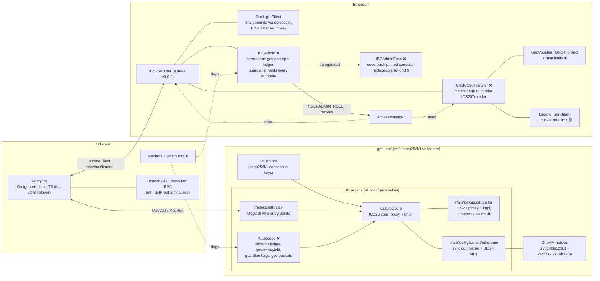

Client pairing: the gno.land Ethereum client `ethereum-N` ↔ the router client `client-M` (a `GnoLightClient`). Each
side registers the other as counterparty with its merkle prefix:

- **On Ethereum**, the gno client's prefix is `["main", "/pv/vm:gno.land/r/aib/ibc/core:"]`.
- **On gno.land**, the Ethereum client's prefix is `[""]`: router commitments live directly in its storage
  mapping.

## 4. Components, status and required changes

Repositories and branches:

| Short name | Location |
|---|---|
| **gno** | this branch, `feat/secp256k1-validators-ibc` (fork remote clockworkgr/gno) |
| **gno-realms** | [allinbits/gno-realms `feat/ethereum-light-client`](https://github.com/allinbits/gno-realms/tree/feat/ethereum-light-client) |
| **ts-relayer** | [allinbits/ibc-v2-ts-relayer PR #40](https://github.com/allinbits/ibc-v2-ts-relayer/pull/40) (`feat/ethereum-clients`) |
| **gno-eth-ibc** | [allinbits/gno-eth-ibc](https://github.com/allinbits/gno-eth-ibc) (`main`): the Solidity contracts, deployment scripts, Go relayer, testnet and e2e scripts. |
| **bridges** | [gnolang/bridges](https://github.com/gnolang/bridges): `main` (Solana, live) and [`ethereum-draft`](https://github.com/gnolang/bridges/tree/ethereum-draft) |
| **eureka** | [cosmos/solidity-ibc-eureka `solidity-v3.0.2`](https://github.com/cosmos/solidity-ibc-eureka/tree/solidity-v3.0.2) |

### 4.1 Chain (tm2, gno.land node)

| # | Component | Status | Where | Changes needed |
|---|---|---|---|---|
| C1 | secp256k1 validator consensus keys: params accept both key types; `gnoland secrets init -validator-key-type`; new keys default to secp256k1 | ✅ | gno: [`tm2/pkg/bft/types/params.go`](../../tm2/pkg/bft/types/params.go), [`tm2/pkg/bft/privval/signer/local/key.go`](../../tm2/pkg/bft/privval/signer/local/key.go), [`gno.land/cmd/gnoland/secrets_init.go`](../../gno.land/cmd/gnoland/secrets_init.go); ADR [`pr6375_secp256k1_validator_keys`](../../tm2/adr/pr6375_secp256k1_validator_keys.md); test `TestReactorBasicSecp256k1` | Upstream PR. It reverses [`pr5949_remove_secp256k1_validators`](../../tm2/adr/pr5949_remove_secp256k1_validators.md), so the PR must answer that ADR's reasons. Signatures are 64-byte `r‖s` over `sha256(signBytes)`, low-S. |
| C2 | **Migration of gnoland-1's validators to secp256k1** | ❌ | — | A chain-upgrade plan: set `Validator.PubKeyTypeURLs` to allow both types, have each validator rotate its consensus key (valset change through GovDAO), then optionally restrict to secp256k1. Coordinate with operators. While the set is mixed, `GnoLightClient` refuses ed25519 signers (C1 is secp256k1-only on the Ethereum side). |
| C3 | Colons in realm param names (IBC keys contain `:`) | ✅ | gno: [`gnovm/stdlibs/chain/params/params.go`](../../gnovm/stdlibs/chain/params/params.go), [`gno.land/pkg/sdk/vm/params_deposit.go`](../../gno.land/pkg/sdk/vm/params_deposit.go); ADR [`pr6358_param_key_colons`](../../gnovm/adr/pr6358_param_key_colons.md); upstream as [gnolang/gno#6358](https://github.com/gnolang/gno/pull/6358) | Needs a maintainer review. |
| C4 | `vm/qrender` ignores the requested height | ❌ (nice to have) | — | Relayers and monitors cannot read render history at a height. Not blocking: proofs use `.store` queries. |
| C5 | Lossless `block_results` (non-UTF-8 event bytes become U+FFFD in JSON) | n/a | — | Not needed for IBC: we prove state (ICS23), not results leaves. Relevant only if results-leaf proofs are ever used (the Hyperlane design depends on them). |

### 4.2 GnoVM natives

| # | Component | Status | Where | Changes needed |
|---|---|---|---|---|
| N1 | `crypto/bls12381.FastAggregateVerify(pubkeys, msg, sig)` | ✅ | gno: [`gnovm/stdlibs/crypto/bls12381/`](../../gnovm/stdlibs/crypto/bls12381/), gas row in [`native_gas.go`](../../gnovm/stdlibs/native_gas.go) (Base 2,024,000; Slope 1,962,000 per 1,024 bytes of keys, ≈92k per 48-byte key); ADR [`pr6375_bls12381_native`](../../gnovm/adr/pr6375_bls12381_native.md) | Gas rows are drafts: calibrate against the gas benchmark harness before upstreaming. Builds on the idea of [gnolang/gno#5583](https://github.com/gnolang/gno/pull/5583). Needs an audit (subgroup checks, infinity handling). |
| N2 | `crypto/bls12381.FastAggregateVerifyExcluding(aggregate, excluded, msg, sig)`: verify against a committee's aggregate key minus non-signers | ✅ | gno: same package (gas Base 2,116,000; same slope per 1,024 bytes of excluded keys) | Same as N1. This lets updates carry only non-signers, which cut update gas from about 260M to 40M. |
| N3 | `crypto/keccak256`, `crypto/sha256` | ✅ (master) | gno: [`gnovm/stdlibs/crypto/`](../../gnovm/stdlibs/crypto/) | None. |

### 4.3 gno.land realms and packages (gno-realms)

| # | Component | Status | Where | Changes needed |
|---|---|---|---|---|
| R1 | IBC v2 core (ICS26) behind an upgradeable proxy | ✅ (pre-existing) | [`r/aib/ibc/core`](https://github.com/allinbits/gno-realms/blob/feat/ethereum-light-client/gno.land/r/aib/ibc/core) | Scope route controls per client (§7). The relayer allow-list gates `UpdateClient`, `RecvPacket`, `Acknowledgement` and `Timeout` in the core **proxy** ([`core.gno`](https://github.com/allinbits/gno-realms/blob/feat/ethereum-light-client/gno.land/r/aib/ibc/core/core.gno), [`client.gno`](https://github.com/allinbits/gno-realms/blob/feat/ethereum-light-client/gno.land/r/aib/ibc/core/client.gno)), which is frozen once deployed, so the public-relaying decision of R17 must be made before deployment. `core.Pause` blocks refunds and is reserved for a core bug. |
| R2 | Client-specific proofs through the frozen messages' `Ext` field (`extproof.Proof{Data any}` + `Verifier`) | ✅ | [`p/aib/ibc/lightclient/extproof/v0`](https://github.com/allinbits/gno-realms/tree/feat/ethereum-light-client/gno.land/p/aib/ibc/lightclient/extproof/v0); core impl routing (commit `a5d7f0b`) | None. |
| R3 | **Ethereum light client**: Altair sync protocol across Electra, Fulu and Gloas; summaries instead of keys; non-signer updates; next-committee-only updates; MPT/RLP/SSZ; wire decoders | ✅ | [`p/aib/ibc/lightclient/ethereum/v0`](https://github.com/allinbits/gno-realms/tree/feat/ethereum-light-client/gno.land/p/aib/ibc/lightclient/ethereum/v0) (`ethereum.gno`, `ssz.gno`, `mpt.gno`, `rlp.gno`, `wire.gno`, `types.gno`); ADR [0003](https://github.com/allinbits/gno-realms/blob/feat/ethereum-light-client/docs/adrs/0003-ethereum-light-client.md); live Sepolia replay test | Fixed in review: updates build on the latest trusted state only ([`d56b992`](https://github.com/allinbits/gno-realms/commit/d56b992)); the client expires 8 sync committee periods after its latest trusted slot, misbehaviour requires conflicting finality, and misbehaviour too must build on the latest trusted state ([`cba712f`](https://github.com/allinbits/gno-realms/commit/cba712f)). Still to do: consensus-state pruning (each update stores about 6 KB, never refunded), a fork-upgrade migration (R16), an audit. |
| R4 | `r/aib/ibc/ethrelay`: MsgCall entry points taking wire-encoded `[]byte` (`UpdateClient`, `SubmitMisbehaviour`, `RecvPacket`, `Acknowledgement`, `Timeout`), avoiding MsgRun's per-byte cost | ✅ | [`r/aib/ibc/ethrelay`](https://github.com/allinbits/gno-realms/tree/feat/ethereum-light-client/gno.land/r/aib/ibc/ethrelay) | Optional: `CreateClient`/`RegisterCounterparty` from wire bytes (today a MsgRun). |
| R5 | Wire format `p/aib/encoding/wire/v0` (originally `p/clockwork/wire/v0` from [clockworkgr/gno-upgradeable](https://github.com/clockworkgr/gno-upgradeable)) | ✅ | [`p/aib/encoding/wire/v0`](https://github.com/allinbits/gno-realms/tree/feat/ethereum-light-client/gno.land/p/aib/encoding/wire/v0) (commit `e0b12e6`) | Deploy with the realms. |
| R6 | ICS20 ABI payloads (`application/x-solidity-abi`) to and from `ethereum-*` clients | ✅ | [`p/aib/ibc/ics20/abi/v0`](https://github.com/allinbits/gno-realms/tree/feat/ethereum-light-client/gno.land/p/aib/ibc/ics20/abi/v0); transfer impl (commit `1b53279`) | None. |
| R7 | Core renders of Ethereum client and consensus states (read by the TS relayer) | ✅ | core `impl/v0/render.gno` (commits `a863e19`, `39fc86b`) | None. |
| R8 | **Outflow meters + claim queue** for Ethereum → gno credits (§7.1) | ♻️ | bridges: [`solana/realm/p/hlroute/v0/hlroute.gno`](https://github.com/gnolang/bridges/blob/ethereum-draft/solana/realm/p/hlroute/v0/hlroute.gno) (`Meter`, `Credit`, `Claim`, `Cap`), [`ethereum/realm/hlgnot/installments.gno`](https://github.com/gnolang/bridges/blob/ethereum-draft/ethereum/realm/hlgnot/installments.gno) | Port the meter/claim/void algorithms (not the 2,500-line package, which is tied to one route's lock) into a new transfer impl, keyed by (client, denom). Two accountings: **unescrow of gno-native assets** is capped by their escrow (the lock); **minting of vouchers for Ethereum assets** has no lock and needs its own cap and backing accounting ([`impl/v0/app.gno`](https://github.com/allinbits/gno-realms/blob/feat/ethereum-light-client/gno.land/r/aib/ibc/apps/transfer/impl/v0/app.gno) mints them). `Claim(n)` must be reachable: the transfer proxy's `Logic` interface is frozen ([`apps/transfer/upgrade.gno`](https://github.com/allinbits/gno-realms/blob/feat/ethereum-light-client/gno.land/r/aib/ibc/apps/transfer/upgrade.gno)), so a new proxy entry point (or a generic dispatch method) is required — a proxy change, not only an impl. |
| R9 | **Decision ledger** + **governor / one-way yield** (§7.5, §7.7) | ♻️ | bridges: [`solana/realm/p/decisions/v0/decisions.gno`](https://github.com/gnolang/bridges/blob/main/solana/realm/p/decisions/v0/decisions.gno) (about 300 lines, depends only on `avl`; deployed on gnoland-1 under the bridge operator's namespace) | Reuse by import or copy. Its 7-day `Delay` and 14-day `Deadline` are constants and `DAOPath` is `gno.land/r/gov/dao`, which suits us. Ours needs per-kind delays (24 h unpause, 7 d otherwise). |
| R10 | **Guardian flags** on gno.land (sends / credits / payouts, 4 guardian + 2 watch seats) (§7.4) | ♻️ | bridges: [`ethereum/realm/hlmailbox/flags.gno`](https://github.com/gnolang/bridges/blob/ethereum-draft/ethereum/realm/hlmailbox/flags.gno), [`gov.gno`](https://github.com/gnolang/bridges/blob/ethereum-draft/ethereum/realm/hlmailbox/gov.gno) | Host them in the new governance realm (R11); the transfer impl consults them per client. |
| R11 | **Governance realm `ibcgov`**: builders, ledger, governor/yield, flags, and the **sender of governance packets** to Ethereum on a `gov` port (§7.6) | ❌ (pattern ♻️) | pattern: bridges [`ethereum/realm/hlgov/hlgov.gno`](https://github.com/gnolang/bridges/blob/ethereum-draft/ethereum/realm/hlgov/hlgov.gno) (decision kinds, `seq`, `Redispatch`) | New realm. It registers as an IBC app on gno core (port `gov`) and sends `kind‖seq‖params` packets to `IBCAdmin`. It handles acks (recorded) and timeouts (re-dispatch with the same `seq`). |
| R12 | Send-side limits: per-message max/min, route fee with floor and ceiling, recipient filters (§7.8) | ❌ (♻️ `CheckSend`) | bridges: `hlroute.CheckSend`, [`ethereum/realm/hlgnot/hlgnot.gno`](https://github.com/gnolang/bridges/blob/ethereum-draft/ethereum/realm/hlgnot/hlgnot.gno) `TransferRemote` (`RefusedEthRecipient`) | Transfer impl v1, per client. |
| R13 | Voids / restores / credit-by-vote (§7.9) | ❌ (♻️) | bridges: `hlroute.DraftVoid`, `Decide` | Only with the claim queue. Needs IBC terminal-state rules: claims are keyed by packet and created atomically with the receipt; a manual credit only for a packet with a receipt; never both a credit and a source refund (§7.9). |
| R14 | Existing admin surface: `p/aib/authority` (deployer + GovDAO), relayer allow-list, global and per-app pause, address blocklist, GovDAO builders, `UpdateImpl` | 🟡 | [`r/aib/ibc/core/admin.gno`](https://github.com/allinbits/gno-realms/blob/feat/ethereum-light-client/gno.land/r/aib/ibc/core/admin.gno), [`core/upgrade.gno`](https://github.com/allinbits/gno-realms/blob/feat/ethereum-light-client/gno.land/r/aib/ibc/core/upgrade.gno), [`app.gno`](https://github.com/allinbits/gno-realms/blob/feat/ethereum-light-client/gno.land/r/aib/ibc/core/app.gno), [`apps/transfer/admin.gno`](https://github.com/allinbits/gno-realms/blob/feat/ethereum-light-client/gno.land/r/aib/ibc/apps/transfer/admin.gno), [`p/aib/authority`](https://github.com/allinbits/gno-realms/blob/feat/ethereum-light-client/gno.land/p/aib/authority/v0/authority.gno) | Today authority members (the deployer and GovDAO) act **immediately**, including `UpdateImpl` and adding members, which would bypass every delay. Every loosening power over the Ethereum route — impl upgrades, membership, relayer list, recovery, legacy proposal callbacks — must move exclusively to `ibcgov` (R11) and the deployer must be removed; immediate authority remains only for tightening. |
| R15 | 18-decimal Ethereum tokens on gno (GRC20 and amounts are int64: about 9.22 tokens max) | ❌ | — | A 6-decimal wrapper on Ethereum (factory, `wrap` takes whole multiples of 10^(d−6), refunds dust, `wrapAndSend`), or accept the cap (§12). |
| R16 | **Ethereum light-client fork migration**: replacing the verifier of a live `ethereum-N` client (new fork parameters, new container indices) while keeping its client id, commitments and consensus states | ❌ | [`p/aib/ibc/lightclient/ethereum/v0/ethereum.gno`](https://github.com/allinbits/gno-realms/blob/feat/ethereum-light-client/gno.land/p/aib/ibc/lightclient/ethereum/v0/ethereum.gno) (client upgrade/recovery refuse differing fork parameters) | A core impl change: a governed `SetLightClient`-style conversion from the old client state to a new package version, rehearsed before each relevant Ethereum fork (§6.12). A new package alone changes no stored client. |
| R17 | **Route-scoped flags on gno** that keep returns open, and **public relaying for the Ethereum route** | ❌ | [`core/app.gno`](https://github.com/allinbits/gno-realms/blob/feat/ethereum-light-client/gno.land/r/aib/ibc/core/app.gno) `PauseApp` pauses the whole `transfer` port (sends included, so voucher returns too); [`core/core.gno`](https://github.com/allinbits/gno-realms/blob/feat/ethereum-light-client/gno.land/r/aib/ibc/core/core.gno) and [`core/client.gno`](https://github.com/allinbits/gno-realms/blob/feat/ethereum-light-client/gno.land/r/aib/ibc/core/client.gno) apply the relayer allow-list to `UpdateClient`, `RecvPacket`, `Acknowledgement` and `Timeout` | Per-client flags in the transfer impl that stop credits/payouts and sends of gno-native tokens, never burns of returning vouchers. Refunds need fresh client updates as well as the ack/timeout itself, so exempting acks and timeouts alone is not enough: make every relaying entry point for the Ethereum client permissionless (they are proof-checked), or keep the allow-list with at least two independent relayers and a documented fail-over. Decide before deploying the core proxy. |
| R18 | **Route replacement on gno.land** (§7.12): new Ethereum client and counterparty, `ibcgov` epoch, re-keying escrow and voucher denom paths, freezing the old client, reconciliation of in-flight packets | ❌ | — | New, in core impl, the transfer impl and `ibcgov`; GovDAO-driven. |

### 4.4 Ethereum contracts

| # | Component | Status | Where | Changes needed |
|---|---|---|---|---|
| E1 | `ICS26Router`, `Escrow`, `IBCERC20`, `AccessManager` roles | ✅ (eureka v3.0.2, unchanged) | eureka [`contracts/`](https://github.com/cosmos/solidity-ibc-eureka/blob/solidity-v3.0.2/contracts); deployed by gno-eth-ibc [`contracts/script/DeployGnoIBC.s.sol`](https://github.com/allinbits/gno-eth-ibc/blob/main/contracts/script/DeployGnoIBC.s.sol) | `ICS20Transfer` is replaced by a minimal fork (E6); AccessManager's admin moves to E8. |
| E2 | **`GnoLightClient`**: tm2 header hash (amino leaves, sha256 merkle), CanonicalVote sign bytes, secp256k1 `ecrecover` low-S, power tally ≥ 2/3 plus trust level for non-adjacent headers, validator-set cache by hash, packed 81-byte signatures, minimal signer set, ICS23 B+tree + simple-tree membership/non-membership, misbehaviour freezing | ✅ | gno-eth-ibc [`contracts/src/GnoLightClient.sol`](https://github.com/allinbits/gno-eth-ibc/blob/main/contracts/src/GnoLightClient.sol), [`contracts/src/lib/`](https://github.com/allinbits/gno-eth-ibc/tree/main/contracts/src/lib); 88 Foundry tests (fixtures from real tm2 code) | Add the quarantine (E9). Consider supporting mixed key sets only if C2 needs it. Audit. |
| E3 | **`GnoVoucher`**: ERC20 with gno.land's decimals (GNOT 6), mint/burn only by ICS20, registered with `setCustomERC20` before the first transfer; `RegisterGnoDenom.s.sol` for more denoms | ✅ | gno-eth-ibc [`contracts/src/GnoVoucher.sol`](https://github.com/allinbits/gno-eth-ibc/blob/main/contracts/src/GnoVoucher.sol), [`contracts/script/GnoDenoms.sol`](https://github.com/allinbits/gno-eth-ibc/blob/main/contracts/script/GnoDenoms.sol), [`contracts/script/RegisterGnoDenom.s.sol`](https://github.com/allinbits/gno-eth-ibc/blob/main/contracts/script/RegisterGnoDenom.s.sol) | Limits are **not** enforced in `mint`: ICS20 also calls `mint` to refund a returning voucher on an error ack or timeout ([ICS20Transfer.sol `_refundTokens`](https://github.com/cosmos/solidity-ibc-eureka/blob/solidity-v3.0.2/contracts/ICS20Transfer.sol)), and a refund must never be limited. Limits live in E6's receive path. |
| E4 | Deployment: AccessManager, router, ICS20, roles as eureka's `DeployAccessManagerWithRoles`, GnoLightClient, `addClient`, GNOT voucher; resumes a broadcast after RPC nonce lag | ✅ | gno-eth-ibc [`contracts/script/DeployGnoIBC.s.sol`](https://github.com/allinbits/gno-eth-ibc/blob/main/contracts/script/DeployGnoIBC.s.sol), [`scripts/sepolia.sh`](https://github.com/allinbits/gno-eth-ibc/blob/main/scripts/sepolia.sh) | Hand every authority to E8 at the end; add a `finishSetup`-style check list (♻️ bridges `HlAdmin.finishSetup`). |
| E5 | **Mint and release limits** per token: per-message max + leaky-bucket day cap (§7.2) | ♻️ | bridges: [`PausableGate.sol`](https://github.com/gnolang/bridges/blob/ethereum-draft/ethereum/bridge/contracts/src/PausableGate.sol) `_charge`/`_level` | Enforced in E6's `onRecvPacket` only, before minting or `escrow.send`, so refunds (which also mint or use `escrow.send`, [`utils/Escrow.sol`](https://github.com/cosmos/solidity-ibc-eureka/blob/solidity-v3.0.2/contracts/utils/Escrow.sol)) are never limited. Eureka's own `Escrow` rate limit also applies to refunds, so it is left unset. |
| E6 | **`GnoICS20Transfer`**: a **minimal fork** of eureka's `ICS20Transfer` (installed by its UUPS upgrade). The callbacks are `external` and not `virtual`, and `_refundTokens` is private ([`ICS20Transfer.sol`](https://github.com/cosmos/solidity-ibc-eureka/blob/solidity-v3.0.2/contracts/ICS20Transfer.sol)), so a subclass is impossible. The fork adds, in `onRecvPacket` only: flags, quarantine, limits (E5), and **default-deny denoms** (a gno-native denom without a registered `GnoVoucher` is refused, so no stock 18-decimal `IBCERC20` can ever be created for it); in every send variant: send-side limits **for Ethereum-native tokens leaving through escrow only** — returning vouchers (burns) are never limited or paused; and leaves acks, timeouts and refunds unconditional. Expected refusals revert with non-empty custom errors | ❌ | — | New. Keep the diff small and audited, or upstream an extensibility hook to eureka. Do not grant `PAUSER_ROLE`: eureka's pause also blocks `onAcknowledgementPacket`/`onTimeoutPacket`. Note the router turns a callback revert **with non-empty data** into an **error ack** ([`ICS26Router.sol`](https://github.com/cosmos/solidity-ibc-eureka/blob/solidity-v3.0.2/contracts/ICS26Router.sol) `recvPacket`'s try/catch): such a refused receive refunds the sender. A revert with empty data (including out-of-gas) or an empty/forbidden returned ack reverts the whole router call and rolls back the receipt, so the packet stays pending. |
| E7 | **Guardians, flags and holds** on Ethereum (4 guardian + 2 watch seats; hold = two guardian flags; unpause after 24 h clears only earlier flags; replacement under a hold no sooner than day 21) | ♻️ | bridges: [`lib/Guardians.sol`](https://github.com/gnolang/bridges/blob/ethereum-draft/ethereum/bridge/contracts/src/lib/Guardians.sol) | Reuse nearly as is, in E6/E3 (deliveries) and E8 (decisions). |
| E8 | **`IBCAdmin`** (permanent) + **`IBCAdminExec`** (replaceable executor). `IBCAdmin` is a small immutable IBC app on port `gov` (router ports can never be re-registered, [`ICS26Router._addIBCApp`](https://github.com/cosmos/solidity-ibc-eureka/blob/solidity-v3.0.2/contracts/ICS26Router.sol)) that owns the ledger state (sequence, buffer, decision hashes, cancellations, maturity times, flags, hold history, recovery proposals) and **holds every authority** (`ADMIN_ROLE`, every proxy, `migrateClient`). It accepts packets only from the router, from `ibcgov` over the paired client, and delegatecalls an executor whose code hash it pins; decision kinds with delays, deferred by flags and holds; code-hash-pinned upgrades with after-checks. A hand-over (kind 9) swaps the executor's code hash atomically, with an optional one-time migration call; no state or authority moves | ❌ (pattern ♻️) | pattern: bridges [`HlAdmin.sol`](https://github.com/gnolang/bridges/blob/ethereum-draft/ethereum/bridge/contracts/src/HlAdmin.sol), [`admin/HlAdminExec.sol`](https://github.com/gnolang/bridges/blob/ethereum-draft/ethereum/bridge/contracts/src/admin/HlAdminExec.sol) (there the executor is fixed and hand-over moves authorities to a successor) | Replace Hyperlane's `handle`/ISM plumbing with `IIBCApp` callbacks and implement the delivery protocol of §5.4 (never revert with empty data; expected refusals revert with custom errors; out-of-window packets error-ack for redispatch). Kinds remapped (§7.6). Keep each contract under EIP-170. |
| E9 | **Quarantine** after a validator-set transition | ❌ (♻️) | bridges: [`GnoLightClient.sol`](https://github.com/gnolang/bridges/blob/ethereum-draft/ethereum/bridge/contracts/src/GnoLightClient.sol) (`quarantineEnd`) | The client keeps a **live epoch**: the `nextValidatorsHash` of its latest accepted header. A newly accepted update (not a no-op, not misbehaviour checking) starts the quarantine when its header's `validatorsHash` differs from the live epoch's or from its verification anchor's next set (callers choose `trustedHeight`, so the anchor alone is not enough), or when it announces a different next set. `_verifyHeader` is `view`: it returns the transition data and `update` applies it (`contracts/src/GnoLightClient.sol`). E6 refuses token receives until `quarantineEnd`; `IBCAdmin` ignores it. |
| E10 | 6-decimal wrapper for 18-decimal Ethereum tokens | ❌ | — | See R15. |
| E11 | **Bootstrap role cleanup**: the deployment grants the deployer `ID_CUSTOMIZER_ROLE` and `ERC20_CUSTOMIZER_ROLE` besides the AccessManager admin ([`contracts/script/DeployGnoIBC.s.sol`](https://github.com/allinbits/gno-eth-ibc/blob/main/contracts/script/DeployGnoIBC.s.sol)) | 🟡 | gno-eth-ibc [`contracts/script/DeployGnoIBC.s.sol`](https://github.com/allinbits/gno-eth-ibc/blob/main/contracts/script/DeployGnoIBC.s.sol) | `finishSetup` must enumerate and revoke every bootstrap role and admin, renounce the deployer, and check the result on chain (♻️ bridges `finishSetup`'s check list). |
| E12 | **Route replacement** (§7.12): freeze an old client id, add a new one, open a new governance epoch (`epoch ‖ seq`) dropping the old epoch's unexecuted state, `migrateRoute` re-keying voucher denom paths and escrow; the optional guardian-attested emergency path | ❌ | — | New, in `IBCAdmin`/`IBCAdminExec` and the ICS20 fork (E6). |

### 4.5 Relayers and tooling

| # | Component | Status | Where | Changes needed |
|---|---|---|---|---|
| T1 | Go relayer: trust, create/update clients both ways, relay gno → Eth and Eth → gno, acks, transfers, snapshots, wire/ABI vectors | ✅ | gno-eth-ibc `relayer/` (`cmd/relayer`, `relay/`, `gnoibc/`, `ethgno/`, `beacon/`, `eth/`) | Fix: `relay-gno-acks` re-sends an ack another step just delivered (stale read). Read commitments at the latest receipt's block. |
| T2 | TypeScript relayer: Ethereum chains (source and host), gno hosting Ethereum clients, byte-equality tests against the Go encoders | ✅ (PR open) | ts-relayer [`src/clients/ethereum/`](https://github.com/allinbits/ibc-v2-ts-relayer/tree/feat/ethereum-clients/src/clients/ethereum), [`src/clients/gno/ethereum.ts`](https://github.com/allinbits/ibc-v2-ts-relayer/blob/feat/ethereum-clients/src/clients/gno/ethereum.ts); [PR #40](https://github.com/allinbits/ibc-v2-ts-relayer/pull/40) | Support the claim queue (call `Claim`), governance packets, and the guardian-aware pause. Implement conflicting-header detection for the GnoLightClient (unsupported today, `src/clients/ethereum/host.ts`) and bounded `eth_getLogs` scans instead of scanning from block 0. |
| T3 | Local testnet (N secp256k1 validators, realms at genesis), local e2e with anvil, Sepolia scripts | ✅ | gno-eth-ibc [`testnet/`](https://github.com/allinbits/gno-eth-ibc/tree/main/testnet), [`scripts/e2e-local.sh`](https://github.com/allinbits/gno-eth-ibc/blob/main/scripts/e2e-local.sh), [`scripts/sepolia.sh`](https://github.com/allinbits/gno-eth-ibc/blob/main/scripts/sepolia.sh) | — |
| T4 | **Monitors**: supply identity, header record, foreign decisions; auto-flag on integrity breaks, alarm on liveness | ❌ (♻️) | bridges: [`ethereum/bridge/agent`](https://github.com/gnolang/bridges/tree/ethereum-draft/ethereum/bridge/agent) (monitor role) | New, IBC-specific: escrow per client against voucher supply, plus in-flight packets from commitments. |
| T5 | **Watch tool** for guardians and GovDAO members: state, pending decisions, flags, `check` of upgrade targets (code-hash, reproducible build, append-only storage layout) | ❌ (♻️) | bridges: [`ethereum/bridge/cmd/hlwatch`](https://github.com/gnolang/bridges/tree/ethereum-draft/ethereum/bridge/cmd/hlwatch) | Port. |
| T6 | Setup audit tool (reads every authority and setting back, byte-for-byte creation checks) | ❌ (♻️) | bridges: `ethereum/bridge/cmd/hleth` (`audit`) | Port. |

## 5. Protocol design

### 5.1 gno.land → Ethereum: `GnoLightClient`

- **Header.** The relayer submits the tm2 header (its amino-encoded leaves), the commit, and the signers' packed
  signatures: 81 bytes each, `validatorIndex u16 ‖ trustedIndex u16 ‖ timeSeconds u64 ‖ timeNanos u32 ‖ r ‖ s ‖ v`
  ([`contracts/src/msgs/IGnoLightClientMsgs.sol`](https://github.com/allinbits/gno-eth-ibc/blob/main/contracts/src/msgs/IGnoLightClientMsgs.sol); the recovery id `v` is found off chain). The client rebuilds the header hash with
  sha256 merkle, rebuilds each validator's CanonicalVote sign bytes, recovers each address with `ecrecover` over
  `sha256(signBytes)`, and requires low-S.
- **Trust rule.** Adjacent headers need more than 2/3 of the trusted next set's power. Non-adjacent headers need
  more than 2/3 of the header's own set **and**, when that set differs from the trusted next set, more than the
  trust level (1/3) of the trusted next set (tm2 light-client rules), within the trusting period and the clock
  drift. So the security of skipping is the standard light-client assumption: fewer than 1/3 of the trusted set's
  power is faulty within the trusting period. A coalition of more than 1/3 of the trusted set can sign a header of
  a set it fully controls; the quarantine (§7.10) is the brake for that.
- **Validator-set cache.** Sets are stored by hash on first sight. Later updates send no keys, only signer indexes.
  The relayer sends the minimal signer set: enough of the trusted power first, then of the new set.
- **Proofs.** Packet commitments, receipts and acks are proven with ICS23 against the app hash of height H+1:
  - the `ics23:bptree` op proves the key in gno.land's `main` B+tree store under
    `/pv/vm:gno.land/r/aib/ibc/core:`;
  - the `ics23:simple` op proves the store in the multistore root.
- **Misbehaviour.** Two conflicting signed headers freeze the client.

### 5.2 Ethereum → gno.land: the Ethereum light client in Gno

- **State.**
  - Client state: chain id, genesis validators root and time, fork schedule, slot parameters, the router address,
    and the slot of the router's commitments mapping.
  - Consensus state per finalized slot: execution state root, timestamp, and the summaries of the current and
    next sync committee (SSZ pubkeys root + aggregate pubkey).
- **Update.** A light-client update carries:
  - the attested and finalized headers with the finality branch;
  - the sync aggregate bits and signature;
  - the **non-signers** with their Merkle branches to the pubkeys root;
  - on Gloas, the RLP execution header, checked against the committed block hash;
  - optionally the next committee's summary with its branch.

  The client requires at least `MinSyncCommitteeParticipants` (2/3 of 512) to have signed, and checks
  `FastAggregateVerifyExcluding(aggregate, nonSigners, signingRoot, sig)`.
- **Next-committee-only updates.** Updates whose finalized slot does not advance are accepted when they reveal the
  next committee (the spec's `apply_light_client_update`). This is needed because beacon nodes only serve
  bootstraps at recent checkpoints.
- **Single store.** Every update must build on the client's **latest** trusted state (`TrustedSlot == LatestSlot`),
  as the spec's store does; it either advances the latest slot or, for a next-committee-only update, updates the
  latest state in place. No update can insert a root below the latest slot, so a past committee cannot add history.
  Roots already stored stay usable for proofs.
- **Freshness (enforced).** The client follows Ethereum one sync-committee period (~27 h) at a time, so it can
  catch up after a gap. Its trust is bounded: it **expires** `TrustingPeriods = 8` periods (~9 days on mainnet)
  after its latest trusted slot, measured by the current slot from the block time. An expired client reports
  `Expired` and refuses every client message, so stale committees can never advance it; it comes back only through
  governed recovery (the core's recovery with a fresh substitute) or a route replacement (§7.12). The relayer
  updates it at least daily; the monitor alarms after a day without an update.
- **Misbehaviour** is conflicting finality: two valid updates (each with the supermajority participation an update
  needs) that finalize **different beacon headers at the same slot**. Different attested heads alone are not
  evidence: sync committees sign their fork-choice head, and an ordinary reorg yields two. Evidence must build on
  the latest trusted state of an unexpired client, so a past committee cannot freeze it. Valid evidence freezes the
  client. A header that would store a different state root at a slot the client already holds is also treated as
  misbehaviour.
- **Fork-aware generalized indices.** Gloas: finality 735, next committee 2946, execution block hash 2856.
  Electra/Fulu: 169, 87, 25.
- **Proofs.** `eth_getProof` at the finalized block gives an account proof (router address under the state
  root) and a storage proof at `keccak256(keccak256(path) ‖ slot)`, verified with RLP/MPT in Gno.
- **Wire.** Updates and packets reach `r/aib/ibc/ethrelay` as MsgCall `[]byte` arguments in the
  `p/aib/encoding/wire/v0` format: `Uint` 8-byte big-endian, `Uvarint` LEB128, `Str`/`Blob` length-prefixed.

### 5.3 Transfers

- **ICS20 payload.** `application/x-solidity-abi` encoded `FungibleTokenPacketData` both ways.
- **Denoms.** gno-native denoms on Ethereum are `transfer/<client>/<denom>` → `GnoVoucher` (E3). Ethereum
  tokens on gno are GRC20 vouchers of the transfer realm.
- **Acks.** The Ethereum app writes `{"result":"AQ=="}` (JSON) on success. The gno app writes the protobuf
  `Acknowledgement`; relayers decode it to the app ack before `ackPacket`.
- **Amounts** are raw base units, never scaled.

### 5.4 Governance channel (new)

- A dedicated IBC app pair: `ibcgov` on gno.land (port `gov`) ⇄ `IBCAdmin` on Ethereum (port `gov`), over the
  same client pair as transfers.
- Payload: `kind u8 ‖ seq u64 ‖ params`, at most 512 bytes. `seq` is a **dedicated contiguous sequence of
  Ethereum-bound decisions**, separate from the numbers of gno-only ledger entries.
- Router semantics this relies on: a callback revert with non-empty data becomes an error ack and the receipt
  stays; a revert with empty data (or out-of-gas) rolls the whole receive back. So `IBCAdmin` never reverts with
  empty data, and it **orders recording, not delivery**:
  - `seq == last+1`: recorded; then buffered `last+2…` are recorded in order, at most `D` per call (e.g. 8); the
    rest by a permissionless `drain()`.
  - `last+1 < seq ≤ last+W` (window `W`, e.g. 64): stored with its hash, success ack. A second packet for a buffered
    `seq` with the same hash is a no-op; with a different hash it is a conflict: flags `IBCAdmin`, keeps the first,
    is never applied.
  - `seq > last+W`: error ack (custom error). `ibcgov` treats an error ack of a governance packet as "redispatch
    later": it re-sends the **same `seq` with identical bytes** once the window has moved (backpressure).
  - `seq ≤ last`: compared with the stored hash of that number; same hash → no-op success, different → conflict as
    above.
  - Undecodable envelope (no readable `seq`): error ack; `ibcgov`'s builders never produce one, so it can only come
    from a forgery. A decodable decision with unknown kind or bad parameters is recorded and **spent**, so it never
    blocks the sequence.
  - **Cancellations** are an exception to the window: a cancel decision is never refused. On arrival, whatever its
    `seq`, its targets are tombstoned (bounded: at most 64 stored ranges, merging beyond that, as `HlAdmin`), and it
    gets a **success** ack. If its own `seq` is inside the window it is also recorded or buffered as usual; if it is
    beyond the window, the success ack carries an app-level flag `redispatch = 1`, and `ibcgov` re-sends the same
    `seq` with identical bytes later so the cancel takes its place in the sequence (its tombstones already
    applied; re-applying them is a no-op).
  - Only the router may call, only from `ibcgov`'s port over the paired client; anything else is an error ack.
- An ack tells `ibcgov` the decision is recorded or buffered. A **timeout** (no receipt) or an out-of-window error
  ack lets `ibcgov` re-dispatch the same `seq` with identical bytes. `ibcgov` never skips or reuses a number, so the
  destination never has a permanent gap. **A number's bytes are immutable once bound**: a dispatched decision is
  withdrawn only by a separate cancel decision (its own number), never by re-sending its number with other bytes. A
  number may be sent as a no-op only if it was reserved but never bound to a decision or dispatched (e.g. its
  builder's proposal failed), so no other bytes for it can exist.
- Forged governance packets (a light-client forgery) can occupy sequence numbers with the attacker's bytes; honest
  re-sends then show up as conflicts and flag `IBCAdmin`. That case is handled by the guardians' hold and the route
  replacement of §7.12, which starts a new governance epoch over a new client, not by GovDAO cancelling over the
  same channel.

## 6. Flows

### 6.1 GNOT gno.land → Ethereum

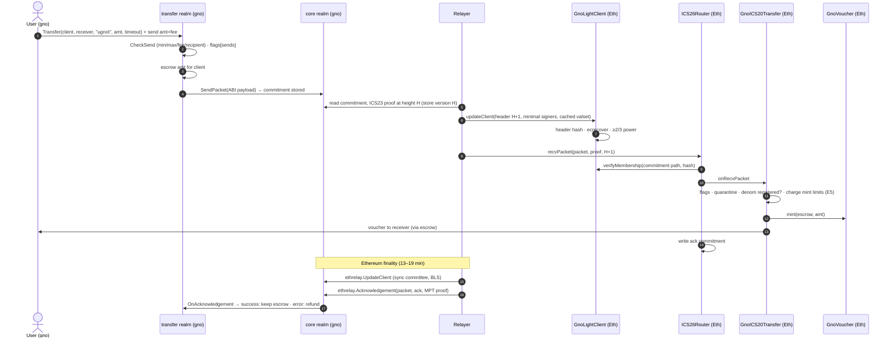

### 6.2 Ethereum → gno.land (voucher returning, or an Ethereum token)

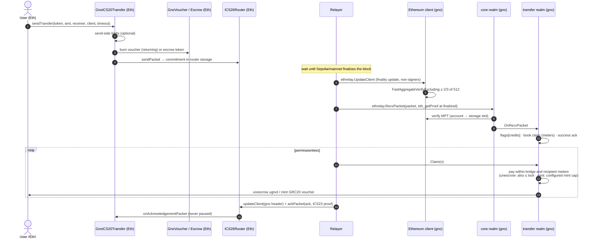

### 6.3 Timeouts and error acks (refunds)

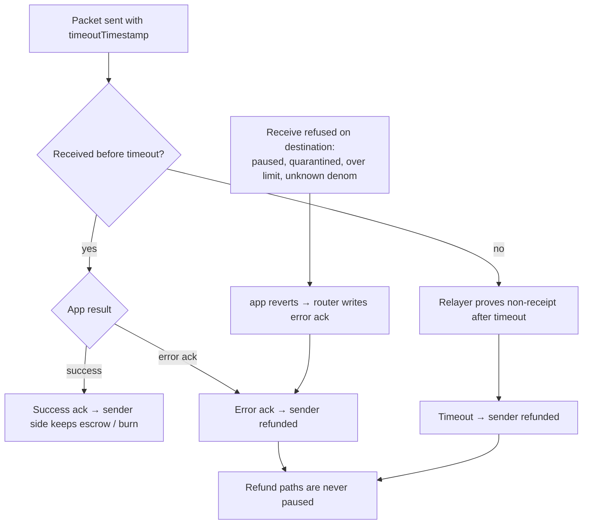

### 6.4 `GnoLightClient` update

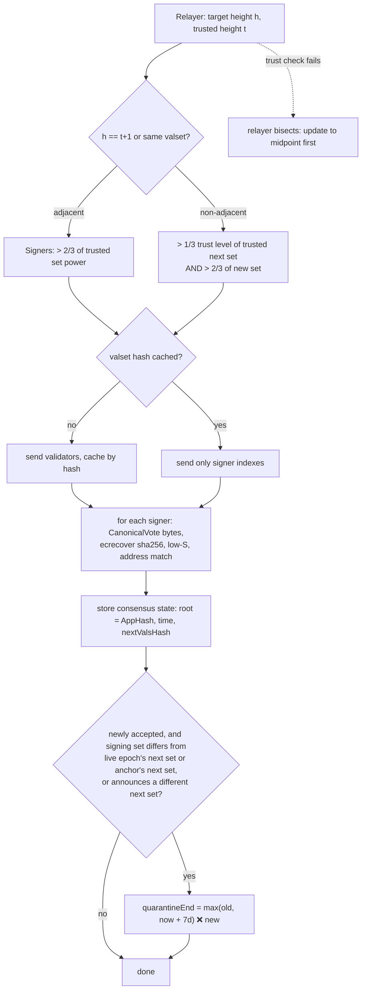

### 6.5 Ethereum light-client update on gno.land

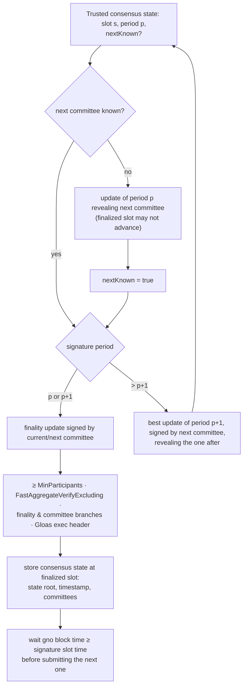

### 6.6 Governance decision lifecycle (new)

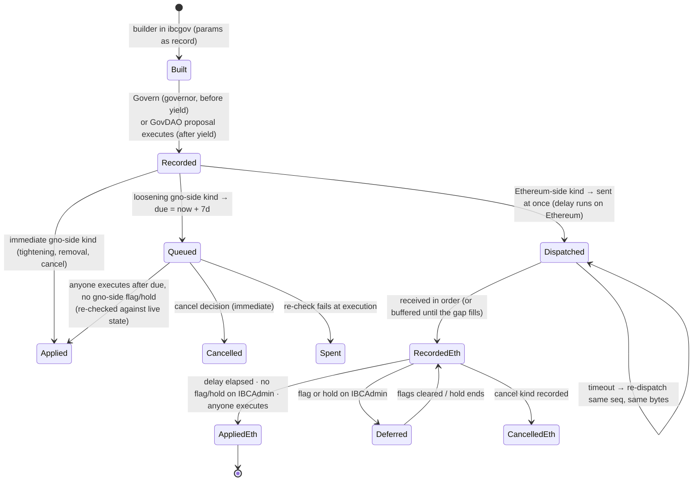

The delay is applied once per side:

- **gno-side kinds** (meters, fees, gno guardians) wait on gno.land.
- **Ethereum kinds** are dispatched at once from gno.land and wait in `IBCAdmin` after they are recorded (7 days;
  unpause 24 h). Guardians on either side have the full window. Every 7-day Ethereum kind is deferred while a flag
  or hold stands on `IBCAdmin`, **except** the guardian replacement, which lands through a hold no sooner than day
  21 of the hold (as `HlAdmin`). Holds on gno.land (deferring gno-side decisions) are new work: bridges' realms have
  no holds on gno.land.

### 6.7 Guardian flags and holds

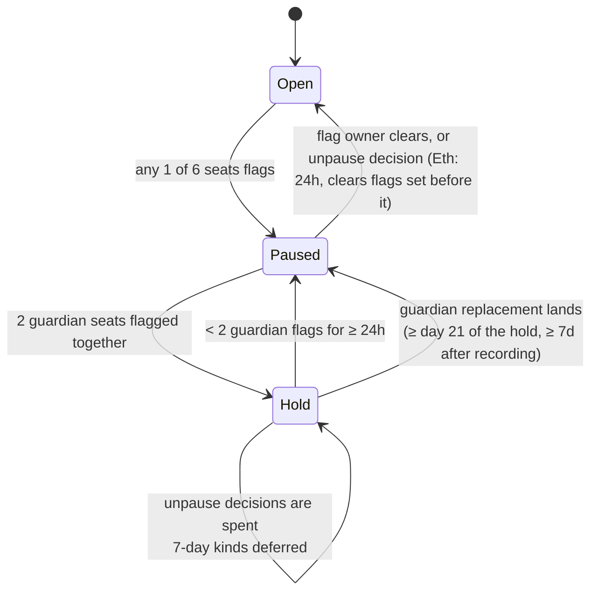

What a flag stops: deliveries/mints (Ethereum), `credits`/`payouts`/`sends` (gno.land, per client). What it never
stops: burns, sends of vouchers back, acks, timeouts, refunds.

### 6.8 Meters and claims on gno.land

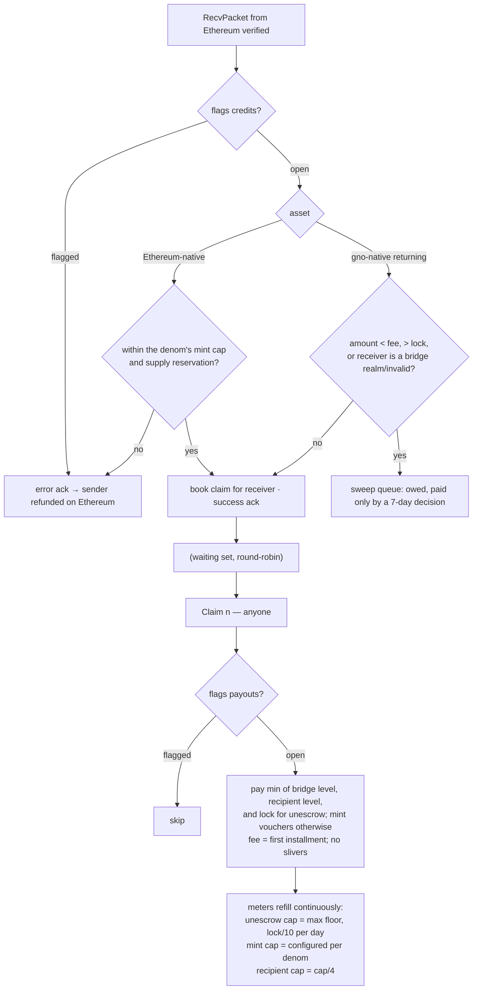

### 6.9 Validator-set change and quarantine

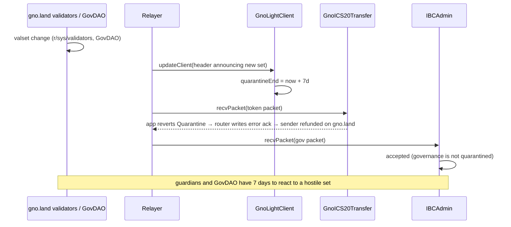

### 6.10 Launch and yield

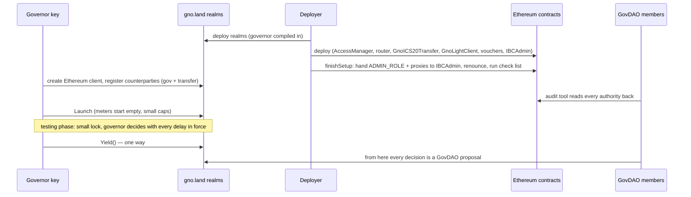

### 6.11 Incident response

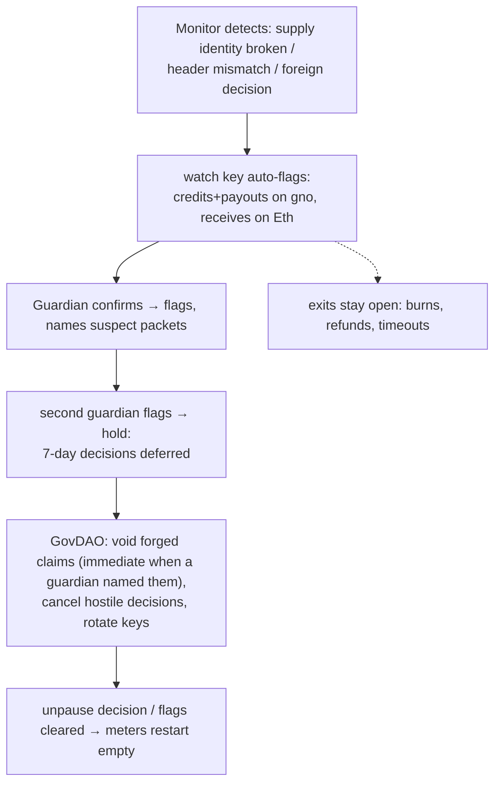

### 6.12 Upgrades

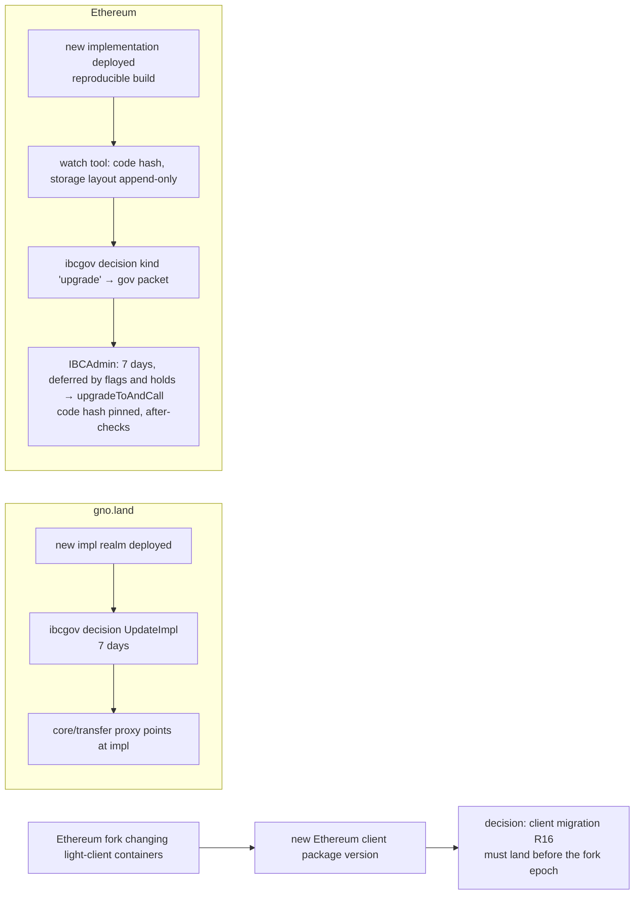

## 7. Safety and governance controls

The controls are those of gnolang/bridges, ported to the IBC app layer. They are scoped **per Ethereum client**,
so other IBC routes of the same realms are unaffected.

### 7.1 Outflow meters and claims (gno.land) — R8

- **Day cap.** `cap = max(CapFloor, lock/10)`, recomputed at every refill.
- **Bridge meter.** A token bucket refilling at `cap/86400` per second, ceiling one day: no midnight reset, at most
  2 caps in any 24 hours.
- **Recipient meter.** Same, at `cap/4`.
- **Credits are claims.** `RecvPacket` books a claim and returns a success ack. Anyone calls `Claim(n ≤ 20)`.
  - Recipients are served round-robin, the oldest claim first.
  - Each turn pays `min(bridge, recipient, lock)`.
  - The fee is the first installment.
  - A later installment is paid only when both meters hold at least `min(remaining, fee)` (no slivers).
- **Sweep queue.** Amounts below the fee, above the lock, or to a bridge realm or invalid address are booked as
  owed and paid only by a 7-day decision.
- **Meters start empty.** At launch, after a migration, and whenever a `payouts` flag is cleared.
- **Two accountings.** Gno-native assets returning from Ethereum are unescrowed: `lock` is their escrow and caps
  payouts. Ethereum assets arriving on gno are **minted** as vouchers: there is no gno lock, so they get their own
  day cap (absolute, per denom) and their own outstanding-supply accounting; `amount > lock` sweeping applies only
  to unescrow.
- **What it bounds.** A bucket starts at most full and refills over time, so within any 24 hours at most **two**
  day caps can leave (a full bucket plus one day of refill), and within `t` hours of an exploit at most
  `level₀ + ∫ cap(τ)/24 dτ ≤ level₀ + cap_max·t/24`, where `cap_max` is the largest cap over the interval (for
  unescrow `cap = max(CapFloor, lock/10)` only falls while the lock drains, so `cap_max` is the cap at the start
  unless new deposits raise the lock; for minting it is the configured cap). The loss before a void is that amount for the time it takes a monitor or guardian to set a
  `payouts` flag; that detection time is an operational parameter (monitors poll every 10 s and flag within
  minutes).
- **Time to leave.** If nothing is flagged, holders can withdraw at the meter rate before a hostile 7-day decision
  lands — about half the lock in 7 days at lock/10 per day; less when the meter is shared with an attacker or a
  `payouts` flag stops exits.
- **IBC alternative.** Refuse with an error ack when a meter is empty, so the sender is refunded on Ethereum.
  Simpler, but under an attack honest transfers bounce. The claim queue is the tested design and is the default.

### 7.2 Mint and release limits (Ethereum) — E5

- **Per token:** a per-message maximum and a leaky-bucket day cap (`used` drains at `dayCap` per day).
- **Where:** in `GnoICS20Transfer.onRecvPacket`, before it mints a gno-native token's voucher or releases an
  Ethereum token from escrow. **Not** in `GnoVoucher.mint` or `Escrow.send`: ICS20's refund path (error ack,
  timeout) also mints returning vouchers and uses `escrow.send`, and refunds must never be limited. Eureka's
  per-token escrow rate limit is left unset for the same reason.
- **Default deny:** a gno-native denom without a registered `GnoVoucher` and configured limits is refused.
- **Launch values:** `maxPerMessage = min(25,000, dayCap)`, `dayCap = min(100,000, expectedLock/10)`.
- **What it bounds:** a gno.land validator-key forgery mints at most `level₀ + dayCap·t/day` within `t` of the
  forgery (at most two day caps in any 24 hours), each message at most `maxPerMessage`, until a flag lands.

### 7.3 Pausing that never traps exits — E6, R1

- **Rule: a pause stops minting and crediting, never burning, acks, timeouts or refunds.**
- **gno.land.**
  - The incident tool is the per-client flags of the transfer impl (R17): `credits`, `payouts`, and `sends` of
    gno-native tokens. Burns of returning vouchers are never paused.
  - `PauseApp` refuses sends (voucher returns included) for the whole `transfer` port, error-acks receives and keeps
    acks and timeouts running: acceptable as a coarse fallback, not the incident tool.
  - `core.Pause` blocks the whole packet path, refunds included, and is reserved for a core bug.
  - Acks and timeouts must not depend on the relayer allow-list (R17), or a fail-over relayer must be guaranteed.
- **Ethereum.**
  - Eureka's `ICS20Transfer.pause` also blocks `onAcknowledgementPacket`/`onTimeoutPacket`, so `PAUSER_ROLE` is
    granted to nobody.
  - The pause lives in `GnoICS20Transfer.onRecvPacket` and in its send variants for **Ethereum-native** tokens
    entering escrow; a voucher returning to gno.land (a burn) is never paused or limited.
  - A paused receive reverts inside the app with a custom error; the router turns that into an **error ack**, and
    the source refunds the sender when the ack is relayed: IBC's escape hatch, which the Hyperlane design does not
    have. (A receive refused *before* the app — by the light client — or reverting with empty data would instead
    leave the packet pending until it times out.)
  - On gno.land, refusals in the transfer impl return a failure acknowledgement before any state change, rather
    than relying on a panic being converted.

### 7.4 Guardians, flags and holds — R10, E7

- **Seats.** Six per side: 4 guardians (2 of them outsiders) and 2 watch keys (the operator's monitors).
- **Flags.**
  - One flag pauses at once.
  - Flags are per function on gno.land (`sends`, `credits`, `payouts`, per client).
  - Flags are per object on Ethereum (`GnoICS20Transfer`+vouchers, and `IBCAdmin`).
- **Holds.** Two guardian flags make a **hold**: every 7-day decision is deferred (except the guardian
  replacement, below) and unpause decisions are spent. A hold ends after 24 hours below two flags. Holds exist on
  Ethereum in bridges' code; on gno.land they are new work.
- **Guardian replacement** under a hold lands no sooner than day 21 of the hold.
- **Unpause.**
  - The flag's owner can clear their own flag at any time.
  - On gno.land, GovDAO unpauses immediately.
  - On Ethereum, an unpause decision waits 24 hours and clears only flags set before it.
- **Naming suspects.** A guardian's `payouts` flag may name suspect packets, which makes their void immediate.
- **No veto.** Guardians delay, they never veto. Unlike AccessManager's guardian role, they cannot cancel a
  decision.

### 7.5 Decisions with delays — R9

- **Immediate:** tightening changes, removals, cancels and unpauses on gno.land; on Ethereum, cancels and
  tightening of limits (kind 4 lowering) take effect at recording, and unpauses after 24 h (§7.6).
- **7 days:** every loosening change: raising a cap, maximum or fee; adding or replacing a key, signer or
  guardian; upgrades; enrolling a client or route; a hand-over.
- **The ledger.** Decisions are numbered and are pending, applied, cancelled or spent.
  - Anyone executes after the delay.
  - Parameters are re-checked against live state at execution.
  - Proposals expire after 14 days.
  - The builders take no free text: the parameters are the record.
- **Ordering rule.** Raise the remote mint limit before the gno send maximum; lower them in the reverse order.

### 7.6 GovDAO governs Ethereum — R11, E8

- **`IBCAdmin` is immutable code and the permanent owner** of the governance state and of every authority:
  AccessManager's `ADMIN_ROLE`, every proxy's upgrade right, `migrateClient`, the custom-ERC20 registration, the
  mint limits and the guardian seats. Its logic runs in `IBCAdminExec`, which it delegatecalls at a pinned code
  hash.
  - It acts only on `gov` packets from `ibcgov`, proven by the GnoLightClient, on its own timers, and on the
    guardians' local flags and the §7.12 recovery path.
- **Decision kinds** (remapped from `HlAdmin`):

  | Kind | Action | Delay |
  |---|---|---|
  | 1 | cancel numbers / ranges | at recording |
  | 2 | unpause an object (clears earlier flags; spent under a hold) | 24 h |
  | 3 | set guardians / watch keys (at most 2 guardians, never a seat's current key) | 7 d; lands through a hold at ≥ day 21 |
  | 4 | set mint/release limits (per router client and denom) | lowering: at recording; raising: 7 d |
  | 5 | register a gno denom's voucher (`setCustomERC20`) | 7 d |
  | 6 | add / migrate a light client (`addClient`, `migrateClient`) | 7 d |
  | 7 | upgrade a proxy (implementation + code hash + optional call; after-checks) | 7 d |
  | 8 | grant / revoke a **non-admin** AccessManager role (relayer allow-list only); never `ADMIN_ROLE`, never a role or target function that can upgrade, re-point authorities or set execution delays | 7 d (revoke: immediate) |
  | 9 | hand-over: swap `IBCAdminExec`'s pinned code hash (optional one-time migration call); state and authorities stay in `IBCAdmin` | 7 d |

- **Choice of transport.** A dedicated port rather than eureka's `ICS27GMP`: GMP executes arbitrary calls from a
  derived account, with no delays, guardians or kind checks.
- **Stable endpoint and state.** Router ports cannot be re-registered and an immutable contract's storage cannot be
  moved, so the port registration, the ledger state and the authorities all stay in `IBCAdmin`; only the executor
  changes, atomically, by kind 9. A broken `IBCAdmin` itself can only be answered by a new deployment (new port),
  which is why it is kept minimal.
- **Scope.** Route controls (flags, limits, quarantine) are keyed by router client id and denom; upgrades, roles
  and the guardian seats are global powers of the deployment.
- **Single point of failure.** If the GnoLightClient can no longer follow gno.land, or a forgery has pushed it past
  honest heights, the governance channel stops and GovDAO's cancellations are not provable on Ethereum. See §7.12
  for the recovery that does not depend on the channel.

### 7.7 Governor and one-way yield — R9/R11

- The realms compile a governor key, which decides through the same builders, checks and delays as GovDAO.
- GovDAO proposals are refused until the governor calls `Yield()` once. After that only GovDAO decides.
- Until the yield the lock is kept small and no outside holders are invited. A leaked governor key is a leaked lock
  after 7 days, unless it is seen and cancelled.

### 7.8 Send-side limits — R12

- Per-message maximum and minimum.
- A route fee with a floor and a ceiling (≤ cap/4): raising it waits 7 days, lowering is immediate.
- Recipient filters: refuse the zero address, the token itself, bridge contracts and realms, and malformed
  addresses.

### 7.9 Voids — R13

- A **withheld** void can be restored. A **forged** void drops the remainder and books what was already paid as
  lost.
- A void is immediate when a guardian's flag named the packet, otherwise 7 days.
- Credit-by-vote is the manual fallback for a griefed transfer: 7 days, never above the lock.
- **IBC terminal-state rules.** A claim is keyed by its packet and created in the same transaction as the receipt.
  A credit-by-vote is only for a packet whose acknowledgement on gno.land is a **success** (or an asynchronous ack
  still unwritten, which the credit completes as success in the same transaction); an error-acked packet is
  refunded at its source and is never credited. Credits are deduplicated against every claim and payment of the
  same packet. A void never creates a refund on the source: a successfully acknowledged packet is final there, so a
  voided forged claim is booked as lost or withheld on gno.land only. Escrow is reserved for open claims so voids
  and payouts never double-spend it.

### 7.10 Quarantine — E9

- A newly accepted update whose signing set differs from the client's live epoch (the latest accepted header's
  next set) or from its verification anchor's next set, or which announces a different next set, starts a 7-day
  quarantine of token receives on Ethereum (E9). Governance is not quarantined. Quarantined receives error-ack and
  are refunded at the source.
- It bounds a validator-set takeover: two GovDAO members can replace the set in one block.
- The duration is a governed parameter (0 disables it).

### 7.11 Monitoring — T4, T5

- **Supply identity, per client and denom:**
  - gno-native: `escrowed on gno = voucher supply on Ethereum + in flight + open/owed/withheld claims on gno`
    (a returned voucher is burned on Ethereum but its GNOT stays escrowed until its claim is paid);
  - Ethereum-native: `escrow on Ethereum = voucher supply on gno + in flight + open/owed/withheld claims`.
  - "In flight" means packets in an economic state: sent and not yet received, **or received with an error ack
    whose refund has not yet been processed at the source** (a pending refund liability) — not every outstanding
    commitment, since commitments also persist until acks are processed.
  - Evaluated in a fixed snapshot order from the operator's own nodes, with two agreeing RPC providers pinned by
    block hash, counting only finalized Ethereum state.
- **What triggers what.** A break auto-flags (credits+payouts, receives). Stalls, ages and float runways only
  alarm.
- **Watch tool.** Guardians and members see flags, holds, pending decisions and the client heads, and check
  upgrade targets.

### 7.12 Recovery without the governance channel — new

The governance channel runs over the same GnoLightClient it would need to repair. Three situations need recovery:
the client **expired** (no update within the trusting period), it is **frozen** (misbehaviour), or it was
**poisoned** by a forgery (a > 1/3 coalition of a trusted set signed headers the honest chain never had). A
poisoned client can be pushed to any height with current timestamps, and the forgery can leave state behind:
router receipts at transport sequence numbers the attacker chose (eureka stores a receipt hash per
`(client, sequence)` and refuses a different packet there,
[`IBCStoreUpgradeable.setPacketReceipt`](https://github.com/cosmos/solidity-ibc-eureka/blob/solidity-v3.0.2/contracts/utils/IBCStoreUpgradeable.sol)), and governance sequence
numbers, buffered decisions and tombstones in `IBCAdmin`. Replacing the verifier of the same client id
(`migrateClient`) repairs none of that, so recovery is a **route replacement**.

- **Ethereum-local brake (always available).** Guardian flags and holds on `IBCAdmin` and `GnoICS20Transfer` are
  Ethereum transactions, not packets, so they keep working while the channel is down or poisoned.
- **Emergency route replacement (optional, off at launch; an explicit additional trust assumption).**
  1. *Proposal.* A guardian supermajority (e.g. 3 of 4) proposes a new GnoLightClient rooted at a checkpoint they
     attest (a gno.land header of the same chain id and its validator set). No constraint ties it to the old
     client's height: a poisoned client's height is meaningless, so the checkpoint is judged on its own (the
     watch tool shows it against the operator's own gno nodes and public endpoints).
  2. *Eligibility.* Only while the old client is expired or frozen, the governance channel has been silent for a
     set period, or a guardian hold has stood for a set period.
  3. *Delay and cancellation.* It executes after a long public delay (e.g. 30 days). During the delay every token
     receive on the old client is refused, the monitors alarm, and only a guardian majority can cancel it —
     governance packets over the old client cannot, since that client may be the compromised party. Guardian
     replacements (kind 3) are deferred while a proposal is pending.
  4. *Execution, atomically in `IBCAdmin`:*
     - retire the old client id: the ICS20 fork refuses every send variant on it (the router's `sendPacket` does
       not check client status, [`ICS26Router.sol`](https://github.com/cosmos/solidity-ibc-eureka/blob/solidity-v3.0.2/contracts/ICS26Router.sol)), and returns go through the new client; then freeze it
       (no further receives, acks or timeouts through it). Sends are retired on both chains, and the retirement is
       final on both, before any reconciliation snapshot is taken;
     - `addClient` a **new client id** with the attested GnoLightClient, so transport sequence numbers start
       fresh and no forged receipt can block an honest packet;
     - open a **new governance epoch**: packets carry `epoch ‖ seq`; every recorded-but-unexecuted decision,
       buffered entry and tombstone of the old epoch is dropped (executed decisions stand; a forged one that
       executed is reversed by new decisions); the new epoch's sequence starts at 1 and only accepts packets from
       `ibcgov` over the new client;
     - re-key the route: the fork's `migrateRoute(oldClient, newClient)` moves each registered voucher's denom
       path (`transfer/<old>/<denom>` → `transfer/<new>/<denom>`) and the escrow of Ethereum-native tokens to the
       new client, so balances and backing carry over (needs E6's fork: eureka's `setCustomERC20` refuses a token
       that already has a denom).
- **gno.land side, by GovDAO directly.** Create the new Ethereum client and register it against the new router
  client; start `ibcgov`'s new epoch; move the transfer realm's escrow and voucher denom paths from the old client
  to the new one; freeze the old client. GovDAO acts on gno.land without the channel. (The core's ordinary
  recovery needs a frozen or expired subject and a substitute ahead of it,
  [`impl/v0/client.gno`](https://github.com/allinbits/gno-realms/blob/feat/ethereum-light-client/gno.land/r/aib/ibc/core/impl/v0/client.gno); a route replacement does not use it.)
- **Packets of the old route** are settled by a governed reconciliation, after sends are retired on both chains.
  Each side proves, through the new clients, the destination's state for every outstanding source commitment, and
  each packet gets exactly one terminal settlement, recorded atomically with consuming (or marking settled) its
  source commitment:
  - received with a **success** ack → stands; the source commitment is consumed as acknowledged;
  - received with an **error** ack whose refund is pending → refunded at the source by decision;
  - **not received** → refunded at the source by decision; the destination's old client is frozen, so it can no
    longer be received there;
  - received with an **asynchronous ack not yet written** → the destination writes it (success or error) before the
    snapshot, then one of the two cases above;
  - **already settled** (ack or timeout processed) → nothing;
  - accepted by the old client but **never sent** by the honest source (a forgery) → written off against the voids
    and loss accounting of §7.9.
  Refund liabilities move with the backing: escrow re-keyed to the new client stays reserved for the refunds owed.
- **Without the emergency path** (the default), the route replacement can only be done through governance, which
  needs a working governance channel. If the channel is lost (client expired, frozen or poisoned), **the Ethereum
  side's backing is stranded**: the escrow of Ethereum-native tokens can only be released by the existing ICS20
  contract ([`utils/Escrow.sol`](https://github.com/cosmos/solidity-ibc-eureka/blob/solidity-v3.0.2/contracts/utils/Escrow.sol) `send`), existing vouchers can only be minted and burned by it, and every
  authority over it sits in `IBCAdmin`. A fresh deployment would need fresh liquidity and could not honour the old
  vouchers. So: if preserving backing after a channel loss is a requirement, the emergency path must be enabled
  (once the guardian seats hold independent outsiders); otherwise this risk is accepted and stated in the trust
  statement (§8.1).
- **Operational deadlines.** The relayer updates the GnoLightClient at least daily, well within the trusting
  period; the monitor alarms after 3 days without one. Timeouts need a proof from the destination after the
  timeout, so a halted chain cannot refund until it resumes.

## 8. Security assumptions and behaviour

### 8.1 Trust per direction

| Direction | Accepted when | Trusted |
|---|---|---|
| gno.land → Ethereum | `GnoLightClient`: > 2/3 of the header's set and, for a skip, > 1/3 of the trusted next set (secp256k1) | gno.land's validators: fewer than 1/3 of the trusted set's power faulty within the trusting period (a > 1/3 coalition can forge a skip to a set it controls; > 2/3 forge adjacent headers; ≥ 1/3 halt); the Solidity client and `ecrecover`; eureka core |
| Ethereum → gno.land | Gno Ethereum client: ≥ 2/3 of the 512-member sync committee signed a finalized header (BLS aggregate) + MPT proof | The sync committee (unslashable for signing; weaker than Casper finality, the standard light-client assumption); the BLS natives; the Gno client's fork tracking |
| Governance → Ethereum | `IBCAdmin`: a `gov` packet from `ibcgov` proven by the GnoLightClient | GovDAO (after the yield) or the governor; gno.land's validators; the 7-day window and guardians |
| Emergency recovery (if enabled, §7.12) | a guardian supermajority's attested checkpoint, after a long public delay | the guardian supermajority — a declared, optional trust assumption |
| Recovery if the emergency path is disabled | governance over a working channel only | nobody — but a lost governance channel strands the Ethereum side's backing (§7.12) |

### 8.2 Actors and what each can break

| Actor | Can | Cannot | Bounded by |
|---|---|---|---|
| > 1/3 of the trusted gno.land validator power (or keys leaked) | forge a skipped header to a set it controls, then gno → Eth packets and governance packets; push the client past honest heights; consume governance sequence numbers | bypass Ethereum's delays, guardians or limits | quarantine (every set transition), mint limits, guardians and holds (Ethereum-local), 7-day delays, §7.12 recovery |
| 2 GovDAO members | replace the validator set in one block (on gno.land) | skip Ethereum's 7-day delays | quarantine + guardians (time to leave) |
| Sync committee (≥ 2/3 colluding) | forge Eth → gno credits | mint on Ethereum | gno meters, flags, voids |
| Relayers | delay, withhold, grief with permissionless calls | move funds, forge | anyone can relay; work per call bounded (claims ≤ 20, pages) |
| Guardians | pause, hold (delay decisions up to their lifting); with §7.12 enabled, a supermajority can install a client checkpoint after a long delay | veto, unpause others' flags; move funds directly | GovDAO replacement (≥ day 21 under a hold); §7.12's delay, constraints and cancellation |
| Governor (before yield) | every decision, with delays | skip delays | small lock, cancel window |
| Deployer | plant state during setup | act after `finishSetup` | check list + audit tool, byte-for-byte |
| RPC providers | lie to relayers/monitors | forge a verified proof | two agreeing providers; own gno nodes |
| BLS / ecrecover / client bugs | forge depending on the bug | — | audits; meters and limits bound the loss |

### 8.3 Behaviour under failure

| Situation | Behaviour |
|---|---|
| gno.land halts | gno → Eth stops; Eth → gno packets wait; their timeouts need a gno.land proof after the timeout, so refunds on Ethereum wait until gno.land resumes |
| Ethereum finality stalls | Eth → gno stops (only finalized state is provable); monitors go blind and alarm |
| Ethereum fork changes light-client containers | the Gno client must be upgraded before the fork; otherwise Eth → gno stops until it is |
| Validator set changes | quarantine of gno → Eth receives (if enabled): they error-ack and are refunded on gno.land |
| GnoLightClient cannot follow gno.land (expired trusting period), frozen, or poisoned by a forgery | every proof against it fails or is untrustworthy — receives, acks and timeouts on Ethereum, and governance; guardians hold the route; recovery is a route replacement (§7.12), by governance or, if enabled, the guardian emergency path |
| Meter exhausted (gno) | claims wait and are paid as the meter refills; no loss |
| Mint limit reached (Eth) | receive refused in the app → error ack → sender refunded on gno.land |
| Guardian flag | the flagged function stops; exits stay open |
| Relayer down | relaying is permissionless on Ethereum; on gno.land the relayer allow-list applies, so acks/timeouts are exempted from it (R17) or a fail-over relayer is kept |

### 8.4 Known limits

- gno amounts and GRC20 vouchers are int64. An 18-decimal ERC20 is capped at about 9.22 tokens (per transfer and in
  supply) unless wrapped to 6 decimals on Ethereum (R15/E10).
- Each gno-side Ethereum client update stores about 6 KB, never refunded (pruning: R3).
- A first transfer of a denom on Ethereum must use a registered `GnoVoucher`. `setCustomERC20` refuses a denom that
  already has a token.

## 9. Parameters

Proposed launch values, following gnolang/bridges where applicable.

| Parameter | Value | Change rule |
|---|---|---|
| gno meter `CapFloor` (per denom) | 10,000 tokens/day | raise 7 d, lower immediate (not below launch floor, not below 4·fee) |
| gno meter fraction | lock/10 per day | constant |
| per-recipient meter | cap/4 | constant |
| send max / min per message (GNOT) | 25,000 / 40 | raise 7 d / lower immediate |
| route fee (GNOT) | 20 (floor 2, ceiling cap/4) | raise 7 d / lower immediate |
| Ethereum `maxPerMessage` | min(25,000, dayCap) | kind 4, 7 d |
| Ethereum `dayCap` | min(100,000, expectedLock/10) | kind 4, 7 d |
| decision delay | 7 days | constant |
| Ethereum unpause delay | 24 h | constant |
| proposal deadline | 14 days | constant |
| guardian replacement under hold | ≥ day 21 of the hold | constant |
| quarantine after valset change | 7 days | kind (governed), 0 disables |
| GnoLightClient trusting period / clock drift | 14 days / 30 s (gno.land is proof-of-authority with no unbonding; the period assumes a retired validator key is not used to forge within 14 days of its removal) | client creation |
| GnoLightClient update cadence / alarm | at least every 24 h / no update for 3 days | relayer and monitor configuration |
| Gno Ethereum client trusting window | 8 sync committee periods (~9 days) after the latest trusted slot | constant `TrustingPeriods` in the client package (changes by a new package version, R16) |
| Gno Ethereum client update cadence / alarm | at least every 24 h / no update for 24 h | relayer and monitor configuration |
| packet timeout (relayer default) | 1–3 h | per transfer |

## 10. Costs

Measured on the working stack. Ethereum figures: 3 validators on Sepolia (Glamsterdam pricing) unless noted. gno.land
figures in gas, priced at 1 ugnot per 1,000 gas on mainnet.

| Operation | Gas |
|---|---|
| Ethereum: `updateClient`, validator set cached / first sight | 463k / 928k (≈196k cached on Cancun pricing; est. ~245k at 15 validators on mainnet) |
| Ethereum: `recvPacket`, steady state / first on a client (creates escrow) | ≈549k / 1.87M |
| Ethereum: `sendTransfer` | 348k |
| Ethereum: `ackPacket` | 398k |
| Ethereum: full deployment | ≈120M on Sepolia (Glamsterdam repricing); far less on mainnet |
| gno: create Ethereum client | 46M |
| gno: Ethereum client update (finality / next committee / period crossing) | ~40M / ~37M / 50–54M |
| gno: `RecvPacket` from Ethereum (MPT proof) | 94M |
| gno: `Acknowledgement` from Ethereum | 63M |
| gno: ICS20 `Transfer` to Ethereum | 70M |

For comparison, the Hyperlane draft verifying ed25519 in Solidity costs 1.38M gas per update at 6 validators, 3.56M at
20 and 16.4M at 100. The controls add a few storage writes per transfer on each side, not yet measured.

## 11. Alternatives considered

| Alternative | Why not |
|---|---|
| **Hyperlane design as in gnolang/bridges** (private Mailbox, HypERC20, results-leaf proofs, 2-of-3 signers back) | Trusted way back until a ZK verifier exists; no refunds (messages never expire); its stock relayers cannot serve the private ISM; no interoperability gained. Its controls are adopted here instead. |
| **Keep ed25519 validators, verify ed25519 in Solidity** | About 221k gas per signature (update 1.4M → 16M gas as the set grows); a forgery-critical custom ed25519 implementation. |
| **ZK light client of gno.land on Ethereum** (like sp1-ics07-tendermint, ~230k gas) | A new SP1 program for tm2's amino; prover infrastructure; a later cost cut, not the launch. |
| **ZK sync-committee verifier on gno.land** (SP1 Helios → Groth16 on bn254) | Needs a prover, a verifying key per fork and the zkVM's trust; the native BLS client is simpler and already works. |
| **Trusted signers for Ethereum → gno.land** | Removes trust minimisation; only acceptable as a delayed fallback. |
| **Governance through eureka `ICS27GMP`** | Arbitrary calls from a derived account, with no delays, kinds or guardians. |
| **Error ack instead of claim queue when meters are empty** | Simpler, but honest transfers bounce under attack; kept as a fallback option. |
| **AccessManager guardians + execution delays alone** | AccessManager's guardian cancels (a veto), and its admin is a key; no cross-chain governance. |
| **Scaling amounts for 18-decimal tokens inside ICS20** | Breaks escrow accounting and ICS20 conservation; touches audited code. |

## 12. Consequences

- **Positive.**
  - Trust-minimised in both directions from launch.
  - Ethereum header cost nearly independent of the validator count.
  - Standard IBC v2: audited Ethereum core, timeouts and refunds, any IBC v2 relayer.
  - Losses bounded by meters and limits.
  - GovDAO governs both chains, with delays and guardians.
- **Negative.**
  - Requires a chain-level validator key migration (C2) and new natives (N1, N2).
  - Ethereum fork maintenance in Gno (each relevant fork needs a client upgrade first).
  - Heavy gno-side gas and storage per message type.
  - The governance channel depends on the light client.
  - 18-decimal tokens need a wrapper.
  - The ported controls (from model-only audits) and all our custom pieces need a human review and an outside audit
    before real value moves.
- **Neutral.** The gno IBC realms gain per-client controls, which other IBC routes may also use.

## 13. Work plan and open questions

### Milestones

1. **Chain (C1–C3, N1–N2).** Upstream the secp256k1, BLS and param PRs (#6358 first); calibrate gas rows; audit the
   BLS natives; write the gnoland-1 key-migration plan (C2).
2. **Controls, Ethereum (E5–E9, E11).**
   - `GnoICS20Transfer` (minimal fork, or an upstream extensibility PR to eureka), limits and default-deny denoms
     in its receive path, `Guardians` library, the `gov` dispatcher and `IBCAdmin` with kinds 1–9, the buffered
     sequence and the §7.12 recovery path, quarantine in `GnoLightClient`, `finishSetup` check list and role
     cleanup.
   - Foundry tests, including fuzzing the limits and the hold state machine.
3. **Controls, gno.land (R8–R14, R16, R17).**
   - Transfer proxy entry point for `Claim`, and a new impl with meters (both accountings), claims, send limits,
     route-scoped flags and voids per client.
   - Move every loosening authority (impl upgrades, membership, relayer list) to `ibcgov`; remove the deployer.
   - Ethereum client fork migration in core.
   - The `ibcgov` realm with ledger, governor/yield, flags and the gov port.
   - Gno tests and filetests.
4. **Relayers and tooling (T1, T2, T4–T6).** Claim calls, governance packets, monitors, the watch tool and the audit
   tool.
5. **Testnet.**
   - Sepolia + a gno.land testnet for two weeks with drills: flags, holds, a void, an upgrade by decision, a hand-over,
     a validator-set change with quarantine, an Ethereum fork rehearsal.
6. **Audit.** Outside audit of `GnoLightClient`, `IBCAdmin`/`IBCAdminExec`, the ICS20 fork, the Gno Ethereum client, the BLS
   natives and the meter/claim realm.
7. **Mainnet.** gnoland-1 upgrade (C1–C3, N1–N2); validators migrate keys (C2); deploy; testing phase under the
   governor with a small lock; then the yield.

### Open questions

1. **Where the Solidity contracts live long-term.** They are in [allinbits/gno-eth-ibc](https://github.com/allinbits/gno-eth-ibc)
   with the Go relayer and scripts; the controls (E5–E11) could be developed there or in a dedicated contracts
   repository.
2. Claim queue vs error ack when meters are empty (default: claim queue).
3. Whether to enable §7.12's emergency route replacement — required if Ethereum backing must survive the loss of
   the governance channel — and its guardian threshold, eligibility periods and delay.
4. Quarantine duration and whether to enable it at launch (a 7-day gno → Eth outage per validator-set change).
5. 18-decimal Ethereum tokens: wrapper (E10) or cap.
6. Mixed ed25519/secp256k1 validator sets during the migration: support both in `GnoLightClient` (costly for the
   ed25519 part), or migrate before launch.
7. Pruning policy for the Gno Ethereum client's consensus states.
8. Reuse `p/decisions` from the bridge operator's namespace on gnoland-1, or vendor it under ours.
9. Who pays header updates on Ethereum (relayer economics, fee booking per transfer).
10. Coexistence with the Hyperlane bridges: separate locks per route (as gnolang/bridges does between Solana and
    Ethereum), so a fault on one route touches only its own lock.

## 14. Review log

- 2026-10-16, review of this ADR with Codex (read-only, against the code). Folded:
  - Router callback reverts become error acks: corrected the pause/quarantine/limit flows (§6.3, §6.9, §7.3) and
    redesigned the governance sequence as buffered rather than revert-to-retry (§5.4, E8).
  - Refunds mint and use `escrow.send` too: limits moved to the ICS20 receive path (E3, E5, §7.2).
  - eureka's `ICS20Transfer` is not extensible by inheritance: E6 is a minimal fork.
  - Non-adjacent updates trust > 1/3 of the trusted set: trust model and quarantine trigger corrected (§5.1, §7.10,
    §8).
  - gno.land authority acts immediately today, including `UpdateImpl` (R14); the transfer proxy needs a `Claim`
    entry point (R8); Ethereum assets need their own mint accounting (R8, §7.1).
  - Router ports are permanent: a stable `gov` dispatcher (E8, §7.6). Bootstrap roles (E11). Governance-channel
    loss and client expiry: §7.12, §8.3.
  - Terminal-state rules for credits and voids (§7.9); supply identity includes claims (§7.11); loss bounds stated
    as functions of time (§7.1, §7.2); default-deny denoms (E6); route-scoped pause and public refunds (R17);
    Ethereum client fork migration (R16); TS relayer gaps (T2); BLS gas slope and packed signature format corrected.
- 2026-10-16, second review with Codex. Folded:
  - §7.12's emergency recovery declared as an optional, additional trust assumption with constraints (state,
    chain id and height, long delay, cancellation only by newer proofs or guardians, guardian replacement deferred
    while pending); gno-side recovery preconditions stated.
  - Full governance delivery protocol (§5.4): dedicated contiguous sequence, window with error-ack backpressure,
    hashes for buffered and consumed numbers, undecodable envelopes, bounded draining, cancellations not held
    behind gaps, no skipping or reuse.
  - Credit-by-vote only for success-acked packets (§7.9).
  - `IBCAdmin` is the permanent owner of port, state and authorities; kind 9 swaps a code-hash-pinned executor
    (E8, §7.6, diagram).
  - Quarantine tracks the client's live epoch as well as the anchor, and applies only on newly accepted updates
    (E9, §7.10).
  - Public relaying must cover client updates too and be decided before the core proxy is deployed (R1, R17);
    Ethereum send-side controls never touch returning vouchers (E6, §7.3).
  - "Any revert becomes an error ack" qualified to non-empty reverts (E6, §5.4, §7.3).
  - Separate mint/unescrow paths in §6.8; pending refunds in the supply identity (§7.11); loss bound with a varying
    cap (§7.1).
  - Concrete trusting period, clock drift and update cadence (§9); remaining "subclass" wording, R1's `PauseApp`
    advice, §6.6's hold check, Ethereum limit lowering and the per-client scope aligned.
- 2026-10-16, third review with Codex. Folded:
  - Recovery is a route replacement (§7.12, E12, R18): a new client id (forged router receipts block honest
    packets at their sequence numbers under the old id), a new governance epoch dropping the old epoch's unexecuted
    state, re-keyed denom paths and escrow, reconciliation of in-flight packets; the emergency path has no height
    constraint against the poisoned client and can be cancelled only by guardians.
  - Diagrams §6.1, §6.2, §6.4 and §6.8 aligned with the receive-path limits, the separate mint accounting and the
    live-epoch quarantine test.
- 2026-10-16, fourth review with Codex. Folded:
  - **Code fix** in gno-realms ([`d56b992`](https://github.com/allinbits/gno-realms/commit/d56b992)): Ethereum client updates must build on the latest
    trusted state; a past committee could otherwise insert historical roots (R3, §5.2). Freshness rule added.
  - A lost governance channel strands Ethereum backing unless the emergency path is enabled (§7.12, §8.1, open
    question 3).
  - Route replacement retires every send on the old client on both chains before reconciling; reconciliation
    defined per packet state, with refund liabilities moving with the backing (§7.12).
  - Cancellations beyond the governance window: tombstones persisted, success ack with `redispatch`, re-sent for
    ordered recording (§5.4).
- 2026-10-16, fifth review with Codex. Folded:
  - **Code fixes** in gno-realms ([`cba712f`](https://github.com/allinbits/gno-realms/commit/cba712f)): the Ethereum client expires 8 sync committee
    periods after its latest trusted slot and then refuses client messages; misbehaviour requires conflicting
    finality (not merely different attested heads) and must build on the latest trusted state (R3, §5.2, §9).
  - A governance number's bytes are immutable once bound; withdrawal is a separate cancel; no-ops only for numbers
    never bound or dispatched (§5.4).

## 15. References

- This branch:
  - [`tm2/adr/pr6375_secp256k1_validator_keys.md`](../../tm2/adr/pr6375_secp256k1_validator_keys.md)
  - [`gnovm/adr/pr6375_bls12381_native.md`](../../gnovm/adr/pr6375_bls12381_native.md)
  - [`gnovm/adr/pr6358_param_key_colons.md`](../../gnovm/adr/pr6358_param_key_colons.md)
- gno-realms:
  - [branch `feat/ethereum-light-client`](https://github.com/allinbits/gno-realms/tree/feat/ethereum-light-client)
  - ADRs [0001](https://github.com/allinbits/gno-realms/blob/feat/ethereum-light-client/docs/adrs/0001-proxy-realm-for-core-upgrades.md), [0002](https://github.com/allinbits/gno-realms/blob/feat/ethereum-light-client/docs/adrs/0002-proxy-realm-for-transfer-upgrades.md), [0003](https://github.com/allinbits/gno-realms/blob/feat/ethereum-light-client/docs/adrs/0003-ethereum-light-client.md)
- TypeScript relayer: [allinbits/ibc-v2-ts-relayer#40](https://github.com/allinbits/ibc-v2-ts-relayer/pull/40)
- gnolang/bridges:
  - [README](https://github.com/gnolang/bridges/blob/main/README.md)
  - [Solana PLAN](https://github.com/gnolang/bridges/blob/main/solana/bridge/PLAN.md)
  - [Ethereum PLAN](https://github.com/gnolang/bridges/blob/ethereum-draft/ethereum/bridge/PLAN.md)
  - [contracts](https://github.com/gnolang/bridges/tree/ethereum-draft/ethereum/bridge/contracts/src)
  - [realms](https://github.com/gnolang/bridges/tree/ethereum-draft/ethereum/realm)
  - [shared packages](https://github.com/gnolang/bridges/tree/main/solana/realm/p)
- [solidity-ibc-eureka v3.0.2](https://github.com/cosmos/solidity-ibc-eureka/tree/solidity-v3.0.2):
  - `ICS26Router`, `ICS20Transfer`, `ICS27GMP`
  - `utils/Escrow.sol`, `utils/RateLimitUpgradeable.sol`, `utils/IBCRolesLib.sol`
- Ethereum light-client spec:
  [consensus-specs, altair/light-client](https://github.com/ethereum/consensus-specs/tree/master/specs/altair/light-client)
  and its Electra, Fulu and Gloas updates.
- Upstream: [gnolang/gno#6358](https://github.com/gnolang/gno/pull/6358) (param key colons),
  [gnolang/gno#5583](https://github.com/gnolang/gno/pull/5583) (BLS).
- [allinbits/gno-eth-ibc](https://github.com/allinbits/gno-eth-ibc): [`CONTEXT.md`](https://github.com/allinbits/gno-eth-ibc/blob/main/CONTEXT.md) (state of the work), [`docs/bridges-review.md`](https://github.com/allinbits/gno-eth-ibc/blob/main/docs/bridges-review.md) (review of gnolang/bridges),
  [`contracts/README.md`](https://github.com/allinbits/gno-eth-ibc/blob/main/contracts/README.md) (GnoLightClient design and gas scaling).
