# ADR: IBC v2 between gno.land and Ethereum

- **Status:** proposed. The protocol path works end to end on a local 3-validator gno.land testnet ⇄ Ethereum
  Sepolia; the safety and governance controls (§7) are designed, not built.
- **Date:** 2026-10-16
- **Scope:** tm2, gnovm, gno.land, the IBC realms (allinbits/gno-realms), the Ethereum contracts, the relayers and
  the off-chain tooling.
- **Related ADRs:** [`tm2/adr/prxxxx_secp256k1_validator_keys.md`](../../tm2/adr/prxxxx_secp256k1_validator_keys.md),
  [`gnovm/adr/prxxxx_bls12381_native.md`](../../gnovm/adr/prxxxx_bls12381_native.md),
  [`gnovm/adr/prxxxx_param_key_colons.md`](../../gnovm/adr/prxxxx_param_key_colons.md),
  [gno-realms ADR 0003 — Ethereum light client](https://github.com/allinbits/gno-realms/blob/feat/ethereum-light-client/docs/adrs/0003-ethereum-light-client.md).

## Contents

1. [Context](#1-context)
2. [Decision](#2-decision)
3. [Architecture](#3-architecture)
4. [Components, status and required changes](#4-components-status-and-required-changes)
5. [Protocol design](#5-protocol-design)
6. [Flows](#6-flows)
7. [Safety and governance controls](#7-safety-and-governance-controls)
8. [Security assumptions and behaviour](#8-security-assumptions-and-behaviour)
9. [Parameters](#9-parameters)
10. [Costs](#10-costs)
11. [Alternatives considered](#11-alternatives-considered)
12. [Consequences](#12-consequences)
13. [Work plan and open questions](#13-work-plan-and-open-questions)
14. [References](#14-references)

Status legend used throughout: **✅ implemented** · **🟡 implemented, needs changes** · **♻️ exists in
gnolang/bridges, to be ported** · **❌ not implemented**.

---

## 1. Context

gno.land needs a bridge to Ethereum for GNOT, GRC20s and Ethereum tokens. Two designs exist:

1. **This design: IBC v2 (Eureka)** on both chains, with a light client on each side.
   - Ethereum verifies gno.land's tm2 commits.
   - gno.land verifies Ethereum's sync committee.
2. **[gnolang/bridges](https://github.com/gnolang/bridges)**: a Hyperlane-based design.
   - Its Solana bridge is live (testing phase).
   - Its Ethereum port is a first draft on the
     [`ethereum-draft`](https://github.com/gnolang/bridges/tree/ethereum-draft) branch.
   - It verifies gno.land's ed25519 commits in Solidity.
   - The way back (Ethereum → gno.land) is 2-of-3 trusted signers until a ZK verifier ships.
   - It surrounds that with a strong set of controls: meters, mint limits, guardians, delayed decisions, and
     governance of the Ethereum side by gno.land's GovDAO.

Verifying ed25519 in Solidity costs about 221k gas per signature, so the Hyperlane draft's update cost scales
badly: 1.38M gas at today's 6 validators, 3.56M at 20, and one transaction tops out near 100. Either design would
therefore want gno.land validators to sign with **secp256k1**, which Ethereum verifies with `ecrecover`.

With that settled, the remaining difference is the protocol:

- **IBC v2** is a standard, has audited core contracts on Ethereum
  ([solidity-ibc-eureka](https://github.com/cosmos/solidity-ibc-eureka)), refunds stuck transfers through timeouts,
  and needs no trusted parties in either direction.
- **The Hyperlane draft's controls** are its real strength, and they are transport-agnostic.

## 2. Decision

1. **Use IBC v2 as the protocol, unmodified on the wire.**
   - Ethereum: solidity-ibc-eureka `ICS26Router` and `ICS20Transfer`, with a `GnoLightClient`.
   - gno.land: the ICS26/ICS20 realms of allinbits/gno-realms, with an Ethereum light client.
2. **gno.land validators sign with secp256k1.** Ethereum verifies commits with `ecrecover`.
3. **gno.land verifies Ethereum natively.** A sync-committee light client in Gno, with BLS12-381 aggregate
   verification as a GnoVM native, and Merkle-Patricia storage proofs with the `keccak256` native.
4. **Port the controls of gnolang/bridges** into the app layer and an admin contract, scoped to the Ethereum route
   (§7). The IBC wire format is unchanged, so counterparties and relayers stay standard.
   - Outflow meters with a claim queue on gno.land.
   - Mint limits on Ethereum.
   - Guardians with flags and holds.
   - A decision ledger with 7-day delays on every loosening change.
   - A governor who yields once to GovDAO.
   - An immutable Ethereum admin that acts only on GovDAO decisions proven over IBC.
   - A quarantine after validator-set changes.
   - Voids, monitors and the operational rules.
5. **Gno-native denoms get real decimals on Ethereum.** A `GnoVoucher` with gno.land's decimals is registered
   through `ICS20Transfer.setCustomERC20` before the denom's first transfer.

## 3. Architecture

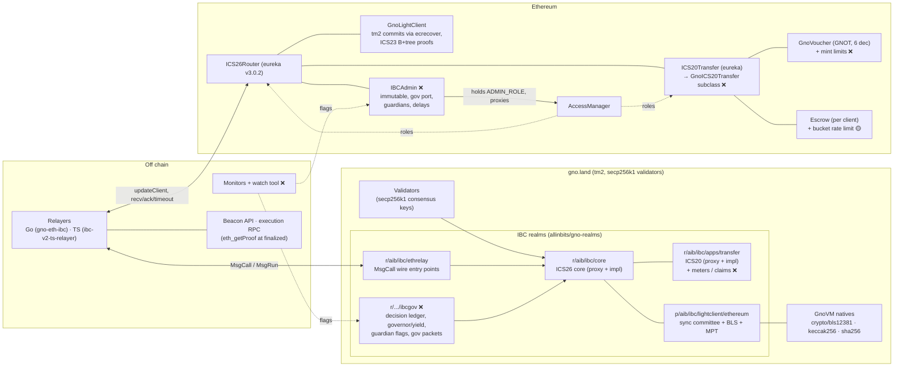

Client pairing: the gno.land Ethereum client `ethereum-N` ↔ the router client `client-M` (a `GnoLightClient`). Each
side registers the other as counterparty with its merkle prefix:

- **On Ethereum**, the gno client's prefix is `["main", "/pv/vm:gno.land/r/aib/ibc/core:"]`.
- **On gno.land**, the Ethereum client's prefix is `[""]`: router commitments live directly in its storage
  mapping.

## 4. Components, status and required changes

Repositories and branches:

| Short name | Location |
|---|---|
| **gno** | this branch, `feat/secp256k1-validators-ibc` (fork remote clockworkgr/gno) |
| **gno-realms** | [allinbits/gno-realms `feat/ethereum-light-client`](https://github.com/allinbits/gno-realms/tree/feat/ethereum-light-client) |
| **ts-relayer** | [allinbits/ibc-v2-ts-relayer PR #40](https://github.com/allinbits/ibc-v2-ts-relayer/pull/40) (`feat/ethereum-clients`) |
| **gno-eth-ibc** | the Solidity contracts, deployment scripts, Go relayer, testnet and e2e scripts. **Not yet published** (local repository; see §13). Paths below are relative to its root. |
| **bridges** | [gnolang/bridges](https://github.com/gnolang/bridges): `main` (Solana, live) and [`ethereum-draft`](https://github.com/gnolang/bridges/tree/ethereum-draft) |
| **eureka** | [cosmos/solidity-ibc-eureka `solidity-v3.0.2`](https://github.com/cosmos/solidity-ibc-eureka/tree/solidity-v3.0.2) |

### 4.1 Chain (tm2, gno.land node)

| # | Component | Status | Where | Changes needed |
|---|---|---|---|---|
| C1 | secp256k1 validator consensus keys: params accept both key types; `gnoland secrets init -validator-key-type`; new keys default to secp256k1 | ✅ | gno: [`tm2/pkg/bft/types/params.go`](../../tm2/pkg/bft/types/params.go), [`tm2/pkg/bft/privval/signer/local/key.go`](../../tm2/pkg/bft/privval/signer/local/key.go), [`gno.land/cmd/gnoland/secrets_init.go`](../../gno.land/cmd/gnoland/secrets_init.go); ADR [`prxxxx_secp256k1_validator_keys`](../../tm2/adr/prxxxx_secp256k1_validator_keys.md); test `TestReactorBasicSecp256k1` | Upstream PR. It reverses [`pr5949_remove_secp256k1_validators`](../../tm2/adr/pr5949_remove_secp256k1_validators.md), so the PR must answer that ADR's reasons. Signatures are 64-byte `r‖s` over `sha256(signBytes)`, low-S. |
| C2 | **Migration of gnoland-1's validators to secp256k1** | ❌ | — | A chain-upgrade plan: set `Validator.PubKeyTypeURLs` to allow both types, have each validator rotate its consensus key (valset change through GovDAO), then optionally restrict to secp256k1. Coordinate with operators. While the set is mixed, `GnoLightClient` refuses ed25519 signers (C1 is secp256k1-only on the Ethereum side). |
| C3 | Colons in realm param names (IBC keys contain `:`) | ✅ | gno: [`gnovm/stdlibs/chain/params/params.go`](../../gnovm/stdlibs/chain/params/params.go), [`gno.land/pkg/sdk/vm/params_deposit.go`](../../gno.land/pkg/sdk/vm/params_deposit.go); ADR [`prxxxx_param_key_colons`](../../gnovm/adr/prxxxx_param_key_colons.md); upstream as [gnolang/gno#6358](https://github.com/gnolang/gno/pull/6358) | Needs a maintainer review. |
| C4 | `vm/qrender` ignores the requested height | ❌ (nice to have) | — | Relayers and monitors cannot read render history at a height. Not blocking: proofs use `.store` queries. |
| C5 | Lossless `block_results` (non-UTF-8 event bytes become U+FFFD in JSON) | n/a | — | Not needed for IBC: we prove state (ICS23), not results leaves. Relevant only if results-leaf proofs are ever used (the Hyperlane design depends on them). |

### 4.2 GnoVM natives

| # | Component | Status | Where | Changes needed |
|---|---|---|---|---|
| N1 | `crypto/bls12381.FastAggregateVerify(pubkeys, msg, sig)` | ✅ | gno: [`gnovm/stdlibs/crypto/bls12381/`](../../gnovm/stdlibs/crypto/bls12381/), gas row in [`native_gas.go`](../../gnovm/stdlibs/native_gas.go) (Base 2,024,000, Slope 1,962,000 per key); ADR [`prxxxx_bls12381_native`](../../gnovm/adr/prxxxx_bls12381_native.md) | Gas rows are drafts: calibrate against the gas benchmark harness before upstreaming. Builds on the idea of [gnolang/gno#5583](https://github.com/gnolang/gno/pull/5583). Needs an audit (subgroup checks, infinity handling). |
| N2 | `crypto/bls12381.FastAggregateVerifyExcluding(aggregate, excluded, msg, sig)`: verify against a committee's aggregate key minus non-signers | ✅ | gno: same package (gas Base 2,116,000, Slope 1,962,000 per excluded key) | Same as N1. This lets updates carry only non-signers, which cut update gas from about 260M to 40M. |
| N3 | `crypto/keccak256`, `crypto/sha256` | ✅ (master) | gno: [`gnovm/stdlibs/crypto/`](../../gnovm/stdlibs/crypto/) | None. |

### 4.3 gno.land realms and packages (gno-realms)

| # | Component | Status | Where | Changes needed |
|---|---|---|---|---|
| R1 | IBC v2 core (ICS26) behind an upgradeable proxy | ✅ (pre-existing) | [`r/aib/ibc/core`](https://github.com/allinbits/gno-realms/tree/feat/ethereum-light-client/gno.land/r/aib/ibc/core) | Scope the new controls per client (§7); `core.Pause` blocks refunds, so incidents use `PauseApp` (§7.3). |
| R2 | Client-specific proofs through the frozen messages' `Ext` field (`extproof.Proof{Data any}` + `Verifier`) | ✅ | [`p/aib/ibc/lightclient/extproof/v0`](https://github.com/allinbits/gno-realms/tree/feat/ethereum-light-client/gno.land/p/aib/ibc/lightclient/extproof/v0); core impl routing (commit `a5d7f0b`) | None. |
| R3 | **Ethereum light client**: Altair sync protocol across Electra, Fulu and Gloas; summaries instead of keys; non-signer updates; next-committee-only updates; MPT/RLP/SSZ; wire decoders | ✅ | [`p/aib/ibc/lightclient/ethereum/v0`](https://github.com/allinbits/gno-realms/tree/feat/ethereum-light-client/gno.land/p/aib/ibc/lightclient/ethereum/v0) (`ethereum.gno`, `ssz.gno`, `mpt.gno`, `rlp.gno`, `wire.gno`, `types.gno`); ADR [0003](https://github.com/allinbits/gno-realms/blob/feat/ethereum-light-client/docs/adrs/0003-ethereum-light-client.md); live Sepolia replay test | Consensus-state pruning (each update stores about 6 KB, never refunded). A fork-upgrade procedure (§6.12). Audit. |
| R4 | `r/aib/ibc/ethrelay`: MsgCall entry points taking wire-encoded `[]byte` (`UpdateClient`, `SubmitMisbehaviour`, `RecvPacket`, `Acknowledgement`, `Timeout`), avoiding MsgRun's per-byte cost | ✅ | [`r/aib/ibc/ethrelay`](https://github.com/allinbits/gno-realms/tree/feat/ethereum-light-client/gno.land/r/aib/ibc/ethrelay) | Optional: `CreateClient`/`RegisterCounterparty` from wire bytes (today a MsgRun). |
| R5 | Wire format `p/aib/encoding/wire/v0` (originally `p/clockwork/wire/v0` from [clockworkgr/gno-upgradeable](https://github.com/clockworkgr/gno-upgradeable)) | ✅ | [`p/aib/encoding/wire/v0`](https://github.com/allinbits/gno-realms/tree/feat/ethereum-light-client/gno.land/p/aib/encoding/wire/v0) (commit `e0b12e6`) | Deploy with the realms. |
| R6 | ICS20 ABI payloads (`application/x-solidity-abi`) to and from `ethereum-*` clients | ✅ | [`p/aib/ibc/ics20/abi/v0`](https://github.com/allinbits/gno-realms/tree/feat/ethereum-light-client/gno.land/p/aib/ibc/ics20/abi/v0); transfer impl (commit `1b53279`) | None. |
| R7 | Core renders of Ethereum client and consensus states (read by the TS relayer) | ✅ | core `impl/v0/render.gno` (commits `a863e19`, `39fc86b`) | None. |
| R8 | **Outflow meters + claim queue** for Ethereum → gno credits (§7.1) | ♻️ | bridges: [`solana/realm/p/hlroute/v0/hlroute.gno`](https://github.com/gnolang/bridges/blob/ethereum-draft/solana/realm/p/hlroute/v0/hlroute.gno) (`Meter`, `Credit`, `Claim`, `Cap`), [`ethereum/realm/hlgnot/installments.gno`](https://github.com/gnolang/bridges/blob/ethereum-draft/ethereum/realm/hlgnot/installments.gno) | Port the meter, claim and void machinery into a new transfer impl (`impl/v1`), keyed by (client, denom). `Credit` becomes the transfer app's receive path. hlroute is about 2,500 lines tied to one route's lock: take the algorithms (`Meter.refill`, round-robin claims, installments), not the package. |
| R9 | **Decision ledger** + **governor / one-way yield** (§7.5, §7.7) | ♻️ | bridges: [`solana/realm/p/decisions/v0/decisions.gno`](https://github.com/gnolang/bridges/blob/main/solana/realm/p/decisions/v0/decisions.gno) (about 300 lines, depends only on `avl`; deployed on gnoland-1 under the bridge operator's namespace) | Reuse by import or copy. Its 7-day `Delay` and 14-day `Deadline` are constants and `DAOPath` is `gno.land/r/gov/dao`, which suits us. Ours needs per-kind delays (24 h unpause, 7 d otherwise). |
| R10 | **Guardian flags** on gno.land (sends / credits / payouts, 4 guardian + 2 watch seats) (§7.4) | ♻️ | bridges: [`ethereum/realm/hlmailbox/flags.gno`](https://github.com/gnolang/bridges/blob/ethereum-draft/ethereum/realm/hlmailbox/flags.gno), [`gov.gno`](https://github.com/gnolang/bridges/blob/ethereum-draft/ethereum/realm/hlmailbox/gov.gno) | Host them in the new governance realm (R11); the transfer impl consults them per client. |
| R11 | **Governance realm `ibcgov`**: builders, ledger, governor/yield, flags, and the **sender of governance packets** to Ethereum on a `gov` port (§7.6) | ❌ (pattern ♻️) | pattern: bridges [`ethereum/realm/hlgov/hlgov.gno`](https://github.com/gnolang/bridges/blob/ethereum-draft/ethereum/realm/hlgov/hlgov.gno) (decision kinds, `seq`, `Redispatch`) | New realm. It registers as an IBC app on gno core (port `gov`) and sends `kind‖seq‖params` packets to `IBCAdmin`. It handles acks (recorded) and timeouts (re-dispatch with the same `seq`). |
| R12 | Send-side limits: per-message max/min, route fee with floor and ceiling, recipient filters (§7.8) | ❌ (♻️ `CheckSend`) | bridges: `hlroute.CheckSend`, [`ethereum/realm/hlgnot/hlgnot.gno`](https://github.com/gnolang/bridges/blob/ethereum-draft/ethereum/realm/hlgnot/hlgnot.gno) `TransferRemote` (`RefusedEthRecipient`) | Transfer impl v1, per client. |
| R13 | Voids / restores / credit-by-vote (§7.9) | ❌ (♻️) | bridges: `hlroute.DraftVoid`, `Decide` | Only with the claim queue. |
| R14 | Existing admin surface: `p/aib/authority` (deployer + GovDAO), relayer allow-list, global and per-app pause, address blocklist, GovDAO builders | ✅ | [`r/aib/ibc/core/admin.gno`](https://github.com/allinbits/gno-realms/blob/feat/ethereum-light-client/gno.land/r/aib/ibc/core/admin.gno), [`app.gno`](https://github.com/allinbits/gno-realms/blob/feat/ethereum-light-client/gno.land/r/aib/ibc/core/app.gno), [`apps/transfer/admin.gno`](https://github.com/allinbits/gno-realms/blob/feat/ethereum-light-client/gno.land/r/aib/ibc/apps/transfer/admin.gno) | Route Ethereum-route changes through R9's delays. Keep immediate authority for tightening only. |
| R15 | 18-decimal Ethereum tokens on gno (GRC20 and amounts are int64: about 9.22 tokens max) | ❌ | — | A 6-decimal wrapper on Ethereum (factory, `wrap` takes whole multiples of 10^(d−6), refunds dust, `wrapAndSend`), or accept the cap (§12). |

### 4.4 Ethereum contracts

| # | Component | Status | Where | Changes needed |
|---|---|---|---|---|
| E1 | `ICS26Router`, `ICS20Transfer`, `Escrow`, `IBCERC20`, `AccessManager` roles | ✅ (eureka v3.0.2, unchanged) | eureka [`contracts/`](https://github.com/cosmos/solidity-ibc-eureka/tree/solidity-v3.0.2/contracts); deployed by gno-eth-ibc `contracts/script/DeployGnoIBC.s.sol` | `ICS20Transfer` is replaced by a subclass (E6); AccessManager's admin moves to E8. |
| E2 | **`GnoLightClient`**: tm2 header hash (amino leaves, sha256 merkle), CanonicalVote sign bytes, secp256k1 `ecrecover` low-S, power tally ≥ 2/3 plus trust level for non-adjacent headers, validator-set cache by hash, packed 81-byte signatures, minimal signer set, ICS23 B+tree + simple-tree membership/non-membership, misbehaviour freezing | ✅ | gno-eth-ibc `contracts/src/GnoLightClient.sol`, `contracts/src/lib/`; 88 Foundry tests (fixtures from real tm2 code) | Add the quarantine (E9). Consider supporting mixed key sets only if C2 needs it. Audit. |
| E3 | **`GnoVoucher`**: ERC20 with gno.land's decimals (GNOT 6), mint/burn only by ICS20, registered with `setCustomERC20` before the first transfer; `RegisterGnoDenom.s.sol` for more denoms | ✅ | gno-eth-ibc `contracts/src/GnoVoucher.sol`, `contracts/script/GnoDenoms.sol`, `contracts/script/RegisterGnoDenom.s.sol` | Add mint limits (E5) and the receive pause (E7). |
| E4 | Deployment: AccessManager, router, ICS20, roles as eureka's `DeployAccessManagerWithRoles`, GnoLightClient, `addClient`, GNOT voucher; resumes a broadcast after RPC nonce lag | ✅ | gno-eth-ibc `contracts/script/DeployGnoIBC.s.sol`, `scripts/sepolia.sh` | Hand every authority to E8 at the end; add a `finishSetup`-style check list (♻️ bridges `HlAdmin.finishSetup`). |
| E5 | **Mint limits** per token: per-message max + leaky-bucket day cap (§7.2) | ♻️ | bridges: [`PausableGate.sol`](https://github.com/gnolang/bridges/blob/ethereum-draft/ethereum/bridge/contracts/src/PausableGate.sol) `_charge`/`_level` | In `GnoVoucher.mint`. For Ethereum tokens leaving escrow, replace eureka's fixed-day `RateLimitUpgradeable` with the same bucket (Escrow beacon upgrade) or keep it. |
| E6 | **`GnoICS20Transfer`**: a subclass of eureka's `ICS20Transfer` (UUPS upgrade) that overrides only the receive and send hooks to apply flags, quarantine and send-side limits, and **never pauses acks or timeouts** | ❌ | — | New. Eureka's `whenNotPaused` covers `onAcknowledgementPacket` and `onTimeoutPacket`, which would hold refunds back; don't grant `PAUSER_ROLE` to anyone. |
| E7 | **Guardians, flags and holds** on Ethereum (4 guardian + 2 watch seats; hold = two guardian flags; unpause after 24 h clears only earlier flags; replacement under a hold no sooner than day 21) | ♻️ | bridges: [`lib/Guardians.sol`](https://github.com/gnolang/bridges/blob/ethereum-draft/ethereum/bridge/contracts/src/lib/Guardians.sol) | Reuse nearly as is, in E6/E3 (deliveries) and E8 (decisions). |
| E8 | **`IBCAdmin`**: an immutable IBC app on port `gov` that holds `ADMIN_ROLE`, every proxy and the router's client-migration rights; accepts packets only from `ibcgov` on gno.land through the GnoLightClient pair; decision kinds with delays, deferred by flags and holds; code-hash-pinned upgrades with after-checks; hand-over to a successor | ❌ (pattern ♻️) | pattern: bridges [`HlAdmin.sol`](https://github.com/gnolang/bridges/blob/ethereum-draft/ethereum/bridge/contracts/src/HlAdmin.sol), [`admin/HlAdminExec.sol`](https://github.com/gnolang/bridges/blob/ethereum-draft/ethereum/bridge/contracts/src/admin/HlAdminExec.sol) | Replace the Hyperlane `handle`/ISM plumbing with `IIBCApp.onRecvPacket` (source client + port checks) and ack. Kinds are remapped (§7.6). Keep it under EIP-170 (HlAdmin splits into two contracts). |
| E9 | **Quarantine** after a validator-set change | ❌ (♻️) | bridges: [`GnoLightClient.sol`](https://github.com/gnolang/bridges/blob/ethereum-draft/ethereum/bridge/contracts/src/GnoLightClient.sol) (`quarantineEnd`) | Our client records `quarantineEnd`; E6 refuses token receives until then; E8 ignores it. |
| E10 | 6-decimal wrapper for 18-decimal Ethereum tokens | ❌ | — | See R15. |

### 4.5 Relayers and tooling

| # | Component | Status | Where | Changes needed |
|---|---|---|---|---|
| T1 | Go relayer: trust, create/update clients both ways, relay gno → Eth and Eth → gno, acks, transfers, snapshots, wire/ABI vectors | ✅ | gno-eth-ibc `relayer/` (`cmd/relayer`, `relay/`, `gnoibc/`, `ethgno/`, `beacon/`, `eth/`) | Fix: `relay-gno-acks` re-sends an ack another step just delivered (stale read). Read commitments at the latest receipt's block. |
| T2 | TypeScript relayer: Ethereum chains (source and host), gno hosting Ethereum clients, byte-equality tests against the Go encoders | ✅ (PR open) | ts-relayer [`src/clients/ethereum/`](https://github.com/allinbits/ibc-v2-ts-relayer/tree/feat/ethereum-clients/src/clients/ethereum), [`src/clients/gno/ethereum.ts`](https://github.com/allinbits/ibc-v2-ts-relayer/blob/feat/ethereum-clients/src/clients/gno/ethereum.ts); [PR #40](https://github.com/allinbits/ibc-v2-ts-relayer/pull/40) | Support the claim queue (call `Claim`), governance packets, and the guardian-aware pause. |
| T3 | Local testnet (N secp256k1 validators, realms at genesis), local e2e with anvil, Sepolia scripts, demo recorder | ✅ | gno-eth-ibc `testnet/`, `scripts/e2e-local.sh`, `scripts/sepolia.sh` | — |
| T4 | **Monitors**: supply identity, header record, foreign decisions; auto-flag on integrity breaks, alarm on liveness | ❌ (♻️) | bridges: [`ethereum/bridge/agent`](https://github.com/gnolang/bridges/tree/ethereum-draft/ethereum/bridge/agent) (monitor role) | New, IBC-specific: escrow per client against voucher supply, plus in-flight packets from commitments. |
| T5 | **Watch tool** for guardians and GovDAO members: state, pending decisions, flags, `check` of upgrade targets (code-hash, reproducible build, append-only storage layout) | ❌ (♻️) | bridges: [`ethereum/bridge/cmd/hlwatch`](https://github.com/gnolang/bridges/tree/ethereum-draft/ethereum/bridge/cmd/hlwatch) | Port. |
| T6 | Setup audit tool (reads every authority and setting back, byte-for-byte creation checks) | ❌ (♻️) | bridges: `ethereum/bridge/cmd/hleth` (`audit`) | Port. |

## 5. Protocol design

### 5.1 gno.land → Ethereum: `GnoLightClient`

- **Header.** The relayer submits the tm2 header (its amino-encoded leaves), the commit, and the signers' packed
  signatures (`index u8 ‖ r ‖ s`, the recovery id found off chain). The client rebuilds the header hash with
  sha256 merkle, rebuilds each validator's CanonicalVote sign bytes, recovers each address with `ecrecover` over
  `sha256(signBytes)`, and requires low-S.
- **Trust rule.** Adjacent headers need more than 2/3 of the trusted set's power. Non-adjacent headers need more
  than the trust level (1/3) of the trusted next set **and** more than 2/3 of the new set (tm2 light-client rules),
  within the trusting period and the clock drift.
- **Validator-set cache.** Sets are stored by hash on first sight. Later updates send no keys, only signer indexes.
  The relayer sends the minimal signer set: enough of the trusted power first, then of the new set.
- **Proofs.** Packet commitments, receipts and acks are proven with ICS23 against the app hash of height H+1:
  - the `ics23:bptree` op proves the key in gno.land's `main` B+tree store under
    `/pv/vm:gno.land/r/aib/ibc/core:`;
  - the `ics23:simple` op proves the store in the multistore root.
- **Misbehaviour.** Two conflicting signed headers freeze the client.

### 5.2 Ethereum → gno.land: the Ethereum light client in Gno

- **State.**
  - Client state: chain id, genesis validators root and time, fork schedule, slot parameters, the router address,
    and the slot of the router's commitments mapping.
  - Consensus state per finalized slot: execution state root, timestamp, and the summaries of the current and
    next sync committee (SSZ pubkeys root + aggregate pubkey).
- **Update.** A light-client update carries:
  - the attested and finalized headers with the finality branch;
  - the sync aggregate bits and signature;
  - the **non-signers** with their Merkle branches to the pubkeys root;
  - on Gloas, the RLP execution header, checked against the committed block hash;
  - optionally the next committee's summary with its branch.

  The client requires at least `MinSyncCommitteeParticipants` (2/3 of 512) to have signed, and checks
  `FastAggregateVerifyExcluding(aggregate, nonSigners, signingRoot, sig)`.
- **Next-committee-only updates.** Updates whose finalized slot does not advance are accepted when they reveal the
  next committee (the spec's `apply_light_client_update`). This is needed because beacon nodes only serve
  bootstraps at recent checkpoints.
- **Fork-aware generalized indices.** Gloas: finality 735, next committee 2946, execution block hash 2856.
  Electra/Fulu: 169, 87, 25.
- **Proofs.** `eth_getProof` at the finalized block gives an account proof (router address under the state
  root) and a storage proof at `keccak256(keccak256(path) ‖ slot)`, verified with RLP/MPT in Gno.
- **Wire.** Updates and packets reach `r/aib/ibc/ethrelay` as MsgCall `[]byte` arguments in the
  `p/aib/encoding/wire/v0` format: `Uint` 8-byte big-endian, `Uvarint` LEB128, `Str`/`Blob` length-prefixed.

### 5.3 Transfers

- **ICS20 payload.** `application/x-solidity-abi` encoded `FungibleTokenPacketData` both ways.
- **Denoms.** gno-native denoms on Ethereum are `transfer/<client>/<denom>` → `GnoVoucher` (E3). Ethereum
  tokens on gno are GRC20 vouchers of the transfer realm.
- **Acks.** The Ethereum app writes `{"result":"AQ=="}` (JSON) on success. The gno app writes the protobuf
  `Acknowledgement`; relayers decode it to the app ack before `ackPacket`.
- **Amounts** are raw base units, never scaled.

### 5.4 Governance channel (new)

- A dedicated IBC app pair: `ibcgov` on gno.land (port `gov`) ⇄ `IBCAdmin` on Ethereum (port `gov`), over the
  same client pair as transfers.
- Payload: `kind u8 ‖ seq u64 ‖ params`, at most 512 bytes.
- `IBCAdmin` records `seq == last+1`, ignores `seq ≤ last` (ack success, no-op), and reverts `seq > last+1` so the
  packet stays receivable. IBC v2 is unordered, so the sequence keeps decisions in order.
- An ack tells `ibcgov` the decision is recorded. A timeout re-dispatches the same `seq`.

## 6. Flows

### 6.1 GNOT gno.land → Ethereum

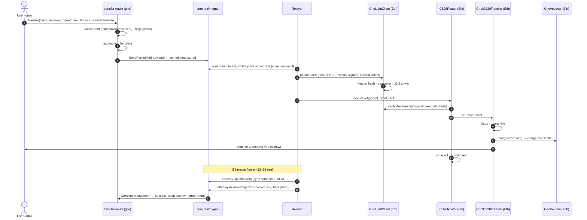

### 6.2 Ethereum → gno.land (voucher returning, or an Ethereum token)

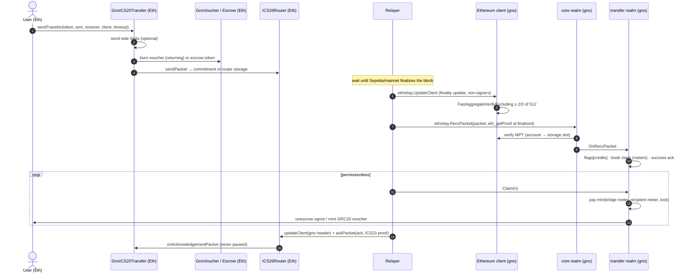

### 6.3 Timeouts and error acks (refunds)

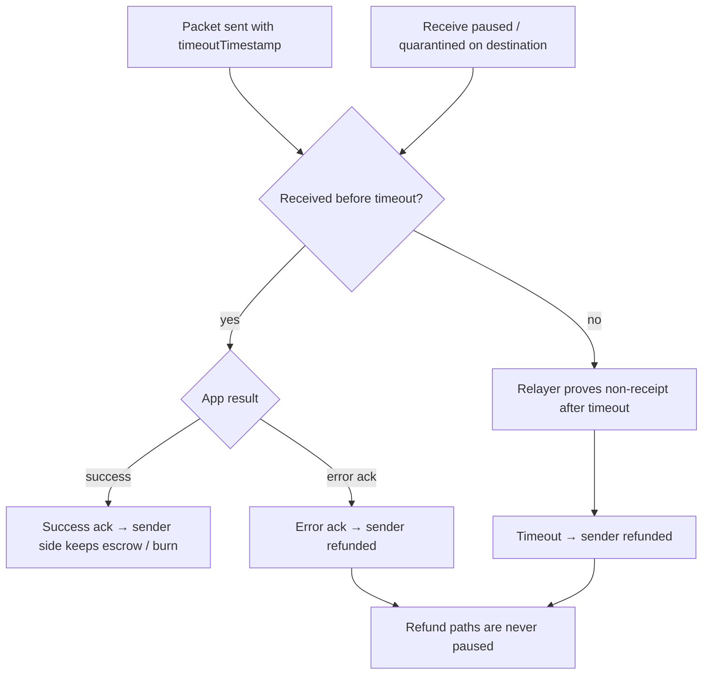

### 6.4 `GnoLightClient` update

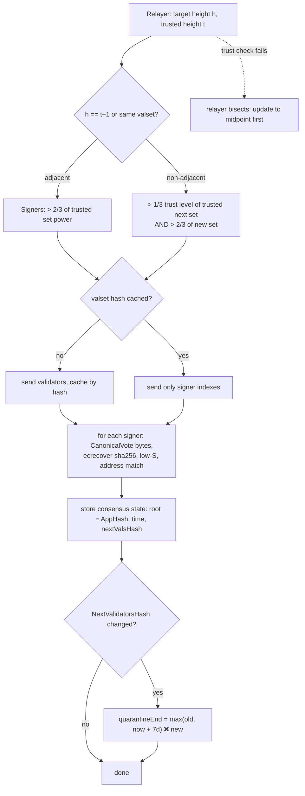

### 6.5 Ethereum light-client update on gno.land

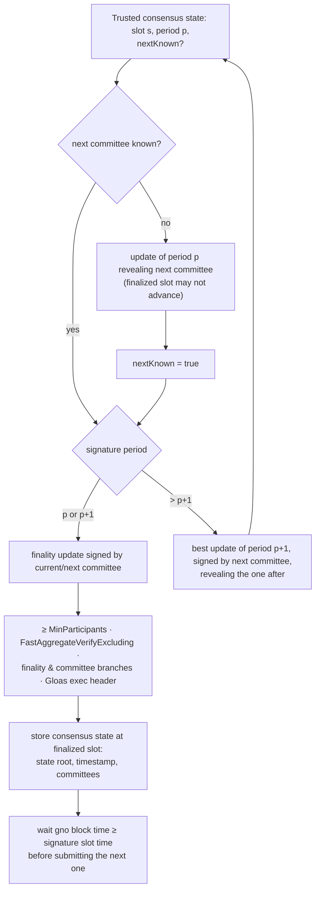

### 6.6 Governance decision lifecycle (new)

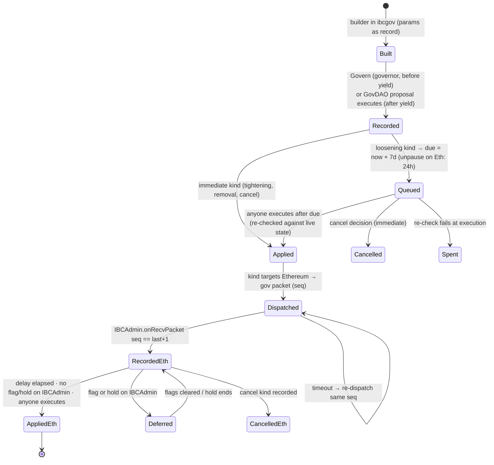

The delay is applied once per side:

- **gno-side kinds** (meters, fees, gno guardians) wait on gno.land.
- **Ethereum kinds** wait in `IBCAdmin` after they are recorded. They are dispatched at once from gno.land, so a
  guardian on either side has the full window.

### 6.7 Guardian flags and holds

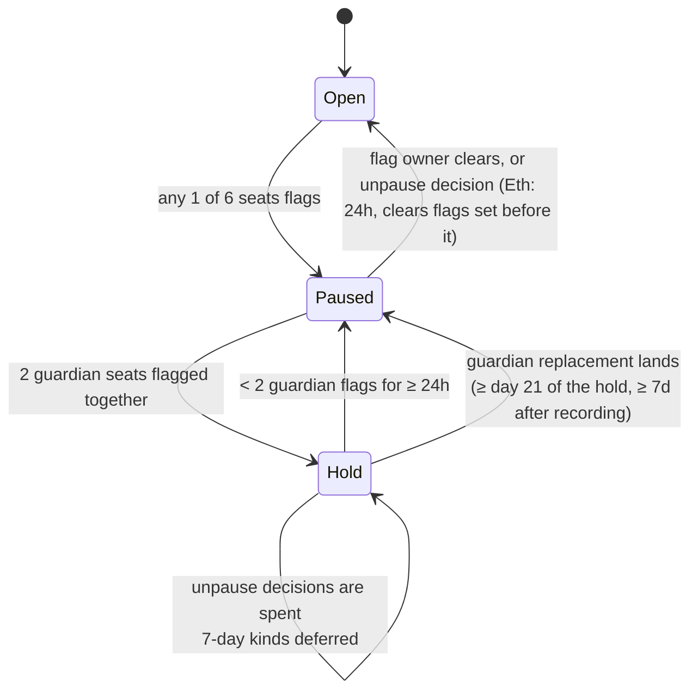

What a flag stops: deliveries/mints (Ethereum), `credits`/`payouts`/`sends` (gno.land, per client). What it never
stops: burns, sends of vouchers back, acks, timeouts, refunds.

### 6.8 Meters and claims on gno.land

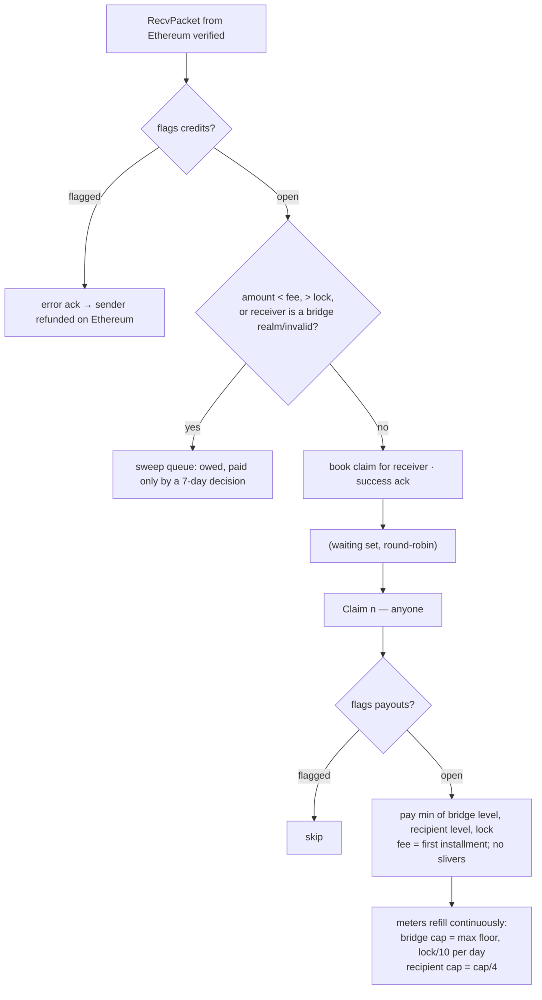

### 6.9 Validator-set change and quarantine

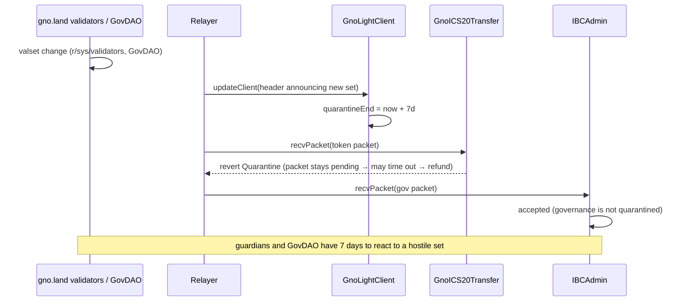

### 6.10 Launch and yield

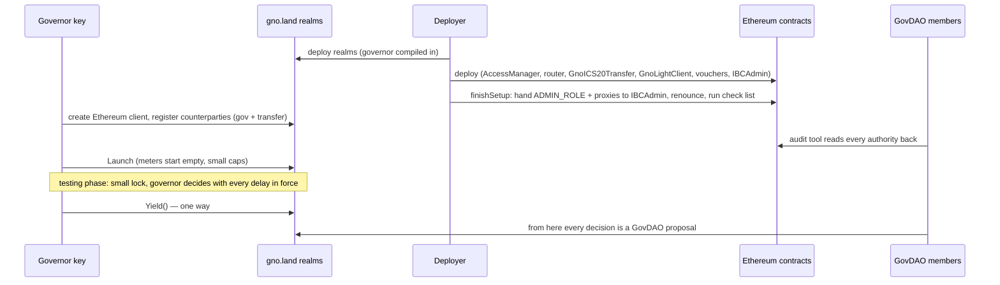

### 6.11 Incident response

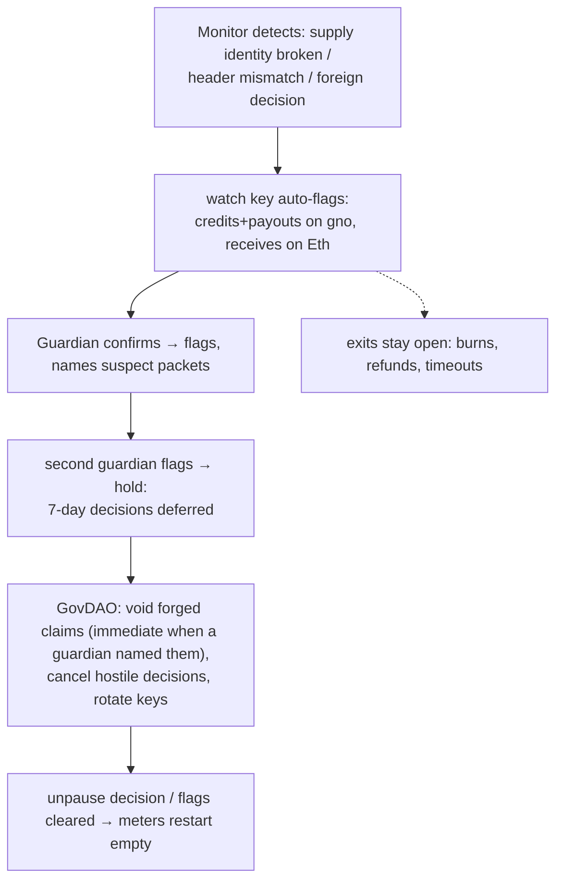

### 6.12 Upgrades

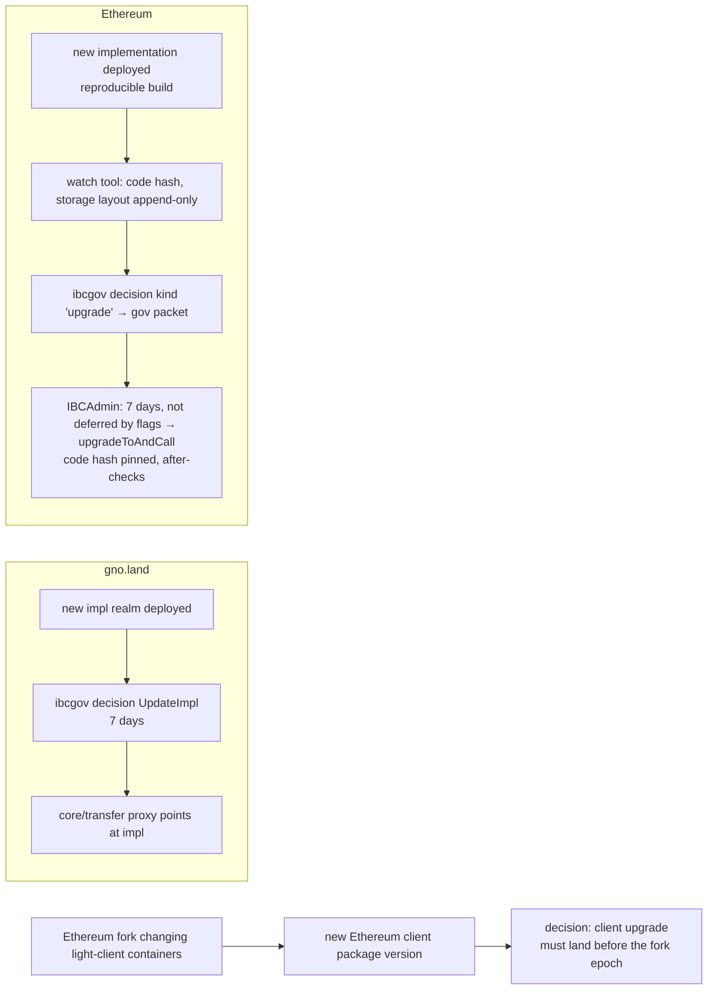

## 7. Safety and governance controls

The controls are those of gnolang/bridges, ported to the IBC app layer. They are scoped **per Ethereum client**,
so other IBC routes of the same realms are unaffected.

### 7.1 Outflow meters and claims (gno.land) — R8

- **Day cap.** `cap = max(CapFloor, lock/10)`, recomputed at every refill.
- **Bridge meter.** A token bucket refilling at `cap/86400` per second, ceiling one day: no midnight reset, at most
  2 caps in any 24 hours.
- **Recipient meter.** Same, at `cap/4`.
- **Credits are claims.** `RecvPacket` books a claim and returns a success ack. Anyone calls `Claim(n ≤ 20)`.
  - Recipients are served round-robin, the oldest claim first.
  - Each turn pays `min(bridge, recipient, lock)`.
  - The fee is the first installment.
  - A later installment is paid only when both meters hold at least `min(remaining, fee)` (no slivers).
- **Sweep queue.** Amounts below the fee, above the lock, or to a bridge realm or invalid address are booked as
  owed and paid only by a 7-day decision.
- **Meters start empty.** At launch, after a migration, and whenever a `payouts` flag is cleared.
- **What it bounds.**
  - A forged or buggy Ethereum client drains at most cap/day across recipients, or cap/4 per recipient, until a
    void.
  - It also gives holders time to leave before any hostile decision lands: about 52% of the lock can leave in
    7 days.
- **IBC alternative.** Refuse with an error ack when a meter is empty, so the sender is refunded on Ethereum.
  Simpler, but under an attack honest transfers bounce. The claim queue is the tested design and is the default.

### 7.2 Mint and release limits (Ethereum) — E5

- **Per token:** a per-message maximum and a leaky-bucket day cap (`used` drains at `dayCap` per day).
- **Where:**
  - `GnoVoucher.mint` for gno-native tokens;
  - the `Escrow` for Ethereum tokens being released (eureka's fixed-UTC-day `RateLimitUpgradeable` replaced by the
    bucket, or kept).
- **Launch values:** `maxPerMessage = min(25,000, dayCap)`, `dayCap = min(100,000, expectedLock/10)`.
- **What it bounds:** a gno.land validator-key forgery mints at most one message plus one day cap before the flags
  land.

### 7.3 Pausing that never traps exits — E6, R1

- **Rule: a pause stops minting and crediting, never burning, acks, timeouts or refunds.**
- **gno.land.**
  - The incident tool is `PauseApp` (already correct: it refuses sends, error-acks receives so the sender is
    refunded, and keeps acks and timeouts running) together with the per-client flags.
  - `core.Pause` blocks the whole packet path, refunds included, and is reserved for a core bug.
- **Ethereum.**
  - Eureka's `ICS20Transfer.pause` also blocks `onAcknowledgementPacket`/`onTimeoutPacket`, so `PAUSER_ROLE` is
    granted to nobody.
  - The pause lives in `GnoICS20Transfer.onRecvPacket` and `GnoVoucher.mint`.
  - A paused receive leaves the packet pending. When it times out, the source refunds it: IBC's escape hatch, which
    the Hyperlane design does not have.

### 7.4 Guardians, flags and holds — R10, E7

- **Seats.** Six per side: 4 guardians (2 of them outsiders) and 2 watch keys (the operator's monitors).
- **Flags.**
  - One flag pauses at once.
  - Flags are per function on gno.land (`sends`, `credits`, `payouts`, per client).
  - Flags are per object on Ethereum (`GnoICS20Transfer`+vouchers, and `IBCAdmin`).
- **Holds.** Two guardian flags make a **hold**: every 7-day decision is deferred and unpause decisions are spent.
  A hold ends after 24 hours below two flags.
- **Guardian replacement** under a hold lands no sooner than day 21 of the hold.
- **Unpause.**
  - The flag's owner can clear their own flag at any time.
  - On gno.land, GovDAO unpauses immediately.
  - On Ethereum, an unpause decision waits 24 hours and clears only flags set before it.
- **Naming suspects.** A guardian's `payouts` flag may name suspect packets, which makes their void immediate.
- **No veto.** Guardians delay, they never veto. Unlike AccessManager's guardian role, they cannot cancel a
  decision.

### 7.5 Decisions with delays — R9

- **Immediate:** tightening changes, removals, cancels and unpauses.
- **7 days:** every loosening change: raising a cap, maximum or fee; adding or replacing a key, signer or
  guardian; upgrades; enrolling a client or route; a hand-over.
- **The ledger.** Decisions are numbered and are pending, applied, cancelled or spent.
  - Anyone executes after the delay.
  - Parameters are re-checked against live state at execution.
  - Proposals expire after 14 days.
  - The builders take no free text: the parameters are the record.
- **Ordering rule.** Raise the remote mint limit before the gno send maximum; lower them in the reverse order.

### 7.6 GovDAO governs Ethereum — R11, E8

- **`IBCAdmin` is immutable code.**
  - It holds AccessManager's `ADMIN_ROLE`, every proxy's upgrade right, `migrateClient`, the custom-ERC20
    registration, the mint limits and the guardian seats.
  - It acts only on `gov` packets from `ibcgov`, proven by the GnoLightClient, and on its own timers.
- **Decision kinds** (remapped from `HlAdmin`):

  | Kind | Action | Delay |
  |---|---|---|
  | 1 | cancel numbers / ranges | at recording |
  | 2 | unpause an object (clears earlier flags; spent under a hold) | 24 h |
  | 3 | set guardians / watch keys (at most 2 guardians, never a seat's current key) | 7 d; lands through a hold at ≥ day 21 |
  | 4 | set mint/release limits | 7 d |
  | 5 | register a gno denom's voucher (`setCustomERC20`) | 7 d |
  | 6 | add / migrate a light client (`addClient`, `migrateClient`) | 7 d |
  | 7 | upgrade a proxy (implementation + code hash + optional call; after-checks) | 7 d |
  | 8 | grant / revoke an AccessManager role (relayer allow-list, rate limiter) | 7 d (revoke: immediate) |
  | 9 | hand-over to a successor admin (code-hash pinned, all authorities moved) | 7 d |

- **Choice of transport.** A dedicated port rather than eureka's `ICS27GMP`: GMP executes arbitrary calls from a
  derived account, with no delays, guardians or kind checks.
- **Single point of failure.** If the GnoLightClient can no longer follow gno.land, the governance channel stops.
  The answer, as in the Hyperlane design, is a hand-over prepared in advance or a fresh deployment. An optional
  guardian-held emergency path with a long delay (e.g. 30 days) is an open question (§13).

### 7.7 Governor and one-way yield — R9/R11

- The realms compile a governor key, which decides through the same builders, checks and delays as GovDAO.
- GovDAO proposals are refused until the governor calls `Yield()` once. After that only GovDAO decides.
- Until the yield the lock is kept small and no outside holders are invited. A leaked governor key is a leaked lock
  after 7 days, unless it is seen and cancelled.

### 7.8 Send-side limits — R12

- Per-message maximum and minimum.
- A route fee with a floor and a ceiling (≤ cap/4): raising it waits 7 days, lowering is immediate.
- Recipient filters: refuse the zero address, the token itself, bridge contracts and realms, and malformed
  addresses.

### 7.9 Voids — R13

- A **withheld** void can be restored. A **forged** void drops the remainder and books what was already paid as
  lost.
- A void is immediate when a guardian's flag named the packet, otherwise 7 days.
- Credit-by-vote is the manual fallback for a griefed transfer: 7 days, never above the lock.

### 7.10 Quarantine — E9

- A header announcing a new validator set starts a 7-day quarantine of token receives on Ethereum. Governance is
  not quarantined.
- It bounds a validator-set takeover: two GovDAO members can replace the set in one block.
- The duration is a governed parameter (0 disables it).

### 7.11 Monitoring — T4, T5

- **Supply identity, per client and denom:**
  - `escrowed on gno = voucher supply on Ethereum + in-flight`;
  - for Ethereum tokens, `escrow on Ethereum = voucher supply on gno + in-flight + owed claims`.
  - Evaluated in a fixed snapshot order from the operator's own nodes, with two agreeing RPC providers pinned by
    block hash, counting only finalized Ethereum state.
- **What triggers what.** A break auto-flags (credits+payouts, receives). Stalls, ages and float runways only
  alarm.
- **Watch tool.** Guardians and members see flags, holds, pending decisions and the client heads, and check
  upgrade targets.

## 8. Security assumptions and behaviour

### 8.1 Trust per direction

| Direction | Accepted when | Trusted |
|---|---|---|
| gno.land → Ethereum | `GnoLightClient`: > 2/3 of gno.land's validator power signed, secp256k1 | gno.land's validators (forge with > 2/3, halt with ≥ 1/3); the Solidity client and `ecrecover`; eureka core |
| Ethereum → gno.land | Gno Ethereum client: ≥ 2/3 of the 512-member sync committee signed a finalized header (BLS aggregate) + MPT proof | The sync committee (unslashable for signing; weaker than Casper finality, the standard light-client assumption); the BLS natives; the Gno client's fork tracking |
| Governance → Ethereum | `IBCAdmin`: a `gov` packet from `ibcgov` proven by the GnoLightClient | GovDAO (after the yield) or the governor; gno.land's validators; the 7-day window and guardians |

### 8.2 Actors and what each can break

| Actor | Can | Cannot | Bounded by |
|---|---|---|---|
| > 2/3 of gno.land validators (or keys leaked) | forge gno → Eth packets and governance packets | bypass delays on Ethereum | quarantine, mint limits, guardians, 7-day delays |
| 2 GovDAO members | replace the validator set in one block (on gno.land) | skip Ethereum's 7-day delays | quarantine + guardians (time to leave) |
| Sync committee (≥ 2/3 colluding) | forge Eth → gno credits | mint on Ethereum | gno meters, flags, voids |
| Relayers | delay, withhold, grief with permissionless calls | move funds, forge | anyone can relay; work per call bounded (claims ≤ 20, pages) |
| Guardians | pause, hold (delay decisions up to their lifting) | veto, move funds, unpause others' flags | GovDAO replacement (≥ day 21 under a hold) |
| Governor (before yield) | every decision, with delays | skip delays | small lock, cancel window |
| Deployer | plant state during setup | act after `finishSetup` | check list + audit tool, byte-for-byte |
| RPC providers | lie to relayers/monitors | forge a verified proof | two agreeing providers; own gno nodes |
| BLS / ecrecover / client bugs | forge depending on the bug | — | audits; meters and limits bound the loss |

### 8.3 Behaviour under failure

| Situation | Behaviour |
|---|---|
| gno.land halts | gno → Eth stops; Eth → gno packets wait; timeouts refund on Ethereum once provable |
| Ethereum finality stalls | Eth → gno stops (only finalized state is provable); monitors go blind and alarm |
| Ethereum fork changes light-client containers | the Gno client must be upgraded before the fork; otherwise Eth → gno stops until it is |
| Validator set changes | quarantine of gno → Eth receives (if enabled); refunds by timeout |
| GnoLightClient cannot follow gno.land (expired trusting period) | gno → Eth and governance stop; `migrateClient` needs governance → prepared hand-over or new deployment (open question §13) |
| Meter exhausted (gno) | claims wait and are paid as the meter refills; no loss |
| Mint limit reached (Eth) | receive reverts; packet waits or times out → refund |
| Guardian flag | the flagged function stops; exits stay open |
| Relayer down | anyone can relay; costs fall on whoever does |

### 8.4 Known limits

- gno amounts and GRC20 vouchers are int64. An 18-decimal ERC20 is capped at about 9.22 tokens (per transfer and in
  supply) unless wrapped to 6 decimals on Ethereum (R15/E10).
- Each gno-side Ethereum client update stores about 6 KB, never refunded (pruning: R3).
- A first transfer of a denom on Ethereum must use a registered `GnoVoucher`. `setCustomERC20` refuses a denom that
  already has a token.

## 9. Parameters

Proposed launch values, following gnolang/bridges where applicable.

| Parameter | Value | Change rule |
|---|---|---|
| gno meter `CapFloor` (per denom) | 10,000 tokens/day | raise 7 d, lower immediate (not below launch floor, not below 4·fee) |
| gno meter fraction | lock/10 per day | constant |
| per-recipient meter | cap/4 | constant |
| send max / min per message (GNOT) | 25,000 / 40 | raise 7 d / lower immediate |
| route fee (GNOT) | 20 (floor 2, ceiling cap/4) | raise 7 d / lower immediate |
| Ethereum `maxPerMessage` | min(25,000, dayCap) | kind 4, 7 d |
| Ethereum `dayCap` | min(100,000, expectedLock/10) | kind 4, 7 d |
| decision delay | 7 days | constant |
| Ethereum unpause delay | 24 h | constant |
| proposal deadline | 14 days | constant |
| guardian replacement under hold | ≥ day 21 of the hold | constant |
| quarantine after valset change | 7 days | kind (governed), 0 disables |
| GnoLightClient trusting period / clock drift | ⅔ of unbonding / 20 s | client creation |
| packet timeout (relayer default) | 1–3 h | per transfer |

## 10. Costs

Measured on the working stack. Ethereum figures: 3 validators on Sepolia (Glamsterdam pricing) unless noted. gno.land
figures in gas, priced at 1 ugnot per 1,000 gas on mainnet.

| Operation | Gas |
|---|---|
| Ethereum: `updateClient`, validator set cached / first sight | 463k / 928k (≈196k cached on Cancun pricing; est. ~245k at 15 validators on mainnet) |
| Ethereum: `recvPacket`, steady state / first on a client (creates escrow) | ≈549k / 1.87M |
| Ethereum: `sendTransfer` | 348k |
| Ethereum: `ackPacket` | 398k |
| Ethereum: full deployment | ≈120M on Sepolia (Glamsterdam repricing); far less on mainnet |
| gno: create Ethereum client | 46M |
| gno: Ethereum client update (finality / next committee / period crossing) | ~40M / ~37M / 50–54M |
| gno: `RecvPacket` from Ethereum (MPT proof) | 94M |
| gno: `Acknowledgement` from Ethereum | 63M |
| gno: ICS20 `Transfer` to Ethereum | 70M |

For comparison, the Hyperlane draft verifying ed25519 in Solidity costs 1.38M gas per update at 6 validators, 3.56M at
20 and 16.4M at 100. The controls add a few storage writes per transfer on each side, not yet measured.

## 11. Alternatives considered

| Alternative | Why not |
|---|---|
| **Hyperlane design as in gnolang/bridges** (private Mailbox, HypERC20, results-leaf proofs, 2-of-3 signers back) | Trusted way back until a ZK verifier exists; no refunds (messages never expire); its stock relayers cannot serve the private ISM; no interoperability gained. Its controls are adopted here instead. |
| **Keep ed25519 validators, verify ed25519 in Solidity** | About 221k gas per signature (update 1.4M → 16M gas as the set grows); a forgery-critical custom ed25519 implementation. |
| **ZK light client of gno.land on Ethereum** (like sp1-ics07-tendermint, ~230k gas) | A new SP1 program for tm2's amino; prover infrastructure; a later cost cut, not the launch. |
| **ZK sync-committee verifier on gno.land** (SP1 Helios → Groth16 on bn254) | Needs a prover, a verifying key per fork and the zkVM's trust; the native BLS client is simpler and already works. |
| **Trusted signers for Ethereum → gno.land** | Removes trust minimisation; only acceptable as a delayed fallback. |
| **Governance through eureka `ICS27GMP`** | Arbitrary calls from a derived account, with no delays, kinds or guardians. |
| **Error ack instead of claim queue when meters are empty** | Simpler, but honest transfers bounce under attack; kept as a fallback option. |
| **AccessManager guardians + execution delays alone** | AccessManager's guardian cancels (a veto), and its admin is a key; no cross-chain governance. |
| **Scaling amounts for 18-decimal tokens inside ICS20** | Breaks escrow accounting and ICS20 conservation; touches audited code. |

## 12. Consequences

- **Positive.**
  - Trust-minimised in both directions from launch.
  - Ethereum header cost nearly independent of the validator count.
  - Standard IBC v2: audited Ethereum core, timeouts and refunds, any IBC v2 relayer.
  - Losses bounded by meters and limits.
  - GovDAO governs both chains, with delays and guardians.
- **Negative.**
  - Requires a chain-level validator key migration (C2) and new natives (N1, N2).
  - Ethereum fork maintenance in Gno (each relevant fork needs a client upgrade first).
  - Heavy gno-side gas and storage per message type.
  - The governance channel depends on the light client.
  - 18-decimal tokens need a wrapper.
  - The ported controls (from model-only audits) and all our custom pieces need a human review and an outside audit
    before real value moves.
- **Neutral.** The gno IBC realms gain per-client controls, which other IBC routes may also use.

## 13. Work plan and open questions

### Milestones

1. **Chain (C1–C3, N1–N2).** Upstream the secp256k1, BLS and param PRs (#6358 first); calibrate gas rows; audit the
   BLS natives; write the gnoland-1 key-migration plan (C2).
2. **Controls, Ethereum (E5–E9).**
   - `GnoICS20Transfer`, voucher and escrow limits, `Guardians` library, `IBCAdmin` with kinds 1–9, quarantine in
     `GnoLightClient`, `finishSetup` check list.
   - Foundry tests, including fuzzing the limits and the hold state machine.
3. **Controls, gno.land (R8–R13).**
   - Transfer `impl/v1` with meters, claims, send limits and voids per client.
   - The `ibcgov` realm with ledger, governor/yield, flags and the gov port.
   - Gno tests and filetests.
4. **Relayers and tooling (T1, T2, T4–T6).** Claim calls, governance packets, monitors, the watch tool and the audit
   tool.
5. **Testnet.**
   - Sepolia + a gno.land testnet for two weeks with drills: flags, holds, a void, an upgrade by decision, a hand-over,
     a validator-set change with quarantine, an Ethereum fork rehearsal.
6. **Audit.** Outside audit of `GnoLightClient`, `IBCAdmin`, the ICS20 subclass, the Gno Ethereum client, the BLS
   natives and the meter/claim realm.
7. **Mainnet.** gnoland-1 upgrade (C1–C3, N1–N2); validators migrate keys (C2); deploy; testing phase under the
   governor with a small lock; then the yield.

### Open questions

1. **Where the Solidity contracts, scripts and Go relayer live.** They are in the unpublished gno-eth-ibc repository
   today. Options: publish it as its own repository, or move the contracts into gno-realms (or a new allinbits
   repository).
2. Claim queue vs error ack when meters are empty (default: claim queue).
3. A guardian-held, long-delay emergency path for the governance channel if the GnoLightClient stalls.
4. Quarantine duration and whether to enable it at launch (a 7-day gno → Eth outage per validator-set change).
5. 18-decimal Ethereum tokens: wrapper (E10) or cap.
6. Mixed ed25519/secp256k1 validator sets during the migration: support both in `GnoLightClient` (costly for the
   ed25519 part), or migrate before launch.
7. Pruning policy for the Gno Ethereum client's consensus states.
8. Reuse `p/decisions` from the bridge operator's namespace on gnoland-1, or vendor it under ours.
9. Who pays header updates on Ethereum (relayer economics, fee booking per transfer).
10. Coexistence with the Hyperlane bridges: separate locks per route (as gnolang/bridges does between Solana and
    Ethereum), so a fault on one route touches only its own lock.

## 14. References

- This branch:
  - [`tm2/adr/prxxxx_secp256k1_validator_keys.md`](../../tm2/adr/prxxxx_secp256k1_validator_keys.md)
  - [`gnovm/adr/prxxxx_bls12381_native.md`](../../gnovm/adr/prxxxx_bls12381_native.md)
  - [`gnovm/adr/prxxxx_param_key_colons.md`](../../gnovm/adr/prxxxx_param_key_colons.md)
- gno-realms:
  - [branch `feat/ethereum-light-client`](https://github.com/allinbits/gno-realms/tree/feat/ethereum-light-client)
  - ADRs [0001](https://github.com/allinbits/gno-realms/blob/feat/ethereum-light-client/docs/adrs/0001-proxy-realm-for-core-upgrades.md), [0002](https://github.com/allinbits/gno-realms/blob/feat/ethereum-light-client/docs/adrs/0002-proxy-realm-for-transfer-upgrades.md), [0003](https://github.com/allinbits/gno-realms/blob/feat/ethereum-light-client/docs/adrs/0003-ethereum-light-client.md)
- TypeScript relayer: [allinbits/ibc-v2-ts-relayer#40](https://github.com/allinbits/ibc-v2-ts-relayer/pull/40)
- gnolang/bridges:
  - [README](https://github.com/gnolang/bridges/blob/main/README.md)
  - [Solana PLAN](https://github.com/gnolang/bridges/blob/main/solana/bridge/PLAN.md)
  - [Ethereum PLAN](https://github.com/gnolang/bridges/blob/ethereum-draft/ethereum/bridge/PLAN.md)
  - [contracts](https://github.com/gnolang/bridges/tree/ethereum-draft/ethereum/bridge/contracts/src)
  - [realms](https://github.com/gnolang/bridges/tree/ethereum-draft/ethereum/realm)
  - [shared packages](https://github.com/gnolang/bridges/tree/main/solana/realm/p)
- [solidity-ibc-eureka v3.0.2](https://github.com/cosmos/solidity-ibc-eureka/tree/solidity-v3.0.2):
  - `ICS26Router`, `ICS20Transfer`, `ICS27GMP`
  - `utils/Escrow.sol`, `utils/RateLimitUpgradeable.sol`, `utils/IBCRolesLib.sol`
- Ethereum light-client spec:
  [consensus-specs, altair/light-client](https://github.com/ethereum/consensus-specs/tree/dev/specs/altair/light-client)
  and its Electra, Fulu and Gloas updates.
- Upstream: [gnolang/gno#6358](https://github.com/gnolang/gno/pull/6358) (param key colons),
  [gnolang/gno#5583](https://github.com/gnolang/gno/pull/5583) (BLS).
- gno-eth-ibc (unpublished): `CONTEXT.md` (state of the work), `docs/bridges-review.md` (review of gnolang/bridges),
  `contracts/README.md` (GnoLightClient design and gas scaling).
